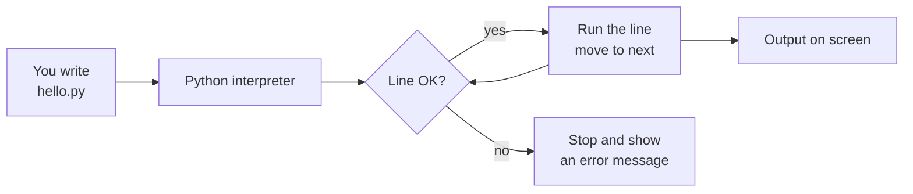

# Session 01 · Basics of Python

> **Module:** Application Based Programming in Python · **Term 1** · ⏱️ ~2 hours
> **You will learn:** what Python is, keywords and identifiers, statements, comments, indentation, and variables.

---

## 1. What is Python? (in plain English)

A computer only understands very simple instructions. A **programming language** lets you write instructions in something close to English, and a translator turns them into what the computer understands.

**Python** is one of those languages. Its translator is called the **interpreter**: it reads your code *one line at a time, top to bottom* and runs it immediately.

> 🍳 **Analogy:** Python code is a recipe. The interpreter is the cook who reads each step in order and does it. If a step is written wrongly, the cook stops at that step and complains.

Why Python is popular for AI and data:
- **Readable** — looks almost like English, so you focus on the problem, not the punctuation.
- **Batteries included** — a huge standard library plus packages like NumPy, Pandas and scikit-learn.
- **Everywhere** — web apps, automation, data science, machine learning, games, robotics.

## 2. Key concepts

| Concept | Meaning | Example |
|---|---|---|
| **Statement** | One complete instruction | `print("Hi")` |
| **Comment** | A note for humans; Python ignores it | `# this is a comment` |
| **Variable** | A *name* that points to a value | `age = 21` |
| **Identifier** | Any name you invent (variables, functions…) | `total_marks` |
| **Keyword** | A word Python has reserved for itself | `if`, `for`, `True`, `def` |
| **Indentation** | Spaces at the start of a line that group code into blocks | 4 spaces inside an `if` |

### Rules for naming identifiers
1. Use letters, digits and `_` only — `marks_2025` ✅ · `marks-2025` ❌
2. Cannot start with a digit — `2nd_place` ❌ · `second_place` ✅
3. Cannot be a keyword — `class = 5` ❌
4. Case-sensitive — `Age` and `age` are **different** variables.
5. Convention (PEP 8): `snake_case` for variables, e.g. `student_name`.

> 📦 **Analogy for variables:** a variable is a *label* stuck on a box. `age = 21` puts 21 in a box and sticks the label `age` on it. `age = 22` moves the label to a new box containing 22.

## 3. How Python runs your program



## 4. Worked examples (step by step)

### Example 1 — your first program
```python
print("Assalam-o-Alaikum, Python!")
```
1. `print` is a built-in **function** that shows something on screen.
2. Text must be inside quotes — that makes it a **string**.

### Example 2 — variables and multiple assignment
```python
name = "Ayesha"          # string
age = 19                 # integer
height_m = 1.62          # float
x, y, z = 1, 2, 3        # assign three variables in one line
a = b = 0                # same value to two names
print(name, "is", age, "years old")
```

### Example 3 — reading input and converting it
```python
year_born = input("Which year were you born? ")   # input() ALWAYS returns text
age = 2026 - int(year_born)                        # int() converts text → number
print(f"You are about {age} years old.")           # f-string puts values inside text
```

### Example 4 — indentation creates blocks
```python
marks = 72
if marks >= 50:
    print("Pass")        # inside the if-block (4 spaces)
    print("Well done")   # also inside
print("Result printed")  # outside — always runs
```

### Example 5 — see every keyword
```python
import keyword
print(len(keyword.kwlist), "keywords:", keyword.kwlist)
```

▶️ All of these are in [`code/examples.py`](./code/examples.py) and the [notebook](./notebook.ipynb).

## 5. Common mistakes

| Mistake | What you see | Fix |
|---|---|---|
| Forgetting quotes: `print(Hello)` | `NameError: name 'Hello' is not defined` | `print("Hello")` |
| Mixing text and numbers: `"Age: " + 21` | `TypeError` | `"Age: " + str(21)` or an f-string |
| Using `input()` result as a number directly | `TypeError` when you do maths | Wrap it: `int(input())` |
| Inconsistent indentation | `IndentationError` | Always 4 spaces; let VS Code do it |
| `Print("hi")` | `NameError` | Python is case-sensitive: `print` |

## 6. Real-life coding problem 🧾

**Problem:** A tea stall in North Nazimabad wants a tiny program: enter the number of cups of tea and parathas, and print a neat bill. Tea is Rs 80, paratha Rs 120. Add 5% service charge.

<details>
<summary>💡 Full solution (try first!)</summary>

```python
TEA_PRICE = 80
PARATHA_PRICE = 120
SERVICE_RATE = 0.05

def make_bill(cups, parathas):
    subtotal = cups * TEA_PRICE + parathas * PARATHA_PRICE
    service = subtotal * SERVICE_RATE
    total = subtotal + service
    lines = [
        "----- CHAI CORNER -----",
        f"Tea      x{cups:<3} Rs {cups * TEA_PRICE:>6}",
        f"Paratha  x{parathas:<3} Rs {parathas * PARATHA_PRICE:>6}",
        f"Service 5%     Rs {service:>6.0f}",
        f"TOTAL          Rs {total:>6.0f}",
    ]
    return "\n".join(lines)

print(make_bill(3, 2))
```
Constants in `CAPITALS` make prices easy to change later. Full file: [`code/problem_solution.py`](./code/problem_solution.py).
</details>

## 7. Practice exercises

1. Store your name, city and favourite subject in three variables and print one sentence using an f-string.
2. Ask the user for the length and width of a room (in feet) and print its area.
3. Which of these identifiers are invalid and why? `total`, `2total`, `total-marks`, `_count`, `for`, `Name1`
4. Swap the values of two variables `a = 5` and `b = 9` **without** a third variable.

<details>
<summary>✅ Solutions</summary>

```python
# 1
name, city, subject = "Bilal", "Karachi", "AI"
print(f"I am {name} from {city} and I love {subject}.")

# 2
length = float(input("Length (ft): "))
width = float(input("Width (ft): "))
print("Area =", length * width, "sq ft")

# 3  invalid: 2total (starts with digit), total-marks (hyphen), for (keyword)

# 4
a, b = 5, 9
a, b = b, a
print(a, b)   # 9 5
```
Runnable version (with sample inputs): [`code/exercises_solutions.py`](./code/exercises_solutions.py)
</details>

## 8. Quiz (5 questions)

1. What does the Python interpreter do?
2. What is the output type of `input()`?
3. Is `my_var` the same as `My_Var`?
4. What does Python do with a line that starts with `#`?
5. Which is a valid identifier: `class`, `class_1`, `1class`?

<details>
<summary>Answers</summary>

1. Reads and runs your code line by line, top to bottom.
2. Always a string (`str`).
3. No — Python is case-sensitive.
4. Ignores it — it is a comment.
5. `class_1`.
</details>

## 9. Summary

- Python is an **interpreted**, readable language used heavily in AI and data science.
- A **variable** is a name pointing to a value; names follow identifier rules and must not be **keywords**.
- **Comments** (`#`) explain code; **indentation** (4 spaces) groups code into blocks.
- `input()` returns text — convert with `int()` / `float()` before doing maths.

---
[⬅ Module home](../README.md) · [Next: Session 02 ➡](../Session-02-programming-language-constructs/)

<sub>Original teaching material by Aseef Ahmed · not official Aptech courseware · CC BY-NC 4.0 (text) / MIT (code)</sub>
