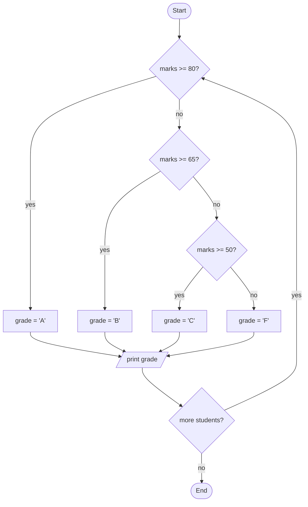
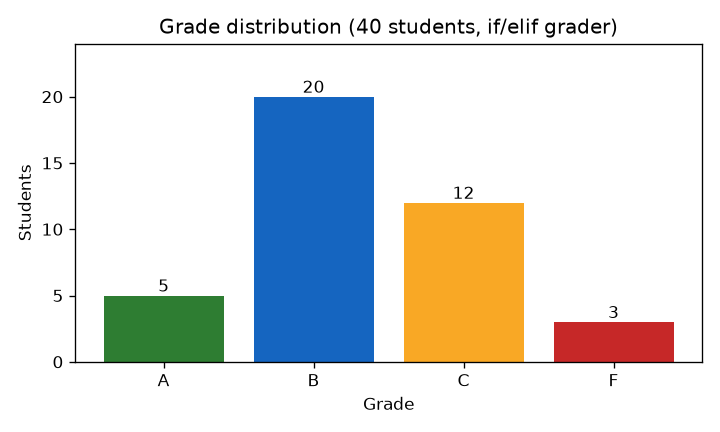

# Session 02 · Programming Language Constructs

> **Module:** Application Based Programming in Python · **Term 1** · ⏱️ ~2 hours
> **You will learn:** Python's data types, how operators work, and how to control the flow of a program with `if`, `for`, `while`, `break` and `continue`.

---

## 1. The big idea

Every program does three things: **stores data**, **works on data**, and **makes decisions / repeats work**. This session covers exactly those three:

| Need | Python tool |
|---|---|
| Store data | **Data types** — numbers, text, lists, dictionaries… |
| Work on data | **Operators** — `+ - * / // % ** == and or in` |
| Decide & repeat | **Control flow** — `if/elif/else`, `for`, `while` |

> 🚦 **Analogy:** control flow is a traffic warden. `if` decides which road a car takes; a loop is a roundabout the car goes around until told to exit (`break`).

## 2. Data types

| Type | Example | Changeable (mutable)? | Use it for |
|---|---|---|---|
| `int` | `42` | — | whole numbers |
| `float` | `3.14` | — | decimals |
| `bool` | `True`, `False` | — | yes/no |
| `str` | `"Karachi"` | ❌ | text |
| `list` | `[90, 75, 60]` | ✅ | ordered collection you will change |
| `tuple` | `(24.86, 67.01)` | ❌ | fixed records, e.g. coordinates |
| `set` | `{"AI", "ML"}` | ✅ | unique items, fast membership tests |
| `dict` | `{"name": "Sana", "age": 20}` | ✅ | key → value look-ups |

Use `type(x)` to check a type and `int()`, `float()`, `str()`, `list()` to convert.

## 3. Operators

| Group | Operators | Example → result |
|---|---|---|
| Arithmetic | `+ - * / // % **` | `17 // 5 → 3`, `17 % 5 → 2`, `2 ** 3 → 8` |
| Comparison | `== != > < >= <=` | `5 >= 3 → True` |
| Logical | `and or not` | `True and False → False` |
| Assignment | `= += -= *= /=` | `x += 1` means `x = x + 1` |
| Membership | `in`, `not in` | `"a" in "cat" → True` |
| Identity | `is`, `is not` | `x is None` |

> ⚠️ `/` always gives a float (`10 / 2 → 5.0`). Use `//` for whole-number division.

## 4. Control flow at a glance



## 5. Worked examples

### Example 1 — if / elif / else
```python
marks = 68
if marks >= 80:
    grade = "A"
elif marks >= 65:
    grade = "B"
elif marks >= 50:
    grade = "C"
else:
    grade = "F"
print(grade)   # B
```
Python checks conditions **top to bottom** and runs only the **first** true branch.

### Example 2 — for loop over a list
```python
fruits = ["mango", "banana", "guava"]
for i, fruit in enumerate(fruits, start=1):
    print(i, fruit.title())
```

### Example 3 — `range()` and a running total
```python
total = 0
for n in range(1, 11):     # 1..10 (end is excluded)
    total += n
print(total)               # 55
```

### Example 4 — while loop with break and continue
```python
n = 0
while True:
    n += 1
    if n % 2 == 0:
        continue           # skip even numbers
    if n > 9:
        break              # leave the loop
    print(n, end=" ")      # 1 3 5 7 9
```

### Example 5 — dictionaries and loops together
```python
stock = {"pen": 40, "notebook": 0, "marker": 12}
for item, qty in stock.items():
    status = "OUT" if qty == 0 else "ok"     # one-line if (conditional expression)
    print(f"{item:10} {qty:>3} {status}")
```

### Example 6 — `match` (Python 3.10+)
```python
command = "stop"
match command:
    case "start": print("Engine on")
    case "stop":  print("Engine off")
    case _:       print("Unknown")
```

📊 [`code/make_chart.py`](./code/make_chart.py) uses an `if/elif` grader and a loop to count grades for a class of 40 and draws this chart:



## 6. Common mistakes

| Mistake | Fix |
|---|---|
| `if x = 5:` (assignment instead of comparison) | `if x == 5:` |
| Infinite `while` loop because the variable never changes | Update the variable inside the loop, or add `break` |
| `range(1, 10)` expected to include 10 | The end is excluded → `range(1, 11)` |
| Changing a list while looping over it | Loop over a copy: `for x in items[:]` |
| Comparing floats with `==` (`0.1 + 0.2 == 0.3` is `False`) | `math.isclose(a, b)` |

## 7. Real-life coding problem 🔐

**Problem:** A login screen allows **3 attempts**. Check a PIN; lock the account after 3 wrong tries. Also check the PIN is exactly 4 digits.

<details>
<summary>💡 Full solution</summary>

```python
CORRECT_PIN = "4826"

def login(attempts):
    """attempts: list of PINs the user types, in order."""
    for count, pin in enumerate(attempts, start=1):
        if len(pin) != 4 or not pin.isdigit():
            print(f"Attempt {count}: PIN must be 4 digits")
        elif pin == CORRECT_PIN:
            print(f"Attempt {count}: Welcome!")
            return True
        else:
            print(f"Attempt {count}: Wrong PIN")
        if count == 3:
            print("Account locked. Contact the bank.")
            return False
    return False

login(["12a4", "1111", "4826"])
login(["0000", "1234", "9999"])
```
File: [`code/problem_solution.py`](./code/problem_solution.py)
</details>

## 8. Practice exercises

1. Print the multiplication table of 7 (7 × 1 … 7 × 10).
2. Given `nums = [12, 7, 3, 18, 25, 4]`, print the largest number **without** `max()`.
3. FizzBuzz: for 1–20, print "Fizz" for multiples of 3, "Buzz" for 5, "FizzBuzz" for both.
4. Count the vowels in `"Artificial Intelligence"`.

<details>
<summary>✅ Solutions</summary>

```python
# 1
for i in range(1, 11):
    print(f"7 x {i} = {7 * i}")

# 2
nums = [12, 7, 3, 18, 25, 4]
largest = nums[0]
for n in nums:
    if n > largest:
        largest = n
print(largest)  # 25

# 3
for n in range(1, 21):
    if n % 15 == 0: print("FizzBuzz")
    elif n % 3 == 0: print("Fizz")
    elif n % 5 == 0: print("Buzz")
    else: print(n)

# 4
text = "Artificial Intelligence"
print(sum(1 for ch in text.lower() if ch in "aeiou"))  # 10
```
File: [`code/exercises_solutions.py`](./code/exercises_solutions.py)
</details>

## 9. Quiz

1. What is `17 % 4`?
2. Which type would you use to store a student's roll number → name pairs?
3. What does `continue` do inside a loop?
4. What is printed by `print(type(10 / 2))`?
5. Can you change an item of a tuple?

<details>
<summary>Answers</summary>

1. `1` · 2. `dict` · 3. Skips the rest of this iteration and jumps to the next one · 4. `<class 'float'>` · 5. No — tuples are immutable.
</details>

## 10. Summary

- Python has simple types (`int`, `float`, `bool`, `str`) and collections (`list`, `tuple`, `set`, `dict`).
- Operators calculate, compare and combine values; `//` and `%` are your friends for whole-number maths.
- `if/elif/else` chooses; `for` repeats over a collection; `while` repeats until a condition is false; `break`/`continue` steer loops.

---
[⬅ Session 01](../Session-01-basics-of-python/) · [Module home](../README.md) · [Session 03 ➡](../Session-03-introduction-to-functions/)

<sub>Original teaching material by Aseef Ahmed · not official Aptech courseware · CC BY-NC 4.0 (text) / MIT (code)</sub>
