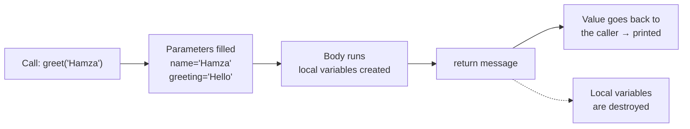

# Session 03 · Introduction to Functions

> **Module:** Application Based Programming in Python · **Term 1** · ⏱️ ~2 hours
> **You will learn:** what functions are, how to define and call them, variable scope, and the different kinds of parameters and arguments.

---

## 1. Why functions?

Imagine writing the same 10 lines every time you need to calculate a student's grade. A **function** lets you write those lines **once**, give them a name, and *call* that name whenever you need it.

> 🥤 **Analogy:** a function is a juice machine. You put in **inputs** (fruit = *arguments*), it does its job inside (the *body*), and gives back an **output** (juice = *return value*). You don't need to know how the machine works inside to use it.

Benefits: **reuse** (write once), **readability** (a good name explains intent), **testing** (check small pieces), **teamwork** (split work by function).

## 2. Types of functions

| Type | Example |
|---|---|
| **Built-in** — come with Python | `print()`, `len()`, `max()`, `round()`, `sorted()` |
| **User-defined** — you write them with `def` | `def area(r): ...` |
| **Anonymous (lambda)** — one-line, no name | `lambda x: x * 2` *(Session 04)* |
| **From modules** — imported | `math.sqrt()`, `random.choice()` |

## 3. Anatomy of a function

```python
def greet(name, greeting="Hello"):       # header: name + parameters
    """Return a friendly greeting."""     # docstring (help text)
    message = f"{greeting}, {name}!"      # body (indented)
    return message                        # output

print(greet("Hamza"))                     # call with an argument
```

- **Parameter** = the variable name in the definition (`name`).
- **Argument** = the actual value you pass in the call (`"Hamza"`).
- A function without `return` gives back `None`.



## 4. Kinds of arguments

| Kind | How it looks | Notes |
|---|---|---|
| **Positional** | `power(2, 3)` | Matched by order |
| **Keyword** | `power(exp=3, base=2)` | Matched by name — order doesn't matter |
| **Default** | `def power(base, exp=2)` | Used when the caller omits it |
| **Variable-length positional** | `def total(*nums)` | Extra values arrive as a **tuple** |
| **Variable-length keyword** | `def profile(**info)` | Extra `name=value` pairs arrive as a **dict** |

Order in a definition: `def f(pos, default=1, *args, **kwargs)`.

## 5. Scope — where a variable lives

- **Local**: created inside a function; disappears when it returns.
- **Global**: created at the top level of the file; readable everywhere.
- Python searches **L**ocal → **E**nclosing → **G**lobal → **B**uilt-in (the *LEGB* rule).
- To *change* a global inside a function you must say `global name` — but returning a value is usually cleaner.

> 🏠 **Analogy:** local variables are things in your room; global variables are in the living room. You can see the living room from your room, but if you want to rearrange it, you have to say so explicitly.

## 6. Worked examples

### Example 1 — define, call, return
```python
def circle_area(radius):
    return 3.14159 * radius ** 2

print(round(circle_area(5), 2))  # 78.54
```

### Example 2 — default and keyword arguments
```python
def power(base, exp=2):
    return base ** exp

print(power(4))            # 16  (exp defaulted to 2)
print(power(2, 5))         # 32  positional
print(power(exp=3, base=10))  # 1000 keyword
```

### Example 3 — `*args` and `**kwargs`
```python
def average(*marks):
    return sum(marks) / len(marks)

def student_card(name, **details):
    lines = [f"Name: {name}"] + [f"{k.title()}: {v}" for k, v in details.items()]
    return "\n".join(lines)

print(average(70, 85, 90))
print(student_card("Zara", batch="2511C", course="AI"))
```

### Example 4 — local vs global
```python
counter = 0            # global

def increment():
    global counter
    counter += 1

def show_local():
    counter = 99       # a NEW local variable, global untouched
    return counter

increment(); increment()
print(counter, show_local(), counter)   # 2 99 2
```

### Example 5 — returning several values
```python
def min_max(values):
    return min(values), max(values)   # a tuple

lo, hi = min_max([4, 9, 1, 7])
print(lo, hi)   # 1 9
```

## 7. Common mistakes

| Mistake | Fix |
|---|---|
| Forgetting to `return` and then using the result (`None`) | Add `return value` |
| Calling before defining it in a script | Put `def` above the call |
| Mutable default: `def add(x, items=[])` shares one list across calls | Use `items=None` then `items = items or []` |
| Mixing order: `f(name="A", 5)` | Positional arguments must come before keyword ones |
| Printing inside a function instead of returning | Return the value; let the caller decide to print |

## 8. Real-life coding problem 💡

**Problem:** K-Electric-style tiered electricity billing. Units 1–100 cost Rs 22/unit, 101–200 cost Rs 30/unit, above 200 cost Rs 42/unit. Write a function `electricity_bill(units, tax_rate=0.17)` that returns the bill including tax, and a helper that prints a summary for several houses.

<details>
<summary>💡 Full solution</summary>

```python
SLABS = [(100, 22), (100, 30), (float("inf"), 42)]   # (units in slab, rate)

def energy_charge(units):
    charge, remaining = 0, units
    for size, rate in SLABS:
        used = min(remaining, size)
        charge += used * rate
        remaining -= used
        if remaining <= 0:
            break
    return charge

def electricity_bill(units, tax_rate=0.17):
    base = energy_charge(units)
    return round(base * (1 + tax_rate), 2)

def print_summary(**houses):
    for house, units in houses.items():
        print(f"{house:8} {units:>4} units -> Rs {electricity_bill(units):,.2f}")

print_summary(house_a=85, house_b=150, house_c=320)
```
`house_c`: 100×22 + 100×30 + 120×42 = 10,240 → with 17 % tax = **Rs 11,980.80**. File: [`code/problem_solution.py`](./code/problem_solution.py)
</details>

## 9. Practice exercises

1. Write `is_even(n)` that returns `True`/`False`.
2. Write `celsius_to_fahrenheit(c)` and print a table for 0, 10, …, 40 °C.
3. Write `describe(*items)` that returns `"3 items: pen, book, bag"`.
4. Write `make_email(first, last, domain="aptech.edu.pk")` that returns e.g. `sara.khan@aptech.edu.pk` (lower-case).

<details>
<summary>✅ Solutions</summary>

```python
def is_even(n):
    return n % 2 == 0

def celsius_to_fahrenheit(c):
    return c * 9 / 5 + 32

for c in range(0, 41, 10):
    print(c, "°C =", celsius_to_fahrenheit(c), "°F")

def describe(*items):
    return f"{len(items)} items: {', '.join(items)}"

def make_email(first, last, domain="aptech.edu.pk"):
    return f"{first}.{last}@{domain}".lower()

print(describe("pen", "book", "bag"))
print(make_email("Sara", "Khan"))
```
File: [`code/exercises_solutions.py`](./code/exercises_solutions.py)
</details>

## 10. Quiz

1. What does a function return if it has no `return` statement?
2. In `def f(a, b=2)`, what is `b` called?
3. Inside `def f(*args)`, what type is `args`?
4. A variable created inside a function is ___ to that function.
5. Is `f(x=1, 2)` a valid call?

<details>
<summary>Answers</summary>

1. `None` · 2. A default parameter · 3. `tuple` · 4. local · 5. No — positional arguments cannot follow keyword arguments.
</details>

## 11. Summary

- A function packages reusable logic: `def name(parameters): ... return value`.
- Arguments can be positional, keyword, default, `*args` or `**kwargs`.
- Variables inside functions are local; Python looks names up using LEGB.
- Prefer returning values over printing or changing globals.

---
[⬅ Session 02](../Session-02-programming-language-constructs/) · [Module home](../README.md) · [Session 04 ➡](../Session-04-functions-modules-and-packages/)

<sub>Original teaching material by Aseef Ahmed · not official Aptech courseware · CC BY-NC 4.0 (text) / MIT (code)</sub>
