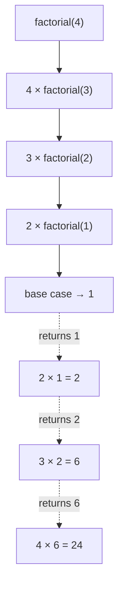
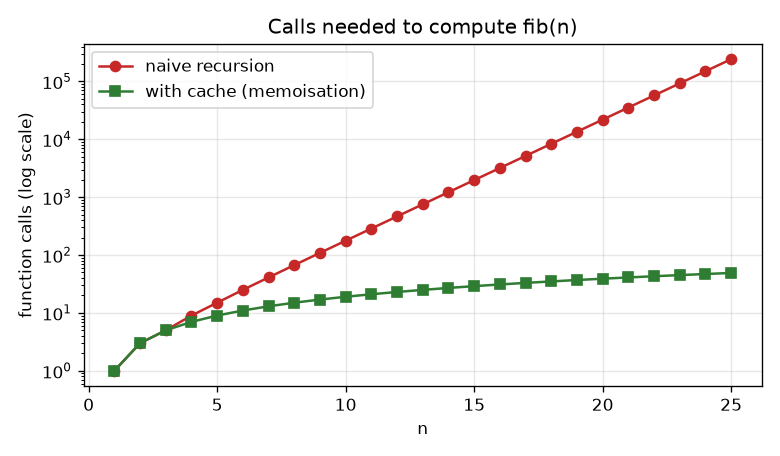
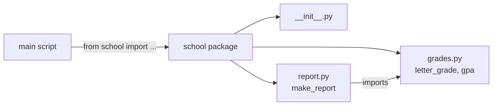

# Session 04 · Functions, Modules, and Packages

> **Module:** Application Based Programming in Python · **Term 1** · ⏱️ ~2 hours
> **You will learn:** recursive functions, lambda functions, how to create and import modules, and how to organise modules into packages.

---

## 1. Recursion — a function that calls itself

A **recursive** function solves a big problem by solving a *smaller copy* of the same problem, until it reaches a case so small the answer is obvious (the **base case**).

> 🪆 **Analogy:** Russian nesting dolls. To reach the smallest doll you open one doll, then do *the same thing* to the doll inside, until there is nothing left to open (base case).

```python
def factorial(n):
    if n <= 1:          # base case — stops the recursion
        return 1
    return n * factorial(n - 1)   # recursive case — smaller problem
```



Every recursive function needs: **(1)** a base case and **(2)** progress toward it. Without them you get `RecursionError: maximum recursion depth exceeded`.

### Recursion can be slow — and how to fix it
Naive Fibonacci recalculates the same values again and again. Adding a cache (`functools.lru_cache`) remembers answers:



*Generated by [`code/make_chart.py`](./code/make_chart.py): calls needed for `fib(n)` with and without caching.*

## 2. Lambda functions — tiny, nameless functions

```python
square = lambda x: x * x        # same as def square(x): return x * x
```
Lambdas shine as **short arguments** to other functions:

```python
students = [("Ali", 72), ("Sana", 91), ("Umer", 65)]
print(sorted(students, key=lambda s: s[1], reverse=True))   # sort by marks
print(list(map(lambda m: m + 5, [60, 70])))                 # grace marks
print(list(filter(lambda m: m >= 50, [45, 67, 30, 88])))     # pass only
```
Rule of thumb: if it needs more than one expression or a name you will reuse, write a normal `def`.

## 3. Modules — one `.py` file you can import

A **module** is just a Python file. Anything defined in `grades.py` can be used in another file:

```python
import math                    # whole module
from statistics import mean    # one name
import random as rnd           # alias
print(math.sqrt(81), mean([2, 4, 6]), rnd.randint(1, 6))
```

Your own module works the same way. The guard below lets a file act as a **script** when run directly, but stay quiet when imported:
```python
if __name__ == "__main__":
    print("Running as a script")
```

## 4. Packages — a folder of modules

```text
code/
└── school/                ← package (folder)
    ├── __init__.py        ← marks the folder as a package; can expose names
    ├── grades.py          ← module
    └── report.py          ← module
```
```python
from school.grades import letter_grade
from school import report
```



> 📚 **Analogy:** a function is a recipe, a module is a recipe book, a package is a shelf of recipe books, and PyPI (`pip install`) is the library down the road.

## 5. Worked examples

All runnable in [`code/examples.py`](./code/examples.py), using the package in [`code/school/`](./code/school/).

### Example 1 — recursive sum of digits
```python
def digit_sum(n):
    return n if n < 10 else n % 10 + digit_sum(n // 10)
print(digit_sum(2026))   # 10
```

### Example 2 — recursion over nested data
```python
def count_files(folder):
    """folder is a dict: name -> None (file) or another dict (sub-folder)."""
    return sum(1 if v is None else count_files(v) for v in folder.values())

drive = {"notes.txt": None, "AI": {"lab1.py": None, "data": {"a.csv": None, "b.csv": None}}}
print(count_files(drive))  # 4
```

### Example 3 — using your own package
```python
from school.grades import letter_grade, gpa
from school.report import make_report
print(letter_grade(84), gpa([84, 71, 58]))
print(make_report("Sana", {"Python": 84, "SQL": 71, "Stats": 58}))
```

## 6. Common mistakes

| Mistake | Fix |
|---|---|
| No base case → infinite recursion | Always write the stopping condition first |
| Naming your file `random.py` or `math.py` | It hides the real module — choose a unique name |
| `ModuleNotFoundError` for your own module | Run Python from the folder that contains the package |
| Long, complex lambdas | Use `def` with a clear name |
| Code at the top level of a module runs on import | Put demo code under `if __name__ == "__main__":` |

## 7. Real-life coding problem 🗂️

**Problem:** A university website has a nested menu (menus inside menus). Write a recursive function that prints the menu as an indented tree and counts all links, then package the helpers so other scripts can import them.

<details>
<summary>💡 Full solution</summary>

```python
menu = {
    "Home": None,
    "Programs": {"Diploma in AI": None, "Short Courses": {"Python": None, "Power BI": None}},
    "Admissions": {"Apply": None, "Fee Structure": None},
}

def print_menu(tree, depth=0):
    count = 0
    for title, children in tree.items():
        print("  " * depth + ("📁 " if children else "🔗 ") + title)
        count += 1 if children is None else print_menu(children, depth + 1)
    return count

links = print_menu(menu)
print("Total links:", links)   # 6
```
File: [`code/problem_solution.py`](./code/problem_solution.py)
</details>

## 8. Practice exercises

1. Write a recursive `power(base, exp)` without using `**`.
2. Write a recursive `reverse(text)` that reverses a string.
3. Sort `["banana", "kiwi", "apple", "fig"]` by word length using a lambda.
4. Add a function `attendance_status(percent)` to `school/grades.py` that returns `"Allowed"` if ≥ 75 else `"Short"`; import and test it.

<details>
<summary>✅ Solutions</summary>

```python
def power(base, exp):
    return 1 if exp == 0 else base * power(base, exp - 1)

def reverse(text):
    return text if len(text) <= 1 else reverse(text[1:]) + text[0]

print(power(2, 10), reverse("python"))
print(sorted(["banana", "kiwi", "apple", "fig"], key=lambda w: len(w)))

# in school/grades.py
def attendance_status(percent):
    return "Allowed" if percent >= 75 else "Short"
```
File: [`code/exercises_solutions.py`](./code/exercises_solutions.py)
</details>

## 9. Quiz

1. What are the two essential parts of every recursive function?
2. Rewrite `def double(x): return x * 2` as a lambda.
3. What is the difference between a module and a package?
4. Why do we write `if __name__ == "__main__":`?
5. What does `from math import sqrt as root` let you write?

<details>
<summary>Answers</summary>

1. A base case and a recursive case that moves toward it · 2. `double = lambda x: x * 2` · 3. A module is one `.py` file; a package is a folder of modules (usually with `__init__.py`) · 4. So demo/test code runs only when the file is executed directly, not when imported · 5. `root(25)`.
</details>

## 10. Summary

- **Recursion** = base case + smaller self-call; cache results to avoid repeated work.
- **Lambda** = a one-expression anonymous function, perfect for `sorted`, `map`, `filter`.
- **Module** = a `.py` file; **package** = a folder of modules; import with `import` / `from … import …`.

---
[⬅ Session 03](../Session-03-introduction-to-functions/) · [Module home](../README.md) · [Session 05 ➡](../Session-05-file-and-exception-handling/)

<sub>Original teaching material by Aseef Ahmed · not official Aptech courseware · CC BY-NC 4.0 (text) / MIT (code)</sub>
