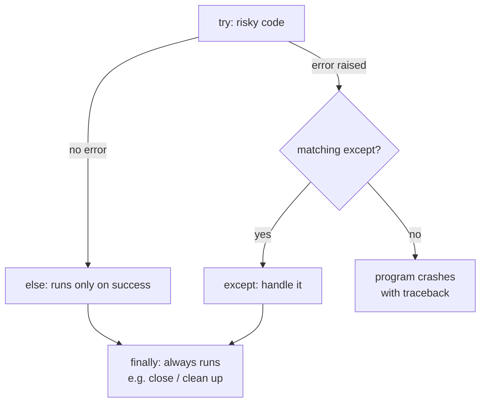

# Session 05 · File Handling and Exception Handling

> **Module:** Application Based Programming in Python · **Term 1** · ⏱️ ~2 hours
> **You will learn:** file access modes, reading and writing text/CSV/JSON files, and handling errors gracefully with `try / except / else / finally` and `raise`.

---

## 1. Why files?

Variables vanish when a program ends. **Files** keep data after the program closes — marks sheets, logs, settings, datasets for AI.

> 📒 **Analogy:** RAM (variables) is a whiteboard — fast but wiped after class. A file is a notebook — you can close it and open it next week.

## 2. Opening a file — access modes

```python
with open("notes.txt", "w", encoding="utf-8") as f:   # 'with' closes the file automatically
    f.write("Hello file!\n")
```

| Mode | Meaning | If the file doesn't exist | If it exists |
|---|---|---|---|
| `"r"` | read (default) | ❌ `FileNotFoundError` | read from the start |
| `"w"` | write | creates it | **erases** it first ⚠️ |
| `"a"` | append | creates it | adds to the end |
| `"x"` | exclusive create | creates it | ❌ `FileExistsError` |
| `"r+"` | read and write | ❌ error | keeps content |
| add `"b"` | binary (`"rb"`, `"wb"`) — images, PDFs, models | | |

### Reading methods

| Method | Returns |
|---|---|
| `f.read()` | the whole file as one string |
| `f.readline()` | the next line |
| `f.readlines()` | a list of all lines |
| `for line in f:` | one line at a time — **best for big files** |

Useful helpers: `f.write(text)`, `f.writelines(list)`, `f.seek(0)` (go back to start), `f.tell()` (current position), and `pathlib.Path` for paths (`Path("data") / "marks.csv"`).

## 3. Exceptions — when things go wrong

An **exception** is Python's way of saying "I can't continue": a missing file, dividing by zero, text where a number was expected. Unhandled, it crashes the program. Handled, the program can recover.

> 🪂 **Analogy:** `try` is jumping out of the plane; `except` is the parachute; `finally` is landing — it happens no matter what.



| Common exception | Typical cause |
|---|---|
| `FileNotFoundError` | wrong file name or path |
| `ValueError` | `int("abc")` |
| `ZeroDivisionError` | `10 / 0` |
| `TypeError` | `"5" + 5` |
| `KeyError` / `IndexError` | missing dict key / list position |
| `PermissionError` | file open in Excel or protected |

## 4. Worked examples

### Example 1 — write, append, read
```python
with open("diary.txt", "w", encoding="utf-8") as f:
    f.write("Day 1: learned variables\n")
with open("diary.txt", "a", encoding="utf-8") as f:
    f.write("Day 2: learned loops\n")
with open("diary.txt", encoding="utf-8") as f:
    for n, line in enumerate(f, 1):
        print(n, line.strip())
```

### Example 2 — CSV files
```python
import csv
rows = [["name", "marks"], ["Ali", 72], ["Sana", 91]]
with open("marks.csv", "w", newline="", encoding="utf-8") as f:
    csv.writer(f).writerows(rows)
with open("marks.csv", encoding="utf-8") as f:
    for row in csv.DictReader(f):
        print(row["name"], int(row["marks"]))
```

### Example 3 — JSON (settings, API data)
```python
import json
settings = {"theme": "dark", "font_size": 14}
with open("settings.json", "w") as f:
    json.dump(settings, f, indent=2)
with open("settings.json") as f:
    print(json.load(f)["theme"])
```

### Example 4 — try / except / else / finally
```python
def safe_divide(a, b):
    try:
        result = a / b
    except ZeroDivisionError:
        print("Cannot divide by zero")
        return None
    except TypeError as e:
        print("Bad input:", e)
        return None
    else:
        return result
    finally:
        print("safe_divide finished")
```

### Example 5 — raising your own exceptions
```python
class InvalidMarksError(Exception):
    """Marks must be between 0 and 100."""

def set_marks(m):
    if not 0 <= m <= 100:
        raise InvalidMarksError(f"{m} is out of range")
    return m
```

## 5. Common mistakes

| Mistake | Fix |
|---|---|
| Opening with `"w"` when you meant to add | Use `"a"` — `"w"` wipes the file |
| Forgetting to close the file | Always use `with open(...)` |
| Bare `except:` that hides every bug | Catch specific exceptions: `except ValueError:` |
| Urdu/emoji text looks garbled | Pass `encoding="utf-8"` |
| Blank lines between CSV rows on Windows | `open(..., newline="")` with `csv` |

## 6. Real-life coding problem 🧮

**Problem:** A teacher receives `raw_marks.csv` from several students. Some rows are broken (missing marks, text instead of numbers, marks > 100). Read the file, skip and **log** bad rows to `errors.log`, and write a clean `report.csv` with grades and the class average.

<details>
<summary>💡 Full solution</summary>

```python
import csv

def grade(m):
    return "A" if m >= 80 else "B" if m >= 65 else "C" if m >= 50 else "F"

def clean_marks(src, dst, log):
    good, errors = [], []
    with open(src, encoding="utf-8") as f:
        for line_no, row in enumerate(csv.DictReader(f), start=2):
            try:
                m = int(row["marks"])
                if not 0 <= m <= 100:
                    raise ValueError(f"marks {m} out of range")
                good.append({"name": row["name"].strip(), "marks": m, "grade": grade(m)})
            except (ValueError, TypeError) as e:
                errors.append(f"line {line_no}: {row} -> {e}")
    with open(dst, "w", newline="", encoding="utf-8") as f:
        w = csv.DictWriter(f, fieldnames=["name", "marks", "grade"])
        w.writeheader(); w.writerows(good)
    with open(log, "w", encoding="utf-8") as f:
        f.write("\n".join(errors))
    avg = sum(r["marks"] for r in good) / len(good)
    return len(good), len(errors), round(avg, 1)
```
The full file creates a sample `raw_marks.csv` with 2 bad rows and checks the result: [`code/problem_solution.py`](./code/problem_solution.py)
</details>

## 7. Practice exercises

1. Write a program that counts the lines, words and characters in a text file.
2. Ask for a number repeatedly until the user enters a valid integer (use `try/except ValueError`).
3. Copy only the lines containing the word `"error"` from `server.log` into `errors_only.log`.
4. Write `read_config(path)` that returns a dict from a JSON file, or `{}` if the file is missing.

<details>
<summary>✅ Solutions</summary>

```python
def file_stats(path):
    with open(path, encoding="utf-8") as f:
        text = f.read()
    return len(text.splitlines()), len(text.split()), len(text)

def ask_int(answers):            # answers simulates input() calls
    for a in answers:
        try:
            return int(a)
        except ValueError:
            print(f"'{a}' is not a whole number, try again")

def filter_errors(src, dst):
    with open(src) as fin, open(dst, "w") as fout:
        for line in fin:
            if "error" in line.lower():
                fout.write(line)

import json
def read_config(path):
    try:
        with open(path) as f:
            return json.load(f)
    except FileNotFoundError:
        return {}
```
File: [`code/exercises_solutions.py`](./code/exercises_solutions.py)
</details>

## 8. Quiz

1. Which mode erases a file's contents when opened?
2. Why is `with open(...)` preferred?
3. When does the `else` block of a `try` statement run?
4. Which exception does `int("12a")` raise?
5. When does `finally` run?

<details>
<summary>Answers</summary>

1. `"w"` · 2. It closes the file automatically, even if an error happens · 3. Only when no exception occurred in `try` · 4. `ValueError` · 5. Always — with or without an exception.
</details>

## 9. Summary

- Open files with `with open(path, mode, encoding="utf-8")`; choose `r`, `w`, `a`, `x` carefully.
- Use `csv` and `json` modules for structured data; iterate line by line for big files.
- Handle predictable errors with specific `except` blocks; use `else` for success, `finally` for clean-up, `raise` for your own rules.

---
[⬅ Session 04](../Session-04-functions-modules-and-packages/) · [Module home](../README.md) · [Session 06 ➡](../Session-06-regex-and-tokenization/)

<sub>Original teaching material by Aseef Ahmed · not official Aptech courseware · CC BY-NC 4.0 (text) / MIT (code)</sub>
