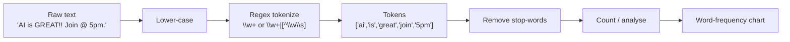
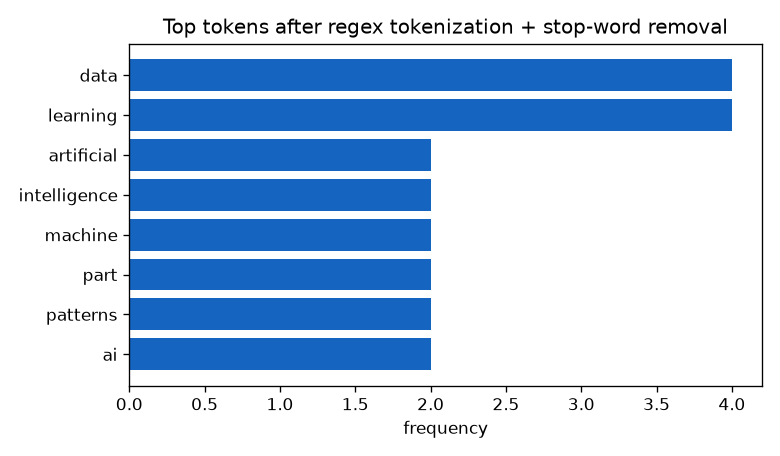

# Session 06 · Regular Expressions and Tokenization of Text

> **Module:** Application Based Programming in Python · **Term 1** · ⏱️ ~2 hours
> **You will learn:** why regular expressions are useful, character classes, special sequences and metacharacters, the main `re` functions, and how to split text into tokens — the first step of every NLP pipeline.

---

## 1. What is a regular expression?

A **regular expression (regex)** is a tiny pattern language for *describing* text. Instead of saying "find `0300-1234567`", you say "find **4 digits, a dash, 7 digits**" → `\d{4}-\d{7}`.

> 🔦 **Analogy:** `Ctrl+F` finds one exact word. A regex is `Ctrl+F` with superpowers — it finds *every phone number*, *every email*, *every date*, even if you've never seen them before.

**Benefits:** validate input (emails, CNIC, passwords), extract data (prices from a web page), clean text (remove extra spaces, punctuation), and tokenize text for AI.

## 2. The building blocks

### Metacharacters
| Symbol | Meaning | Example | Matches |
|---|---|---|---|
| `.` | any character except newline | `c.t` | cat, cot, c9t |
| `^` / `$` | start / end of string | `^Hi` | "Hi there" |
| `*` | 0 or more | `ab*` | a, ab, abbb |
| `+` | 1 or more | `ab+` | ab, abbb |
| `?` | 0 or 1 (optional) | `colou?r` | color, colour |
| `{m,n}` | between m and n times | `\d{2,4}` | 12, 2026 |
| `[]` | character class (one of) | `[aeiou]` | any vowel |
| `[^ ]` | NOT one of | `[^0-9]` | any non-digit |
| `\|` | OR | `cat\|dog` | cat or dog |
| `( )` | group / capture | `(\d+)-(\d+)` | captures both numbers |
| `\` | escape a special character | `\.` | a real dot |

### Special sequences
| Sequence | Means | Opposite |
|---|---|---|
| `\d` | digit `[0-9]` | `\D` |
| `\w` | word char `[A-Za-z0-9_]` | `\W` |
| `\s` | whitespace (space, tab, newline) | `\S` |
| `\b` | word boundary | `\B` |

> 💡 Always write patterns as **raw strings**: `r"\d+"`. Without the `r`, Python may treat `\b` as a backspace character.

## 3. The `re` module

| Function | What it does | Returns |
|---|---|---|
| `re.search(p, s)` | first match **anywhere** | `Match` or `None` |
| `re.match(p, s)` | match only at the **start** | `Match` or `None` |
| `re.fullmatch(p, s)` | whole string must match | `Match` or `None` |
| `re.findall(p, s)` | all matches | list of strings |
| `re.finditer(p, s)` | all matches with positions | iterator of `Match` |
| `re.sub(p, repl, s)` | replace matches | new string |
| `re.split(p, s)` | split on the pattern | list |
| `re.compile(p)` | pre-build a pattern you reuse | `Pattern` |

Flags: `re.IGNORECASE` (`re.I`), `re.MULTILINE` (`re.M`).

## 4. Tokenization

**Tokenization** = breaking text into units (**tokens**) — usually words, numbers and punctuation. Computers can't understand a sentence until it's split into pieces they can count and compare.



| Tokenizer | Pattern | `"Don't stop, AI-2026!"` → |
|---|---|---|
| whitespace | `str.split()` | `["Don't", 'stop,', 'AI-2026!']` |
| word | `r"\w+"` | `['Don', 't', 'stop', 'AI', '2026']` |
| word + apostrophe | `r"[A-Za-z]+(?:'[a-z]+)?\|\d+"` | `["Don't", 'stop', 'AI', '2026']` |
| word + punctuation | `r"\w+\|[^\w\s]"` | `['Don', "'", 't', 'stop', ',', 'AI', '-', '2026', '!']` |
| sentence | `r"(?<=[.!?])\s+"` with `re.split` | splits into sentences |

## 5. Worked examples

```python
import re
text = "Call 0300-1234567 or 021-34567890. Email: info@aptech.pk, admin@school.edu.pk"

re.findall(r"\b\d{3,4}-\d{7,8}\b", text)          # ['0300-1234567', '021-34567890']
re.findall(r"[\w.]+@[\w.]+\.\w+", text)             # both emails
re.sub(r"\d", "#", "PIN 4826")                      # 'PIN ####'
re.split(r"[,;]\s*", "red, green;blue")             # ['red', 'green', 'blue']

m = re.search(r"(\d{2})/(\d{2})/(\d{4})", "Exam on 15/11/2026")
day, month, year = m.groups()                        # ('15', '11', '2026')

cnic = re.compile(r"^\d{5}-\d{7}-\d$")
bool(cnic.fullmatch("42101-1234567-1"))              # True
```

Tokenize and count words:
```python
from collections import Counter
review = "The course is great. The labs are great and the teacher is great!"
tokens = re.findall(r"[a-z]+", review.lower())
stop = {"the", "is", "are", "and"}
Counter(t for t in tokens if t not in stop).most_common(3)
# [('great', 3), ('course', 1), ('labs', 1)]
```

📊 [`code/make_chart.py`](./code/make_chart.py) tokenizes a short paragraph about AI and plots its top words:



## 6. Common mistakes

| Mistake | Fix |
|---|---|
| Forgetting `r""` so `\b` breaks | Always use raw strings |
| `.` meant as a real dot in emails/URLs | Escape it: `\.` |
| Using `match()` and expecting it to search the middle | Use `search()` |
| Greedy `.*` eats too much (`<b>x</b><b>y</b>`) | Make it lazy: `.*?` |
| Validating with `search` → `"abc42101-1234567-1xyz"` passes | Use `fullmatch` or `^…$` |

## 7. Real-life coding problem 🧾

**Problem:** You receive SMS bank alerts as text. Extract the **amount**, **type** (debit/credit), **date** and **last 4 digits of the card**, and compute the total spent.

```text
PKR 2,500.00 debited from card ****4821 on 12-10-2026 at FOODPANDA.
PKR 15,000.00 credited to card ****4821 on 13-10-2026 Salary.
PKR 799.50 debited from card ****4821 on 14-10-2026 at DARAZ.
```

<details>
<summary>💡 Full solution</summary>

```python
import re
PATTERN = re.compile(
    r"PKR\s(?P<amount>[\d,]+\.\d{2})\s(?P<kind>debited|credited)"
    r".*?\*{4}(?P<card>\d{4})\son\s(?P<date>\d{2}-\d{2}-\d{4})"
)

def parse_alerts(text):
    out = []
    for m in PATTERN.finditer(text):
        d = m.groupdict()
        d["amount"] = float(d["amount"].replace(",", ""))
        out.append(d)
    return out

alerts = parse_alerts(sms_text)
spent = sum(a["amount"] for a in alerts if a["kind"] == "debited")
print(spent)   # 3299.5
```
Named groups `(?P<name>...)` make results readable. File: [`code/problem_solution.py`](./code/problem_solution.py)
</details>

## 8. Practice exercises

1. Extract all hashtags from `"Loving #Python and #AI at #Aptech2026!"`.
2. Validate a Pakistani mobile number in the form `03XX-XXXXXXX`.
3. Replace multiple spaces in `"too    many   spaces"` with one space.
4. Split a paragraph into sentences and print how many words each sentence has.

<details>
<summary>✅ Solutions</summary>

```python
import re
print(re.findall(r"#\w+", "Loving #Python and #AI at #Aptech2026!"))

def valid_mobile(s):
    return re.fullmatch(r"03\d{2}-\d{7}", s) is not None

print(re.sub(r"\s+", " ", "too    many   spaces"))

para = "Python is easy. Regex is powerful! Are you ready?"
for s in re.split(r"(?<=[.!?])\s+", para):
    print(len(re.findall(r"\w+", s)), "words:", s)
```
File: [`code/exercises_solutions.py`](./code/exercises_solutions.py)
</details>

## 9. Quiz

1. What does `\d+` match?
2. Difference between `re.match` and `re.search`?
3. What does `re.findall(r"\w+", "Hi, AI!")` return?
4. How do you match a literal `.`?
5. What is tokenization and why does NLP need it?

<details>
<summary>Answers</summary>

1. One or more digits · 2. `match` checks only the start; `search` looks anywhere · 3. `['Hi', 'AI']` · 4. `\.` · 5. Splitting text into units (tokens) so a program can count, compare and model them.
</details>

## 10. Summary

- Regex patterns combine metacharacters (`. ^ $ * + ? {} [] | ()`) and sequences (`\d \w \s \b`).
- Use `search/findall/finditer` to find, `sub` to clean, `split` to break, `fullmatch` to validate.
- Tokenization turns raw text into tokens — the foundation for word counts, sentiment analysis and every NLP model.

---
[⬅ Session 05](../Session-05-file-and-exception-handling/) · [Module home](../README.md) · [Session 07 ➡](../Session-07-web-development-with-flask/)

<sub>Original teaching material by Aseef Ahmed · not official Aptech courseware · CC BY-NC 4.0 (text) / MIT (code)</sub>
