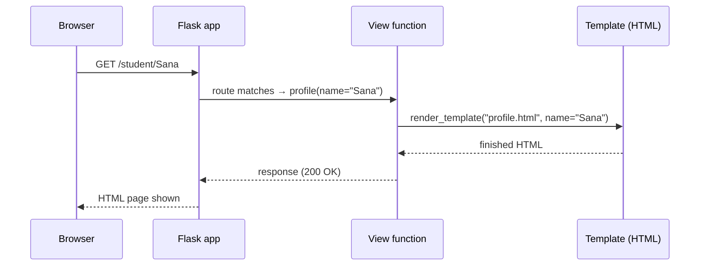

# Session 07 · Web Development Using Flask

> **Module:** Application Based Programming in Python · **Term 1** · ⏱️ ~2 hours
> **You will learn:** how the web works, how to install Flask, and how to build a Flask app with routes, dynamic URLs, HTML templates, forms and a JSON API.

---

## 1. How a website talks to Python

When you open a web page, your **browser (client)** sends a **request** to a **server**. The server runs some code and sends back a **response** — usually HTML (a page) or JSON (data).

**Flask** is a lightweight Python *web framework*: it listens for requests and calls the Python function you connected to that URL.

> 🍽️ **Analogy:** the browser is a customer, Flask is the waiter, your Python functions are the kitchen. The customer orders `/menu`; the waiter takes the order to the right cook (route) and brings back the dish (response).



## 2. Setup and installation

```bash
conda activate diploma-ai        # or activate your venv
pip install flask
python -c "import flask; print(flask.__version__)"
```

Project layout used in this session:
```text
code/
├── app.py                 ← the Flask application
├── templates/
│   ├── base.html          ← shared layout
│   ├── index.html
│   └── feedback.html
└── problem_solution.py    ← feedback app with a JSON API
```

## 3. Key concepts

| Concept | What it is | Example |
|---|---|---|
| **App object** | Your web application | `app = Flask(__name__)` |
| **Route** | Connects a URL to a function | `@app.route("/about")` |
| **View function** | Returns the response | `def about(): return "About us"` |
| **Dynamic URL** | Part of the URL becomes an argument | `/student/<name>` |
| **HTTP methods** | `GET` reads, `POST` sends data | `methods=["GET", "POST"]` |
| **Template** | HTML with placeholders (Jinja2) | `{{ name }}`, `` |
| **`request`** | The incoming data (form, query, JSON) | `request.form["email"]` |
| **`jsonify`** | Returns JSON for APIs | `return jsonify(items)` |
| **Status code** | Result of the request | `200` OK, `404` Not found, `400` Bad request |

## 4. Building a Flask app step by step

### Step 1 — Hello Flask
```python
from flask import Flask
app = Flask(__name__)

@app.route("/")
def home():
    return "<h1>Hello, Flask!</h1>"

if __name__ == "__main__":
    app.run(debug=True)      # open http://127.0.0.1:5000
```

### Step 2 — dynamic routes and query strings
```python
@app.route("/square/<int:n>")
def square(n):
    return f"{n} squared is {n * n}"

@app.route("/search")
def search():
    q = request.args.get("q", "")        # /search?q=python
    return f"You searched for: {q}"
```

### Step 3 — templates (keep HTML out of Python)
```html
<!-- templates/index.html -->


  <h2>Courses</h2>
  <ul><li>{{ c }}</li></ul>

```
```python
@app.route("/courses")
def courses():
    return render_template("index.html", courses=["Python", "SQL", "MongoDB"])
```

### Step 4 — a form with GET and POST
```python
@app.route("/feedback", methods=["GET", "POST"])
def feedback():
    message = None
    if request.method == "POST":
        name = request.form.get("name", "").strip()
        message = f"Thank you, {name}!" if name else "Name is required."
    return render_template("feedback.html", message=message)
```

### Step 5 — a JSON API
```python
@app.route("/api/courses")
def api_courses():
    return jsonify([{"id": 1, "title": "Python"}, {"id": 2, "title": "SQL"}])
```

### Step 6 — test without a browser
Flask's **test client** sends fake requests — perfect for checking your app (this is how every file here was verified):
```python
client = app.test_client()
r = client.get("/square/7")
print(r.status_code, r.get_data(as_text=True))   # 200 7 squared is 49
```

Run the full app: `cd code && python app.py`, then visit <http://127.0.0.1:5000>.

## 5. Common mistakes

| Mistake | Fix |
|---|---|
| `TemplateNotFound` | Templates must be in a folder called `templates/` next to `app.py` |
| `405 Method Not Allowed` on form submit | Add `methods=["GET", "POST"]` to the route |
| Port 5000 already in use | `app.run(port=5001)` |
| Leaving `debug=True` on a public server | Debug mode is for development only |
| Building HTML with string `+` and user input | Use templates — Jinja2 escapes user input and blocks HTML injection |

## 6. Real-life coding problem 📝

**Problem:** Build a **course feedback service** for your centre: students POST a rating (1–5) and a comment to `/api/feedback`; staff GET `/api/feedback/summary` to see the count and average rating. Reject invalid ratings with status **400**.

<details>
<summary>💡 Full solution</summary>

```python
from flask import Flask, jsonify, request

def create_app():
    app = Flask(__name__)
    store = []                                   # in-memory; a database comes in Session 10

    @app.post("/api/feedback")
    def add_feedback():
        data = request.get_json(silent=True) or {}
        rating = data.get("rating")
        if not isinstance(rating, int) or not 1 <= rating <= 5:
            return jsonify(error="rating must be an integer 1-5"), 400
        item = {"id": len(store) + 1, "rating": rating, "comment": data.get("comment", "")}
        store.append(item)
        return jsonify(item), 201

    @app.get("/api/feedback/summary")
    def summary():
        if not store:
            return jsonify(count=0, average=None)
        avg = round(sum(i["rating"] for i in store) / len(store), 2)
        return jsonify(count=len(store), average=avg)

    return app

if __name__ == "__main__":
    create_app().run(debug=True)
```
The **app-factory** pattern (`create_app`) makes testing easy. File with tests: [`code/problem_solution.py`](./code/problem_solution.py)
</details>

## 7. Practice exercises

1. Add a route `/about` that returns your name and batch.
2. Add `/add/<int:a>/<int:b>` that returns the sum.
3. Add `/api/grade?marks=72` that returns `{"marks": 72, "grade": "B"}`; return 400 if marks is missing.
4. Create a template that shows a table of students passed from the view.

<details>
<summary>✅ Solutions</summary>

```python
@app.route("/about")
def about():
    return "Aseef's student · Batch 2511C"

@app.route("/add/<int:a>/<int:b>")
def add(a, b):
    return str(a + b)

@app.route("/api/grade")
def api_grade():
    marks = request.args.get("marks", type=int)
    if marks is None:
        return jsonify(error="marks is required"), 400
    g = "A" if marks >= 80 else "B" if marks >= 65 else "C" if marks >= 50 else "F"
    return jsonify(marks=marks, grade=g)
```
All four (with tests) in [`code/exercises_solutions.py`](./code/exercises_solutions.py)
</details>

## 8. Quiz

1. What does `@app.route("/")` do?
2. Which HTTP method is normally used to submit a form?
3. Where must Flask templates be stored by default?
4. What does `<int:id>` in a route mean?
5. Which status code means "created"?

<details>
<summary>Answers</summary>

1. Connects the home URL to the function below it · 2. `POST` · 3. A `templates/` folder beside the app · 4. That URL part is converted to an integer and passed as `id` · 5. `201`.
</details>

## 9. Summary

- Flask maps **URLs → Python functions** using `@app.route`.
- Use **dynamic routes**, **query strings**, **forms** (`request.form`) and **JSON** (`request.get_json`, `jsonify`).
- Keep HTML in **Jinja2 templates**; test routes with `app.test_client()`.

---
[⬅ Session 06](../Session-06-regex-and-tokenization/) · [Module home](../README.md) · [Session 08 ➡](../Session-08-web-scraping/)

<sub>Original teaching material by Aseef Ahmed · not official Aptech courseware · CC BY-NC 4.0 (text) / MIT (code)</sub>
