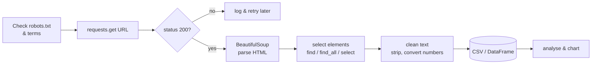
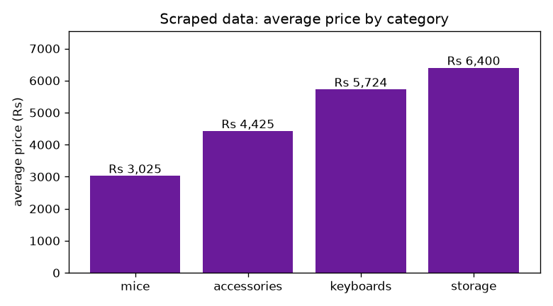

# Session 08 · Web Scraping in Python

> **Module:** Application Based Programming in Python · **Term 1** · ⏱️ ~2 hours
> **You will learn:** what web scraping is, the rules for scraping responsibly, the main Python scraping libraries, and how to build a scraper that turns a web page into a clean dataset.

---

## 1. What is web scraping?

Web pages are written in **HTML** — text with tags like `<h1>`, `<p>`, `<a>`. **Web scraping** is writing a program that downloads a page and *pulls out the data you need* (prices, headlines, job titles) into a structured form such as a CSV.

> 🧑‍🌾 **Analogy:** a web page is a crowded fruit stall. Scraping is sending a helper with a shopping list: "only mangoes, and write down each price". The helper ignores everything else.

Why AI people care: models need **data**, and a lot of it lives on web pages.

## 2. The rules of responsible scraping ⚖️

| Rule | Why |
|---|---|
| **Prefer an official API** if one exists | Cleaner, faster and allowed |
| **Read `robots.txt`** (`site.com/robots.txt`) and the site's Terms | Respect what the owner allows |
| **Go slow** — pause between requests (`time.sleep(1)`) | Don't overload someone's server |
| **Identify yourself** with a `User-Agent` header | Honest and polite |
| **No personal or copyrighted data** for redistribution | Privacy and legal reasons |
| **Cache** pages while developing | Fewer requests to the site |

Practice sites built for learners: <https://books.toscrape.com> and <https://quotes.toscrape.com>.

## 3. The toolbox

| Library | Job |
|---|---|
| `requests` | Download a page (`requests.get(url)`) |
| `BeautifulSoup` (`bs4`) | Parse HTML and find elements |
| `urllib.robotparser` | Check `robots.txt` rules |
| `pandas` | Store/clean the results, save CSV |
| `Selenium` / `Playwright` | Control a real browser for JavaScript-heavy sites |
| `Scrapy` | Framework for large crawling projects |

## 4. The scraping pipeline



## 5. Reading HTML like a scraper

```html
<div class="product">
  <h3 class="title">Wireless Mouse</h3>
  <span class="price">Rs 1,850</span>
  <span class="stock in">In stock</span>
</div>
```
Right-click → **Inspect** in your browser to see tags and classes. Each product is a `div.product`; inside, the title is `h3.title` and the price is `span.price`.

| BeautifulSoup call | Finds |
|---|---|
| `soup.find("h3")` | first `<h3>` |
| `soup.find_all("div", class_="product")` | every product card |
| `soup.select("div.product span.price")` | CSS selector |
| `tag.get_text(strip=True)` | the visible text |
| `tag["href"]` / `tag.get("href")` | an attribute |

## 6. Worked examples

All in [`code/examples.py`](./code/examples.py). They parse the local practice page [`code/sample_store.html`](./code/sample_store.html) so they run offline.

### Example 1 — parse and find
```python
from bs4 import BeautifulSoup
html = open("sample_store.html", encoding="utf-8").read()
soup = BeautifulSoup(html, "html.parser")
print(soup.title.get_text())
print(soup.find("h1").get_text(strip=True))
```

### Example 2 — extract every product into a list of dicts
```python
products = []
for card in soup.select("div.product"):
    products.append({
        "title": card.select_one(".title").get_text(strip=True),
        "price": int(card.select_one(".price").get_text().replace("Rs", "").replace(",", "")),
        "in_stock": "in" in card.select_one(".stock")["class"],
        "category": card["data-category"],
    })
```

### Example 3 — downloading a live page politely
```python
import requests, time
HEADERS = {"User-Agent": "DiplomaAI-student-scraper/1.0 (learning project)"}
r = requests.get("https://books.toscrape.com/", headers=HEADERS, timeout=10)
r.raise_for_status()                 # error if not 200
r.encoding = r.apparent_encoding     # avoid garbled symbols (£ instead of £)
soup = BeautifulSoup(r.text, "html.parser")
time.sleep(1)                        # be polite before the next request
```

### Example 4 — checking robots.txt
```python
from urllib import robotparser
rp = robotparser.RobotFileParser()
rp.parse(["User-agent: *", "Disallow: /admin/"])   # or rp.set_url(...); rp.read()
rp.can_fetch("*", "https://example.com/admin/")     # False
```

📊 After scraping, [`code/make_chart.py`](./code/make_chart.py) charts the average price per category:



## 7. Common mistakes

| Mistake | Fix |
|---|---|
| `AttributeError: 'NoneType' object has no attribute 'get_text'` | The element wasn't found — check the selector or guard with `if tag:` |
| Prices stay as text `"Rs 1,850"` | Clean: remove `Rs` and `,` then `int()` |
| Page looks empty in `requests` but full in the browser | It's built by JavaScript — look for an API in DevTools → Network, or use Selenium/Playwright |
| Getting blocked (`403`/`429`) | Slow down, add a User-Agent, respect `robots.txt` |
| Symbols look garbled (`£` instead of `£`) | Set `r.encoding = r.apparent_encoding` before reading `r.text` |
| Scraper breaks next month | Sites change; keep selectors in one place and test often |

## 8. Real-life coding problem 🛒

**Problem:** A student wants to track laptop-accessory prices. Scrape the practice store page, save `products.csv`, and print: cheapest in-stock item, the most expensive category on average, and items under Rs 2,000.

<details>
<summary>💡 Full solution</summary>

```python
import csv
from bs4 import BeautifulSoup

def parse_price(text):
    return int(text.replace("Rs", "").replace(",", "").strip())

def scrape(html):
    soup = BeautifulSoup(html, "html.parser")
    rows = []
    for card in soup.select("div.product"):
        rows.append({
            "title": card.select_one(".title").get_text(strip=True),
            "category": card["data-category"],
            "price": parse_price(card.select_one(".price").get_text()),
            "in_stock": "in" in card.select_one(".stock")["class"],
        })
    return rows

rows = scrape(open("sample_store.html", encoding="utf-8").read())
in_stock = [r for r in rows if r["in_stock"]]
cheapest = min(in_stock, key=lambda r: r["price"])
by_cat = {}
for r in rows:
    by_cat.setdefault(r["category"], []).append(r["price"])
priciest_cat = max(by_cat, key=lambda c: sum(by_cat[c]) / len(by_cat[c]))
under_2000 = [r["title"] for r in rows if r["price"] < 2000]
```
File (also writes the CSV): [`code/problem_solution.py`](./code/problem_solution.py)
</details>

## 9. Practice exercises

1. From the practice page, print every link text and its `href`.
2. Count how many products are out of stock.
3. Write `scrape_quotes(html)` that returns `(quote, author)` pairs from HTML shaped like quotes.toscrape.com (sample HTML is in the solution file).
4. Add a `delay` parameter to a function that downloads a list of URLs and sleeps between requests.

<details>
<summary>✅ Solutions</summary>

```python
for a in soup.find_all("a"):
    print(a.get_text(strip=True), "->", a.get("href"))

out = len(soup.select("span.stock.out"))

def scrape_quotes(html):
    s = BeautifulSoup(html, "html.parser")
    return [(q.select_one(".text").get_text(strip=True), q.select_one(".author").get_text(strip=True))
            for q in s.select("div.quote")]

def download_all(urls, delay=1.0, get=requests.get):
    pages = []
    for u in urls:
        pages.append(get(u, timeout=10).text)
        time.sleep(delay)
    return pages
```
File: [`code/exercises_solutions.py`](./code/exercises_solutions.py)
</details>

## 10. Quiz

1. Which library downloads a page and which one parses it?
2. What file tells you which parts of a site bots may visit?
3. What does `soup.select("div.card a")` return?
4. Why add `time.sleep()` between requests?
5. A page's data doesn't appear in `requests` output. Why might that be?

<details>
<summary>Answers</summary>

1. `requests` downloads; `BeautifulSoup` parses · 2. `robots.txt` · 3. A list of all `<a>` tags inside `div` elements with class `card` · 4. To avoid overloading the server (and getting blocked) · 5. The content is loaded by JavaScript after the page opens.
</details>

## 11. Summary

- Scraping = **download → parse → select → clean → save**.
- Use `requests` + `BeautifulSoup`; locate data with Inspect and CSS selectors.
- Scrape **responsibly**: APIs first, `robots.txt`, slow requests, no personal data.

---
[⬅ Session 07](../Session-07-web-development-with-flask/) · [Module home](../README.md) · [Session 09 ➡](../Session-09-gui-programming-with-tkinter/)

<sub>Original teaching material by Aseef Ahmed · not official Aptech courseware · CC BY-NC 4.0 (text) / MIT (code)</sub>
