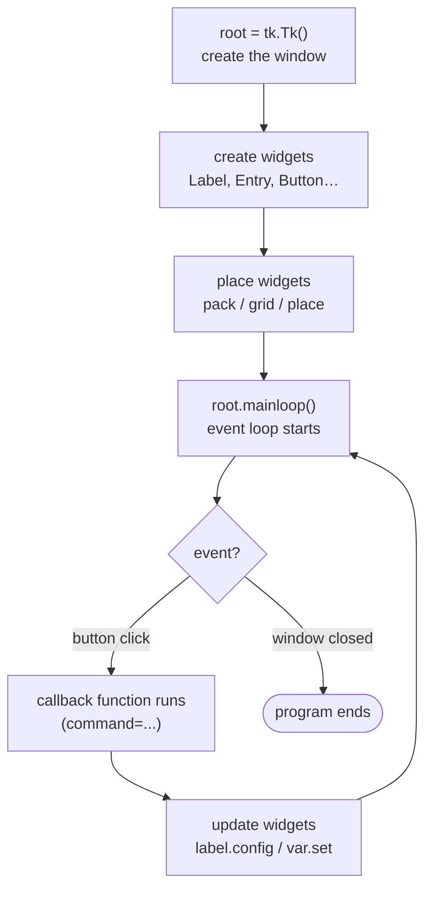

# Session 09 · GUI Programming in Tkinter

> **Module:** Application Based Programming in Python · **Term 1** · ⏱️ ~2 hours
> **You will learn:** what Tkinter is, the common widgets and their properties, three ways to place widgets (`pack`, `grid`, `place`), events, and how to build small desktop applications.

---

## 1. What is a GUI and what is Tkinter?

So far our programs talk through the terminal. A **GUI (Graphical User Interface)** gives users windows, buttons and text boxes instead.

**Tkinter** is Python's built-in GUI toolkit — no installation needed on Windows/macOS (`sudo apt install python3-tk` on Ubuntu).

> 🧱 **Analogy:** a Tkinter app is a LEGO board. The **window** is the base plate, **widgets** are the bricks (labels, buttons, entries), and a **layout manager** decides where each brick sits. The **event loop** is the shopkeeper who waits for customers (clicks, key presses) and reacts.

## 2. The life of a Tkinter program



## 3. Common widgets and properties

| Widget | Purpose | Key options |
|---|---|---|
| `Label` | show text/image | `text`, `font`, `fg`, `bg` |
| `Button` | clickable action | `text`, `command`, `state` |
| `Entry` | one-line text input | `width`, `show="*"` (passwords) |
| `Text` | multi-line text | `height`, `width`, `wrap` |
| `Checkbutton` | on/off option | `variable`, `onvalue`, `offvalue` |
| `Radiobutton` | pick one of many | `variable`, `value` |
| `Listbox` | list of items | `selectmode` |
| `Combobox` (`ttk`) | dropdown | `values`, `state="readonly"` |
| `Frame` | container to group widgets | `padx`, `pady`, `relief` |
| `messagebox` | pop-up alerts | `showinfo`, `showerror`, `askyesno` |

**Control variables** link widgets to data: `tk.StringVar()`, `tk.IntVar()`, `tk.DoubleVar()`, `tk.BooleanVar()` — use `.get()` and `.set()`.

## 4. Three ways to create a layout

| Manager | Idea | Best for |
|---|---|---|
| `pack()` | stack widgets top-to-bottom or side-by-side | simple vertical/horizontal layouts |
| `grid(row=, column=)` | spreadsheet-like rows and columns | forms |
| `place(x=, y=)` | exact pixel position | rare, fixed designs |

⚠️ Never mix `pack` and `grid` **inside the same container** — use separate `Frame`s.

## 5. Worked examples

### Example 1 — Hello window
```python
import tkinter as tk
root = tk.Tk()
root.title("Hello Tkinter")
root.geometry("300x120")
tk.Label(root, text="Assalam-o-Alaikum!", font=("Segoe UI", 14)).pack(pady=20)
root.mainloop()
```

### Example 2 — button + entry + callback
```python
def greet():
    name = entry.get().strip()
    result.config(text=f"Hello, {name or 'stranger'}!")

entry = tk.Entry(root); entry.pack()
tk.Button(root, text="Greet", command=greet).pack()   # command = function name, no ()
result = tk.Label(root, text=""); result.pack()
```

### Example 3 — a form with `grid`
```python
for row, label in enumerate(["Name", "Email", "Course"]):
    tk.Label(root, text=label).grid(row=row, column=0, sticky="e", padx=5, pady=3)
    tk.Entry(root, width=25).grid(row=row, column=1)
```

### Example 4 — keep logic separate from the GUI ✅
Write calculations as **plain functions** (easy to test), and let the GUI only collect input and show output:
```python
# converter_logic.py
def convert(value, unit):
    rates = {"km→miles": 0.621371, "kg→pounds": 2.20462, "°C→°F": None}
    if unit == "°C→°F":
        return value * 9 / 5 + 32
    return value * rates[unit]
```
Files: [`code/widgets_tour.py`](./code/widgets_tour.py) (tour of widgets and layouts), [`code/converter_logic.py`](./code/converter_logic.py) + [`code/converter_gui.py`](./code/converter_gui.py) (unit converter).

▶️ Run any GUI with `python widgets_tour.py`. Logic is tested headlessly by [`code/test_logic.py`](./code/test_logic.py).

## 6. Common mistakes

| Mistake | Fix |
|---|---|
| `command=greet()` runs once at start-up | Pass the function: `command=greet` (or `lambda: greet(x)`) |
| Window opens and closes instantly | You forgot `root.mainloop()` |
| `entry.get()` used as a number | Convert with `float()` and handle `ValueError` |
| Mixing `pack` and `grid` in one frame → app freezes | Use one manager per container |
| `_tkinter.TclError: no display` on a server/Colab | Tkinter needs a desktop; run it on your own computer |

## 7. Real-life coding problem 🎓

**Problem:** Build a **Student Result Calculator** window: enter a name and marks for 3 subjects, click *Calculate* to show the total, percentage and grade; show an error pop-up for invalid marks; *Clear* resets the form; results are added to a list on the right.

<details>
<summary>💡 Full solution</summary>

```python
# result_logic.py — pure functions (tested in test_logic.py)
def validate_marks(values):
    marks = []
    for v in values:
        m = float(v)                       # ValueError if not a number
        if not 0 <= m <= 100:
            raise ValueError(f"{m} is not between 0 and 100")
        marks.append(m)
    return marks

def compute_result(marks):
    total = sum(marks)
    pct = round(total / (len(marks) * 100) * 100, 1)
    grade = "A" if pct >= 80 else "B" if pct >= 65 else "C" if pct >= 50 else "F"
    return total, pct, grade
```
```python
# problem_solution.py — the GUI
import tkinter as tk
from tkinter import messagebox
from result_logic import validate_marks, compute_result

class ResultApp(tk.Tk):
    SUBJECTS = ["Python", "SQL", "Statistics"]
    def __init__(self):
        super().__init__()
        self.title("Student Result Calculator")
        form = tk.Frame(self, padx=10, pady=10); form.pack(side="left")
        self.name = tk.StringVar()
        tk.Label(form, text="Name").grid(row=0, column=0, sticky="e")
        tk.Entry(form, textvariable=self.name).grid(row=0, column=1)
        self.marks = []
        for i, subject in enumerate(self.SUBJECTS, start=1):
            var = tk.StringVar(); self.marks.append(var)
            tk.Label(form, text=subject).grid(row=i, column=0, sticky="e")
            tk.Entry(form, textvariable=var, width=8).grid(row=i, column=1, sticky="w")
        tk.Button(form, text="Calculate", command=self.calculate).grid(row=4, column=0, pady=8)
        tk.Button(form, text="Clear", command=self.clear).grid(row=4, column=1)
        self.output = tk.Label(form, text="", fg="navy"); self.output.grid(row=5, column=0, columnspan=2)
        self.history = tk.Listbox(self, width=32); self.history.pack(side="right", padx=10, pady=10)

    def calculate(self):
        try:
            marks = validate_marks(v.get() for v in self.marks)
        except ValueError as e:
            messagebox.showerror("Invalid marks", str(e)); return
        total, pct, grade = compute_result(marks)
        self.output.config(text=f"Total {total:.0f} · {pct}% · Grade {grade}")
        self.history.insert("end", f"{self.name.get() or 'Student'}: {pct}% ({grade})")

    def clear(self):
        self.name.set(""); [v.set("") for v in self.marks]; self.output.config(text="")

if __name__ == "__main__":
    ResultApp().mainloop()
```
Files: [`code/result_logic.py`](./code/result_logic.py), [`code/problem_solution.py`](./code/problem_solution.py)
</details>

## 8. Practice exercises

1. Make a window with a **counter**: a label showing 0 and buttons `+1`, `-1`, `Reset`.
2. Build a **login form** with username and password (`show="*"`); show "Welcome" or an error.
3. Add a **dark-mode** `Checkbutton` that changes the window background.
4. Write and test a pure function `bmi(weight_kg, height_m)` that returns `(value, category)`; then wire it into a small GUI.

<details>
<summary>✅ Solutions</summary>

All four are in [`code/exercises_solutions.py`](./code/exercises_solutions.py) (GUI) and the `bmi` / `check_login` logic is tested in [`code/test_logic.py`](./code/test_logic.py). The core of exercise 1:

```python
count = tk.IntVar(value=0)
tk.Label(root, textvariable=count, font=("Segoe UI", 24)).pack()
tk.Button(root, text="+1", command=lambda: count.set(count.get() + 1)).pack(side="left")
tk.Button(root, text="-1", command=lambda: count.set(count.get() - 1)).pack(side="left")
tk.Button(root, text="Reset", command=lambda: count.set(0)).pack(side="left")
```
</details>

## 9. Quiz

1. Which call starts the event loop?
2. Which layout manager arranges widgets in rows and columns?
3. What is wrong with `tk.Button(root, text="Go", command=go())`?
4. Which widget would you use for a password field, and with which option?
5. Why keep calculation logic in separate functions?

<details>
<summary>Answers</summary>

1. `root.mainloop()` · 2. `grid()` · 3. `go()` runs immediately; pass `go` without brackets · 4. `Entry` with `show="*"` · 5. It can be tested without opening windows and reused in other apps (web, CLI).
</details>

## 10. Summary

- Tkinter apps = **window → widgets → layout → `mainloop()`**.
- Use `pack`, `grid` or `place` (one per container); link widgets to data with `StringVar`/`IntVar`.
- Buttons call **callback functions**; keep business logic in plain, testable functions.

---
[⬅ Session 08](../Session-08-web-scraping/) · [Module home](../README.md) · [Session 10 ➡](../Session-10-database-integration/)

<sub>Original teaching material by Aseef Ahmed · not official Aptech courseware · CC BY-NC 4.0 (text) / MIT (code)</sub>
