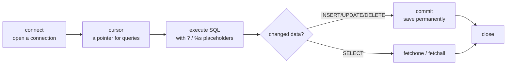

# Session 10 · Database Integration with Python

> **Module:** Application Based Programming in Python · **Term 1** · ⏱️ ~2 hours
> **You will learn:** what a relational database is, how Python talks to one through the DB-API (`connect → cursor → execute → commit → close`), full CRUD with SQLite, safe parameterised queries, and the same code on MySQL with `mysql-connector-python`.

---

## 1. Why a database?

Files (Session 05) are fine for one user and small data. As soon as many people read and write at once, or you need to *search* thousands of rows quickly, you want a **database management system (DBMS)**.

> 🏦 **Analogy:** a CSV file is a box of loose receipts. A database is a bank's ledger system — every entry has a fixed place, a unique number, rules about what is allowed, and many tellers can use it at the same time without tearing pages.

| | Text/CSV file | Relational database |
|---|---|---|
| Structure | anything goes | tables with typed columns |
| Searching | read the whole file | indexed `SELECT ... WHERE` |
| Many users at once | risky | built-in locking & transactions |
| Rules (unique id, not null) | you code them | enforced by the DB |

**SQLite** ships inside Python (`import sqlite3`) — a whole database in one file, no server. **MySQL / PostgreSQL / SQL Server** run as servers for real multi-user apps. The Python code is almost identical because they all follow **PEP 249, the DB-API**.

## 2. The DB-API workflow



| Step | SQLite | MySQL (`mysql.connector`) |
|---|---|---|
| connect | `sqlite3.connect("school.db")` | `mysql.connector.connect(host=..., user=..., password=..., database=...)` |
| placeholder | `?` | `%s` |
| auto-increment | `INTEGER PRIMARY KEY AUTOINCREMENT` | `INT AUTO_INCREMENT PRIMARY KEY` |
| fetch | `cur.fetchall()` | `cur.fetchall()` (same) |
| save | `conn.commit()` | `conn.commit()` (same) |

### CRUD ↔ SQL

| CRUD | SQL | Example |
|---|---|---|
| **C**reate | `INSERT` | `INSERT INTO students(name, city) VALUES (?, ?)` |
| **R**ead | `SELECT` | `SELECT name FROM students WHERE city = ?` |
| **U**pdate | `UPDATE` | `UPDATE students SET city = ? WHERE id = ?` |
| **D**elete | `DELETE` | `DELETE FROM students WHERE id = ?` |

## 3. Never build SQL with f-strings 🔐

```python
name = "x' OR '1'='1"
cur.execute(f"SELECT * FROM users WHERE name = '{name}'")   # ❌ SQL injection: returns every user
cur.execute("SELECT * FROM users WHERE name = ?", (name,))  # ✅ the driver escapes the value
```

> 🧪 **Analogy:** a placeholder is a sealed envelope. The database reads what is *inside* as data, never as instructions.

## 4. Worked examples

### Example 1 — connect and create a table
```python
import sqlite3
conn = sqlite3.connect(":memory:")          # or "school.db" for a file on disk
cur = conn.cursor()
cur.execute("""CREATE TABLE students(
    id INTEGER PRIMARY KEY AUTOINCREMENT,
    name TEXT NOT NULL,
    city TEXT,
    marks INTEGER CHECK (marks BETWEEN 0 AND 100))""")
```

### Example 2 — insert one row and many rows
```python
cur.execute("INSERT INTO students(name, city, marks) VALUES (?, ?, ?)", ("Ayesha", "Karachi", 88))
data = [("Bilal", "Lahore", 64), ("Hira", "Karachi", 92), ("Omar", "Quetta", 47)]
cur.executemany("INSERT INTO students(name, city, marks) VALUES (?, ?, ?)", data)
conn.commit()
print("last id:", cur.lastrowid)
```

### Example 3 — read with filters, ordering and aggregates
```python
for row in cur.execute("SELECT name, marks FROM students WHERE city = ? ORDER BY marks DESC", ("Karachi",)):
    print(row)
cur.execute("SELECT city, COUNT(*), ROUND(AVG(marks), 1) FROM students GROUP BY city")
print(cur.fetchall())
```

### Example 4 — update and delete, checking `rowcount`
```python
cur.execute("UPDATE students SET marks = marks + 5 WHERE marks < ?", (50,))
print(cur.rowcount, "row(s) updated")
cur.execute("DELETE FROM students WHERE name = ?", ("Bilal",))
conn.commit()
```

### Example 5 — transactions and errors
```python
try:
    with conn:                                   # commits on success, rolls back on error
        cur.execute("INSERT INTO students(name, marks) VALUES (?, ?)", ("Zara", 70))
        cur.execute("INSERT INTO students(name, marks) VALUES (?, ?)", ("Bad", 140))  # violates CHECK
except sqlite3.IntegrityError as e:
    print("Rolled back:", e)                     # Zara was NOT saved either
```

### Example 6 — rows as dictionaries
```python
conn.row_factory = sqlite3.Row
cur = conn.cursor()
for r in cur.execute("SELECT * FROM students"):
    print(r["name"], r["marks"])
```

### MySQL variant (same logic, server database)
```python
# pip install mysql-connector-python
import mysql.connector
conn = mysql.connector.connect(host="localhost", user="root", password=os.environ["MYSQL_PWD"], database="school")
cur = conn.cursor()
cur.execute("""CREATE TABLE IF NOT EXISTS students(
    id INT AUTO_INCREMENT PRIMARY KEY, name VARCHAR(60) NOT NULL, city VARCHAR(40), marks INT)""")
cur.execute("INSERT INTO students(name, city, marks) VALUES (%s, %s, %s)", ("Ayesha", "Karachi", 88))
conn.commit()
cur.execute("SELECT name, marks FROM students WHERE city = %s", ("Karachi",))
print(cur.fetchall())
cur.close(); conn.close()
```
Full file (needs a running MySQL server, so it is compile-checked only): [`code/mysql_variant.py`](./code/mysql_variant.py)

## 5. Common mistakes

| Mistake | Fix |
|---|---|
| Data "disappears" after the program ends | You forgot `conn.commit()` (or use `with conn:`) |
| Building SQL with f-strings / `+` | Always pass values as a tuple to placeholders |
| `("Karachi")` passed as parameters | A one-item tuple needs a comma: `("Karachi",)` |
| Using `?` with MySQL | MySQL connector uses `%s` |
| Password written in the code | Read it from an environment variable or `.env` (never commit it) |
| `database is locked` in SQLite | Close other connections / DB Browser before writing |

## 6. Real-life coding problem 🧮

**Problem:** Build a tiny **library manager** backed by SQLite: tables `books` and `loans`, functions to add a book, issue it to a member (only if available), return it, and list overdue loans with the fine (Rs 20 per late day).

<details>
<summary>💡 Full solution</summary>

```python
import sqlite3
from datetime import date, timedelta

FINE_PER_DAY = 20

def setup(conn):
    conn.executescript("""
    CREATE TABLE IF NOT EXISTS books(id INTEGER PRIMARY KEY, title TEXT NOT NULL, available INTEGER DEFAULT 1);
    CREATE TABLE IF NOT EXISTS loans(id INTEGER PRIMARY KEY, book_id INTEGER REFERENCES books(id),
        member TEXT, due TEXT, returned INTEGER DEFAULT 0);""")

def add_book(conn, title):
    with conn:
        return conn.execute("INSERT INTO books(title) VALUES (?)", (title,)).lastrowid

def issue(conn, book_id, member, today, days=14):
    with conn:
        ok = conn.execute("SELECT available FROM books WHERE id = ?", (book_id,)).fetchone()
        if not ok or ok[0] == 0:
            return False
        conn.execute("UPDATE books SET available = 0 WHERE id = ?", (book_id,))
        conn.execute("INSERT INTO loans(book_id, member, due) VALUES (?, ?, ?)",
                     (book_id, member, (today + timedelta(days=days)).isoformat()))
    return True

def return_book(conn, book_id):
    with conn:
        conn.execute("UPDATE loans SET returned = 1 WHERE book_id = ? AND returned = 0", (book_id,))
        conn.execute("UPDATE books SET available = 1 WHERE id = ?", (book_id,))

def overdue(conn, today):
    rows = conn.execute("""SELECT b.title, l.member, l.due FROM loans l JOIN books b ON b.id = l.book_id
                           WHERE l.returned = 0 AND l.due < ? ORDER BY l.due""", (today.isoformat(),))
    return [(t, m, (today - date.fromisoformat(d)).days * FINE_PER_DAY) for t, m, d in rows]
```
Full runnable file with a demo and checks: [`code/problem_solution.py`](./code/problem_solution.py)
</details>

## 7. Practice exercises

1. Create a `products(id, name, price, qty)` table and insert five products with `executemany`.
2. Write `stock_value(conn)` that returns the total of `price * qty` using one SQL query.
3. Write `restock(conn, name, extra)` that adds `extra` to `qty` and returns `True` only if a row was changed.
4. Write `search(conn, text)` that returns product names containing `text` (case-insensitive) using `LIKE` safely.

<details>
<summary>✅ Solutions</summary>

```python
def make_products(conn):
    conn.execute("CREATE TABLE products(id INTEGER PRIMARY KEY, name TEXT, price REAL, qty INTEGER)")
    conn.executemany("INSERT INTO products(name, price, qty) VALUES (?, ?, ?)",
                     [("Pen", 30, 100), ("Notebook", 150, 40), ("Bag", 2200, 5),
                      ("Ruler", 60, 25), ("Marker", 90, 60)])
    conn.commit()

def stock_value(conn):
    return conn.execute("SELECT SUM(price * qty) FROM products").fetchone()[0]

def restock(conn, name, extra):
    with conn:
        cur = conn.execute("UPDATE products SET qty = qty + ? WHERE name = ?", (extra, name))
    return cur.rowcount == 1

def search(conn, text):
    rows = conn.execute("SELECT name FROM products WHERE LOWER(name) LIKE ?", (f"%{text.lower()}%",))
    return [r[0] for r in rows]
```
File: [`code/exercises_solutions.py`](./code/exercises_solutions.py)
</details>

## 8. Quiz

1. Which method permanently saves an `INSERT` to the database?
2. What placeholder does `sqlite3` use, and what does `mysql.connector` use?
3. Why are parameterised queries safer than f-strings?
4. What does `with conn:` do when an exception happens inside it?
5. Which attribute tells you how many rows an `UPDATE` changed?

<details>
<summary>Answers</summary>

1. `conn.commit()` · 2. `?` for SQLite, `%s` for MySQL · 3. Values are sent as data, so they can't change the SQL (prevents SQL injection) · 4. It rolls the transaction back · 5. `cursor.rowcount`.
</details>

## 9. Summary

- DB-API pattern: **connect → cursor → execute → commit → close**; works the same for SQLite and MySQL.
- CRUD maps to `INSERT / SELECT / UPDATE / DELETE`; use `fetchone`, `fetchall` or iterate the cursor.
- Always use placeholders, wrap related changes in a transaction, and keep passwords out of code.

---
[⬅ Session 09](../Session-09-gui-programming-with-tkinter/) · [Module home](../README.md) · [Session 11 ➡](../Session-11-data-handling-with-pandas/)

<sub>Original teaching material by Aseef Ahmed · not official Aptech courseware · CC BY-NC 4.0 (text) / MIT (code)</sub>
