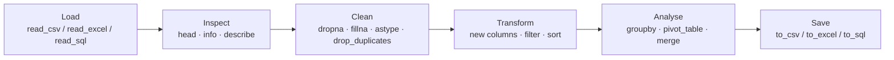

# Session 11 · Data Handling Using Pandas

> **Module:** Application Based Programming in Python · **Term 1** · ⏱️ ~2 hours
> **You will learn:** `Series` and `DataFrame`, loading CSV/Excel/SQL data, inspecting a dataset, selecting with `loc`/`iloc` and boolean masks, adding columns, handling missing values, sorting, `groupby` aggregation, merging tables and saving results.

---

## 1. Why Pandas?

Lists and dicts get painful once data has thousands of rows and many columns. **Pandas** gives you a spreadsheet inside Python — but scriptable, repeatable and able to handle millions of rows. Almost every AI/ML project starts with Pandas.

> 📊 **Analogy:** a `DataFrame` is an Excel sheet that obeys commands. A `Series` is one column of that sheet, with row labels (the **index**) on the left.

```python
import pandas as pd
s = pd.Series([72, 91, 64], index=["Ali", "Sana", "Omar"], name="marks")
df = pd.DataFrame({"name": ["Ali", "Sana"], "marks": [72, 91]})
```

## 2. The typical Pandas workflow



| Task | Code |
|---|---|
| First / last rows | `df.head()`, `df.tail(3)` |
| Shape, columns, types | `df.shape`, `df.columns`, `df.dtypes`, `df.info()` |
| Quick statistics | `df.describe()` |
| Count each value | `df["city"].value_counts()` |
| Missing values per column | `df.isna().sum()` |

### Selecting data

| You want | Code |
|---|---|
| one column (Series) | `df["marks"]` |
| several columns | `df[["name", "marks"]]` |
| rows by **label** | `df.loc[2]`, `df.loc[0:3, "name":"city"]` (end **included**) |
| rows by **position** | `df.iloc[0]`, `df.iloc[0:3, 0:2]` (end **excluded**) |
| rows that match a condition | `df[df["marks"] > 80]` |
| two conditions | `df[(df["marks"] > 80) & (df["city"] == "Karachi")]` |
| value in a list | `df[df["city"].isin(["Lahore", "Quetta"])]` |

> 🎯 **Memory trick:** **loc** = **l**abels, **iloc** = **i**nteger positions.

## 3. Worked examples

### Example 1 — create and inspect
```python
df = pd.DataFrame({
    "name": ["Ayesha", "Bilal", "Hira", "Omar", "Zara", "Hamza"],
    "city": ["Karachi", "Lahore", "Karachi", "Quetta", "Lahore", "Karachi"],
    "python": [88, 64, 92, None, 75, 58],
    "sql": [79, 70, 95, 60, None, 66],
})
print(df.shape); print(df.dtypes); print(df.describe())
```

### Example 2 — select and filter
```python
print(df.loc[df["city"] == "Karachi", ["name", "python"]])
print(df.iloc[:2])
print(df.query("python >= 75 and sql >= 75"))
```

### Example 3 — handle missing values
```python
print(df.isna().sum())
df["python"] = df["python"].fillna(df["python"].mean())
df = df.dropna(subset=["sql"])          # or fill with a default
```

### Example 4 — new columns, apply and sort
```python
df["total"] = df["python"] + df["sql"]
df["grade"] = df["total"].apply(lambda t: "A" if t >= 160 else "B" if t >= 130 else "C")
print(df.sort_values("total", ascending=False))
```

### Example 5 — groupby and pivot tables
```python
print(df.groupby("city")["total"].agg(["count", "mean", "max"]).round(1))
print(pd.pivot_table(df, values="total", index="city", columns="grade", aggfunc="count", fill_value=0))
```

### Example 6 — merge two tables (like SQL JOIN)
```python
fees = pd.DataFrame({"name": ["Ayesha", "Hira", "Omar"], "fee_paid": [True, True, False]})
print(df.merge(fees, on="name", how="left"))
```

### Example 7 — read and write files
```python
df.to_csv("output/students.csv", index=False)
back = pd.read_csv("output/students.csv")
# pd.read_excel("file.xlsx")  ·  pd.read_sql("SELECT * FROM t", conn)  ·  df.to_json(...)
```

## 4. Common mistakes

| Mistake | Fix |
|---|---|
| `df[df.marks > 80 and df.city == "K"]` → error | Use `&` / `|` with brackets around each condition |
| `SettingWithCopyWarning` | Use `df.loc[mask, "col"] = value`, or `.copy()` a slice before editing |
| Extra `Unnamed: 0` column after reloading | Save with `to_csv(..., index=False)` |
| Numbers read as text (`object` dtype) | `pd.to_numeric(df["col"], errors="coerce")` |
| `fillna` "did nothing" | It returns a new object — assign it back |
| Writing loops over rows | Prefer vectorised column maths; it is much faster |

## 5. Real-life coding problem 🧮

**Problem:** A shop exports a messy month of orders (duplicate rows, prices stored as text like `"Rs 1,200"`, missing quantities). Clean it, then report **revenue per category**, the **top 3 products**, and the **best day of the week**.

<details>
<summary>💡 Full solution</summary>

```python
import pandas as pd

def clean_orders(raw):
    df = raw.drop_duplicates().copy()
    df["price"] = pd.to_numeric(df["price"].str.replace(r"[^0-9.]", "", regex=True), errors="coerce")
    df["qty"] = df["qty"].fillna(1).astype(int)
    df["date"] = pd.to_datetime(df["date"])
    df = df.dropna(subset=["price"])
    df["revenue"] = df["price"] * df["qty"]
    return df

def report(df):
    by_cat = df.groupby("category")["revenue"].sum().sort_values(ascending=False)
    top3 = df.groupby("product")["revenue"].sum().nlargest(3)
    best_day = df.groupby(df["date"].dt.day_name())["revenue"].sum().idxmax()
    return by_cat, top3, best_day
```
Full file with sample data and checks: [`code/problem_solution.py`](./code/problem_solution.py)
</details>

## 6. Practice exercises

1. Build a DataFrame of 5 cities with `population` (millions) and `area` (km²); add a `density` column.
2. From the students DataFrame, return names of students who scored above the class average in **both** subjects.
3. Count how many students are in each city and return it as a dict.
4. Write `fill_by_group(df, col, group)` that fills missing values in `col` with the **mean of that student's group** (e.g. city).

<details>
<summary>✅ Solutions</summary>

```python
def city_density():
    df = pd.DataFrame({"city": ["Karachi", "Lahore", "Islamabad", "Quetta", "Peshawar"],
                       "population": [20.4, 13.0, 1.2, 1.6, 2.3],
                       "area": [3780, 1772, 906, 3501, 1257]})
    df["density"] = (df["population"] * 1_000_000 / df["area"]).round()
    return df

def above_average_both(df):
    mask = (df["python"] > df["python"].mean()) & (df["sql"] > df["sql"].mean())
    return df.loc[mask, "name"].tolist()

def count_by_city(df):
    return df["city"].value_counts().to_dict()

def fill_by_group(df, col, group):
    out = df.copy()
    out[col] = out[col].fillna(out.groupby(group)[col].transform("mean"))
    return out
```
File: [`code/exercises_solutions.py`](./code/exercises_solutions.py)
</details>

## 7. Quiz

1. What is the difference between a `Series` and a `DataFrame`?
2. `df.loc[0:2]` returns how many rows on a default index? And `df.iloc[0:2]`?
3. Which operator combines two boolean conditions in Pandas?
4. Which method gives the number of missing values per column?
5. What does `df.groupby("city")["total"].mean()` return?

<details>
<summary>Answers</summary>

1. A Series is one labelled column; a DataFrame is a table of Series sharing an index · 2. `loc` → 3 (end included), `iloc` → 2 (end excluded) · 3. `&` (and `|` for or), with brackets · 4. `df.isna().sum()` · 5. A Series of average totals, one per city.
</details>

## 8. Summary

- Pandas = **Series** (column) + **DataFrame** (table) with an index.
- Workflow: **load → inspect → clean → transform → analyse → save**.
- Select with `[]`, `loc`, `iloc` and boolean masks; summarise with `groupby`, `pivot_table`; combine with `merge`.

---
[⬅ Session 10](../Session-10-database-integration/) · [Module home](../README.md) · [Session 12 ➡](../Session-12-data-visualization/)

<sub>Original teaching material by Aseef Ahmed · not official Aptech courseware · CC BY-NC 4.0 (text) / MIT (code)</sub>
