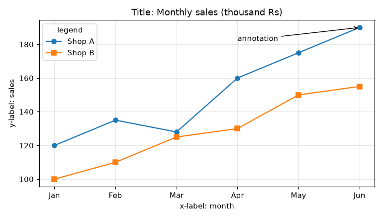
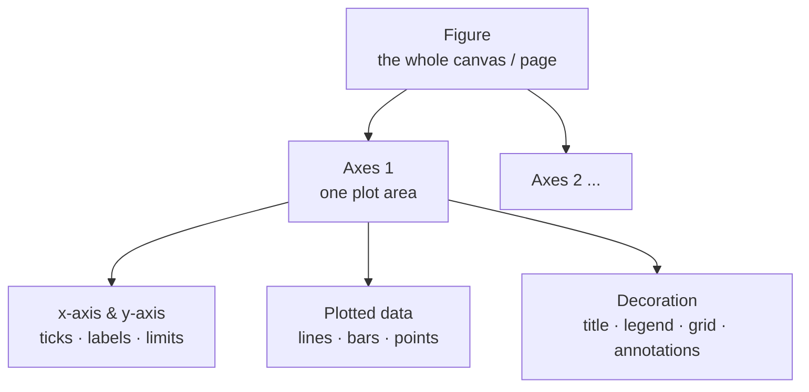
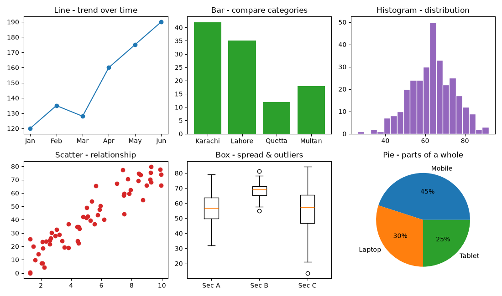

# Session 12 · Data Visualization in Python

> **Module:** Application Based Programming in Python · **Term 1** · ⏱️ ~2 hours
> **You will learn:** how a Matplotlib figure is built, choosing the right chart (line, bar, histogram, scatter, box, pie), styling and labelling, subplots/dashboards, plotting straight from pandas, and saving charts for reports.

---

## 1. Why visualize?

A table of 10,000 numbers hides its story; a chart tells it in two seconds. Before any ML model, data scientists **look** at the data to spot trends, outliers and mistakes.

> 🗺️ **Analogy:** a dataset is a city; a chart is its map. You would not explore Karachi by reading every street address — you open a map first.

```python
import matplotlib.pyplot as plt
plt.plot(["Jan", "Feb", "Mar"], [120, 135, 128])
plt.title("Sales"); plt.show()
```

## 2. Anatomy of a chart and the two coding styles





| Style | Code | Use when |
|---|---|---|
| **pyplot** (quick) | `plt.plot(...)`, `plt.title(...)` | one fast chart while exploring |
| **object-oriented** (recommended) | `fig, ax = plt.subplots()` then `ax.plot(...)`, `ax.set_title(...)` | several charts, dashboards, reusable functions |

### Which chart answers which question?



| Question | Chart | Matplotlib |
|---|---|---|
| How does it change over **time**? | Line | `ax.plot(x, y)` |
| How do **categories** compare? | Bar / horizontal bar | `ax.bar()`, `ax.barh()` |
| How are values **distributed**? | Histogram | `ax.hist(data, bins=20)` |
| Are two variables **related**? | Scatter | `ax.scatter(x, y)` |
| What is the **spread** and where are **outliers**? | Box plot | `ax.boxplot(data)` |
| What **share** of the whole? (≤ 5 parts) | Pie | `ax.pie(values, labels=...)` |

### Styling cheat-sheet

| Want | Code |
|---|---|
| colour, marker, line style | `ax.plot(x, y, color="teal", marker="o", linestyle="--")` or shorthand `"r-o"` |
| labels & title | `ax.set_xlabel()`, `ax.set_ylabel()`, `ax.set_title()` |
| legend | give `label="..."` to each plot, then `ax.legend()` |
| axis range | `ax.set_xlim(0, 10)`, `ax.set_ylim(0, 100)` |
| numbers on bars | `ax.bar_label(bars)` |
| save to file | `fig.savefig("chart.png", dpi=150, bbox_inches="tight")` |

## 3. Worked examples

### Example 1 — first line chart
```python
months = ["Jan", "Feb", "Mar", "Apr", "May", "Jun"]
sales = [120, 135, 128, 160, 175, 190]
plt.plot(months, sales, marker="o", color="teal", linestyle="--", label="Sales")
plt.title("Monthly sales (thousand Rs)")
plt.xlabel("Month"); plt.ylabel("Sales")
plt.legend(); plt.grid(alpha=0.3)
plt.savefig("line.png", dpi=100); plt.show()
```

### Example 2 — bar chart, object-oriented style
```python
fig, ax = plt.subplots(figsize=(6, 4))
bars = ax.bar(["Karachi", "Lahore", "Islamabad", "Quetta"], [42, 35, 20, 12])
ax.bar_label(bars)
ax.set_title("Students per city"); ax.set_ylabel("Students")
```

### Example 3 — histogram + box plot side by side
```python
marks = np.clip(np.random.default_rng(42).normal(66, 12, 200), 0, 100)
fig, (ax1, ax2) = plt.subplots(1, 2, figsize=(10, 4))
ax1.hist(marks, bins=15, edgecolor="white")
ax1.axvline(marks.mean(), color="red", linestyle="--", label=f"mean {marks.mean():.1f}")
ax1.legend()
ax2.boxplot(marks, orientation="horizontal")
```

### Example 4 — scatter with a colour scale
```python
sc = ax.scatter(hours, score, c=score, cmap="viridis")
fig.colorbar(sc, label="score")
ax.set_title(f"r = {np.corrcoef(hours, score)[0, 1]:.2f}")   # correlation
```

### Example 5 — plot directly from pandas
```python
df = pd.DataFrame({"month": months, "online": [50, 62, 58, 80, 95, 110],
                   "shop": [70, 73, 70, 80, 80, 80]}).set_index("month")
df.plot(kind="bar", stacked=True, title="Online vs in-shop sales")
```
`df.plot(kind=...)` accepts `line`, `bar`, `barh`, `hist`, `box`, `scatter`, `pie`, `area`.

### Example 6 — a 2×2 dashboard
```python
fig, axs = plt.subplots(2, 2, figsize=(10, 7))
axs[0, 0].plot(months, sales);   axs[0, 1].bar(cities, students)
axs[1, 0].hist(marks, bins=12);  axs[1, 1].pie([45, 30, 25], labels=["Mobile", "Laptop", "Tablet"])
fig.suptitle("Mini dashboard"); fig.tight_layout()
```
All six examples, runnable cell by cell: [`code/examples.py`](./code/examples.py) · [`notebook.ipynb`](./notebook.ipynb)

## 4. Common mistakes

| Mistake | Fix |
|---|---|
| Chart has no title or axis labels | Always label — a reader should understand it without you |
| `plt.savefig()` called **after** `plt.show()` → blank image | Save first, then show |
| Overlapping labels in subplots | `fig.tight_layout()`; rotate ticks `ax.tick_params(axis="x", rotation=45)` |
| Pie chart with 12 slices | Use a bar chart; pies only for 2–5 parts |
| Bar chart y-axis not starting at 0 | Exaggerates differences — keep bars from 0 |
| Old charts pile up in loops / memory warnings | `plt.close(fig)` after saving |
| Random colours with no meaning | Same colour = same thing across all charts |

## 5. Real-life coding problem 🧮

**Problem:** A shop owner in Karachi has 90 days of sales (date, category, amount). Build a **one-page dashboard PNG** showing: daily revenue with a 7-day moving average, revenue per month, share by category, and average sale by weekday. Return the best category and best weekday.

<details>
<summary>💡 Full solution</summary>

```python
def build_dashboard(df, path):
    monthly = df.groupby(df["date"].dt.to_period("M"))["amount"].sum()
    by_cat = df.groupby("category")["amount"].sum().sort_values(ascending=False)
    order = ["Monday", "Tuesday", "Wednesday", "Thursday", "Friday", "Saturday", "Sunday"]
    weekday = df.groupby(df["date"].dt.day_name())["amount"].mean().reindex(order)
    daily = df.groupby("date")["amount"].sum()

    fig, axs = plt.subplots(2, 2, figsize=(12, 8))
    axs[0, 0].plot(daily.index, daily.values, alpha=0.4, label="daily")
    axs[0, 0].plot(daily.index, daily.rolling(7).mean(), color="red", label="7-day average")
    axs[0, 0].legend(); axs[0, 0].set_title("Daily revenue")
    b = axs[0, 1].bar(monthly.index.astype(str), monthly.values / 1000)
    axs[0, 1].bar_label(b, fmt="%.0fk"); axs[0, 1].set_title("Revenue per month")
    axs[1, 0].pie(by_cat.values, labels=by_cat.index, autopct="%1.0f%%")
    axs[1, 1].barh(weekday.index, weekday.values); axs[1, 1].set_title("Average sale by weekday")
    fig.suptitle("Shop dashboard"); fig.tight_layout()
    fig.savefig(path, dpi=100); plt.close(fig)
    return {"best_category": by_cat.index[0], "best_weekday": weekday.idxmax()}
```
The full file generates sample data and checks the output: [`code/problem_solution.py`](./code/problem_solution.py)
</details>

## 6. Practice exercises

1. Plot a week of max and min temperatures on the same axes, shading the gap between them.
2. Draw a horizontal bar chart of the 5 most common words in a sentence.
3. Draw a pie chart of a monthly budget with the largest slice "exploded" (pulled out).
4. Draw a **grouped** bar chart comparing Section A and Section B averages in 3 subjects.

<details>
<summary>✅ Solutions</summary>

```python
# 1
ax.plot(days, tmax, "r-o", label="max"); ax.plot(days, tmin, "b-o", label="min")
ax.fill_between(days, tmin, tmax, alpha=0.15); ax.legend()

# 2
words = pd.Series(text.lower().replace(",", "").replace(".", "").split())
top = words.value_counts().head(5).sort_values()
ax.barh(top.index, top.values)

# 3
explode = [0.1 if v == max(values) else 0 for v in values]
ax.pie(values, labels=labels, autopct="%1.0f%%", explode=explode, startangle=90)

# 4
x = np.arange(len(subjects)); w = 0.38
ax.bar(x - w/2, sec_a, w, label="Section A")
ax.bar(x + w/2, sec_b, w, label="Section B")
ax.set_xticks(x, subjects); ax.legend()
```
File: [`code/exercises_solutions.py`](./code/exercises_solutions.py)
</details>

## 7. Quiz

1. What is the difference between a `Figure` and an `Axes`?
2. Which chart best shows the distribution of 500 students' marks?
3. You want to see whether advertising spend is related to sales. Which chart?
4. Why can `plt.savefig()` produce a blank file?
5. What does `fig, axs = plt.subplots(2, 3)` create?

<details>
<summary>Answers</summary>

1. The Figure is the whole canvas; an Axes is one plot area inside it · 2. Histogram (or box plot) · 3. Scatter plot · 4. It was called after `plt.show()`, which clears the figure · 5. One figure with a 2-row × 3-column grid of 6 axes (`axs[row, col]`).
</details>

## 8. Summary

- Matplotlib draws on a **Figure** that holds one or more **Axes**; prefer `fig, ax = plt.subplots()`.
- Pick the chart by the question: line = trend, bar = compare, histogram/box = distribution, scatter = relationship, pie = share.
- Label everything, keep colours meaningful, use `tight_layout()`, `savefig()` before `show()`, and `plt.close()` in loops.
- pandas `df.plot(kind=...)` gives quick charts straight from a DataFrame.

---
[⬅ Session 11](../Session-11-data-handling-with-pandas/) · [Module home](../README.md) · [Session 13 ➡](../Session-13-data-processing-for-ml/)

<sub>Original teaching material by Aseef Ahmed · not official Aptech courseware · CC BY-NC 4.0 (text) / MIT (code)</sub>
