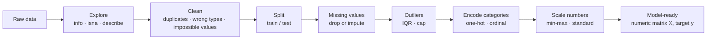
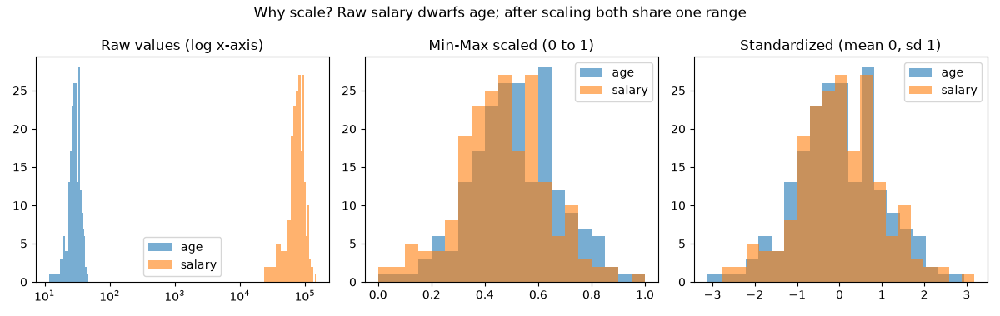
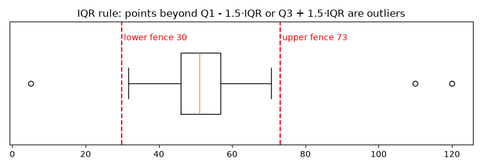

# Session 13 · Data Processing Techniques in Machine Learning

> **Module:** Application Based Programming in Python · **Term 1** · ⏱️ ~2 hours
> **You will learn:** why raw data must be prepared before a model sees it, handling missing values, duplicates and outliers, encoding categories, scaling numbers, simple feature engineering, the train/test split, avoiding data leakage, and wrapping it all in a scikit-learn `Pipeline`.

---

## 1. Why process data?

A machine-learning model only understands **clean numbers**. Real data arrives with blanks, typos, text categories, duplicated rows and values on wildly different scales. Data scientists commonly spend most of a project on this step.

> 🍳 **Analogy:** a model is a chef; data processing is washing, peeling and cutting the vegetables. A great chef with muddy, unpeeled potatoes still serves a bad dish — **garbage in, garbage out**.

## 2. The preprocessing workflow



> ⚠️ **Split before you learn anything from the data.** Medians, means, min/max and category lists must be learned from the **training** set only, then applied to the test set. Otherwise test information "leaks" into training and your accuracy looks better than it really is.

### Missing values

| Strategy | Code | When |
|---|---|---|
| Drop rows | `df.dropna()` | very few rows affected |
| Drop column | `df.drop(columns="x")` | column mostly empty (e.g. > 60%) |
| Fill with mean / median | `df["age"].fillna(df["age"].median())` | numbers (median is safer with outliers) |
| Fill with mode | `df["city"].fillna(df["city"].mode()[0])` | categories |
| scikit-learn | `SimpleImputer(strategy="median")` | inside a pipeline |

### Encoding categories

| Type | Example | Technique | Code |
|---|---|---|---|
| **Nominal** — no order | city: Karachi, Lahore | One-hot (one 0/1 column per value) | `pd.get_dummies()`, `OneHotEncoder()` |
| **Ordinal** — natural order | education: Inter < BS < MS < PhD | Ordered integers 0, 1, 2, 3 | `OrdinalEncoder(categories=[[...]])` |
| **Target** (classification label) | spam / not spam | integer labels | `LabelEncoder()` |

### Scaling numbers



| Scaler | Formula | Result | Good for |
|---|---|---|---|
| `MinMaxScaler` | (x − min) / (max − min) | 0 to 1 | neural networks, images, bounded data |
| `StandardScaler` | (x − mean) / std | mean 0, std 1 | most models (linear/logistic regression, SVM, KNN) |
| `RobustScaler` | (x − median) / IQR | resists outliers | data with extreme values |

Tree models (decision trees, random forests) do not need scaling; distance- and gradient-based models do.

### Outliers — the IQR rule



IQR = Q3 − Q1. Values below **Q1 − 1.5·IQR** or above **Q3 + 1.5·IQR** are outliers. Decide: is it an error (fix/remove), or real but extreme (cap with `.clip()` or keep)?

## 3. Worked examples

### Example 1 — first look at a messy dataset
```python
df = pd.DataFrame({
    "age": [22, 25, None, 31, 28, 45, 38, 29, 26, 120],
    "city": ["Karachi", "Lahore", "Karachi", None, "Quetta", "Lahore", "Karachi", "Karachi", "Lahore", "Quetta"],
    "education": ["BS", "MS", "BS", "PhD", "Inter", "MS", "BS", "MS", "Inter", "BS"],
    "salary_k": [60, 95, 70, 150, 40, 130, 110, None, 45, 80],
    "hired": [0, 1, 0, 1, 0, 1, 1, 1, 0, 0],
})
df.info(); print(df.isna().sum())
```

### Example 2 — drop vs fill
```python
print(len(df.dropna()), "of", len(df))            # dropping loses 30% of the data!
filled = df.copy()
filled["age"] = filled["age"].fillna(filled["age"].median())
filled["salary_k"] = filled["salary_k"].fillna(filled["salary_k"].mean())
filled["city"] = filled["city"].fillna(filled["city"].mode()[0])
```

### Example 3 — find and cap outliers
```python
q1, q3 = filled["age"].quantile([0.25, 0.75]); iqr = q3 - q1
lo, hi = q1 - 1.5 * iqr, q3 + 1.5 * iqr
print(filled[(filled["age"] < lo) | (filled["age"] > hi)])   # age 120 is caught
filled["age"] = filled["age"].clip(lo, hi)
```

### Example 4 — one-hot and ordinal encoding
```python
pd.get_dummies(filled, columns=["city"], dtype=int)
enc = OrdinalEncoder(categories=[["Inter", "BS", "MS", "PhD"]])
filled["edu_level"] = enc.fit_transform(filled[["education"]])
```

### Example 5 — scaling
```python
MinMaxScaler().fit_transform(filled[["age", "salary_k"]])     # 0..1
StandardScaler().fit_transform(filled[["age", "salary_k"]])   # mean 0, std 1
```

### Example 6 & 7 — split first, then one Pipeline does everything
```python
X, y = df.drop(columns="hired"), df["hired"]
X_train, X_test, y_train, y_test = train_test_split(X, y, test_size=0.3, random_state=42, stratify=y)

prep = ColumnTransformer([
    ("num", Pipeline([("impute", SimpleImputer(strategy="median")), ("scale", StandardScaler())]),
     ["age", "salary_k"]),
    ("nom", Pipeline([("impute", SimpleImputer(strategy="most_frequent")),
                      ("onehot", OneHotEncoder(handle_unknown="ignore"))]), ["city"]),
    ("ord", OrdinalEncoder(categories=[["Inter", "BS", "MS", "PhD"]]), ["education"]),
])
Xtr = prep.fit_transform(X_train)   # learns from TRAIN only
Xte = prep.transform(X_test)        # applies the same rules to TEST
```
All examples: [`code/examples.py`](./code/examples.py) · [`notebook.ipynb`](./notebook.ipynb)

## 4. Common mistakes

| Mistake | Fix |
|---|---|
| Scaling/imputing the **whole** dataset before splitting (data leakage) | Split first; `fit` on train, `transform` on test |
| Label-encoding a nominal column (Karachi = 0, Lahore = 1, Quetta = 2) | The model thinks Quetta > Lahore — use one-hot |
| Filling missing values with 0 | 0 is a real value; use median/mode or a "missing" flag |
| Deleting every outlier automatically | First ask: error or genuine extreme? |
| Test set has a new category → crash | `OneHotEncoder(handle_unknown="ignore")` |
| Forgetting to remove duplicates | `df.drop_duplicates()` early |
| One-hot encoding a column with 5,000 unique values | Group rare values into "Other" first |

## 5. Real-life coding problem 🧮

**Problem:** A bank's loan-application file (income, loan amount, age, city, employment type, approved yes/no) has blanks, duplicated rows and impossible incomes (−50, 2000k). Clean it, add a `loan_to_income` feature, split 80/20 and produce model-ready numeric matrices with **no leakage**.

<details>
<summary>💡 Full solution</summary>

```python
def clean(df):
    df = df.drop_duplicates().copy()
    bad = (df["income_k"] <= 0) | (df["income_k"] > 1000)
    df.loc[bad, "income_k"] = np.nan                  # impossible -> treat as missing
    df["loan_to_income"] = df["loan_k"] / df["income_k"]
    return df

def build_preprocessor():
    num = ["income_k", "loan_k", "age", "loan_to_income"]
    cat = ["city", "employment"]
    return ColumnTransformer([
        ("num", Pipeline([("imp", SimpleImputer(strategy="median")), ("sc", StandardScaler())]), num),
        ("cat", Pipeline([("imp", SimpleImputer(strategy="most_frequent")),
                          ("oh", OneHotEncoder(handle_unknown="ignore"))]), cat),
    ])

def prepare(df):
    df = clean(df)
    X, y = df.drop(columns="approved"), df["approved"]
    X_tr, X_te, y_tr, y_te = train_test_split(X, y, test_size=0.2, random_state=1, stratify=y)
    prep = build_preprocessor()
    return prep.fit_transform(X_tr), prep.transform(X_te), y_tr, y_te, prep
```
The full file generates 300 messy applications and verifies there are no NaNs and 11 features: [`code/problem_solution.py`](./code/problem_solution.py)
</details>

## 6. Practice exercises

1. Write `fill_missing(df)`: numeric columns get the median, text columns the most frequent value.
2. Implement min-max scaling by hand with NumPy and check it matches `MinMaxScaler`.
3. Write `drop_outliers(df, col)` using the IQR rule.
4. From `dob` and `joined` dates create `age`, `tenure_years` and a 0/1 `is_senior` (tenure ≥ 5).

<details>
<summary>✅ Solutions</summary>

```python
def fill_missing(df):
    out = df.copy()
    for col in out.columns:
        if pd.api.types.is_numeric_dtype(out[col]):
            out[col] = out[col].fillna(out[col].median())
        else:
            out[col] = out[col].fillna(out[col].mode()[0])
    return out

def min_max(values):
    a = np.asarray(values, dtype=float)
    return (a - a.min()) / (a.max() - a.min())

def drop_outliers(df, col):
    q1, q3 = df[col].quantile([0.25, 0.75]); iqr = q3 - q1
    return df[df[col].between(q1 - 1.5 * iqr, q3 + 1.5 * iqr)]

def add_features(df, today="2026-10-27"):
    out = df.copy(); t = pd.Timestamp(today)
    out["age"] = (t - pd.to_datetime(out["dob"])).dt.days // 365
    out["tenure_years"] = ((t - pd.to_datetime(out["joined"])).dt.days / 365).round(1)
    out["is_senior"] = (out["tenure_years"] >= 5).astype(int)
    return out
```
File: [`code/exercises_solutions.py`](./code/exercises_solutions.py)
</details>

## 7. Quiz

1. Why should you split into train/test **before** fitting a scaler or imputer?
2. Which encoding suits a "city" column, and why not plain integers?
3. Which value is safer for filling missing salaries when a few people earn crores: mean or median?
4. State the IQR outlier rule.
5. Name one model type that does **not** need feature scaling.

<details>
<summary>Answers</summary>

1. To prevent data leakage — statistics from the test set must not influence training · 2. One-hot; integers would invent an order between cities · 3. Median — it is not pulled by extreme values · 4. Outlier if below Q1 − 1.5·IQR or above Q3 + 1.5·IQR · 5. Decision trees / random forests.
</details>

## 8. Summary

- Explore → clean → **split** → impute → handle outliers → encode → scale.
- One-hot for nominal categories, ordered integers for ordinal ones; median/mode for missing values.
- `StandardScaler` or `MinMaxScaler` puts features on one scale for distance- and gradient-based models.
- Fit preprocessing on training data only; a `ColumnTransformer` + `Pipeline` makes that automatic and reusable.

---
[⬅ Session 12](../Session-12-data-visualization/) · [Module home](../README.md) · [Session 14 ➡](../Session-14-types-of-machine-learning/)

<sub>Original teaching material by Aseef Ahmed · not official Aptech courseware · CC BY-NC 4.0 (text) / MIT (code)</sub>
