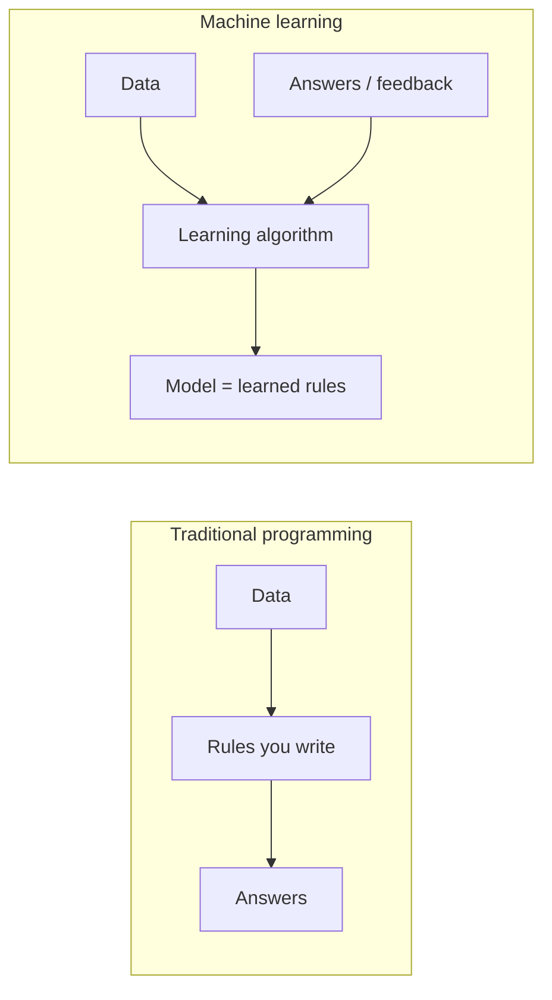
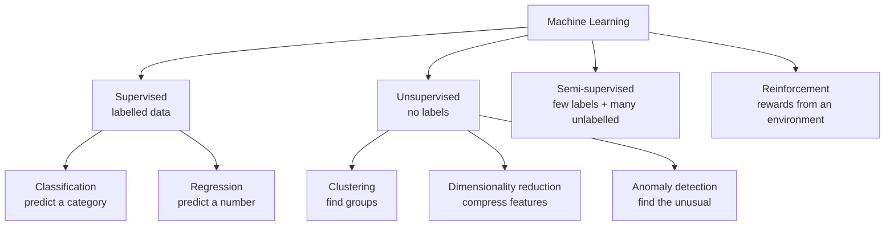
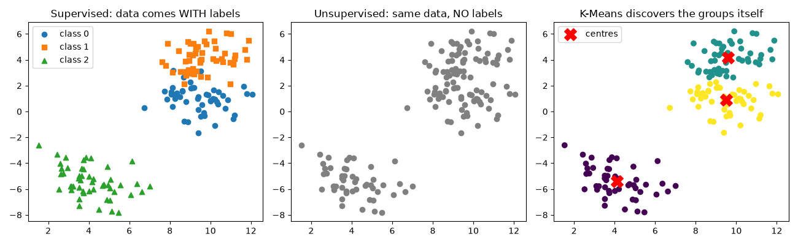
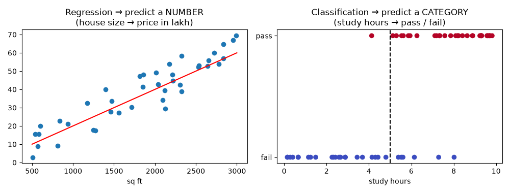

# Session 14 · Introduction to Different Types of Machine Learning

> **Module:** Application Based Programming in Python · **Term 1** · ⏱️ ~2 hours
> **You will learn:** what machine learning is, the four main types (supervised, unsupervised, semi-supervised, reinforcement), classification vs regression, clustering and dimensionality reduction, the standard ML workflow, and scikit-learn's `fit → predict → score` pattern.

---

## 1. What is machine learning?

In normal programming **you** write the rules. In machine learning you give the computer **examples** and it **learns the rules** itself.



> 👶 **Analogy:** you never gave a child a rulebook for "what is a cat". You showed many cats ("that's a cat!") and the child learned. That is supervised learning. A child sorting toys into piles with no instructions is unsupervised learning. A child learning to ride a bicycle by falling and balancing is reinforcement learning.

## 2. The four types



| Type | Learns from | Goal | Pakistani everyday example | Typical algorithms |
|---|---|---|---|---|
| **Supervised – classification** | inputs + correct **category** | predict a label | Is this SMS spam? Will this student pass? | Logistic regression, KNN, decision tree, random forest, SVM |
| **Supervised – regression** | inputs + correct **number** | predict a value | Price of a flat in Gulshan; tomorrow's electricity demand | Linear regression, polynomial, random forest regressor |
| **Unsupervised – clustering** | inputs only | find natural groups | Segment Daraz shoppers for marketing | K-Means, DBSCAN, hierarchical |
| **Unsupervised – dimensionality reduction** | inputs only | fewer, richer features | Compress 100 survey questions into 3 scores | PCA, t-SNE |
| **Semi-supervised** | a few labels + lots of unlabelled data | label the rest cheaply | 200 hand-tagged Urdu reviews + 50,000 untagged | self-training, label propagation |
| **Reinforcement** | rewards and penalties | best sequence of actions | Game-playing bots, ride-hailing driver dispatch, robot control | Q-learning, policy gradients, bandits |





### The ML workflow and the scikit-learn pattern

| Step | What happens | scikit-learn |
|---|---|---|
| 1. Collect & prepare | clean, encode, scale (Session 13) | `Pipeline`, `ColumnTransformer` |
| 2. Split | train set to learn, test set to check | `train_test_split()` |
| 3. Choose a model | pick an algorithm | `model = KNeighborsClassifier()` |
| 4. Train | learn patterns | `model.fit(X_train, y_train)` |
| 5. Predict | apply to new data | `model.predict(X_test)` |
| 6. Evaluate | how good? | `accuracy_score`, `mean_absolute_error` |
| 7. Improve / deploy | tune, retrain, use in an app | `GridSearchCV`, Flask (Session 07) |

> 🧩 Every scikit-learn model speaks the same language — `fit`, `predict`, `score`. Learn it once, swap models freely.

## 3. Worked examples

### Example 1 — classification with K-Nearest Neighbours
```python
iris = load_iris()
X_tr, X_te, y_tr, y_te = train_test_split(iris.data, iris.target, test_size=0.25,
                                          random_state=0, stratify=iris.target)
knn = KNeighborsClassifier(n_neighbors=5).fit(X_tr, y_tr)   # learn
pred = knn.predict(X_te)                                     # predict
print(accuracy_score(y_te, pred))                            # evaluate
```

### Example 2 — swap in a decision tree (same three lines)
```python
tree = DecisionTreeClassifier(max_depth=3).fit(X_tr, y_tr)
print(accuracy_score(y_te, tree.predict(X_te)))
```

### Example 3 — regression: house size → price
```python
reg = LinearRegression().fit(size, price)          # size must be 2-D: shape (n, 1)
print(reg.coef_, reg.intercept_)
print(reg.predict([[1200]]))                       # price for 1,200 sq ft
```

### Example 4 — clustering customers with K-Means
```python
km = KMeans(n_clusters=3, n_init=10, random_state=0).fit(customers)
customers["segment"] = km.labels_
print(customers.groupby("segment").mean())         # describe each segment
```

### Example 5 — PCA: 4 features → 2
```python
pca = PCA(n_components=2).fit(iris.data)
print(pca.explained_variance_ratio_.sum())         # ≈ 0.98 of the information kept
```

### Example 6 — reinforcement learning in miniature (epsilon-greedy bandit)
```python
for step in range(5000):
    arm = rng.integers(3) if rng.random() < eps else int(np.argmax(estimates))  # explore / exploit
    reward = rng.random() < true_click_rate[arm]                                 # environment
    counts[arm] += 1
    estimates[arm] += (reward - estimates[arm]) / counts[arm]                    # learn from reward
```
No labels are given — the agent discovers the best banner purely from rewards.

All examples: [`code/examples.py`](./code/examples.py) · [`notebook.ipynb`](./notebook.ipynb)

## 4. Common mistakes

| Mistake | Fix |
|---|---|
| Measuring accuracy on the training data | Always evaluate on a held-out test set |
| Calling a "predict the price" task classification | Number → regression; category → classification |
| Passing a 1-D array to `fit` (`ValueError: Expected 2D array`) | `X.reshape(-1, 1)` or use `df[["col"]]` (double brackets) |
| Expecting K-Means to "know" the right number of clusters | Choose `k` with the elbow method or business sense |
| Forgetting to scale before KNN / K-Means | Distance-based — use `StandardScaler` first |
| Celebrating 95% accuracy when 95% of rows are one class | Compare with a majority-class **baseline** |

## 5. Real-life coding problem 🧮

**Problem:** An online store logs each visit: pages viewed, minutes on site, items in cart and whether the visitor is returning. Using **one dataset**, (a) build a supervised model that predicts whether a visitor will buy, compare it with a baseline and list the most important features; (b) use unsupervised clustering to find shopper segments for marketing.

<details>
<summary>💡 Full solution</summary>

```python
def supervised_part(df):
    X, y = df.drop(columns="bought"), df["bought"]
    X_tr, X_te, y_tr, y_te = train_test_split(X, y, test_size=0.25, random_state=0, stratify=y)
    model = RandomForestClassifier(n_estimators=200, random_state=0).fit(X_tr, y_tr)
    acc = accuracy_score(y_te, model.predict(X_te))
    baseline = max(y_te.mean(), 1 - y_te.mean())          # always guess the majority
    importance = pd.Series(model.feature_importances_, index=X.columns).sort_values(ascending=False)
    return acc, baseline, importance

def unsupervised_part(df, k=3):
    feats = df[["pages_viewed", "minutes_on_site", "items_in_cart"]]
    km = KMeans(n_clusters=k, n_init=10, random_state=0).fit(StandardScaler().fit_transform(feats))
    return feats.assign(segment=km.labels_).groupby("segment").mean().round(1)
```
Typical output: accuracy ≈ 0.83 vs baseline ≈ 0.59; `items_in_cart` is the strongest signal; segments such as "browsers", "cart-fillers" and "long-stay readers". Full file: [`code/problem_solution.py`](./code/problem_solution.py)
</details>

## 6. Practice exercises

1. Label each scenario as supervised-classification, supervised-regression, unsupervised or reinforcement: PSX index tomorrow · spam filter · grouping news articles with no labels · robot learning to walk · used-car price · unusual card transactions with no fraud labels.
2. On scikit-learn's wine dataset, scale the features and try KNN with k = 1…15. Which k scores best?
3. Use the **elbow method** (K-Means inertia for k = 1…8) on blob data with 4 hidden groups.
4. Write a 1-nearest-neighbour classifier from scratch with NumPy.

<details>
<summary>✅ Solutions</summary>

```python
# 1
SCENARIOS = {
    "predict tomorrow's PSX index value": "supervised-regression",
    "flag an email as spam or not": "supervised-classification",
    "group news articles by topic without labels": "unsupervised",
    "teach a robot to walk by rewarding balance": "reinforcement",
    "estimate a used car's price": "supervised-regression",
    "detect unusual card transactions with no fraud labels": "unsupervised",
}

# 2
for k in range(1, 16):
    model = make_pipeline(StandardScaler(), KNeighborsClassifier(n_neighbors=k)).fit(X_tr, y_tr)
    scores[k] = accuracy_score(y_te, model.predict(X_te))

# 3  - the drop in inertia flattens sharply after k = 4
inertias = [KMeans(k, n_init=10, random_state=0).fit(X).inertia_ for k in range(1, 9)]

# 4
def nn_predict(X_train, y_train, x):
    d = np.sqrt(((np.asarray(X_train) - np.asarray(x)) ** 2).sum(axis=1))
    return y_train[int(np.argmin(d))]
```
File: [`code/exercises_solutions.py`](./code/exercises_solutions.py)
</details>

## 7. Quiz

1. What is the key difference between supervised and unsupervised learning?
2. Predicting a student's exact percentage is classification or regression?
3. Which type of learning uses rewards and penalties?
4. Name the three methods almost every scikit-learn model shares.
5. Why do we keep a separate test set?

<details>
<summary>Answers</summary>

1. Supervised data has the correct answers (labels); unsupervised data does not · 2. Regression (a number) · 3. Reinforcement learning · 4. `fit`, `predict`, `score` · 5. To measure how well the model works on data it has never seen.
</details>

## 8. Summary

- ML learns rules from data instead of you writing them.
- **Supervised** (labels): classification → category, regression → number. **Unsupervised** (no labels): clustering, dimensionality reduction, anomaly detection. **Semi-supervised** mixes both. **Reinforcement** learns actions from rewards.
- Workflow: prepare → split → choose → `fit` → `predict` → evaluate → improve.
- Always compare with a simple baseline and evaluate on unseen data.

---
[⬅ Session 13](../Session-13-data-processing-for-ml/) · [Module home](../README.md) · [Session 15 ➡](../Session-15-regression-techniques/)

<sub>Original teaching material by Aseef Ahmed · not official Aptech courseware · CC BY-NC 4.0 (text) / MIT (code)</sub>
