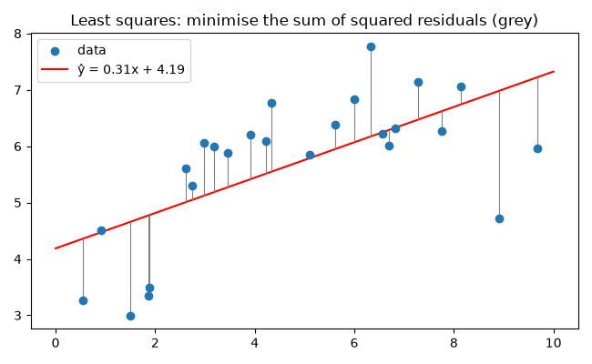
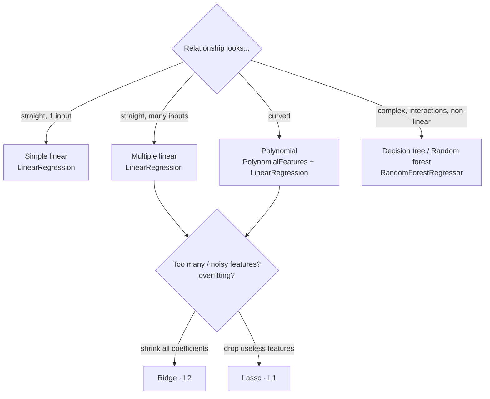
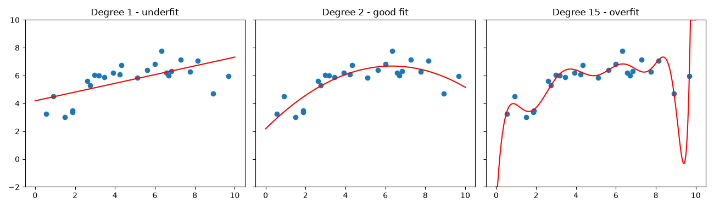

# Session 15 · Regression Techniques for Machine Learning

> **Module:** Application Based Programming in Python · **Term 1** · ⏱️ ~2 hours
> **You will learn:** simple and multiple linear regression, the least-squares idea, evaluation metrics (MAE, MSE, RMSE, R²), polynomial regression, underfitting vs overfitting, cross-validation, regularization with Ridge and Lasso, tree-based regressors, and how to choose between them.

---

## 1. What is regression?

**Regression** predicts a **continuous number**: a price, a temperature, a bill, a score. The model learns how the output changes as the inputs change.

> 📏 **Analogy:** a tailor who has measured hundreds of customers can guess your shirt size from your height and weight without measuring you. The tailor has learned a regression in their head.

The simplest model is a straight line:

**ŷ = m·x + c** — `m` (slope / coefficient) says how much ŷ rises when x rises by 1; `c` (intercept) is ŷ when x = 0.
With many inputs: **ŷ = b₀ + b₁x₁ + b₂x₂ + … + bₙxₙ** (multiple linear regression).

### Least squares — how the "best" line is chosen



The **residual** is the gap between the actual value and the prediction (y − ŷ). Ordinary least squares picks the `m` and `c` that make the **sum of squared residuals** as small as possible.

## 2. Regression techniques at a glance



| Technique | Idea | scikit-learn | Strength | Watch out |
|---|---|---|---|---|
| Simple linear | one straight line | `LinearRegression()` | easy to explain | only straight relationships |
| Multiple linear | one coefficient per feature | `LinearRegression()` | interpretable coefficients | correlated features confuse it |
| Polynomial | add x², x³ … then fit linearly | `PolynomialFeatures(d)` | captures curves | high degree overfits |
| Ridge (L2) | penalise large coefficients | `Ridge(alpha=1)` | stable with many features | needs scaling |
| Lasso (L1) | push weak coefficients to **0** | `Lasso(alpha=0.1)` | automatic feature selection | needs scaling |
| Random forest | average of many decision trees | `RandomForestRegressor()` | non-linear, little prep | less interpretable, can't extrapolate |

### Evaluation metrics

| Metric | Formula (in words) | Units | Read it as |
|---|---|---|---|
| **MAE** | average of \|y − ŷ\| | same as target | "on average we are off by …" |
| **MSE** | average of (y − ŷ)² | squared | punishes big mistakes |
| **RMSE** | √MSE | same as target | typical error, big errors weigh more |
| **R²** | 1 − (squared error ÷ total variance) | 0–1 (can be < 0) | share of variation explained; 1 = perfect |

### Underfitting vs overfitting



| | Training error | Test error | Fix |
|---|---|---|---|
| **Underfit** (too simple) | high | high | more features, higher degree, more flexible model |
| **Good fit** | low | low | ✅ |
| **Overfit** (memorises noise) | very low | high | simpler model, regularization, more data, cross-validation |

**Cross-validation** (`cross_val_score`, k-fold) trains and tests k times on different slices, giving a more honest score than a single split.

## 3. Worked examples

### Example 1 — simple linear regression by formula and by scikit-learn
```python
hours = np.array([1, 2, 3, 4, 5, 6, 7, 8], dtype=float)
marks = np.array([35, 42, 50, 54, 61, 68, 73, 82], dtype=float)
m = ((hours - hours.mean()) * (marks - marks.mean())).sum() / ((hours - hours.mean()) ** 2).sum()
c = marks.mean() - m * hours.mean()                   # marks = 6.49 * hours + 28.93
lr = LinearRegression().fit(hours.reshape(-1, 1), marks)
print(lr.coef_, lr.intercept_, lr.predict([[9]]))     # same answer
```

### Example 2 — metrics
```python
pred = lr.predict(hours.reshape(-1, 1))
mae = mean_absolute_error(marks, pred); mse = mean_squared_error(marks, pred)
print(mae, mse, np.sqrt(mse), r2_score(marks, pred))
```

### Example 3 — multiple linear regression: flat prices
```python
X, y = flats[["sqft", "bedrooms", "age_years", "floor"]], flats["price_lakh"]
X_tr, X_te, y_tr, y_te = train_test_split(X, y, test_size=0.2, random_state=0)
mlr = LinearRegression().fit(X_tr, y_tr)
print(pd.Series(mlr.coef_, index=X.columns))   # e.g. age_years ≈ -1.2 lakh per year of age
print(r2_score(y_te, mlr.predict(X_te)))
```

### Example 4 — polynomial regression + cross-validation
```python
folds = KFold(n_splits=5, shuffle=True, random_state=0)
for d in [1, 2, 10]:
    model = make_pipeline(PolynomialFeatures(d), StandardScaler(), LinearRegression())
    print(d, cross_val_score(model, Xc, yc, cv=folds, scoring="r2").mean())
# degree 1 ≈ 0.27 (underfit) · degree 2 ≈ 0.75 (best) · degree 10 ≈ 0.51 (overfit)
```

### Example 5 — Ridge and Lasso with 10 useless "noise" features added
```python
for name, model in [("Linear", LinearRegression()), ("Ridge", Ridge(alpha=10)), ("Lasso", Lasso(alpha=1.0))]:
    pipe = make_pipeline(StandardScaler(), model).fit(Xn_tr, yn_tr)
    print(name, pipe.score(Xn_te, yn_te), (np.abs(pipe[-1].coef_) < 1e-6).sum())
# Lasso sets all 10 noise coefficients to exactly 0
```

### Example 6 — random forest regressor
```python
rf = RandomForestRegressor(n_estimators=200, random_state=0).fit(X_tr, y_tr)
print(rf.score(X_te, y_te), rf.feature_importances_)
```
All examples: [`code/examples.py`](./code/examples.py) · [`notebook.ipynb`](./notebook.ipynb)

## 4. Common mistakes

| Mistake | Fix |
|---|---|
| Judging a model by **training** R² | Use test-set or cross-validated scores |
| Cross-validating sorted data without shuffling | `KFold(shuffle=True, random_state=0)` |
| High-degree polynomial without scaling → unstable results | `PolynomialFeatures` → `StandardScaler` → model |
| Ridge/Lasso on unscaled features | Scale first, otherwise the penalty is unfair to big-unit features |
| Comparing MSE of models predicting different units | Compare RMSE/MAE in the target's own units, or R² |
| Using linear regression for yes/no outcomes | That is classification — use logistic regression |
| Trusting predictions far outside the training range | Extrapolation is risky, especially for tree models |

## 5. Real-life coding problem 🧮

**Problem:** Forecast a Karachi household's monthly electricity use (kWh) from average temperature, number of AC units, family size and load-shedding hours. AC use only kicks in above ~26 °C, so the relationship is curved. Compare **linear**, **polynomial + Ridge** and **random forest** regression on a test set, pick the best by MAE, and forecast a hot July month.

<details>
<summary>💡 Full solution</summary>

```python
def compare(df):
    X, y = df.drop(columns="units_kwh"), df["units_kwh"]
    X_tr, X_te, y_tr, y_te = train_test_split(X, y, test_size=0.25, random_state=0)
    models = {
        "Linear": make_pipeline(StandardScaler(), LinearRegression()),
        "Polynomial (deg 2) + Ridge": make_pipeline(PolynomialFeatures(2), StandardScaler(), Ridge(alpha=1)),
        "Random forest": RandomForestRegressor(n_estimators=300, random_state=0),
    }
    rows = []
    for name, model in models.items():
        p = model.fit(X_tr, y_tr).predict(X_te)
        rows.append({"model": name, "MAE_kwh": round(mean_absolute_error(y_te, p), 1),
                     "R2": round(r2_score(y_te, p), 3)})
    table = pd.DataFrame(rows).sort_values("MAE_kwh").reset_index(drop=True)
    return table, models[table.loc[0, "model"]]

july = pd.DataFrame([{"avg_temp_c": 36, "ac_units": 2, "family_size": 5, "load_shedding_hrs": 2}])
print(best.predict(july))
```
Typical result: random forest MAE ≈ 26 kWh (R² ≈ 0.97) beats polynomial ≈ 46 and linear ≈ 87 — the straight line cannot follow the AC curve. Full file: [`code/problem_solution.py`](./code/problem_solution.py)
</details>

## 6. Practice exercises

1. Fit `y = m·x + c` using only NumPy and the least-squares formula.
2. Write your own `metrics(y, p)` returning MAE, MSE, RMSE and R², and check R² against scikit-learn.
3. For noisy cubic data, choose the best polynomial degree (1–8) by 5-fold cross-validation.
4. Implement **gradient descent** for simple linear regression and check it finds m = 2, c = 1 for y = 2x + 1.

<details>
<summary>✅ Solutions</summary>

```python
def fit_line(x, y):
    x, y = np.asarray(x, float), np.asarray(y, float)
    m = ((x - x.mean()) * (y - y.mean())).sum() / ((x - x.mean()) ** 2).sum()
    return m, y.mean() - m * x.mean()

def metrics(y, p):
    err = np.asarray(y, float) - np.asarray(p, float)
    mse = (err ** 2).mean()
    r2 = 1 - (err ** 2).sum() / ((np.asarray(y) - np.mean(y)) ** 2).sum()
    return {"MAE": np.abs(err).mean(), "MSE": mse, "RMSE": np.sqrt(mse), "R2": r2}

def best_degree(x, y):
    X = np.asarray(x).reshape(-1, 1)
    scores = {d: cross_val_score(make_pipeline(PolynomialFeatures(d), LinearRegression()), X, y, cv=5).mean()
              for d in range(1, 9)}
    return max(scores, key=scores.get)          # 3 for cubic data

def gradient_descent(x, y, lr=0.01, epochs=5000):
    x, y = np.asarray(x, float), np.asarray(y, float); m = c = 0.0
    for _ in range(epochs):
        p = m * x + c
        m -= lr * (-2 * (x * (y - p)).mean())   # derivative of MSE w.r.t. m
        c -= lr * (-2 * (y - p).mean())         # derivative of MSE w.r.t. c
    return m, c
```
File: [`code/exercises_solutions.py`](./code/exercises_solutions.py)
</details>

## 7. Quiz

1. In ŷ = 6.5x + 29, what does 6.5 mean if x is study hours and ŷ is marks?
2. Which metric is in the same units as the target and treats all errors equally?
3. A model has training R² = 0.99 and test R² = 0.55. What is happening?
4. What is the practical difference between Ridge and Lasso?
5. Why must features be scaled before Ridge or Lasso?

<details>
<summary>Answers</summary>

1. Each extra hour of study adds about 6.5 marks · 2. MAE · 3. Overfitting — it memorised the training data · 4. Ridge shrinks all coefficients; Lasso can set some exactly to 0 (feature selection) · 5. The penalty depends on coefficient size, which depends on each feature's units — scaling makes it fair.
</details>

## 8. Summary

- Regression predicts numbers; linear regression fits ŷ = b₀ + b₁x₁ + … by least squares.
- Report MAE/RMSE (in the target's units) and R² (share explained) on **test** data or with cross-validation.
- Curved data → polynomial features; too many or noisy features → Ridge/Lasso; complex interactions → random forest.
- Balance underfitting and overfitting: pick model complexity by cross-validated score, not training score.
- 🎓 This completes Module 01 — you can now go from raw data to a trained, evaluated model in Python.

---
[⬅ Session 14](../Session-14-types-of-machine-learning/) · [Module home](../README.md)

<sub>Original teaching material by Aseef Ahmed · not official Aptech courseware · CC BY-NC 4.0 (text) / MIT (code)</sub>
