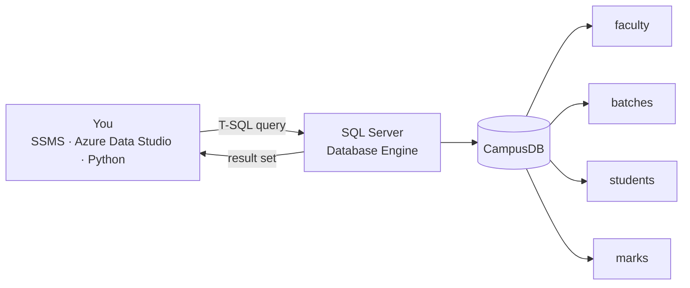

# Session 01 · Introduction to Transact-SQL (T-SQL)

> **Module:** Data Handling using T-SQL · **Term 1** · ⏱️ ~2 hours
> **You will learn:** what a relational database is, how SQL Server and T-SQL fit together, tables, rows, columns, keys and data types, the four families of SQL statements (DDL, DML, DCL, TCL), creating a table with constraints, your first `SELECT` queries, and how we practise T-SQL with SQLite in Python.

---

## 1. Why databases and SQL?

A spreadsheet is fine for 200 rows and one user. A college with 10,000 students, 40 teachers entering marks at the same time and a website reading fees needs a **database**: safe, fast, shared and consistent.

**SQL** (Structured Query Language) is the language every relational database understands. **T-SQL (Transact-SQL)** is Microsoft SQL Server's version of SQL — standard SQL plus extras such as variables, `IF/WHILE`, `TRY…CATCH` and many built-in functions.

> 🏫 **Analogy:** the database is the college's records office, each **table** is a register (students, teachers, marks), each **row** is one entry in a register, each **column** is a printed heading. SQL is the polite request slip you hand to the clerk: "Give me the names of all Karachi students, sorted by fee paid."

## 2. How the pieces fit



### Relational vocabulary

| Term | Meaning | Campus example |
|---|---|---|
| Table (relation) | a set of rows about one kind of thing | `students` |
| Row (record, tuple) | one item | Ayesha Khan's entry |
| Column (field, attribute) | one property, with a data type | `city` |
| **Primary key** | column(s) that uniquely identify a row | `student_id` |
| **Foreign key** | column that points to another table's primary key | `students.batch_id → batches.batch_id` |
| `NULL` | "unknown / not given" (not zero, not empty text) | a student with no email |
| Constraint | a rule the database enforces | `CHECK (marks BETWEEN 0 AND 100)` |

### The four families of SQL statements

| Family | Stands for | Statements | Purpose |
|---|---|---|---|
| **DDL** | Data Definition Language | `CREATE`, `ALTER`, `DROP`, `TRUNCATE` | define structure |
| **DML** | Data Manipulation Language | `SELECT`, `INSERT`, `UPDATE`, `DELETE`, `MERGE` | work with the data |
| **DCL** | Data Control Language | `GRANT`, `REVOKE`, `DENY` | who may do what |
| **TCL** | Transaction Control Language | `BEGIN TRAN`, `COMMIT`, `ROLLBACK`, `SAVE TRAN` | all-or-nothing changes |

### Common SQL Server data types

| Type | Stores | Example |
|---|---|---|
| `INT`, `BIGINT`, `SMALLINT`, `TINYINT` | whole numbers | `fee_paid INT` |
| `DECIMAL(p, s)` / `NUMERIC` | exact decimals (money) | `DECIMAL(10, 2)` |
| `FLOAT`, `REAL` | approximate decimals (science) | sensor readings |
| `CHAR(n)` / `VARCHAR(n)` | text (fixed / variable length) | `VARCHAR(100)` email |
| `NCHAR(n)` / `NVARCHAR(n)` | **Unicode** text (Urdu, Arabic, emoji) | `NVARCHAR(60)` name |
| `DATE`, `TIME`, `DATETIME2` | dates and times | `joined_on DATE` |
| `BIT` | 0 / 1 / NULL | `is_active BIT` |

### How we practise: T-SQL in SQL Server vs SQLite in Python

You can install SQL Server Express (free) and run [`code/campus_sqlserver.sql`](./code/campus_sqlserver.sql) in SSMS to create the same **CampusDB** used in this module. To keep every lab runnable anywhere, our code uses **SQLite**, which is built into Python. Core SQL is the same; a few things differ:

| Task | T-SQL (SQL Server) | SQLite |
|---|---|---|
| first N rows | `SELECT TOP (5) * FROM students` | `SELECT * FROM students LIMIT 5` |
| today's date | `GETDATE()`, `SYSDATETIME()` | `date('now')`, `datetime('now')` |
| auto-number | `INT IDENTITY(1,1)` | `INTEGER PRIMARY KEY` (auto) |
| Unicode text | `NVARCHAR(60)`, literals `N'…'` | `TEXT` (always Unicode) |
| list tables | `SELECT * FROM INFORMATION_SCHEMA.TABLES` | `SELECT name FROM sqlite_master` |
| describe table | `EXEC sp_help 'dbo.students'` | `PRAGMA table_info(students)` |
| end of batch | `GO` (SSMS) | not used |
| start transaction | `BEGIN TRANSACTION` | `BEGIN` |

## 3. Worked examples

### Example 1 — open the database and list its tables
```sql
-- T-SQL
USE CampusDB;
SELECT TABLE_NAME FROM INFORMATION_SCHEMA.TABLES;
```
```python
from campus_db import connect, show       # code/campus_db.py builds CampusDB in SQLite
con = connect()
show(con, "SELECT name FROM sqlite_master WHERE type = 'table'")
```

### Example 2 — DDL: create a table with constraints
```sql
CREATE TABLE dbo.courses (
    course_code  VARCHAR(10)   NOT NULL PRIMARY KEY,
    title        NVARCHAR(80)  NOT NULL,
    duration_wk  INT           CHECK (duration_wk > 0),
    fee          INT           DEFAULT 0
);
```

### Example 3 — DML: insert and read
```sql
INSERT INTO dbo.courses VALUES ('DAI', N'Diploma in AI', 48, 180000),
                               ('DS',  N'Data Science',  24,  90000),
                               ('PY',  N'Python Basics',  8,  25000);
SELECT * FROM dbo.courses;
SELECT title, fee FROM dbo.courses WHERE fee > 50000;
```

### Example 4 — constraints reject bad data
```sql
INSERT INTO dbo.courses VALUES ('PY', N'Duplicate code', 4, 0);   -- ❌ PRIMARY KEY violation
INSERT INTO dbo.courses VALUES ('XX', NULL, 4, 0);                -- ❌ NULL into NOT NULL column
INSERT INTO dbo.courses VALUES ('YY', N'Negative', -2, 0);        -- ❌ CHECK constraint
```

### Example 5 — first queries on campus data
```sql
SELECT name, city FROM dbo.students;
SELECT name, city, fee_paid FROM dbo.students WHERE city = N'Karachi' ORDER BY fee_paid DESC;
SELECT COUNT(*) AS total_students FROM dbo.students;
```

### Example 6 — a transaction you can undo
```sql
BEGIN TRANSACTION;
    DELETE FROM dbo.courses;              -- oops!
    SELECT COUNT(*) FROM dbo.courses;     -- 0
ROLLBACK TRANSACTION;                     -- nothing was lost
SELECT COUNT(*) FROM dbo.courses;         -- 3
```
Runnable SQLite versions of all six: [`code/examples.py`](./code/examples.py) · [`notebook.ipynb`](./notebook.ipynb)

## 4. Common mistakes

| Mistake | Fix |
|---|---|
| Thinking `NULL` = 0 or `''` | `NULL` means unknown; test it with `IS NULL`, never `= NULL` |
| Using `VARCHAR` for Urdu names → `????` | Use `NVARCHAR` and `N'…'` literals |
| Storing money in `FLOAT` | Use `DECIMAL(12, 2)` (exact) |
| Text in double quotes `"Karachi"` | String literals use **single** quotes: `'Karachi'` (double quotes mean identifiers) |
| Forgetting `WHERE` on `DELETE` / `UPDATE` | Write the `WHERE` first, test with `SELECT`, use a transaction |
| `SELECT *` everywhere in real apps | Name the columns you need |
| Running a script in the wrong database | Start scripts with `USE CampusDB;` |

## 5. Real-life coding problem 🧮

**Problem:** The campus wants a small **library** database. Design a `books` table (ISBN as primary key, title, author, category, number of copies that can never be negative, date added defaulting to today), add five books, then answer: which books are available (copies > 0, most copies first)? Which are programming books? How many copies are there in total? Show that a duplicate ISBN is rejected.

<details>
<summary>💡 Full solution</summary>

```sql
-- T-SQL
CREATE TABLE dbo.books (
    isbn      VARCHAR(20)   NOT NULL PRIMARY KEY,
    title     NVARCHAR(120) NOT NULL,
    author    NVARCHAR(80)  NOT NULL,
    category  NVARCHAR(40)  NOT NULL,
    copies    INT           NOT NULL CHECK (copies >= 0),
    added_on  DATE          NOT NULL DEFAULT CAST(GETDATE() AS DATE)
);
INSERT INTO dbo.books (isbn, title, author, category, copies) VALUES
    ('978-1', N'Python Crash Course', N'E. Matthes', N'Programming', 4),
    ('978-2', N'Learning SQL', N'A. Beaulieu', N'Databases', 3),
    ('978-3', N'Hands-On Machine Learning', N'A. Geron', N'AI', 2),
    ('978-4', N'Naked Statistics', N'C. Wheelan', N'Statistics', 0),
    ('978-5', N'Fluent Python', N'L. Ramalho', N'Programming', 1);

SELECT title, copies FROM dbo.books WHERE copies > 0 ORDER BY copies DESC;
SELECT title FROM dbo.books WHERE category = N'Programming';
SELECT SUM(copies) AS total_copies FROM dbo.books;            -- 10
```
SQLite version with checks (default date uses `date('now')`): [`code/problem_solution.py`](./code/problem_solution.py)
</details>

## 6. Practice exercises

1. Show every faculty member's name and subject.
2. Create a `rooms` table: `room_no` primary key, `capacity` (must be > 0), `has_projector` (0/1, default 1).
3. Insert three rooms, one of them without giving `has_projector`, and check the default was used.
4. List students who have paid no fee yet, with their joining date.

<details>
<summary>✅ Solutions</summary>

```sql
-- 1
SELECT name, subject FROM dbo.faculty;

-- 2
CREATE TABLE dbo.rooms (
    room_no        VARCHAR(10) NOT NULL PRIMARY KEY,
    capacity       INT         NOT NULL CHECK (capacity > 0),
    has_projector  BIT         NOT NULL DEFAULT 1
);

-- 3
INSERT INTO dbo.rooms (room_no, capacity, has_projector) VALUES ('Lab-1', 30, 1), ('Lab-2', 25, 0);
INSERT INTO dbo.rooms (room_no, capacity) VALUES ('Hall', 120);   -- has_projector = 1
SELECT * FROM dbo.rooms;

-- 4
SELECT name, joined_on FROM dbo.students WHERE fee_paid = 0;      -- Hamza Malik, Saad Qureshi
```
File: [`code/exercises_solutions.py`](./code/exercises_solutions.py)
</details>

## 7. Quiz

1. What is the difference between SQL and T-SQL?
2. Which statement family does `CREATE TABLE` belong to? And `SELECT`?
3. What does a foreign key do?
4. Which data type should store a student's name in Urdu?
5. What does `ROLLBACK TRANSACTION` do?

<details>
<summary>Answers</summary>

1. SQL is the standard language; T-SQL is SQL Server's extended version (variables, control flow, extra functions) · 2. DDL; DML · 3. Links a row to a row in another table and stops references to rows that don't exist · 4. `NVARCHAR(n)` · 5. Undoes every change made since `BEGIN TRANSACTION`.
</details>

## 8. Summary

- A relational database stores data in **tables** of rows and columns, linked by **primary** and **foreign keys**.
- T-SQL is SQL Server's dialect of SQL; statements fall into DDL, DML, DCL and TCL.
- Choose data types carefully (`NVARCHAR` for names, `DECIMAL` for money, `DATE` for dates) and let **constraints** guard data quality.
- We run the same ideas in SQLite from Python; the README shows the SQL Server syntax you will use in SSMS.

---
[Module home](../README.md) · [Session 02 ➡](../Session-02-t-sql-language-elements/)

<sub>Original teaching material by Aseef Ahmed · not official Aptech courseware · CC BY-NC 4.0 (text) / MIT (code)</sub>
