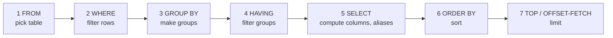

# Session 02 · T-SQL Language Elements

> **Module:** Data Handling using T-SQL · **Term 1** · ⏱️ ~2 hours
> **You will learn:** the clauses of a `SELECT` statement and the order SQL Server actually processes them, expressions and aliases, operators and predicates (`BETWEEN`, `IN`, `LIKE`, `IS NULL`), `DISTINCT`, sorting and paging with `TOP` / `OFFSET…FETCH`, aggregate functions with `GROUP BY` and `HAVING`, variables, comments and batches.

---

## 1. The building blocks of T-SQL

Every T-SQL statement is built from a small set of elements: **keywords** (`SELECT`, `WHERE`), **identifiers** (table and column names), **literals** (`'Karachi'`, `45000`), **operators** (`+`, `=`, `AND`), **functions** (`COUNT()`, `GETDATE()`), **variables** (`@city`), **comments** and **batches**.

> 🧾 **Analogy:** ordering at a dhaba. `SELECT` = what you want on the plate, `FROM` = which kitchen, `WHERE` = "no chilli, only fresh", `GROUP BY` = "one plate per table", `HAVING` = "only tables that ordered more than two dishes", `ORDER BY` = the order plates arrive.

## 2. Written order vs processing order

You **write** a query in one order, but SQL Server **processes** it in another. This explains why a column alias works in `ORDER BY` but not in `WHERE`.



| Clause | Purpose | Example |
|---|---|---|
| `SELECT` | columns / expressions to return | `SELECT name, 45000 - fee_paid AS balance` |
| `FROM` | source table(s) | `FROM dbo.students` |
| `WHERE` | keep rows that match | `WHERE city = N'Karachi'` |
| `GROUP BY` | one output row per group | `GROUP BY subject` |
| `HAVING` | keep groups that match | `HAVING AVG(marks) > 70` |
| `ORDER BY` | sort result | `ORDER BY marks DESC, name` |
| `TOP` / `OFFSET … FETCH` | limit / page | `TOP (3)`, `OFFSET 10 ROWS FETCH NEXT 10 ROWS ONLY` |

### Operators and predicates

| Kind | Operators | Example |
|---|---|---|
| Arithmetic | `+ - * / %` | `fee_paid * 100.0 / 45000` |
| Comparison | `= <> != < > <= >=` | `marks >= 50` |
| Logical | `AND OR NOT` | `city = N'Lahore' OR city = N'Islamabad'` |
| Range | `BETWEEN a AND b` (inclusive) | `marks BETWEEN 60 AND 80` |
| List | `IN (…)`, `NOT IN (…)` | `city IN (N'Lahore', N'Islamabad')` |
| Pattern | `LIKE` with `%` (any text) `_` (one char) `[a-c]` (T-SQL range) | `name LIKE N'H%'` |
| Missing | `IS NULL`, `IS NOT NULL` | `email IS NULL` |
| Concatenate | `+` or `CONCAT()` (T-SQL) · `||` (SQLite) | `name + N' (' + city + N')'` |

### Aggregate functions

| Function | Returns | Ignores NULL? |
|---|---|---|
| `COUNT(*)` | number of rows | counts all rows |
| `COUNT(col)` | number of non-NULL values | ✅ |
| `SUM(col)`, `AVG(col)` | total, mean | ✅ |
| `MIN(col)`, `MAX(col)` | smallest, largest | ✅ |

> ⚠️ Every column in `SELECT` must be either inside an aggregate or listed in `GROUP BY`.

## 3. Worked examples

### Example 1 — expressions and aliases
```sql
SELECT name,
       fee_paid,
       45000 - fee_paid                       AS balance,
       ROUND(fee_paid * 100.0 / 45000, 1)     AS pct_paid    -- 100.0 avoids integer division
FROM dbo.students;
```

### Example 2 — filtering with predicates
```sql
SELECT name, city FROM dbo.students WHERE city = N'Karachi' AND fee_paid >= 45000;
SELECT student_id, subject, marks FROM dbo.marks WHERE marks BETWEEN 60 AND 80;
SELECT name, city FROM dbo.students WHERE city IN (N'Lahore', N'Islamabad');
SELECT name FROM dbo.students WHERE name LIKE N'H%';
SELECT name FROM dbo.students WHERE email IS NULL;
```

### Example 3 — DISTINCT, sorting and paging
```sql
SELECT DISTINCT city FROM dbo.students WHERE city IS NOT NULL ORDER BY city;

SELECT TOP (3) student_id, subject, marks FROM dbo.marks ORDER BY marks DESC;   -- SQLite: LIMIT 3

SELECT student_id, name FROM dbo.students
ORDER BY student_id
OFFSET 3 ROWS FETCH NEXT 3 ROWS ONLY;                                           -- SQLite: LIMIT 3 OFFSET 3
```

### Example 4 — GROUP BY and HAVING
```sql
SELECT subject, COUNT(*) AS attempts, ROUND(AVG(marks * 1.0), 1) AS avg_marks,
       MIN(marks) AS lowest, MAX(marks) AS highest
FROM dbo.marks
GROUP BY subject
ORDER BY avg_marks DESC;

SELECT city, COUNT(*) AS students
FROM dbo.students
WHERE city IS NOT NULL          -- filters ROWS before grouping
GROUP BY city
HAVING COUNT(*) >= 2;           -- filters GROUPS after grouping
```

### Example 5 — variables, comments and batches
```sql
/* multi-line comment: fee report parameters */
DECLARE @city    NVARCHAR(40) = N'Karachi';
DECLARE @min_fee INT;
SET @min_fee = 20000;            -- single-line comment

SELECT name, fee_paid
FROM dbo.students
WHERE city = @city AND fee_paid >= @min_fee;
GO                               -- ends the batch; @city no longer exists after this
```
From Python we use parameters instead of variables: `con.execute("… WHERE city = ? AND fee_paid >= ?", (city, min_fee))` — this also protects against SQL injection.

Runnable SQLite versions: [`code/examples.py`](./code/examples.py) · [`notebook.ipynb`](./notebook.ipynb)

## 4. Common mistakes

| Mistake | Fix |
|---|---|
| `WHERE email = NULL` returns nothing | `WHERE email IS NULL` |
| Using a `SELECT` alias inside `WHERE` | `WHERE` runs before `SELECT` — repeat the expression or use a subquery |
| `WHERE AVG(marks) > 70` → error | Aggregates are filtered with `HAVING` |
| `SELECT city, name, COUNT(*) … GROUP BY city` → error | Every non-aggregated column must be in `GROUP BY` |
| `5 / 2` gives `2` | Integer division — use `5 * 1.0 / 2` or `CAST(5 AS DECIMAL(5,2)) / 2` |
| `TOP (3)` without `ORDER BY` | "Top" of what? Always sort first |
| `NOT IN (…)` with a NULL in the list returns no rows | Filter NULLs out or use `NOT EXISTS` (Session 04) |
| `a OR b AND c` behaves unexpectedly | `AND` binds first — add brackets: `(a OR b) AND c` |

## 5. Real-life coding problem 🧮

**Problem:** The accounts office wants a **fee follow-up report**. The course fee is Rs 45,000. List every student who still owes money with their balance (largest first), show unknown cities as "Unknown", and add a city-wise summary of the number of students owing and the total outstanding.

<details>
<summary>💡 Full solution</summary>

```sql
DECLARE @fee INT = 45000;

SELECT student_id, name, ISNULL(city, N'Unknown') AS city, fee_paid, @fee - fee_paid AS balance
FROM dbo.students
WHERE fee_paid < @fee
ORDER BY balance DESC, name;

SELECT ISNULL(city, N'Unknown') AS city,
       COUNT(*)                 AS students_owing,
       SUM(@fee - fee_paid)     AS outstanding
FROM dbo.students
WHERE fee_paid < @fee
GROUP BY ISNULL(city, N'Unknown')
ORDER BY outstanding DESC;
```
Result: 6 students owe a total of Rs 180,000. SQLite uses `COALESCE` and `?` parameters: [`code/problem_solution.py`](./code/problem_solution.py)
</details>

## 6. Practice exercises

1. List faculty earning between Rs 160,000 and Rs 200,000, highest salary first.
2. Show students whose email ends with `@example.com` and whose city is known.
3. Show each student's average marks, keeping only those averaging below 65.
4. Show the two most recently joined students.

<details>
<summary>✅ Solutions</summary>

```sql
-- 1
SELECT name, salary FROM dbo.faculty WHERE salary BETWEEN 160000 AND 200000 ORDER BY salary DESC;

-- 2
SELECT name, email FROM dbo.students WHERE email LIKE '%@example.com' AND city IS NOT NULL;

-- 3
SELECT student_id, AVG(marks * 1.0) AS avg_marks
FROM dbo.marks
GROUP BY student_id
HAVING AVG(marks * 1.0) < 65
ORDER BY avg_marks;                          -- 108, 104, 102

-- 4
SELECT TOP (2) name, joined_on FROM dbo.students ORDER BY joined_on DESC;
```
File: [`code/exercises_solutions.py`](./code/exercises_solutions.py)
</details>

## 7. Quiz

1. In what order does SQL Server process `SELECT`, `FROM`, `WHERE`, `GROUP BY`?
2. What is the difference between `WHERE` and `HAVING`?
3. Is `BETWEEN 60 AND 80` inclusive of 60 and 80?
4. Which `LIKE` pattern finds names with "a" as the second letter?
5. How do you get rows 11–20 of a sorted result in T-SQL?

<details>
<summary>Answers</summary>

1. `FROM` → `WHERE` → `GROUP BY` → `SELECT` · 2. `WHERE` filters rows before grouping; `HAVING` filters groups after aggregation · 3. Yes, both ends included · 4. `LIKE '_a%'` · 5. `ORDER BY … OFFSET 10 ROWS FETCH NEXT 10 ROWS ONLY`.
</details>

## 8. Summary

- A query is written `SELECT … FROM … WHERE … GROUP BY … HAVING … ORDER BY`, but processed starting from `FROM`.
- Predicates (`=`, `BETWEEN`, `IN`, `LIKE`, `IS NULL`) and `AND/OR/NOT` build filters; `NULL` needs `IS NULL`.
- `DISTINCT` removes duplicates; `ORDER BY` with `TOP` or `OFFSET…FETCH` sorts and pages.
- Aggregates summarise groups; `HAVING` filters those groups.
- `DECLARE`/`SET` create variables in a batch; `GO` ends the batch.

---
[⬅ Session 01](../Session-01-introduction-to-t-sql/) · [Module home](../README.md) · [Session 03 ➡](../Session-03-conditional-formatting/)

<sub>Original teaching material by Aseef Ahmed · not official Aptech courseware · CC BY-NC 4.0 (text) / MIT (code)</sub>
