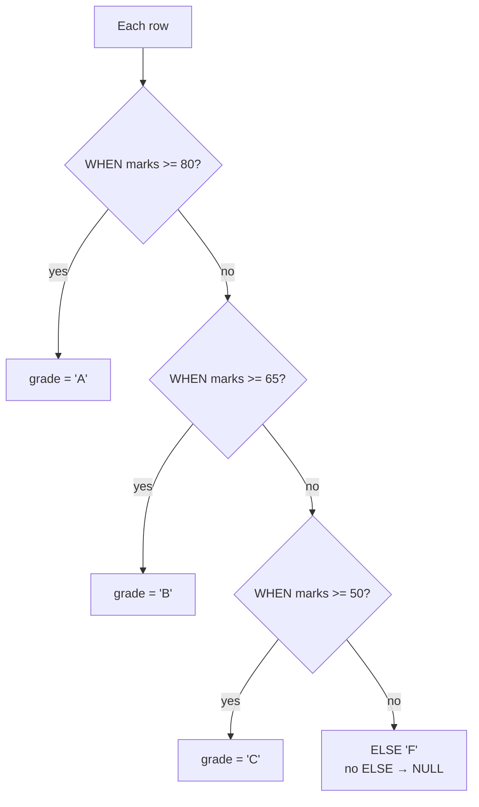

# Session 03 · Performing Conditional Formatting

> **Module:** Data Handling using T-SQL · **Term 1** · ⏱️ ~2 hours
> **You will learn:** making decisions inside queries with `CASE` (simple and searched), `IIF` and `CHOOSE`, handling missing values with `ISNULL`, `COALESCE` and `NULLIF`, converting and formatting output with `CAST`, `CONVERT` and `FORMAT`, using `CASE` inside aggregates and `ORDER BY`, and `IF…ELSE` control flow in a batch.

---

## 1. Why conditional logic in SQL?

Raw data is codes and numbers: `marks = 74`, `timing = 'Evening'`, `email = NULL`. People want **meaning**: "Grade B", "6 pm – 9 pm", "no email on file". Doing this inside the query means every report, app and dashboard gets the same, correct labels.

> 🚦 **Analogy:** `CASE` is a traffic warden at a junction. Each car (row) is checked against the signs in order — "marks ≥ 80? go left to A" — and the first sign that matches decides where it goes. If none match, it takes the `ELSE` road.

## 2. How CASE decides



### Conditional tools

| Tool | Shape | Use when |
|---|---|---|
| **Searched `CASE`** | `CASE WHEN cond THEN x WHEN … ELSE y END` | ranges, several conditions |
| **Simple `CASE`** | `CASE col WHEN 'a' THEN x WHEN 'b' THEN y END` | translating fixed codes |
| `IIF(cond, a, b)` | shorthand for a two-way `CASE` | yes/no labels |
| `CHOOSE(i, a, b, c)` | picks the i-th value (1-based) | numbers → names (month 1 → 'Jan') |
| `ISNULL(x, alt)` | T-SQL: replace NULL with alt | one fallback |
| `COALESCE(a, b, c…)` | first non-NULL value (standard SQL) | several fallbacks |
| `NULLIF(a, b)` | NULL if a = b, else a | avoid divide-by-zero |

### Converting and formatting (T-SQL)

| Need | T-SQL | SQLite equivalent |
|---|---|---|
| change type | `CAST(fee_paid AS VARCHAR(10))` | `CAST(fee_paid AS TEXT)` |
| date style | `CONVERT(VARCHAR(10), joined_on, 105)` → `05-01-2026` | `strftime('%d-%m-%Y', joined_on)` |
| thousands separators | `FORMAT(fee_paid, 'N0')` → `45,000` | `format('%,d', fee_paid)` |
| percentage | `FORMAT(0.667, 'P1')` → `66.7%` | `printf('%.1f%%', 66.7)` |
| fixed decimals | `ROUND(x, 2)`, `CAST(x AS DECIMAL(6,2))` | `ROUND(x, 2)`, `printf('%.2f', x)` |
| join text | `CONCAT(a, ' - ', b)` or `a + ' - ' + b` | `a || ' - ' || b` |
| safe conversion | `TRY_CAST('12a' AS INT)` → NULL | — |

## 3. Worked examples

### Example 1 — searched CASE: marks → grade
```sql
SELECT student_id, subject, marks,
       CASE
           WHEN marks >= 80 THEN 'A'
           WHEN marks >= 65 THEN 'B'
           WHEN marks >= 50 THEN 'C'
           ELSE 'F'
       END AS grade
FROM dbo.marks
ORDER BY marks DESC;
```

### Example 2 — simple CASE: codes → friendly text
```sql
SELECT batch_id,
       CASE timing
           WHEN N'Morning' THEN N'9 am - 12 pm'
           WHEN N'Evening' THEN N'6 pm - 9 pm'
           WHEN N'Weekend' THEN N'Sat & Sun'
           ELSE N'To be announced'          -- also catches NULL
       END AS class_time
FROM dbo.batches;
```

### Example 3 — IIF and CHOOSE
```sql
SELECT name, fee_paid, IIF(fee_paid >= 45000, N'Cleared', N'Pending') AS fee_status
FROM dbo.students;

SELECT batch_id, CHOOSE(MONTH(start_date), 'Jan','Feb','Mar','Apr','May','Jun',
                        'Jul','Aug','Sep','Oct','Nov','Dec') AS start_month
FROM dbo.batches;
```

### Example 4 — NULL handling
```sql
SELECT name,
       ISNULL(email, N'no email on file')     AS contact,
       COALESCE(city, N'Unknown')             AS city,
       COALESCE(batch_id, 'Not placed')       AS batch
FROM dbo.students;

SELECT name, 45000 / NULLIF(fee_paid, 0) AS times_paid   -- NULL instead of "Divide by zero" error
FROM dbo.students;
```

### Example 5 — formatting for a report
```sql
SELECT TOP (4) name,
       N'Rs ' + FORMAT(fee_paid, 'N0')                    AS fee_display,   -- Rs 45,000
       FORMAT(fee_paid * 1.0 / 45000, 'P1')               AS paid_pct,      -- 100.0%
       CAST(fee_paid AS VARCHAR(10)) + ' PKR'             AS fee_text,
       UPPER(LEFT(name, 1)) + '.'                         AS initial,
       CONVERT(VARCHAR(10), joined_on, 105)               AS joined_pk      -- dd-mm-yyyy
FROM dbo.students;
```

### Example 6 — CASE in aggregates and in ORDER BY
```sql
-- pass / fail counts per subject in one row each (a mini pivot)
SELECT subject,
       SUM(CASE WHEN marks >= 50 THEN 1 ELSE 0 END) AS passed,
       SUM(CASE WHEN marks <  50 THEN 1 ELSE 0 END) AS failed,
       ROUND(100.0 * SUM(CASE WHEN marks >= 50 THEN 1 ELSE 0 END) / COUNT(*), 0) AS pass_rate
FROM dbo.marks
GROUP BY subject;

-- Karachi students first, unknown city last
SELECT name, city FROM dbo.students
ORDER BY CASE WHEN city = N'Karachi' THEN 0 WHEN city IS NULL THEN 2 ELSE 1 END, name;
```

### Example 7 — IF…ELSE in a T-SQL batch (control flow, not per-row)
```sql
DECLARE @owing INT = (SELECT COUNT(*) FROM dbo.students WHERE fee_paid < 45000);
IF @owing > 5
    PRINT N'Send fee reminders: ' + CAST(@owing AS NVARCHAR(5)) + N' students owe fees.';
ELSE
    PRINT N'Fee collection on track.';
```
`IF…ELSE` decides **which statements run**; `CASE` decides **a value for each row**. (Control flow has no SQLite equivalent — in Python we use a normal `if`.)

Runnable SQLite versions of Examples 1–6: [`code/examples.py`](./code/examples.py) · [`notebook.ipynb`](./notebook.ipynb)

## 4. Common mistakes

| Mistake | Fix |
|---|---|
| Putting `WHEN marks >= 50` before `WHEN marks >= 80` | `CASE` stops at the **first** match — order from strictest to loosest |
| Forgetting `ELSE` | Unmatched rows silently become `NULL` |
| `CASE timing WHEN NULL THEN …` never matches | Simple `CASE` uses `=`; use searched `CASE WHEN timing IS NULL` |
| Different result types in branches (`THEN 1 … ELSE 'none'`) | Keep every branch the same type, or `CAST` |
| `'Rs ' + fee_paid` → conversion error | `CAST`/`FORMAT` the number first, or use `CONCAT()` |
| Using `FORMAT()` on millions of rows | It is slow — format in the app/report when possible |
| Using an alias inside an `ORDER BY` expression (`ORDER BY CASE status …`) | T-SQL allows a bare alias only; wrap the query in a derived table / CTE |

## 5. Real-life coding problem 🧮

**Problem:** Exam week. Produce (a) a **result card** line for every mark entry: student name, subject, score as `"74 / 100"`, grade (A ≥ 80, B ≥ 65, C ≥ 50, else F) and a remark (Excellent / Good / Needs practice / Re-sit required); (b) a **status** for every student: `Promoted` if no subject is below 50, `Re-sit` otherwise, and `No result` if they have no marks yet — re-sits listed first.

<details>
<summary>💡 Full solution</summary>

```sql
-- (a) result cards
SELECT s.name, m.subject,
       CONCAT(m.marks, ' / 100') AS score,
       CASE WHEN m.marks >= 80 THEN 'A' WHEN m.marks >= 65 THEN 'B'
            WHEN m.marks >= 50 THEN 'C' ELSE 'F' END AS grade,
       CASE WHEN m.marks >= 80 THEN N'Excellent' WHEN m.marks >= 65 THEN N'Good'
            WHEN m.marks >= 50 THEN N'Needs practice' ELSE N'Re-sit required' END AS remark
FROM dbo.marks AS m, dbo.students AS s          -- joins are covered properly in Session 04
WHERE s.student_id = m.student_id
ORDER BY s.name, m.subject;

-- (b) status per student
SELECT name, status
FROM (
    SELECT s.name,
           CASE
               WHEN (SELECT COUNT(*)    FROM dbo.marks m WHERE m.student_id = s.student_id) = 0 THEN N'No result'
               WHEN (SELECT MIN(marks)  FROM dbo.marks m WHERE m.student_id = s.student_id) < 50 THEN N'Re-sit'
               ELSE N'Promoted'
           END AS status
    FROM dbo.students AS s
) AS t
ORDER BY CASE status WHEN N'Re-sit' THEN 0 WHEN N'Promoted' THEN 1 ELSE 2 END, name;
```
Result: Ali Raza and Omar Farooq need a re-sit; Saad Qureshi has no result yet. SQLite version with checks: [`code/problem_solution.py`](./code/problem_solution.py)
</details>

## 6. Practice exercises

1. Give each faculty member a salary band: ≥ 200,000 `Senior`, ≥ 165,000 `Mid`, otherwise `Junior`.
2. For each batch show `Assigned` or `Unassigned` depending on whether it has a faculty member.
3. In a **single row**, count students who have cleared fees (≥ 45,000), paid partially, and paid nothing.
4. Build a contact line: name in capitals, a dash, then the email — or `call office` if there is none.

<details>
<summary>✅ Solutions</summary>

```sql
-- 1
SELECT name, salary,
       CASE WHEN salary >= 200000 THEN 'Senior' WHEN salary >= 165000 THEN 'Mid' ELSE 'Junior' END AS band
FROM dbo.faculty ORDER BY salary DESC;

-- 2
SELECT batch_id, IIF(faculty_id IS NULL, 'Unassigned', 'Assigned') AS status FROM dbo.batches;

-- 3   → cleared 4, partial 4, unpaid 2
SELECT SUM(CASE WHEN fee_paid >= 45000 THEN 1 ELSE 0 END)                  AS cleared,
       SUM(CASE WHEN fee_paid > 0 AND fee_paid < 45000 THEN 1 ELSE 0 END)  AS partial,
       SUM(CASE WHEN fee_paid = 0 THEN 1 ELSE 0 END)                       AS unpaid
FROM dbo.students;

-- 4
SELECT UPPER(name) + N' - ' + ISNULL(email, N'call office') AS contact_line FROM dbo.students;
```
File: [`code/exercises_solutions.py`](./code/exercises_solutions.py)
</details>

## 7. Quiz

1. What is the difference between a simple `CASE` and a searched `CASE`?
2. What does a `CASE` return when no `WHEN` matches and there is no `ELSE`?
3. `COALESCE(NULL, NULL, 'x', 'y')` returns?
4. How does `NULLIF` help with division?
5. When would you use `IF…ELSE` instead of `CASE`?

<details>
<summary>Answers</summary>

1. Simple compares one expression to values with `=`; searched evaluates full conditions (ranges, `IS NULL`, `AND/OR`) · 2. `NULL` · 3. `'x'` · 4. `x / NULLIF(y, 0)` gives NULL instead of a divide-by-zero error when y is 0 · 5. To decide which statements run in a batch/procedure; `CASE` only produces a value inside a statement.
</details>

## 8. Summary

- `CASE` turns raw values into meaningful labels row by row; the first matching `WHEN` wins; always add `ELSE`.
- `IIF` and `CHOOSE` are T-SQL shortcuts; `ISNULL`/`COALESCE` fill gaps, `NULLIF` prevents divide-by-zero.
- `CAST`, `CONVERT` and `FORMAT` control how numbers, dates and text appear.
- `CASE` inside `SUM()` builds pivot-style counts; `CASE` in `ORDER BY` creates custom sort orders.
- `IF…ELSE` is batch-level control flow, not a per-row tool.

---
[⬅ Session 02](../Session-02-t-sql-language-elements/) · [Module home](../README.md) · [Session 04 ➡](../Session-04-retrieve-data-from-multiple-tables/)

<sub>Original teaching material by Aseef Ahmed · not official Aptech courseware · CC BY-NC 4.0 (text) / MIT (code)</sub>
