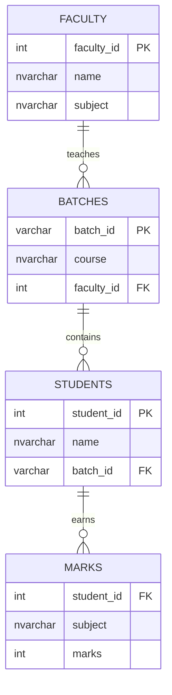
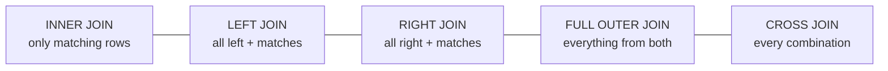

# Session 04 · Retrieve Data from Multiple Tables

> **Module:** Data Handling using T-SQL · **Term 1** · ⏱️ ~2 hours
> **You will learn:** why data is split across tables, table aliases, `INNER`, `LEFT`, `RIGHT`, `FULL OUTER`, `CROSS` and self joins, joining three or more tables, finding "missing" rows, the set operators `UNION`, `UNION ALL`, `INTERSECT` and `EXCEPT`, and subqueries (scalar, `IN`, `EXISTS`, correlated) plus a first look at CTEs (`WITH`).

---

## 1. Why more than one table?

Good database design stores each fact **once**: a teacher's name lives only in `faculty`, a course's timing only in `batches`. Other tables point to it with a **foreign key**. That avoids typos and contradictions — but to answer real questions ("Which teacher does Ayesha have?") we must **join** the tables back together.

> 🧩 **Analogy:** a join is matching the roll number on an answer sheet with the roll number in the attendance register to find the student's name. The **`ON`** clause says which numbers must match.

Campus relationships:



## 2. The join family



| Join | Returns | Unmatched rows | Campus question |
|---|---|---|---|
| `INNER JOIN` | rows that match in both tables | dropped | students **with** a batch |
| `LEFT [OUTER] JOIN` | every left row + matches | right columns = `NULL` | every student, placed or not |
| `RIGHT [OUTER] JOIN` | every right row + matches | left columns = `NULL` | every teacher, with or without a batch |
| `FULL [OUTER] JOIN` | all rows from both | `NULL` on the missing side | complete teacher ↔ batch picture |
| `CROSS JOIN` | every row × every row | — | all teacher × time-slot combinations |
| Self join | a table joined to itself | — | pairs of classmates |

> 🔎 **Finding missing rows:** `LEFT JOIN … WHERE right.key IS NULL` = "rows on the left with **no** partner on the right" (anti-join).

### Set operators (stack results vertically)

| Operator | Result | Duplicates |
|---|---|---|
| `UNION` | rows in either query | removed |
| `UNION ALL` | rows in either query | kept (faster) |
| `INTERSECT` | rows in **both** | removed |
| `EXCEPT` | rows in the first but **not** the second | removed |

Rules: same number of columns, compatible types, column names come from the first query, `ORDER BY` only at the very end.

### Subqueries

| Kind | Example | Returns |
|---|---|---|
| Scalar | `WHERE marks > (SELECT AVG(marks) FROM dbo.marks)` | one value |
| `IN` list | `WHERE batch_id IN (SELECT batch_id FROM dbo.batches WHERE timing = N'Evening')` | a column |
| `EXISTS` | `WHERE NOT EXISTS (SELECT 1 FROM dbo.batches b WHERE b.faculty_id = f.faculty_id)` | true/false |
| Correlated | inner query refers to the outer row (`m2.subject = m.subject`) | re-evaluated per row |
| Derived table / CTE | `FROM (SELECT …) AS t` or `WITH t AS (SELECT …)` | a temporary table |

## 3. Worked examples

### Example 1 — INNER JOIN with aliases
```sql
SELECT s.name, s.batch_id, b.course, b.timing
FROM dbo.students AS s
INNER JOIN dbo.batches AS b ON b.batch_id = s.batch_id
ORDER BY b.course, s.name;            -- Saad (no batch) is not listed
```

### Example 2 — three tables
```sql
SELECT s.name AS student, b.course, f.name AS teacher
FROM dbo.students s
JOIN dbo.batches  b ON b.batch_id   = s.batch_id
JOIN dbo.faculty  f ON f.faculty_id = b.faculty_id
ORDER BY teacher, student;
```

### Example 3 — LEFT JOIN and anti-join
```sql
SELECT s.name, ISNULL(b.course, N'-- not placed --') AS course
FROM dbo.students s
LEFT JOIN dbo.batches b ON b.batch_id = s.batch_id;

SELECT b.batch_id, b.course                    -- batches with no students yet
FROM dbo.batches b
LEFT JOIN dbo.students s ON s.batch_id = b.batch_id
WHERE s.student_id IS NULL;                    -- ML-2701
```

### Example 4 — RIGHT and FULL OUTER JOIN
```sql
SELECT f.name AS teacher, b.batch_id
FROM dbo.batches b RIGHT JOIN dbo.faculty f ON f.faculty_id = b.faculty_id;   -- Nida has no batch

SELECT f.name AS teacher, b.batch_id
FROM dbo.faculty f FULL OUTER JOIN dbo.batches b ON b.faculty_id = f.faculty_id;
-- shows Nida (no batch) AND ML-2701 (no teacher)
```

### Example 5 — self join and CROSS JOIN
```sql
SELECT a.name AS student, b.name AS classmate, a.batch_id
FROM dbo.students a
JOIN dbo.students b ON a.batch_id = b.batch_id AND a.student_id < b.student_id;  -- each pair once

SELECT f.name, t.slot
FROM dbo.faculty f
CROSS JOIN (VALUES (N'Morning'), (N'Evening')) AS t(slot)      -- T-SQL table value constructor
WHERE f.subject IN (N'Python', N'SQL');
```

### Example 6 — set operators
```sql
SELECT name, 'student' AS role FROM dbo.students WHERE city = N'Lahore'
UNION
SELECT name, 'faculty'          FROM dbo.faculty  WHERE subject = N'SQL';

SELECT student_id FROM dbo.marks WHERE subject = N'Python'
INTERSECT
SELECT student_id FROM dbo.marks WHERE subject = N'SQL';     -- took both subjects

SELECT student_id FROM dbo.students
EXCEPT
SELECT student_id FROM dbo.marks;                            -- 110: no marks yet
```

### Example 7 — subqueries
```sql
SELECT student_id, subject, marks FROM dbo.marks
WHERE marks > (SELECT AVG(marks) FROM dbo.marks);                                   -- scalar

SELECT name FROM dbo.students
WHERE batch_id IN (SELECT batch_id FROM dbo.batches WHERE timing = N'Evening');      -- IN

SELECT f.name FROM dbo.faculty f
WHERE NOT EXISTS (SELECT 1 FROM dbo.batches b WHERE b.faculty_id = f.faculty_id);    -- EXISTS

SELECT m.student_id, m.subject, m.marks FROM dbo.marks m                            -- correlated:
WHERE m.marks = (SELECT MAX(m2.marks) FROM dbo.marks m2 WHERE m2.subject = m.subject); -- topper per subject
```
Runnable SQLite versions: [`code/examples.py`](./code/examples.py) · [`notebook.ipynb`](./notebook.ipynb) (SQLite uses `UNION ALL` selects instead of `VALUES … AS t(slot)`).

## 4. Common mistakes

| Mistake | Fix |
|---|---|
| Forgetting the `ON` condition → millions of rows | Every join (except `CROSS`) needs a matching condition |
| `Ambiguous column name 'name'` | Prefix with the alias: `s.name`, `f.name` |
| Using `INNER JOIN` and "losing" students without a batch | Use `LEFT JOIN` when the right side may be missing |
| `LEFT JOIN … WHERE b.timing = 'Evening'` turns into an inner join | Put conditions on the right table in the `ON` clause, or allow `IS NULL` |
| `COUNT(*)` after a `LEFT JOIN` counts 1 for empty groups | Count a right-side column: `COUNT(s.student_id)` |
| Joining on the wrong columns (`s.student_id = b.faculty_id`) | Follow the foreign-key arrows in the ER diagram |
| `NOT IN (subquery)` returns nothing when the subquery has a `NULL` | Use `NOT EXISTS` |
| `UNION` when duplicates are impossible | `UNION ALL` is faster — no duplicate check |

## 5. Real-life coding problem 🧮

**Problem:** The centre manager wants a **student 360 report**: for every student — even those not yet in a batch — show course, teacher, number of subjects attempted, average marks, whether any subject was failed (< 50) and fee balance (fee Rs 45,000). Then rank teachers by how many **at-risk** students they have (failed a subject **or** balance above Rs 15,000).

<details>
<summary>💡 Full solution</summary>

```sql
DECLARE @fee INT = 45000;

-- student 360
SELECT s.student_id, s.name,
       ISNULL(b.course, N'Not placed')               AS course,
       ISNULL(f.name, N'-')                          AS teacher,
       COUNT(m.subject)                              AS subjects,
       ROUND(AVG(m.marks * 1.0), 1)                  AS avg_marks,
       MAX(CASE WHEN m.marks < 50 THEN 1 ELSE 0 END) AS failed_any,
       @fee - s.fee_paid                             AS fee_balance
FROM dbo.students s
LEFT JOIN dbo.batches b ON b.batch_id   = s.batch_id
LEFT JOIN dbo.faculty f ON f.faculty_id = b.faculty_id
LEFT JOIN dbo.marks   m ON m.student_id = s.student_id
GROUP BY s.student_id, s.name, b.course, f.name, s.fee_paid
ORDER BY s.student_id;

-- at-risk students per teacher
WITH report AS (
    SELECT s.student_id, b.faculty_id,
           MAX(CASE WHEN m.marks < 50 THEN 1 ELSE 0 END) AS failed_any,
           @fee - s.fee_paid AS fee_balance
    FROM dbo.students s
    JOIN dbo.batches b    ON b.batch_id   = s.batch_id
    LEFT JOIN dbo.marks m ON m.student_id = s.student_id
    GROUP BY s.student_id, b.faculty_id, s.fee_paid
)
SELECT f.name AS teacher, COUNT(*) AS at_risk
FROM report r JOIN dbo.faculty f ON f.faculty_id = r.faculty_id
WHERE r.failed_any = 1 OR r.fee_balance > 15000
GROUP BY f.name
ORDER BY at_risk DESC, teacher;             -- Kamran Ali 2, Mehwish Raza 1, Sana Iqbal 1
```
SQLite version with checks: [`code/problem_solution.py`](./code/problem_solution.py)
</details>

## 6. Practice exercises

1. List every mark with the student's name and city.
2. Count students per course, **including** courses with no students.
3. Show each teacher's average student marks (faculty → batches → students → marks).
4. Find students who scored above their **own batch's** Python average.

<details>
<summary>✅ Solutions</summary>

```sql
-- 1
SELECT s.name, s.city, m.subject, m.marks
FROM dbo.marks m JOIN dbo.students s ON s.student_id = m.student_id
ORDER BY s.name, m.subject;

-- 2
SELECT b.course, COUNT(s.student_id) AS students
FROM dbo.batches b LEFT JOIN dbo.students s ON s.batch_id = b.batch_id
GROUP BY b.course ORDER BY students DESC;            -- Machine Learning 0

-- 3
SELECT f.name AS teacher, ROUND(AVG(m.marks * 1.0), 1) AS avg_marks
FROM dbo.faculty f
JOIN dbo.batches b  ON b.faculty_id = f.faculty_id
JOIN dbo.students s ON s.batch_id   = b.batch_id
JOIN dbo.marks m    ON m.student_id = s.student_id
GROUP BY f.name ORDER BY avg_marks DESC;             -- Usman Tariq first

-- 4
SELECT s.name, s.batch_id, m.marks
FROM dbo.students s JOIN dbo.marks m ON m.student_id = s.student_id
WHERE m.subject = N'Python'
  AND m.marks > (SELECT AVG(m2.marks * 1.0)
                 FROM dbo.marks m2 JOIN dbo.students s2 ON s2.student_id = m2.student_id
                 WHERE s2.batch_id = s.batch_id AND m2.subject = N'Python');
```
File: [`code/exercises_solutions.py`](./code/exercises_solutions.py)
</details>

## 7. Quiz

1. What is the difference between `INNER JOIN` and `LEFT JOIN`?
2. How do you find batches that have **no** students?
3. What is the difference between `UNION` and `UNION ALL`?
4. What makes a subquery "correlated"?
5. A `CROSS JOIN` of a 5-row and a 3-row table returns how many rows?

<details>
<summary>Answers</summary>

1. `INNER` keeps only matching rows; `LEFT` keeps every left row and fills unmatched right columns with `NULL` · 2. `LEFT JOIN students … WHERE s.student_id IS NULL` (or `NOT EXISTS`) · 3. `UNION` removes duplicates; `UNION ALL` keeps them · 4. It refers to a column of the outer query, so it runs once per outer row · 5. 15.
</details>

## 8. Summary

- Normalised tables are linked by keys; joins reunite them using an `ON` condition.
- `INNER` = matches only; `LEFT`/`RIGHT`/`FULL` keep unmatched rows with `NULL`s; `CROSS` = every combination; a self join pairs rows of one table.
- `LEFT JOIN … IS NULL` or `NOT EXISTS` finds what is missing.
- `UNION`, `UNION ALL`, `INTERSECT`, `EXCEPT` combine result sets vertically.
- Subqueries and CTEs break hard questions into small, readable steps.

---
[⬅ Session 03](../Session-03-conditional-formatting/) · [Module home](../README.md) · [Session 05 ➡](../Session-05-modify-data/)

<sub>Original teaching material by Aseef Ahmed · not official Aptech courseware · CC BY-NC 4.0 (text) / MIT (code)</sub>
