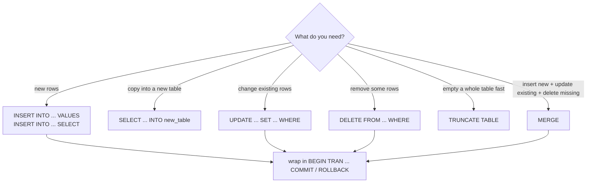

# Session 05 · Modify Data Using T-SQL Statements

> **Module:** Data Handling using T-SQL · **Term 1** · ⏱️ ~2 hours
> **You will learn:** adding rows with `INSERT` (single, multi-row, `INSERT…SELECT`, `SELECT…INTO`), `IDENTITY` columns, changing rows with `UPDATE` (including updates based on another table), removing rows with `DELETE` vs `TRUNCATE`, synchronising data with `MERGE`, seeing what changed with `OUTPUT`, and protecting every change with transactions and `TRY…CATCH`.

---

## 1. Changing data safely

So far we have only **read** data. Real systems also **write**: a new admission, a fee payment, a corrected mark, a student who leaves. These DML statements change data permanently, so the golden rule is: **SELECT first, then modify — inside a transaction.**

> ✏️ **Analogy:** `INSERT` is writing a new line in the register, `UPDATE` is using correction fluid on one line, `DELETE` is tearing a line out, `TRUNCATE` is replacing the whole register with a blank one. A **transaction** is writing in pencil first and only inking it in (`COMMIT`) when everything is correct — or erasing it all (`ROLLBACK`).

## 2. The modification toolkit



| Statement | T-SQL syntax | SQLite equivalent |
|---|---|---|
| insert rows | `INSERT INTO t (c1, c2) VALUES (…), (…)` | same |
| insert from query | `INSERT INTO t (c1) SELECT …` | same |
| new table from query | `SELECT … INTO dbo.new_t FROM …` | `CREATE TABLE new_t AS SELECT …` |
| auto-number | `id INT IDENTITY(1,1)`; read with `SCOPE_IDENTITY()` | `INTEGER PRIMARY KEY AUTOINCREMENT`; `last_insert_rowid()` |
| update | `UPDATE t SET c = … WHERE …` | same |
| update with join | `UPDATE m SET … FROM dbo.marks m JOIN dbo.students s ON …` | `UPDATE … WHERE id IN (SELECT …)` or `UPDATE … FROM` (3.33+) |
| delete | `DELETE FROM t WHERE …` | same |
| empty table | `TRUNCATE TABLE t` | `DELETE FROM t` |
| see changed rows | `OUTPUT inserted.*, deleted.*` | `RETURNING *` |
| upsert / sync | `MERGE target USING source ON … WHEN MATCHED … WHEN NOT MATCHED …` | `INSERT … ON CONFLICT (…) DO UPDATE SET …` |
| rows affected | `@@ROWCOUNT` | `cursor.rowcount` |

### DELETE vs TRUNCATE vs DROP

| | `DELETE` | `TRUNCATE TABLE` | `DROP TABLE` |
|---|---|---|---|
| removes | chosen rows (`WHERE`) | all rows | the whole table + structure |
| speed on big tables | slower (logs each row) | very fast | fast |
| resets `IDENTITY` | no | yes | — |
| fires triggers | yes | no | no |
| blocked by foreign keys | only if rows are referenced | yes, if referenced at all | yes, if referenced |

## 3. Worked examples

### Example 1 — INSERT
```sql
INSERT INTO dbo.students (student_id, name, city, batch_id, joined_on)
VALUES (111, N'Iqra Shah', N'Hyderabad', 'DS-2601', '2026-10-22');           -- fee_paid takes DEFAULT 0

INSERT INTO dbo.students (student_id, name, city, batch_id, joined_on, fee_paid) VALUES
    (112, N'Taha Baig',   N'Karachi', 'AI-2602', '2026-10-23', 15000),
    (113, N'Laiba Aslam', N'Sukkur',  'AI-2602', '2026-10-23', 45000);
```

### Example 2 — INSERT…SELECT and SELECT…INTO
```sql
CREATE TABLE dbo.toppers (student_id INT, subject NVARCHAR(30), marks INT);
INSERT INTO dbo.toppers (student_id, subject, marks)
SELECT student_id, subject, marks FROM dbo.marks WHERE marks >= 85;

SELECT student_id, name INTO dbo.karachi_students        -- creates the table automatically
FROM dbo.students WHERE city = N'Karachi';
```

### Example 3 — UPDATE
```sql
UPDATE dbo.students SET email = 'bilal@example.com' WHERE student_id = 102;

UPDATE dbo.faculty
SET salary = CAST(ROUND(salary * 1.10, 0) AS INT)          -- 10% raise
WHERE hired_on < '2022-01-01';
```

### Example 4 — UPDATE based on another table
```sql
-- 5 grace marks in Python for batch AI-2601, capped at 100
UPDATE m
SET m.marks = IIF(m.marks + 5 > 100, 100, m.marks + 5)
FROM dbo.marks AS m
JOIN dbo.students AS s ON s.student_id = m.student_id
WHERE s.batch_id = 'AI-2601' AND m.subject = N'Python';
```

### Example 5 — DELETE with OUTPUT, and TRUNCATE
```sql
DELETE FROM dbo.toppers
OUTPUT deleted.student_id, deleted.marks                     -- shows what was removed
WHERE marks < 90;

TRUNCATE TABLE dbo.karachi_students;                         -- empty it instantly
```

### Example 6 — MERGE (upsert)
```sql
MERGE dbo.marks AS target
USING (VALUES (101, N'SQL', 84), (106, N'SQL', 70)) AS src (student_id, subject, marks)
   ON target.student_id = src.student_id AND target.subject = src.subject
WHEN MATCHED THEN
    UPDATE SET target.marks = src.marks                      -- 101/SQL updated
WHEN NOT MATCHED BY TARGET THEN
    INSERT (student_id, subject, marks) VALUES (src.student_id, src.subject, src.marks)   -- 106/SQL inserted
OUTPUT $action, inserted.*;
```
SQLite: `INSERT … ON CONFLICT (student_id, subject) DO UPDATE SET marks = excluded.marks`.

### Example 7 — transaction with TRY…CATCH
```sql
BEGIN TRY
    BEGIN TRANSACTION;
        UPDATE dbo.students SET batch_id = 'AI-2601' WHERE student_id = 104;
        INSERT INTO dbo.marks VALUES (104, N'Orientation', 120);   -- violates CHECK (0-100)
    COMMIT TRANSACTION;
END TRY
BEGIN CATCH
    IF @@TRANCOUNT > 0 ROLLBACK TRANSACTION;                  -- the batch change is undone too
    PRINT N'Rolled back: ' + ERROR_MESSAGE();
END CATCH;
```
Runnable SQLite versions: [`code/examples.py`](./code/examples.py) · [`notebook.ipynb`](./notebook.ipynb)

## 4. Common mistakes

| Mistake | Fix |
|---|---|
| `UPDATE students SET fee_paid = 0` with no `WHERE` 😱 | Write `WHERE` first; run it as a `SELECT` to preview the rows |
| `INSERT INTO t VALUES (…)` without column names breaks when a column is added | Always list the columns |
| Inserting a value into an `IDENTITY` column → error | Leave it out (or `SET IDENTITY_INSERT … ON` for migrations only) |
| Deleting a parent row that children reference | Delete/move the children first, or design `ON DELETE` rules |
| `TRUNCATE` when you needed `WHERE` | `TRUNCATE` has no `WHERE` — it empties everything |
| Forgetting `COMMIT` → locks held, changes lost on disconnect | Every `BEGIN TRAN` needs a `COMMIT` or `ROLLBACK` |
| `MERGE` source has duplicate keys → error | De-duplicate the source first |
| Building SQL with string concatenation from user input | Use parameters (`?` in Python, `@p` in T-SQL) to stop SQL injection |

## 5. Real-life coding problem 🧮

**Problem:** Every night the bank sends a file of fee payments `(student_id, amount, paid_on)`. Write the import: reject unknown students and non-positive amounts (and report them), add valid amounts to `students.fee_paid`, keep an audit row in a `fee_payments` table, and run the whole import as **one transaction** — if anything unexpected fails, nothing changes.

<details>
<summary>💡 Full solution</summary>

```sql
CREATE TABLE dbo.fee_payments (
    payment_id  INT IDENTITY(1,1) PRIMARY KEY,
    student_id  INT  NOT NULL REFERENCES dbo.students(student_id),
    amount      INT  NOT NULL CHECK (amount > 0),
    paid_on     DATE NOT NULL
);

-- the bank file loaded into a staging table
CREATE TABLE #bank_file (student_id INT, amount INT, paid_on DATE);
INSERT INTO #bank_file VALUES (102, 15000, '2026-10-26'), (106, 45000, '2026-10-26'),
                              (999, 5000, '2026-10-26'), (104, -100, '2026-10-26'), (109, 15000, '2026-10-27');

-- report rejects
SELECT f.*, CASE WHEN s.student_id IS NULL THEN N'unknown student' ELSE N'bad amount' END AS reason
FROM #bank_file f LEFT JOIN dbo.students s ON s.student_id = f.student_id
WHERE s.student_id IS NULL OR f.amount <= 0;

BEGIN TRY
    BEGIN TRANSACTION;
        INSERT INTO dbo.fee_payments (student_id, amount, paid_on)
        SELECT f.student_id, f.amount, f.paid_on
        FROM #bank_file f JOIN dbo.students s ON s.student_id = f.student_id
        WHERE f.amount > 0;

        UPDATE s SET s.fee_paid = s.fee_paid + p.total
        FROM dbo.students s
        JOIN (SELECT f.student_id, SUM(f.amount) AS total
              FROM #bank_file f JOIN dbo.students s2 ON s2.student_id = f.student_id
              WHERE f.amount > 0 GROUP BY f.student_id) AS p
          ON p.student_id = s.student_id;
    COMMIT TRANSACTION;
END TRY
BEGIN CATCH
    IF @@TRANCOUNT > 0 ROLLBACK TRANSACTION;
    THROW;                                    -- re-raise so the job is marked failed
END CATCH;
```
3 payments applied (Rs 75,000), 2 rejected. The Python/SQLite version also proves that a failure half-way leaves every balance unchanged: [`code/problem_solution.py`](./code/problem_solution.py)
</details>

## 6. Practice exercises

1. Add a new teacher (id 6, Rabia Anwar, ML) and assign her to batch `ML-2701` with a Morning timing.
2. Place student 110 in batch `AI-2602` and record a payment of Rs 20,000 in the same `UPDATE`.
3. Delete marks for any subject that no faculty member teaches, and report how many rows went.
4. Inside a transaction, set `email = 'pending@campus.pk'` for unpaid students with no email, check the row count, then roll back.

<details>
<summary>✅ Solutions</summary>

```sql
-- 1
INSERT INTO dbo.faculty (faculty_id, name, subject, salary, hired_on)
VALUES (6, N'Rabia Anwar', N'ML', 190000, '2026-10-01');
UPDATE dbo.batches SET faculty_id = 6, timing = N'Morning' WHERE batch_id = 'ML-2701';

-- 2
UPDATE dbo.students SET batch_id = 'AI-2602', fee_paid = fee_paid + 20000 WHERE student_id = 110;

-- 3
DELETE FROM dbo.marks WHERE subject NOT IN (SELECT subject FROM dbo.faculty);
SELECT @@ROWCOUNT AS deleted_rows;                -- 0 with the sample data

-- 4
BEGIN TRANSACTION;
    UPDATE dbo.students SET email = 'pending@campus.pk' WHERE fee_paid = 0 AND email IS NULL;
    SELECT @@ROWCOUNT AS would_change;
ROLLBACK TRANSACTION;
```
File: [`code/exercises_solutions.py`](./code/exercises_solutions.py)
</details>

## 7. Quiz

1. What happens if you run `UPDATE` or `DELETE` without a `WHERE` clause?
2. Give two differences between `DELETE` and `TRUNCATE`.
3. What does `SELECT … INTO` do?
4. What three actions can a single `MERGE` perform?
5. Why wrap related changes in a transaction?

<details>
<summary>Answers</summary>

1. Every row in the table is changed / removed · 2. `TRUNCATE` removes all rows (no `WHERE`), is much faster, resets `IDENTITY` and doesn't fire triggers · 3. Creates a new table and fills it with the query result · 4. Update matched rows, insert unmatched source rows, delete target rows missing from the source · 5. So they succeed or fail **together** — no half-finished changes.
</details>

## 8. Summary

- `INSERT` adds rows (list the columns!), `INSERT…SELECT` copies from a query, `SELECT…INTO` creates a table.
- `UPDATE … SET … WHERE` changes rows; T-SQL can update through a `JOIN`.
- `DELETE` removes chosen rows; `TRUNCATE` empties a table quickly; `DROP` removes the table itself.
- `MERGE` synchronises a target with a source; `OUTPUT` shows exactly what changed.
- Preview with `SELECT`, then modify inside `BEGIN TRAN … COMMIT`, with `TRY…CATCH` to roll back on errors.

---
[⬅ Session 04](../Session-04-retrieve-data-from-multiple-tables/) · [Module home](../README.md) · [Session 06 ➡](../Session-06-built-in-functions/)

<sub>Original teaching material by Aseef Ahmed · not official Aptech courseware · CC BY-NC 4.0 (text) / MIT (code)</sub>
