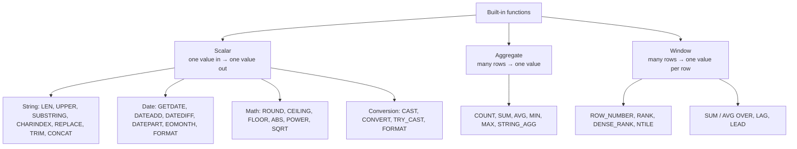

# Session 06 · Working with Built-in Functions

> **Module:** Data Handling using T-SQL · **Term 1** · ⏱️ ~2 hours
> **You will learn:** the main families of SQL Server built-in functions — string, date & time, mathematical, conversion, aggregate (including `STRING_AGG`) and system functions — and the ranking and aggregate **window functions** (`ROW_NUMBER`, `RANK`, `DENSE_RANK`, `NTILE`, `SUM() OVER`, `LAG`) used in real reports.

---

## 1. Why built-in functions?

Raw columns rarely look the way a report needs: names in mixed case, dates as `2026-01-05`, salaries without separators, no ranks. **Built-in functions** transform values right inside the query, so every app gets consistent, ready-to-use results — and the database does the heavy lifting close to the data.

> 🧰 **Analogy:** built-in functions are the tools in a mechanic's toolbox. You don't build a spanner every time you need to tighten a bolt — you pick the right ready-made tool: `UPPER` to fix case, `DATEDIFF` to count days, `ROUND` to tidy money, `RANK` to find position holders.

## 2. Function families



### String functions

| T-SQL | Result for `N'Ayesha Khan'` | SQLite |
|---|---|---|
| `LEN(name)` | 11 | `LENGTH(name)` |
| `UPPER(name)`, `LOWER(name)` | `AYESHA KHAN` | same |
| `LEFT(name, 3)`, `RIGHT(name, 4)` | `Aye`, `Khan` | `SUBSTR(name, 1, 3)`, `SUBSTR(name, -4)` |
| `SUBSTRING(name, 8, 4)` | `Khan` | `SUBSTR(name, 8, 4)` |
| `CHARINDEX(' ', name)` | 7 | `INSTR(name, ' ')` |
| `REPLACE(email, '@example.com', '@campus.pk')` | swaps text | same |
| `LTRIM`, `RTRIM`, `TRIM(x)` | removes spaces | same |
| `CONCAT(a, ' ', b)` / `CONCAT_WS(', ', a, b)` | joins text, treats NULL as '' | `a || ' ' || b` |
| `REPLICATE('*', 3)`, `REVERSE(x)` | `***`, reversed | — |

### Date & time functions

| T-SQL | Meaning | SQLite |
|---|---|---|
| `GETDATE()`, `SYSDATETIME()` | now | `datetime('now')` |
| `CAST(GETDATE() AS DATE)` | today | `date('now')` |
| `DATEADD(MONTH, 6, joined_on)` | add 6 months | `date(joined_on, '+6 months')` |
| `DATEDIFF(DAY, joined_on, GETDATE())` | days between | `julianday(b) - julianday(a)` |
| `YEAR(d)`, `MONTH(d)`, `DAY(d)`, `DATEPART(WEEKDAY, d)` | parts | `strftime('%Y', d)` … |
| `DATENAME(MONTH, d)` | `January` | — |
| `EOMONTH(d)` | last day of month | `date(d, 'start of month', '+1 month', '-1 day')` |
| `FORMAT(d, 'dd-MMM-yyyy')` | `05-Jan-2026` | `strftime('%d-%m-%Y', d)` |

### Mathematical functions

| T-SQL | Example | Result |
|---|---|---|
| `ROUND(x, n)` | `ROUND(15416.666, 2)` | 15416.670 |
| `CEILING(x)`, `FLOOR(x)` | `CEILING(4.1)`, `FLOOR(4.9)` | 5, 4 |
| `ABS(x)` | `ABS(-30000)` | 30000 |
| `POWER(x, y)`, `SQRT(x)`, `SQUARE(x)` | `POWER(2, 10)` | 1024 |
| `x % y` | `17 % 5` | 2 |
| `RAND()` | random 0–1 | — |

### Window functions — `function() OVER (PARTITION BY … ORDER BY …)`

| Function | Ties 90, 90, 85 get | Use |
|---|---|---|
| `ROW_NUMBER()` | 1, 2, 3 | unique numbering, "top 1 per group" |
| `RANK()` | 1, 1, 3 | position holders with gaps |
| `DENSE_RANK()` | 1, 1, 2 | positions without gaps |
| `NTILE(4)` | split into 4 equal bands | quartiles / bands |
| `SUM(x) OVER (ORDER BY d)` | running total | cumulative fees |
| `AVG(x) OVER (PARTITION BY g)` | group average on every row | compare to batch average |
| `LAG(x)`, `LEAD(x)` | previous / next row's value | month-on-month change |

> 💡 Unlike `GROUP BY`, window functions **keep every row** and add a calculated column next to it.

## 3. Worked examples

### Example 1 — string functions
```sql
SELECT TOP (5) name,
       UPPER(name)                                         AS upper_name,
       LEN(name)                                           AS len,
       LEFT(name, CHARINDEX(' ', name) - 1)                AS first_name,
       SUBSTRING(name, CHARINDEX(' ', name) + 1, 50)       AS last_name,
       REPLACE(ISNULL(email, ''), '@example.com', '@campus.pk') AS new_email,
       TRIM(N'  ' + city + N'  ')                          AS city_trimmed
FROM dbo.students;
```

### Example 2 — date functions
```sql
DECLARE @today DATE = '2026-10-27';                     -- or CAST(GETDATE() AS DATE)
SELECT name, joined_on,
       DATEDIFF(DAY, joined_on, @today)    AS days_enrolled,
       YEAR(joined_on)                     AS join_year,
       DATENAME(MONTH, joined_on)          AS join_month,
       DATEADD(MONTH, 6, joined_on)        AS review_date,
       EOMONTH(joined_on)                  AS month_end
FROM dbo.students
ORDER BY joined_on;
```

### Example 3 — math functions
```sql
SELECT name, salary,
       ROUND(salary / 12.0, 2)     AS monthly,
       ROUND(salary * 0.075, 0)    AS tax_estimate,
       FLOOR(salary / 1000.0)      AS thousands_floor,
       ABS(salary - 180000)        AS distance_from_180k
FROM dbo.faculty;

SELECT ROUND(AVG(marks * 1.0), 2) AS mean, MAX(marks) - MIN(marks) AS range_, STDEVP(marks) AS std_dev
FROM dbo.marks;
```

### Example 4 — aggregates + conversion + STRING_AGG
```sql
SELECT b.course,
       COUNT(s.student_id)                            AS students,
       SUM(s.fee_paid)                                AS collected,
       N'Rs ' + FORMAT(SUM(s.fee_paid), 'N0')         AS collected_text,
       STRING_AGG(s.name, N', ')                      AS names
FROM dbo.batches b LEFT JOIN dbo.students s ON s.batch_id = b.batch_id
GROUP BY b.course;
```

### Example 5 — ranking functions
```sql
SELECT subject, student_id, marks,
       ROW_NUMBER() OVER (PARTITION BY subject ORDER BY marks DESC) AS row_no,
       RANK()       OVER (PARTITION BY subject ORDER BY marks DESC) AS rnk,
       DENSE_RANK() OVER (ORDER BY marks DESC)                      AS overall_dense,
       NTILE(4)     OVER (ORDER BY marks DESC)                      AS quartile
FROM dbo.marks
ORDER BY subject, row_no;
```

### Example 6 — running totals, share of total, previous row
```sql
SELECT name, joined_on, fee_paid,
       SUM(fee_paid) OVER (ORDER BY joined_on ROWS UNBOUNDED PRECEDING) AS running_total,
       ROUND(100.0 * fee_paid / SUM(fee_paid) OVER (), 1)               AS pct_of_all,
       fee_paid - AVG(fee_paid) OVER (PARTITION BY batch_id)            AS vs_batch_avg,
       LAG(name) OVER (ORDER BY joined_on)                              AS joined_after
FROM dbo.students
ORDER BY joined_on;
```
Runnable SQLite versions: [`code/examples.py`](./code/examples.py) · [`notebook.ipynb`](./notebook.ipynb)

## 4. Common mistakes

| Mistake | Fix |
|---|---|
| `LEN(N'Ali  ')` returns 3, not 5 | `LEN` ignores trailing spaces; `DATALENGTH` counts bytes |
| `DATEDIFF(YEAR, '2025-12-31', '2026-01-01')` = 1 | `DATEDIFF` counts **boundaries crossed**; for exact age use days / 365.25 |
| `SUBSTRING(name, 0, 3)` returns only 2 characters | T-SQL strings start at position **1** |
| `CHARINDEX(' ', name) - 1` fails for one-word names | Guard with `IIF(CHARINDEX(' ', name) = 0, name, …)` |
| `AVG(marks)` on an `INT` column drops decimals | `AVG(marks * 1.0)` or `AVG(CAST(marks AS DECIMAL(5,2)))` |
| Using a window function in `WHERE` | Not allowed — compute it in a CTE/subquery, then filter (`WHERE rn = 1`) |
| `RANK()` when you need exactly one row per group | Ties share a rank — use `ROW_NUMBER()` |
| Wrapping an indexed column in a function in `WHERE` (`YEAR(joined_on) = 2026`) | Slower — prefer a range: `joined_on >= '2026-01-01' AND joined_on < '2027-01-01'` |

## 5. Real-life coding problem 🧮

**Problem:** Build the **monthly batch performance report** an academic manager sends: for every student with marks, show batch, display name as `KHAN, Ayesha`, average marks, rank inside the batch, gap to the batch topper, a band (top / middle / bottom third across the centre) and days since joining. Add a summary per batch: students, batch average, best mark and the names of anyone who needs support (any mark below 50).

<details>
<summary>💡 Full solution</summary>

```sql
DECLARE @today DATE = '2026-10-27';

WITH avg_marks AS (
    SELECT s.student_id, s.name, s.batch_id, s.joined_on, ROUND(AVG(m.marks * 1.0), 1) AS avg_marks
    FROM dbo.students s JOIN dbo.marks m ON m.student_id = s.student_id
    WHERE s.batch_id IS NOT NULL
    GROUP BY s.student_id, s.name, s.batch_id, s.joined_on
)
SELECT batch_id,
       UPPER(SUBSTRING(name, CHARINDEX(' ', name) + 1, 50)) + N', ' + LEFT(name, CHARINDEX(' ', name) - 1) AS display_name,
       avg_marks,
       RANK() OVER (PARTITION BY batch_id ORDER BY avg_marks DESC)          AS batch_rank,
       MAX(avg_marks) OVER (PARTITION BY batch_id) - avg_marks              AS gap_to_top,
       CHOOSE(NTILE(3) OVER (ORDER BY avg_marks DESC),
              N'Top third', N'Middle third', N'Bottom third')               AS band,
       DATEDIFF(DAY, joined_on, @today)                                     AS days_enrolled
FROM avg_marks
ORDER BY batch_id, batch_rank;

SELECT s.batch_id,
       COUNT(DISTINCT s.student_id)    AS students,
       ROUND(AVG(m.marks * 1.0), 1)    AS batch_avg,
       MAX(m.marks)                    AS best_mark,
       STRING_AGG(CASE WHEN m.marks < 50 THEN s.name END, N', ') AS needs_support   -- NULLs are skipped
FROM dbo.students s JOIN dbo.marks m ON m.student_id = s.student_id
GROUP BY s.batch_id
ORDER BY batch_avg DESC;
```
Result: AI-2602 leads (85.5); Ali Raza (AI-2601) and Omar Farooq (DS-2601) need support. SQLite version with checks: [`code/problem_solution.py`](./code/problem_solution.py)
</details>

## 6. Practice exercises

1. Show each student's initials (e.g. `AK`) and name length, longest name first.
2. Show each teacher's completed years of service as of 27 Oct 2026.
3. Count how many students joined in each month, labelled `YYYY-MM`.
4. Return the single top scorer in every subject using `ROW_NUMBER()`.

<details>
<summary>✅ Solutions</summary>

```sql
-- 1
SELECT name, LEFT(name, 1) + SUBSTRING(name, CHARINDEX(' ', name) + 1, 1) AS initials, LEN(name) AS len
FROM dbo.students ORDER BY len DESC, name;

-- 2
SELECT name, FLOOR(DATEDIFF(DAY, hired_on, '2026-10-27') / 365.25) AS years
FROM dbo.faculty ORDER BY years DESC;                      -- Usman Tariq 7

-- 3
SELECT FORMAT(joined_on, 'yyyy-MM') AS month, COUNT(*) AS joined
FROM dbo.students GROUP BY FORMAT(joined_on, 'yyyy-MM') ORDER BY month;

-- 4
WITH ranked AS (
    SELECT subject, student_id, marks,
           ROW_NUMBER() OVER (PARTITION BY subject ORDER BY marks DESC) AS rn
    FROM dbo.marks
)
SELECT subject, student_id, marks FROM ranked WHERE rn = 1 ORDER BY subject;
```
File: [`code/exercises_solutions.py`](./code/exercises_solutions.py)
</details>

## 7. Quiz

1. Which function finds the position of a space inside a name in T-SQL?
2. How do you get the date 6 months after `joined_on`?
3. For marks 90, 90, 85, what do `RANK()` and `DENSE_RANK()` return?
4. What is the main difference between `GROUP BY` aggregates and window aggregates?
5. Which function joins many names into one comma-separated string?

<details>
<summary>Answers</summary>

1. `CHARINDEX(' ', name)` · 2. `DATEADD(MONTH, 6, joined_on)` · 3. `RANK`: 1, 1, 3 · `DENSE_RANK`: 1, 1, 2 · 4. `GROUP BY` collapses rows into one per group; window functions keep every row and add the calculated value · 5. `STRING_AGG(name, ', ')`.
</details>

## 8. Summary

- **Scalar** functions transform one value: string (`LEN`, `SUBSTRING`, `CHARINDEX`, `REPLACE`), date (`DATEADD`, `DATEDIFF`, `EOMONTH`), math (`ROUND`, `CEILING`, `ABS`) and conversion (`CAST`, `CONVERT`, `FORMAT`).
- **Aggregate** functions summarise groups; `STRING_AGG` builds lists.
- **Window** functions (`ROW_NUMBER`, `RANK`, `NTILE`, `SUM() OVER`, `LAG`) rank and compare rows without losing detail — the backbone of real reports.
- 🎓 This completes Module 02 — you can now design tables, query, combine, modify and report on relational data with T-SQL.

---
[⬅ Session 05](../Session-05-modify-data/) · [Module home](../README.md)

<sub>Original teaching material by Aseef Ahmed · not official Aptech courseware · CC BY-NC 4.0 (text) / MIT (code)</sub>
