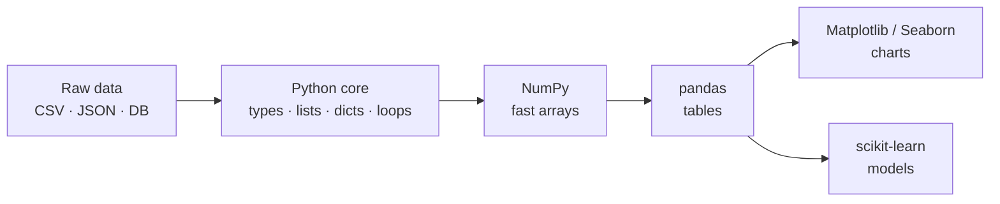

# Session 01 · Basics of Python

> **Module:** Data Science with Python · **Term 1** · ⏱️ ~2 hours
> **You will learn:** the Python features a data scientist uses every day — core data types, lists/dicts/sets, comprehensions, functions with lambdas, and standard-library helpers (`statistics`, `collections`) — as a fast refresher before NumPy and pandas.

---

## 1. Python as a data-science language

Python is popular for data science because the language is small and readable, and the heavy lifting is done by libraries (NumPy, pandas, Matplotlib, scikit-learn) built on a few core ideas. If you are solid on **types, collections, loops and functions**, every library later in this module will feel familiar.

> 📒 **Analogy:** Think of a *kiryana* store. Python's built-in types are the shelves and boxes; the libraries are the wholesale supplier who delivers stock in bulk. You still need to know how the shelves work before the truck arrives.



## 2. Core types and collections — cheat-sheet

| Type | Example | Mutable? | Typical data-science use |
|---|---|---|---|
| `int`, `float` | `42`, `3.14` | — | counts, measurements |
| `str` | `"Karachi"` | no | labels, categories, text |
| `bool` | `True` | — | filters / masks |
| `list` | `[72, 85, 91]` | yes | an ordered column of values |
| `tuple` | `(24.86, 67.01)` | no | a fixed record, e.g. lat/long |
| `dict` | `{"name": "Ali", "marks": 72}` | yes | one row / record (JSON-like) |
| `set` | `{"Lahore", "Karachi"}` | yes | unique values, membership tests |

| Comprehension | Builds | Example |
|---|---|---|
| list | list | `[m * 1.1 for m in marks]` |
| filtered | list | `[m for m in marks if m >= 50]` |
| dict | dict | `{c: len(c) for c in cities}` |
| set | set | `{r["city"] for r in rows}` |

| Standard-library helper | What it gives you |
|---|---|
| `statistics.mean / median / stdev` | quick summary numbers without NumPy |
| `collections.Counter` | frequency counts (`most_common`) |
| `collections.defaultdict(list)` | grouping rows by a key |
| `csv.DictReader` | rows of a CSV as dicts |
| `sorted(rows, key=lambda r: r["marks"])` | sort records by any field |

## 3. Worked examples

Full runnable code: [`code/examples.py`](./code/examples.py) · notebook: [`notebook.ipynb`](./notebook.ipynb)

### Example 1 — records as a list of dicts
```python
students = [
    {"name": "Ali", "city": "Karachi", "marks": 72},
    {"name": "Sana", "city": "Lahore", "marks": 91},
    {"name": "Hamza", "city": "Karachi", "marks": 48},
]
for s in students:
    print(f"{s['name']:<6} {s['city']:<8} {s['marks']}")
```

### Example 2 — comprehensions instead of loops
```python
marks = [s["marks"] for s in students]
passed = [s["name"] for s in students if s["marks"] >= 50]
curved = [min(100, round(m * 1.05)) for m in marks]
```

### Example 3 — quick statistics with the standard library
```python
import statistics as st
print(st.mean(marks), st.median(marks), round(st.stdev(marks), 2))
```

### Example 4 — counting and grouping
```python
from collections import Counter, defaultdict
print(Counter(s["city"] for s in students).most_common())
by_city = defaultdict(list)
for s in students:
    by_city[s["city"]].append(s["marks"])
print({c: sum(v) / len(v) for c, v in by_city.items()})
```

### Example 5 — sorting with `lambda` and `key`
```python
top = sorted(students, key=lambda s: s["marks"], reverse=True)
print([s["name"] for s in top])
```

### Example 6 — a reusable cleaning function
```python
def to_float(value, default=None):
    """Turn messy text like ' 72 ', '72.5' or 'absent' into a float or default."""
    try:
        return float(str(value).strip())
    except ValueError:
        return default
```

## 4. Common mistakes

| Mistake | Fix |
|---|---|
| Changing a list while looping over it | Build a new list with a comprehension |
| `marks = marks.sort()` gives `None` | `marks.sort()` sorts in place; use `sorted(marks)` for a copy |
| Using a list for membership checks on big data | Convert to a `set` — `x in set` is much faster |
| Mixing `"72"` (str) and `72` (int) in a column | Convert types once, right after loading |
| `stdev` on one value raises an error | Needs at least two values; check `len()` first |

## 5. Real-life coding problem 🧮

**Problem:** A tuition centre in Gulshan keeps attendance as raw text lines like `"2026-10-05,Ali,present"`. Some lines have extra spaces, mixed case or are blank. Write `attendance_summary(lines)` that returns, for each student, days present, days total and attendance %, plus the list of students below 75%.

<details>
<summary>💡 Full solution</summary>

```python
from collections import defaultdict

def attendance_summary(lines, threshold=75):
    present, total = defaultdict(int), defaultdict(int)
    for line in lines:
        parts = [p.strip() for p in line.split(",")]
        if len(parts) != 3 or not parts[1]:
            continue                       # skip blank / broken lines
        _, name, status = parts
        name = name.title()
        total[name] += 1
        present[name] += status.lower() == "present"
    report = {n: (present[n], total[n], round(100 * present[n] / total[n], 1)) for n in total}
    low = sorted(n for n, (_, _, pct) in report.items() if pct < threshold)
    return report, low
```
Full file with sample data and checks: [`code/problem_solution.py`](./code/problem_solution.py)
</details>

## 6. Practice exercises

1. Given `temps = [31, 34, 29, 36, 38, 33, 30]` (a Karachi week), list the days (1-based) hotter than the weekly mean.
2. Turn `"apple,banana,apple,mango,banana,apple"` into a frequency dict sorted by count.
3. Write `normalise(values)` that rescales a list to the range 0–1 (min-max scaling).
4. From a list of `(name, city)` tuples, build a dict `city -> sorted list of names`.

<details>
<summary>✅ Solutions</summary>

```python
temps = [31, 34, 29, 36, 38, 33, 30]
avg = sum(temps) / len(temps)
hot_days = [i for i, t in enumerate(temps, 1) if t > avg]

from collections import Counter
freq = dict(Counter("apple,banana,apple,mango,banana,apple".split(",")).most_common())

def normalise(values):
    lo, hi = min(values), max(values)
    return [0.0 for _ in values] if hi == lo else [(v - lo) / (hi - lo) for v in values]

def group_names(pairs):
    out = {}
    for name, city in pairs:
        out.setdefault(city, []).append(name)
    return {c: sorted(n) for c, n in out.items()}
```
File: [`code/exercises_solutions.py`](./code/exercises_solutions.py)
</details>

## 7. Quiz

1. Which built-in type is best for fast "is this value present?" checks?
2. What does `[x for x in data if x > 0]` return?
3. What is the difference between `list.sort()` and `sorted(list)`?
4. Which `collections` class counts frequencies?
5. Why is a list of dicts a natural way to hold table rows?

<details>
<summary>Answers</summary>

1. `set` · 2. A new list with only the positive values · 3. `sort()` changes the list in place and returns `None`; `sorted()` returns a new sorted list · 4. `Counter` · 5. Each dict is one row with named fields, exactly like a JSON record — and pandas turns a list of dicts straight into a DataFrame.
</details>

## 8. Summary

- Data science in Python is built on core types: numbers, strings, lists, dicts, sets and tuples.
- Comprehensions, `sorted(key=...)`, `Counter` and `defaultdict` replace most hand-written loops.
- Convert and clean types early with small, tested functions.
- These ideas carry straight into NumPy arrays and pandas DataFrames next.

---
[Module home](../README.md) · [Session 02 ➡](../Session-02-numpy-library/)

<sub>Original teaching material by Aseef Ahmed · not official Aptech courseware · CC BY-NC 4.0 (text) / MIT (code)</sub>
