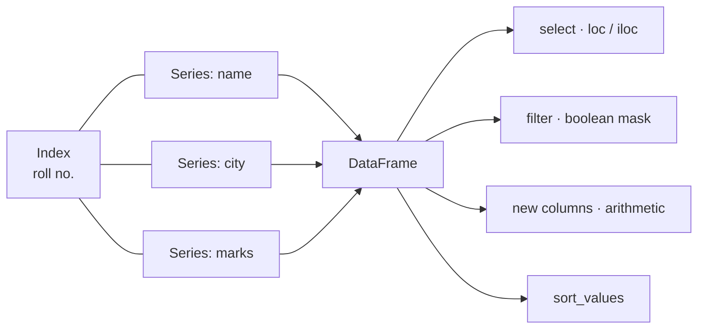

# Session 03 · Operations with Pandas Series and DataFrames

> **Module:** Data Science with Python · **Term 1** · ⏱️ ~2 hours
> **You will learn:** pandas `Series` and `DataFrame`, creating them, inspecting data (`head`, `info`, `describe`), selecting with `loc`/`iloc`, filtering, adding and dropping columns, sorting, and simple arithmetic between columns.

---

## 1. Series and DataFrames

**pandas** gives Python a spreadsheet-like table. A **Series** is one labelled column (values + an index). A **DataFrame** is a set of Series that share the same index — rows and named columns.

> 📒 **Analogy:** A Series is one column in your school's result register (just "Maths marks", with roll numbers down the side). A DataFrame is the whole register: every subject side-by-side, still lined up by roll number.



## 2. Reference tables

| Create | Code |
|---|---|
| Series from list | `pd.Series([72, 85], index=["Ali", "Sana"])` |
| DataFrame from dict of lists | `pd.DataFrame({"name": [...], "marks": [...]})` |
| DataFrame from list of dicts | `pd.DataFrame(rows)` |
| From CSV | `pd.read_csv("file.csv")` |

| Inspect | Tells you |
|---|---|
| `df.head(n)` / `df.tail(n)` | first / last rows |
| `df.shape`, `df.columns`, `df.dtypes` | size, column names, types |
| `df.info()` | types + non-null counts |
| `df.describe()` | count, mean, std, min, quartiles, max |
| `df["city"].value_counts()` | frequency of each value |

| Select | Meaning |
|---|---|
| `df["marks"]` | one column → Series |
| `df[["name", "marks"]]` | several columns → DataFrame |
| `df.loc[row_label, col_label]` | by **labels** (end is inclusive) |
| `df.iloc[0:3, 1]` | by **positions** (end is exclusive) |
| `df[df["marks"] > 70]` | filter rows |
| `df.query("marks > 70 and city == 'Karachi'")` | filter with a text expression |

| Change | Code |
|---|---|
| new column | `df["pct"] = df["marks"] / 100` |
| rename | `df.rename(columns={"marks": "score"})` |
| drop | `df.drop(columns=["pct"])` |
| sort | `df.sort_values("marks", ascending=False)` |
| apply a function | `df["marks"].apply(grade)` |

## 3. Worked examples

Full runnable code: [`code/examples.py`](./code/examples.py) · notebook: [`notebook.ipynb`](./notebook.ipynb)

### Example 1 — a Series with labels
```python
import pandas as pd
sales = pd.Series([1200, 950, 1430], index=["Mon", "Tue", "Wed"], name="biryani_plates")
print(sales["Tue"], sales.mean(), sales.idxmax())
```

### Example 2 — build and inspect a DataFrame
```python
df = pd.DataFrame({
    "name": ["Ali", "Sana", "Hamza", "Ayesha", "Bilal"],
    "city": ["Karachi", "Lahore", "Karachi", "Islamabad", "Lahore"],
    "maths": [72, 91, 48, 66, 80],
    "english": [65, 88, 55, 79, 70],
})
print(df.shape); print(df.describe())
```

### Example 3 — `loc` vs `iloc`
```python
df = df.set_index("name")
print(df.loc["Sana", "maths"])         # by label
print(df.iloc[0:2, 1:3])               # by position
```

### Example 4 — filtering
```python
print(df[df["maths"] >= 70])
print(df[(df["city"] == "Lahore") & (df["english"] > 75)])
print(df.query("maths < 60 or english < 60"))
```

### Example 5 — new columns and sorting
```python
df["total"] = df["maths"] + df["english"]
df["grade"] = df["total"].apply(lambda t: "A" if t >= 160 else "B" if t >= 130 else "C")
print(df.sort_values("total", ascending=False))
```

### Example 6 — column arithmetic and value counts
```python
print((df["maths"] - df["english"]).abs().mean())
print(df["city"].value_counts())
```

## 4. Common mistakes

| Mistake | Fix |
|---|---|
| `df[df.marks > 50 and df.city == "X"]` | Use `&` / `|` and brackets around each condition |
| `SettingWithCopyWarning` after filtering | Take `.copy()` of the filtered frame before changing it |
| Expecting `loc[0:2]` to exclude row 2 | `loc` slices are **inclusive**; `iloc` slices are exclusive |
| `df.sort_values("x")` "did nothing" | It returns a new frame — assign it back |
| Using `df.col` when the name has spaces | Use `df["col name"]` |

## 5. Real-life coding problem 🧮

**Problem:** A small Saddar mobile shop logs each sale with `item`, `brand`, `qty` and `unit_price`. Build a DataFrame from the list of sales, add a `revenue` column, list the three highest-revenue sales, show total quantity sold per brand, and flag sales where `unit_price` is more than 20% above that item's average price (possible overcharging).

<details>
<summary>💡 Full solution</summary>

```python
import pandas as pd

def shop_report(sales):
    df = pd.DataFrame(sales)
    df["revenue"] = df["qty"] * df["unit_price"]
    top3 = df.nlargest(3, "revenue")
    per_brand = df.groupby("brand")["qty"].sum().sort_values(ascending=False)
    avg_price = df.groupby("item")["unit_price"].transform("mean")
    df["overcharged"] = df["unit_price"] > 1.2 * avg_price
    return df, top3, per_brand
```
Full file with data and checks: [`code/problem_solution.py`](./code/problem_solution.py)
</details>

## 6. Practice exercises

1. Make a Series of 7 daily temperatures indexed by weekday and print days above 35.
2. From a DataFrame of products (`name`, `price`, `stock`), add `value = price * stock` and show the most valuable product.
3. Select every second row and only the first two columns using `iloc`.
4. Rename columns to lowercase with underscores (e.g. `"Unit Price"` → `"unit_price"`).

<details>
<summary>✅ Solutions</summary>

```python
import pandas as pd
t = pd.Series([33, 36, 38, 34, 31, 37, 35], index=["Mon","Tue","Wed","Thu","Fri","Sat","Sun"])
hot = t[t > 35]

p = pd.DataFrame({"name": ["pen", "copy", "bag"], "price": [30, 120, 1500], "stock": [200, 80, 10]})
p["value"] = p["price"] * p["stock"]
best = p.loc[p["value"].idxmax(), "name"]

subset = p.iloc[::2, :2]

def tidy_columns(df):
    return df.rename(columns=lambda c: c.strip().lower().replace(" ", "_"))
```
File: [`code/exercises_solutions.py`](./code/exercises_solutions.py)
</details>

## 7. Quiz

1. What is the difference between a Series and a DataFrame?
2. Which selector uses labels and which uses integer positions?
3. What does `df.describe()` show for numeric columns?
4. How do you keep rows where `city` is Karachi **and** marks > 70?
5. What does `value_counts()` return?

<details>
<summary>Answers</summary>

1. A Series is one labelled column; a DataFrame is a table of Series sharing one index · 2. `loc` = labels, `iloc` = positions · 3. count, mean, std, min, 25%, 50%, 75%, max · 4. `df[(df["city"] == "Karachi") & (df["marks"] > 70)]` · 5. A Series of counts for each unique value, sorted from most to least frequent.
</details>

## 8. Summary

- Series = labelled 1-D data; DataFrame = labelled table.
- Inspect first: `shape`, `info()`, `describe()`, `value_counts()`.
- Select with `[]`, `loc` (labels) and `iloc` (positions); filter with boolean masks or `query`.
- Add columns with vectorised arithmetic or `apply`, and remember most methods return new frames.

---
[⬅ Session 02](../Session-02-numpy-library/) · [Module home](../README.md) · [Session 04 ➡](../Session-04-advanced-pandas/)

<sub>Original teaching material by Aseef Ahmed · not official Aptech courseware · CC BY-NC 4.0 (text) / MIT (code)</sub>
