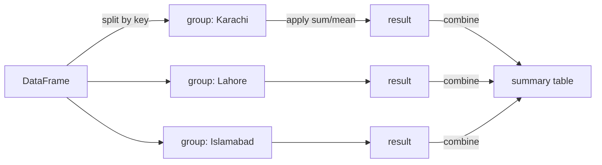

# Session 04 · Advanced Pandas Techniques and Operations

> **Module:** Data Science with Python · **Term 1** · ⏱️ ~2 hours
> **You will learn:** `groupby` with `agg` and `transform`, pivot tables and `crosstab`, combining tables with `merge` and `concat`, reshaping with `melt`/`pivot`, working with dates (`to_datetime`, `.dt`, `resample`) and rolling windows.

---

## 1. From rows to answers

Last session you selected and filtered rows. Real questions are usually *"per something"*: revenue **per branch**, average marks **per batch**, sales **per month**. pandas answers these with the **split → apply → combine** pattern.

> 📒 **Analogy:** At a wedding, the caterer *splits* guests by table, *applies* a count to each table, and *combines* the counts into one list for the kitchen. That is exactly `df.groupby("table")["guest"].count()`.



## 2. Reference tables

| Grouping tool | Returns | Use when |
|---|---|---|
| `df.groupby("k")["v"].sum()` | one row per group | simple total per group |
| `.agg(total=("v", "sum"), avg=("v", "mean"))` | named summary columns | several stats at once |
| `.transform("mean")` | same length as `df` | compare each row to its group |
| `.filter(lambda g: len(g) > 2)` | rows of qualifying groups | drop small groups |
| `pd.pivot_table(df, index, columns, values, aggfunc)` | 2-D summary | spreadsheet-style pivot |
| `pd.crosstab(df.a, df.b)` | counts of combinations | category vs category |

| Combine | Like SQL | Key options |
|---|---|---|
| `pd.merge(a, b, on="id", how="left")` | `JOIN` | `how`: inner, left, right, outer; `indicator=True` |
| `pd.concat([a, b])` | `UNION ALL` | `axis=0` stack rows, `axis=1` side by side |
| `df.melt(id_vars, value_vars)` | unpivot | wide → long |
| `df.pivot(index, columns, values)` | pivot | long → wide |

| Dates | Example |
|---|---|
| parse | `pd.to_datetime(df["date"])` |
| parts | `df["date"].dt.month`, `.dt.day_name()` |
| resample (needs a date index) | `df.resample("W")["sales"].sum()` |
| rolling | `df["sales"].rolling(7).mean()` |

## 3. Worked examples

Full runnable code: [`code/examples.py`](./code/examples.py) · notebook: [`notebook.ipynb`](./notebook.ipynb)

### Example 1 — groupby with named aggregations
```python
summary = orders.groupby("branch").agg(
    orders=("order_id", "count"),
    revenue=("amount", "sum"),
    avg_bill=("amount", "mean"),
).round(0)
```

### Example 2 — `transform` to compare rows with their group
```python
orders["branch_avg"] = orders.groupby("branch")["amount"].transform("mean")
orders["above_avg"] = orders["amount"] > orders["branch_avg"]
```

### Example 3 — pivot table and crosstab
```python
pt = pd.pivot_table(orders, index="branch", columns="channel", values="amount", aggfunc="sum", fill_value=0)
ct = pd.crosstab(orders["branch"], orders["channel"])
```

### Example 4 — merge (join) two tables
```python
branches = pd.DataFrame({"branch": ["Clifton", "Gulshan", "DHA"], "manager": ["Faraz", "Hina", "Usman"]})
full = orders.merge(branches, on="branch", how="left")
```

### Example 5 — melt and pivot
```python
wide = pd.DataFrame({"student": ["Ali", "Sana"], "maths": [72, 91], "physics": [65, 88]})
long = wide.melt(id_vars="student", var_name="subject", value_name="marks")
back = long.pivot(index="student", columns="subject", values="marks")
```

### Example 6 — dates, resample and rolling
```python
orders["date"] = pd.to_datetime(orders["date"])
daily = orders.set_index("date")["amount"].resample("D").sum()
weekly = daily.resample("W").sum()
trend = daily.rolling(3).mean()
```

## 4. Common mistakes

| Mistake | Fix |
|---|---|
| Group result has the key as index and you can't find the column | Use `.reset_index()` or `groupby(..., as_index=False)` |
| Using `agg` when you need one value per original row | Use `transform` |
| Merge silently multiplies rows | Check key uniqueness; use `validate="many_to_one"` |
| `resample` raises "Only valid with DatetimeIndex" | `set_index("date")` after `to_datetime` |
| Dates parsed as month/day instead of day/month | Pass `format="%d/%m/%Y"` or `dayfirst=True` |

## 5. Real-life coding problem 🧮

**Problem:** A Karachi food-delivery startup has an `orders` table (`order_id`, `date`, `rider_id`, `area`, `amount`, `minutes`) and a `riders` table (`rider_id`, `name`, `bike`). Produce: (a) a weekly revenue series, (b) a per-rider table with orders, total amount and average delivery time joined to the rider's name, sorted by speed, and (c) an area × weekday pivot of order counts.

<details>
<summary>💡 Full solution</summary>

```python
import pandas as pd

def delivery_report(orders, riders):
    o = orders.copy()
    o["date"] = pd.to_datetime(o["date"])
    weekly = o.set_index("date")["amount"].resample("W").sum()
    per_rider = (o.groupby("rider_id")
                   .agg(orders=("order_id", "count"), total=("amount", "sum"), avg_min=("minutes", "mean"))
                   .reset_index()
                   .merge(riders, on="rider_id", how="left", validate="one_to_one")
                   .sort_values("avg_min"))
    o["weekday"] = o["date"].dt.day_name()
    pivot = pd.pivot_table(o, index="area", columns="weekday", values="order_id", aggfunc="count", fill_value=0)
    return weekly, per_rider, pivot
```
Full file with generated data and checks: [`code/problem_solution.py`](./code/problem_solution.py)
</details>

## 6. Practice exercises

1. For a marks table (`batch`, `student`, `marks`), find each batch's top scorer.
2. Add a column with each student's marks as a percentage of their batch's best mark.
3. Outer-merge two attendance lists and show students present in only one of them (`indicator=True`).
4. Turn daily sales into a 7-day rolling average and find the day the average first exceeded 1,000.

<details>
<summary>✅ Solutions</summary>

```python
top = marks.loc[marks.groupby("batch")["marks"].idxmax(), ["batch", "student"]]

marks["pct_of_best"] = 100 * marks["marks"] / marks.groupby("batch")["marks"].transform("max")

m = a.merge(b, on="student", how="outer", indicator=True)
only_one = m[m["_merge"] != "both"]

roll = sales.rolling(7).mean()
first_day = roll[roll > 1000].index[0]
```
File: [`code/exercises_solutions.py`](./code/exercises_solutions.py)
</details>

## 7. Quiz

1. What are the three steps of the groupby pattern?
2. When do you use `transform` instead of `agg`?
3. Which `merge` option keeps every row of the left table?
4. What does `melt` do?
5. What must be true before you can call `resample`?

<details>
<summary>Answers</summary>

1. Split, apply, combine · 2. When you need a result aligned to every original row (e.g. compare each row with its group mean) · 3. `how="left"` · 4. Converts wide columns into long rows (unpivot) · 5. The DataFrame/Series must have a `DatetimeIndex`.
</details>

## 8. Summary

- `groupby` + `agg` summarises; `transform` broadcasts group results back to rows.
- `pivot_table` and `crosstab` build 2-D summaries; `melt`/`pivot` reshape.
- `merge` = SQL joins, `concat` = stacking; always check row counts after merging.
- Parse dates once, then use `.dt`, `resample` and `rolling` for time-based analysis.

---
[⬅ Session 03](../Session-03-pandas-series-and-dataframes/) · [Module home](../README.md) · [Session 05 ➡](../Session-05-mongodb-interaction/)

<sub>Original teaching material by Aseef Ahmed · not official Aptech courseware · CC BY-NC 4.0 (text) / MIT (code)</sub>
