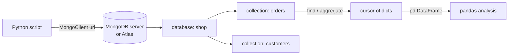

# Session 05 · MongoDB Database Interaction

> **Module:** Data Science with Python · **Term 1** · ⏱️ ~2 hours
> **You will learn:** what a document database is, how to connect to MongoDB from Python with **PyMongo**, insert and query documents, use filters and projections, run a simple aggregation, and load query results into a pandas DataFrame for analysis.

---

## 1. Data that doesn't fit neat rows

Not all data is a tidy table. A customer's order can contain a list of items, each with its own options; a tweet has nested user info and a list of hashtags. **MongoDB** stores each record as a **document** (JSON-like, stored as BSON) inside a **collection**, so nested and varying fields are natural.

> 📒 **Analogy:** A SQL table is a printed attendance register — every row must fill the same columns. A MongoDB collection is a box of student files — each file is a folder that can hold a different number of pages, but they all live in the same drawer.

| SQL term | MongoDB term |
|---|---|
| database | database |
| table | collection |
| row | document |
| column | field |
| primary key | `_id` (auto `ObjectId`) |
| JOIN | embedding, or `$lookup` |



## 2. PyMongo cheat-sheet

```python
from pymongo import MongoClient
client = MongoClient("mongodb://localhost:27017")      # or an Atlas mongodb+srv:// string
db = client["shop"]
orders = db["orders"]
```

| Task | PyMongo call |
|---|---|
| insert one / many | `orders.insert_one(doc)`, `orders.insert_many(docs)` |
| find all | `orders.find()` |
| filter | `orders.find({"city": "Karachi"})` |
| comparison | `{"total": {"$gt": 2000}}` (`$gte $lt $lte $ne $in`) |
| projection | `orders.find({}, {"_id": 0, "customer": 1, "total": 1})` |
| sort / limit | `.sort("total", -1).limit(5)` |
| count | `orders.count_documents({"status": "paid"})` |
| update | `orders.update_one({"_id": i}, {"$set": {"status": "paid"}})` |
| delete | `orders.delete_many({"status": "cancelled"})` |
| aggregate | `orders.aggregate([{"$group": {"_id": "$city", "n": {"$sum": 1}}}])` |
| to pandas | `pd.DataFrame(list(orders.find({}, {"_id": 0})))` |

> 🧪 **Running the code in this repo:** the scripts use [`code/mongo_conn.py`](./code/mongo_conn.py). With no setup they run on **mongomock** (an in-memory fake MongoDB: `pip install mongomock`). Set `MONGO_URI=mongodb://localhost:27017` (and `pip install pymongo`) to run the same code against a real server. Module 05 of this term covers MongoDB in depth.

## 3. Worked examples

Full runnable code: [`code/examples.py`](./code/examples.py) · notebook: [`notebook.ipynb`](./notebook.ipynb)

### Example 1 — connect and insert
```python
from mongo_conn import get_db
db = get_db("shop")
db.orders.insert_many([
    {"customer": "Ali", "city": "Karachi", "items": [{"name": "kurta", "qty": 2, "price": 2500}], "status": "paid"},
    {"customer": "Sana", "city": "Lahore", "items": [{"name": "shawl", "qty": 1, "price": 4200}], "status": "pending"},
])
```

### Example 2 — filters and projections
```python
for doc in db.orders.find({"city": "Karachi"}, {"_id": 0, "customer": 1, "status": 1}):
    print(doc)
```

### Example 3 — query inside arrays and nested fields
```python
db.orders.find({"items.name": "kurta"})                 # any item named kurta
db.orders.find({"items.qty": {"$gte": 2}})
```

### Example 4 — update and count
```python
db.orders.update_many({"status": "pending"}, {"$set": {"status": "paid"}})
print(db.orders.count_documents({"status": "paid"}))
```

### Example 5 — aggregation: revenue per city
```python
pipeline = [
    {"$unwind": "$items"},
    {"$group": {"_id": "$city", "revenue": {"$sum": {"$multiply": ["$items.qty", "$items.price"]}}}},
    {"$sort": {"revenue": -1}},
]
print(list(db.orders.aggregate(pipeline)))
```

### Example 6 — into pandas
```python
import pandas as pd
df = pd.json_normalize(list(db.orders.find({}, {"_id": 0})), record_path="items",
                       meta=["customer", "city", "status"])
df["line_total"] = df["qty"] * df["price"]
```

## 4. Common mistakes

| Mistake | Fix |
|---|---|
| Printing `find()` shows `<Cursor ...>` | Iterate it or wrap in `list(...)` |
| `ObjectId` breaks `to_json` / DataFrame display | Exclude it with `{"_id": 0}` or convert with `str()` |
| `update_one({...}, {"status": "paid"})` errors | Updates need an operator: `{"$set": {...}}` |
| Typos in field names return nothing (no error) | Check one document with `find_one()` first |
| Hard-coding passwords in the connection string | Read the URI from an environment variable |

## 5. Real-life coding problem 🧮

**Problem:** An online clothing store in Karachi keeps orders in MongoDB (customer, city, a list of items with category/qty/price, and `status`). Write `store_insights(db)` that returns: total revenue from **paid** orders, revenue by category (using an aggregation pipeline), the top customer by spend, and a pandas DataFrame of item lines for further analysis.

<details>
<summary>💡 Full solution</summary>

```python
import pandas as pd

def store_insights(db):
    paid = {"status": "paid"}
    by_cat = list(db.orders.aggregate([
        {"$match": paid},
        {"$unwind": "$items"},
        {"$group": {"_id": "$items.category",
                    "revenue": {"$sum": {"$multiply": ["$items.qty", "$items.price"]}}}},
        {"$sort": {"revenue": -1}},
    ]))
    lines = pd.json_normalize(list(db.orders.find(paid, {"_id": 0})), record_path="items",
                              meta=["customer", "city"])
    lines["total"] = lines["qty"] * lines["price"]
    top_customer = lines.groupby("customer")["total"].sum().idxmax()
    return int(lines["total"].sum()), by_cat, top_customer, lines
```
Full file with sample data and checks: [`code/problem_solution.py`](./code/problem_solution.py)
</details>

## 6. Practice exercises

1. Insert five `students` documents (name, batch, marks) and find those with marks ≥ 70, sorted high to low.
2. Show only `name` and `batch` (no `_id`) for students in batch `"DS-01"`.
3. Add 5 bonus marks to every student in batch `"DS-02"` using `$inc`.
4. Use an aggregation to get the average marks per batch.

<details>
<summary>✅ Solutions</summary>

```python
db.students.insert_many(docs)
high = list(db.students.find({"marks": {"$gte": 70}}).sort("marks", -1))
ds01 = list(db.students.find({"batch": "DS-01"}, {"_id": 0, "name": 1, "batch": 1}))
db.students.update_many({"batch": "DS-02"}, {"$inc": {"marks": 5}})
avg = list(db.students.aggregate([{"$group": {"_id": "$batch", "avg": {"$avg": "$marks"}}},
                                  {"$sort": {"_id": 1}}]))
```
File: [`code/exercises_solutions.py`](./code/exercises_solutions.py)
</details>

## 7. Quiz

1. What is the MongoDB equivalent of a SQL table and a row?
2. What does a projection like `{"_id": 0, "name": 1}` do?
3. Why does `update_one(filter, {"x": 1})` fail?
4. How do you query a field inside an array of sub-documents?
5. Which pandas function flattens nested documents?

<details>
<summary>Answers</summary>

1. Collection and document · 2. Returns only `name`, hiding `_id` · 3. The update document must use operators such as `$set` or `$inc` · 4. Dot notation, e.g. `{"items.name": "kurta"}` · 5. `pd.json_normalize`.
</details>

## 8. Summary

- MongoDB stores JSON-like documents in collections; nested lists and varying fields are normal.
- PyMongo: `MongoClient → db → collection`, then `insert_*`, `find`, `update_*`, `delete_*`, `aggregate`.
- Filters use operators (`$gt`, `$in`), dot notation reaches nested fields, projections trim output.
- `pd.DataFrame` / `pd.json_normalize` turn query results into tables for analysis.

---
[⬅ Session 04](../Session-04-advanced-pandas/) · [Module home](../README.md) · [Session 06 ➡](../Session-06-file-formats/)

<sub>Original teaching material by Aseef Ahmed · not official Aptech courseware · CC BY-NC 4.0 (text) / MIT (code)</sub>
