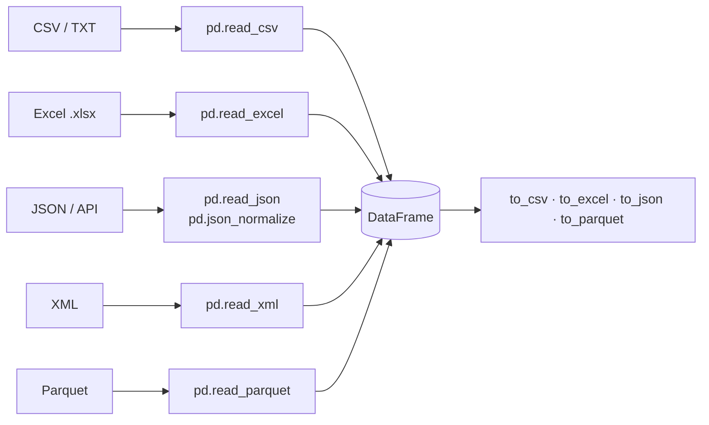

# Session 06 · Handling Different File Formats

> **Module:** Data Science with Python · **Term 1** · ⏱️ ~2 hours
> **You will learn:** how to read and write CSV, Excel, JSON (flat and nested), XML, Parquet and plain text with pandas, the key options of `read_csv`, handling encodings and large files in chunks, and choosing the right format for a job.

---

## 1. Data arrives in many shapes

Your data science work starts with **importing**. A bank sends CSV, the accounts office lives in Excel, a web API returns JSON, an old government portal exports XML, and a data-engineering team prefers Parquet. pandas has a `read_*` and `to_*` function for each.

> 📒 **Analogy:** File formats are like languages at Empress Market — Urdu, Sindhi, English, Pashto. The shopkeeper (pandas) speaks them all; you just have to say which one the customer is using.



## 2. Reference tables

| Format | Read | Write | Extra package | Good for |
|---|---|---|---|---|
| CSV | `pd.read_csv` | `df.to_csv(index=False)` | — | universal exchange, small–medium data |
| Excel | `pd.read_excel(sheet_name=...)` | `df.to_excel` / `ExcelWriter` | `openpyxl` | office users, several sheets |
| JSON | `pd.read_json`, `json_normalize` | `df.to_json(orient="records")` | — | web APIs, nested data |
| XML | `pd.read_xml(xpath=...)` | `df.to_xml` | `lxml` | legacy systems, feeds |
| Parquet | `pd.read_parquet` | `df.to_parquet` | `pyarrow` | big data, fast + compressed, keeps types |
| Text | `open()` / `read_csv(sep=...)` | `open(..., "w")` | — | logs, fixed or custom separators |

| Useful `read_csv` options | Purpose |
|---|---|
| `sep=";"`, `sep="\t"` | other delimiters |
| `usecols=["a", "b"]` | load only some columns |
| `dtype={"phone": str}` | keep leading zeros (`0300...`) |
| `parse_dates=["date"]`, `dayfirst=True` | dates as datetime |
| `na_values=["-", "N/A"]` | extra missing-value markers |
| `skiprows=2`, `nrows=100` | skip a header block / preview |
| `encoding="utf-8"` / `"latin-1"` | fix garbled characters |
| `chunksize=10_000` | stream a huge file in pieces |

## 3. Worked examples

Full runnable code: [`code/examples.py`](./code/examples.py) · notebook: [`notebook.ipynb`](./notebook.ipynb) (all files are created in `code/output/`).

### Example 1 — CSV with tricky options
```python
text = "date;phone;city;amount\n05/10/2026;03001234567;Karachi;1,200\n06/10/2026;03219876543;Quetta;-\n"
df = pd.read_csv(io.StringIO(text), sep=";", dtype={"phone": str}, parse_dates=["date"],
                 dayfirst=True, thousands=",", na_values=["-"])
```

### Example 2 — Excel with two sheets
```python
with pd.ExcelWriter(OUT / "branches.xlsx") as xw:
    north.to_excel(xw, sheet_name="North", index=False)
    south.to_excel(xw, sheet_name="South", index=False)
sheets = pd.read_excel(OUT / "branches.xlsx", sheet_name=None)   # dict of DataFrames
```

### Example 3 — nested JSON from an API
```python
data = [{"id": 1, "user": {"name": "Ali", "city": "Karachi"}, "tags": ["ai", "python"]}]
flat = pd.json_normalize(data)            # columns: id, tags, user.name, user.city
```

### Example 4 — XML
```python
xml = """<stations><station id="1"><name>Saddar</name><temp>34</temp></station></stations>"""
st = pd.read_xml(io.StringIO(xml), xpath="//station")
```

### Example 5 — Parquet keeps types and is small
```python
df.to_parquet(OUT / "sales.parquet")
back = pd.read_parquet(OUT / "sales.parquet")
print(back.dtypes)                         # datetime and category survive
```

### Example 6 — a big file in chunks
```python
total = 0
for chunk in pd.read_csv(OUT / "big.csv", chunksize=5_000):
    total += chunk.loc[chunk["city"] == "Karachi", "amount"].sum()
```

## 4. Common mistakes

| Mistake | Fix |
|---|---|
| Phone numbers lose the leading `0` | `dtype={"phone": str}` |
| `"1,200"` is read as text | `thousands=","` |
| `05/10/2026` read as 10 May | `dayfirst=True` or an explicit `format` |
| Extra `Unnamed: 0` column after re-reading | Save with `index=False` |
| `UnicodeDecodeError` | Try `encoding="utf-8-sig"` or `"latin-1"` |
| Loading a 5 GB CSV crashes the laptop | `usecols`, `dtype`, `chunksize`, or convert to Parquet |

## 5. Real-life coding problem 🧮

**Problem:** A pharmacy chain sends monthly sales from three branches, each in a different format: Clifton as CSV (semicolon-separated, day-first dates), Gulshan as an Excel sheet, and Saddar as JSON from their POS API (nested `item` object). Write `combine_branches(...)` that loads all three, standardises the columns to `date, branch, product, qty, price`, stacks them, and returns the combined table plus revenue per branch. Save the result as Parquet.

<details>
<summary>💡 Full solution</summary>

```python
import json
import pandas as pd

COLS = ["date", "branch", "product", "qty", "price"]

def combine_branches(csv_path, xlsx_path, json_path):
    a = pd.read_csv(csv_path, sep=";", parse_dates=["date"], dayfirst=True)
    a["branch"] = "Clifton"
    b = pd.read_excel(xlsx_path).rename(columns={"Date": "date", "Product": "product", "Qty": "qty", "Price": "price"})
    b["date"] = pd.to_datetime(b["date"]); b["branch"] = "Gulshan"
    c = pd.json_normalize(json.load(open(json_path))).rename(
        columns={"item.name": "product", "item.price": "price", "sold": "qty", "on": "date"})
    c["date"] = pd.to_datetime(c["date"]); c["branch"] = "Saddar"
    allsales = pd.concat([a[COLS], b[COLS], c[COLS]], ignore_index=True)
    allsales["revenue"] = allsales["qty"] * allsales["price"]
    return allsales, allsales.groupby("branch")["revenue"].sum()
```
Full file that creates the three sample files and checks the result: [`code/problem_solution.py`](./code/problem_solution.py)
</details>

## 6. Practice exercises

1. Read a tab-separated string with columns `roll, name, marks` where missing marks are written `"absent"`; count the missing values.
2. Write a DataFrame to JSON in `records` orientation and read it back; check it is unchanged.
3. Save two DataFrames to one Excel file as separate sheets and list the sheet names when reading.
4. Compare the file size of the same 20,000-row DataFrame saved as CSV and Parquet.

<details>
<summary>✅ Solutions</summary>

```python
df = pd.read_csv(io.StringIO(tsv), sep="\t", na_values=["absent"]); missing = df["marks"].isna().sum()

df.to_json(p, orient="records"); same = pd.read_json(p, orient="records").equals(df)

with pd.ExcelWriter(x) as xw:
    a.to_excel(xw, sheet_name="A", index=False); b.to_excel(xw, sheet_name="B", index=False)
names = list(pd.read_excel(x, sheet_name=None).keys())

big.to_csv(c, index=False); big.to_parquet(q)
ratio = os.path.getsize(c) / os.path.getsize(q)
```
File: [`code/exercises_solutions.py`](./code/exercises_solutions.py)
</details>

## 7. Quiz

1. Which `read_csv` option keeps phone numbers like `0300…` intact?
2. What does `sheet_name=None` return from `read_excel`?
3. Which function flattens nested JSON into columns?
4. Name two advantages of Parquet over CSV.
5. How do you process a CSV that is too big for memory?

<details>
<summary>Answers</summary>

1. `dtype={"phone": str}` · 2. A dict mapping sheet name → DataFrame · 3. `pd.json_normalize` · 4. Smaller (compressed), faster to read, keeps column types (dates, categories), can read selected columns only · 5. Read it with `chunksize` and aggregate each chunk (or load only needed `usecols` with compact `dtype`s).
</details>

## 8. Summary

- pandas reads and writes CSV, Excel, JSON, XML and Parquet with `read_*` / `to_*`.
- Most import bugs are fixed with `read_csv` options: `sep`, `dtype`, `parse_dates`, `na_values`, `thousands`, `encoding`.
- `json_normalize` flattens API data; `sheet_name=None` loads every Excel sheet.
- For large data, use `chunksize`, `usecols`, and Parquet.

---
[⬅ Session 05](../Session-05-mongodb-interaction/) · [Module home](../README.md) · [Session 07 ➡](../Session-07-data-cleaning/)

<sub>Original teaching material by Aseef Ahmed · not official Aptech courseware · CC BY-NC 4.0 (text) / MIT (code)</sub>
