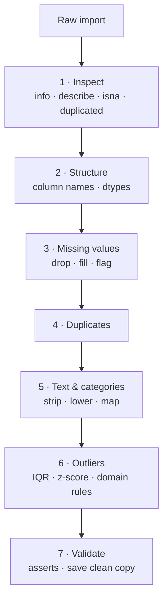

# Session 07 · Cleaning of Imported Data

> **Module:** Data Science with Python · **Term 1** · ⏱️ ~2 hours
> **You will learn:** a repeatable data-cleaning workflow — fixing column names and types, finding and handling missing values, removing duplicates, cleaning messy text and categories, detecting outliers (IQR and z-score), and validating the result with assertions.

---

## 1. Garbage in, garbage out

Imported data is almost never ready. Survey forms have blank answers, people type "khi", "Karachi " and "KARACHI" for the same city, prices arrive as `"Rs. 1,200"`, and one row is entered twice. A model trained on this learns the mess. Data scientists commonly spend more time **cleaning** than modelling.

> 📒 **Analogy:** Cleaning data is like washing and sorting *sabzi* before cooking. You remove the rotten tomatoes (bad rows), wash off the mud (whitespace and symbols), and put the same vegetables together (standard categories). Skip it and the best recipe still tastes wrong.



## 2. Reference tables

| Problem | Detect | Fix |
|---|---|---|
| Missing values | `df.isna().sum()` | `dropna()`, `fillna(value)`, `fillna(df.col.median())`, group-wise `transform` |
| Wrong type | `df.dtypes` | `pd.to_numeric(errors="coerce")`, `pd.to_datetime`, `astype("category")` |
| Duplicates | `df.duplicated().sum()` | `drop_duplicates(subset=[...], keep="first")` |
| Messy text | `df.col.unique()` | `.str.strip().str.title()`, `.str.replace(r"[^0-9.]", "", regex=True)` |
| Inconsistent labels | `value_counts()` | `.replace({"khi": "Karachi"})` or a mapping dict |
| Outliers | box plot, IQR, z-score | remove, cap (`clip`), or investigate |
| Impossible values | domain rules (age < 0) | set to NaN, then handle as missing |

| Filling strategy | When to use |
|---|---|
| drop the row | few missing rows, plenty of data |
| mean | numeric, roughly symmetric |
| median | numeric with outliers / skew (salaries, prices) |
| mode / "Unknown" | categorical |
| forward-fill `ffill()` | time series (sensor readings) |
| group median | values depend on a group (price by product) |

**IQR rule:** `Q1 = 25th percentile`, `Q3 = 75th`, `IQR = Q3 − Q1`; outliers are below `Q1 − 1.5·IQR` or above `Q3 + 1.5·IQR`.

## 3. Worked examples

Full runnable code: [`code/examples.py`](./code/examples.py) · notebook: [`notebook.ipynb`](./notebook.ipynb)

### Example 1 — inspect a messy survey
```python
raw = pd.DataFrame({
    " Name ": ["Ali", "sana ", "Hamza", "Ali", None],
    "City": ["khi", "Lahore", "KARACHI ", "khi", "Isb"],
    "Age": ["21", "abc", "19", "21", "230"],
    "Fee (Rs)": ["Rs. 12,000", "15000", None, "Rs. 12,000", "9,500"],
})
print(raw.isna().sum(), raw.duplicated().sum())
```

### Example 2 — tidy column names and types
```python
df = raw.rename(columns=lambda c: c.strip().lower().replace(" (rs)", "").replace(" ", "_"))
df["age"] = pd.to_numeric(df["age"], errors="coerce")
df["fee"] = pd.to_numeric(df["fee"].str.replace(r"[^0-9.]", "", regex=True), errors="coerce")
```

### Example 3 — clean text and categories
```python
df["name"] = df["name"].str.strip().str.title()
city_map = {"khi": "Karachi", "karachi": "Karachi", "isb": "Islamabad", "lahore": "Lahore"}
df["city"] = df["city"].str.strip().str.lower().map(city_map)
```

### Example 4 — impossible values, duplicates, missing
```python
df.loc[~df["age"].between(10, 80), "age"] = np.nan     # 230 is impossible
df = df.drop_duplicates().dropna(subset=["name"])
df["age"] = df["age"].fillna(df["age"].median())
df["fee"] = df["fee"].fillna(df.groupby("city")["fee"].transform("median"))
```

### Example 5 — outliers with IQR and z-score
```python
q1, q3 = s.quantile([0.25, 0.75]); iqr = q3 - q1
iqr_out = s[(s < q1 - 1.5 * iqr) | (s > q3 + 1.5 * iqr)]
z = (s - s.mean()) / s.std()
z_out = s[z.abs() > 3]
capped = s.clip(q1 - 1.5 * iqr, q3 + 1.5 * iqr)
```

### Example 6 — validate before saving
```python
assert df["name"].notna().all()
assert df["age"].between(10, 80).all()
assert set(df["city"].dropna()) <= {"Karachi", "Lahore", "Islamabad"}
```

## 4. Common mistakes

| Mistake | Fix |
|---|---|
| Filling every gap with 0 | 0 is a real value; use median/mode or flag missingness |
| `astype(int)` fails on `"abc"` | Use `pd.to_numeric(..., errors="coerce")` then handle NaN |
| Dropping outliers that are real (a genuine big order) | Investigate first; cap or keep with a flag |
| Cleaning the test set using the whole data's statistics | Compute fill values on training data only (later in ML) |
| Overwriting the raw file | Keep raw data read-only; save a separate clean file |

## 5. Real-life coding problem 🧮

**Problem:** A property portal scraped 2-bed apartment listings in Karachi. Columns: `area` (typed many ways: "DHA Phase 6", "dha", "Gulistan-e-Johar", "johar"…), `size_sqft` (some with "sq ft"), `price` (like "1.2 crore", "95 lac", "Rs 8,500,000"), and duplicates from repeated scraping. Write `clean_listings(df)` that standardises area names, converts size and price to numbers (in rupees), removes duplicates and impossible sizes (< 300 or > 5,000 sq ft), fills missing sizes with the area's median, and adds `price_per_sqft`.

<details>
<summary>💡 Full solution</summary>

```python
import re
import numpy as np
import pandas as pd

AREAS = {"dha": "DHA", "johar": "Gulistan-e-Johar", "gulshan": "Gulshan-e-Iqbal", "bahria": "Bahria Town"}

def parse_price(text):
    if pd.isna(text):
        return np.nan
    t = str(text).lower().replace(",", "")
    num = float(re.findall(r"[\d.]+", t)[0])
    if "crore" in t: return num * 1e7
    if "lac" in t or "lakh" in t: return num * 1e5
    return num

def clean_area(text):
    t = str(text).lower()
    return next((v for k, v in AREAS.items() if k in t), "Other")

def clean_listings(df):
    d = df.copy()
    d["area"] = d["area"].map(clean_area)
    d["size_sqft"] = pd.to_numeric(d["size_sqft"].astype(str).str.extract(r"([\d.]+)")[0], errors="coerce")
    d["price"] = d["price"].map(parse_price)
    d = d.drop_duplicates()
    d.loc[~d["size_sqft"].between(300, 5000), "size_sqft"] = np.nan
    d["size_sqft"] = d["size_sqft"].fillna(d.groupby("area")["size_sqft"].transform("median"))
    d["price_per_sqft"] = (d["price"] / d["size_sqft"]).round(0)
    return d.reset_index(drop=True)
```
Full file with sample data and checks: [`code/problem_solution.py`](./code/problem_solution.py)
</details>

## 6. Practice exercises

1. Count missing values per column and the percentage of rows with *any* missing value.
2. Standardise a `gender` column containing `"M"`, `"male"`, `" Female"`, `"f"`, `"F "` to `"Male"`/`"Female"`.
3. Fill missing daily temperatures with forward-fill, then any remaining with the column mean.
4. Return the values flagged as outliers by the IQR rule in `[45, 48, 50, 52, 47, 49, 120, 51, 5]`.

<details>
<summary>✅ Solutions</summary>

```python
missing = df.isna().sum(); pct_any = 100 * df.isna().any(axis=1).mean()

g = s.str.strip().str.lower().str[0].map({"m": "Male", "f": "Female"})

t = temps.ffill().fillna(temps.mean())

def iqr_outliers(values):
    s = pd.Series(values); q1, q3 = s.quantile([0.25, 0.75]); iqr = q3 - q1
    return s[(s < q1 - 1.5 * iqr) | (s > q3 + 1.5 * iqr)].tolist()
```
File: [`code/exercises_solutions.py`](./code/exercises_solutions.py)
</details>

## 7. Quiz

1. Why is the median often better than the mean for filling missing prices?
2. What does `pd.to_numeric(s, errors="coerce")` do with `"abc"`?
3. Write the IQR outlier bounds.
4. Which method removes repeated rows?
5. Why should you keep the raw data unchanged?

<details>
<summary>Answers</summary>

1. The median is not pulled by extreme values (skewed data) · 2. Turns it into `NaN` instead of raising an error · 3. Below `Q1 − 1.5×IQR` or above `Q3 + 1.5×IQR` · 4. `drop_duplicates()` · 5. So cleaning can be re-run, checked and corrected; mistakes in cleaning should never destroy the source.
</details>

## 8. Summary

- Follow a fixed order: inspect → structure → missing → duplicates → text/categories → outliers → validate.
- Use `to_numeric(errors="coerce")` and string methods to rescue messy columns.
- Choose a fill strategy that matches the data (median, mode, ffill, group-wise).
- Treat outliers with judgement, and finish with assertions before saving a clean copy.

---
[⬅ Session 06](../Session-06-file-formats/) · [Module home](../README.md) · [Session 08 ➡](../Session-08-matplotlib-visualization/)

<sub>Original teaching material by Aseef Ahmed · not official Aptech courseware · CC BY-NC 4.0 (text) / MIT (code)</sub>
