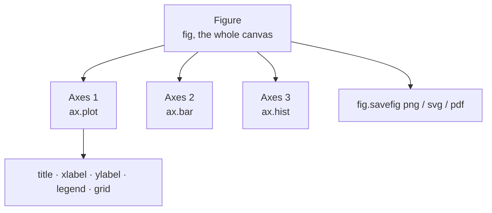
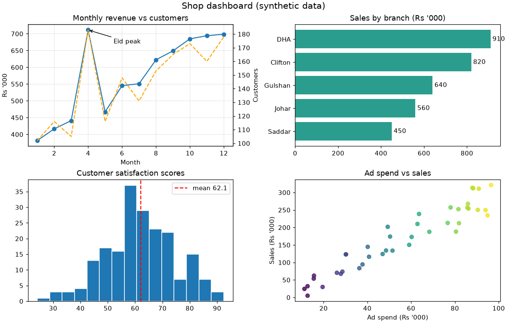
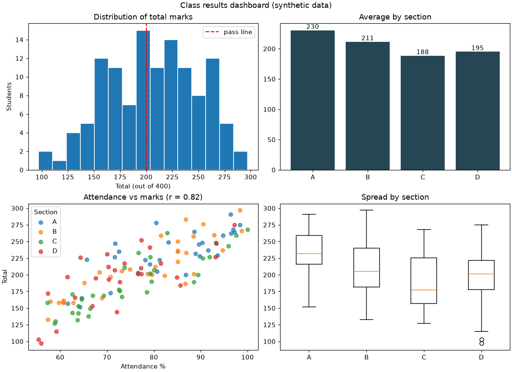

# Session 08 · Data Visualization Using Matplotlib

> **Module:** Data Science with Python · **Term 1** · ⏱️ ~2 hours
> **You will learn:** the Figure/Axes (object-oriented) API, choosing the right chart for a question, line, bar, histogram, scatter and box plots, multi-panel dashboards with `subplots`, annotations, twin axes, styling, and exporting publication-quality images.

---

## 1. Charts answer questions

A good chart answers **one question** quickly: *Is revenue growing? Which branch is best? How are marks spread? Are two things related?* Matplotlib is the foundation library for plotting in Python — pandas and Seaborn draw on top of it — so knowing its object model lets you control every detail.

> 📒 **Analogy:** A **Figure** is the whole wall poster; each **Axes** is one framed picture on that poster. You tell each frame what to draw (`ax.plot`, `ax.bar`), and give it a title and labels like a caption under a photo.





## 2. Which chart for which question?

| Question | Chart | Matplotlib call |
|---|---|---|
| How does a value change over time? | line | `ax.plot(x, y)` |
| How do categories compare? | bar / horizontal bar | `ax.bar`, `ax.barh` |
| How are values distributed? | histogram | `ax.hist(values, bins=20)` |
| Are two numeric variables related? | scatter | `ax.scatter(x, y, c=..., s=...)` |
| Compare distributions across groups | box plot | `ax.boxplot(groups, orientation="horizontal")` |
| Parts of a whole (few parts) | stacked bar (prefer over pie) | `ax.bar(..., bottom=...)` |

| Styling / layout | Code |
|---|---|
| several panels | `fig, axes = plt.subplots(2, 2, figsize=(10, 7))` |
| tidy spacing | `fig.tight_layout()` or `layout="constrained"` |
| labels | `ax.set(title=..., xlabel=..., ylabel=...)` |
| annotate a point | `ax.annotate("peak", xy=(x, y), xytext=(x2, y2), arrowprops={"arrowstyle": "->"})` |
| second y-axis | `ax2 = ax.twinx()` |
| style sheet | `plt.style.use("seaborn-v0_8-whitegrid")` |
| save | `fig.savefig("chart.png", dpi=150, bbox_inches="tight")` then `plt.close(fig)` |

## 3. Worked examples

Full runnable code: [`code/examples.py`](./code/examples.py) · notebook: [`notebook.ipynb`](./notebook.ipynb) · chart script: [`code/make_chart.py`](./code/make_chart.py)

### Example 1 — the object-oriented pattern
```python
fig, ax = plt.subplots(figsize=(7, 4))
ax.plot(months, revenue, marker="o", label="Revenue")
ax.set(title="Monthly revenue (Rs '000)", xlabel="Month", ylabel="Rs '000")
ax.legend(); ax.grid(alpha=0.3)
```

### Example 2 — sorted horizontal bars with value labels
```python
order = branch_sales.sort_values()
bars = ax.barh(order.index, order.values, color="#2a9d8f")
ax.bar_label(bars, fmt="%.0f", padding=3)
```

### Example 3 — histogram with mean line
```python
ax.hist(marks, bins=15, edgecolor="white")
ax.axvline(marks.mean(), color="red", linestyle="--", label=f"mean {marks.mean():.1f}")
```

### Example 4 — scatter with colour and size
```python
sc = ax.scatter(df["ad_spend"], df["sales"], c=df["branch_code"], s=df["staff"] * 15, cmap="viridis", alpha=0.7)
fig.colorbar(sc, ax=ax, label="branch")
```

### Example 5 — a 2×2 dashboard with annotation and twin axis
```python
fig, axes = plt.subplots(2, 2, figsize=(11, 7), layout="constrained")
axes[0, 0].plot(months, revenue)
peak = revenue.idxmax()
axes[0, 0].annotate("Eid peak", xy=(peak, revenue[peak]), xytext=(peak - 3, revenue[peak] * 0.95),
                    arrowprops={"arrowstyle": "->"})
ax2 = axes[0, 0].twinx(); ax2.plot(months, customers, color="orange")
```

### Example 6 — box plots to compare groups
```python
ax.boxplot([g["minutes"] for _, g in df.groupby("rider")], tick_labels=riders, orientation="horizontal")
```

## 4. Common mistakes

| Mistake | Fix |
|---|---|
| Mixing `plt.title` and `ax.set_title` in multi-panel figures | Use the `ax` methods consistently |
| Overlapping labels | `layout="constrained"` / `tight_layout()`; rotate ticks |
| Bar chart y-axis not starting at 0 | Keep zero baseline for bars (exaggeration misleads) |
| Pie chart with 9 slices | Use a sorted bar chart |
| Memory warnings after saving many figures | `plt.close(fig)` after `savefig` |
| Blurry images in reports | `dpi=150` or save as `.svg` |

## 5. Real-life coding problem 🧮

**Problem:** A school wants a one-page **results dashboard** for a class of 120 students across 4 sections: (1) histogram of total marks with pass line, (2) bar chart of average per section with value labels, (3) scatter of attendance % vs total marks, coloured by section, with the correlation in the title, and (4) box plots of marks per section. Save it as `images/results_dashboard.png` and return the summary numbers used.

<details>
<summary>💡 Full solution</summary>

```python
def results_dashboard(df, path, pass_mark=200):
    fig, axes = plt.subplots(2, 2, figsize=(11, 8), layout="constrained")
    ax = axes[0, 0]
    ax.hist(df["total"], bins=15, edgecolor="white")
    ax.axvline(pass_mark, color="red", ls="--", label="pass line"); ax.legend()
    ax.set(title="Distribution of total marks", xlabel="Total (out of 400)", ylabel="Students")
    avg = df.groupby("section")["total"].mean()
    bars = axes[0, 1].bar(avg.index, avg.values, color="#264653")
    axes[0, 1].bar_label(bars, fmt="%.0f"); axes[0, 1].set_title("Average by section")
    r = df["attendance"].corr(df["total"])
    for sec, g in df.groupby("section"):
        axes[1, 0].scatter(g["attendance"], g["total"], label=sec, alpha=0.7)
    axes[1, 0].set(title=f"Attendance vs marks (r = {r:.2f})", xlabel="Attendance %", ylabel="Total")
    axes[1, 0].legend(title="Section")
    axes[1, 1].boxplot([g["total"] for _, g in df.groupby("section")], tick_labels=avg.index)
    axes[1, 1].set_title("Spread by section")
    fig.savefig(path, dpi=120); plt.close(fig)
    return {"pass_rate": (df["total"] >= pass_mark).mean(), "best_section": avg.idxmax(), "r": r}
```
Full file: [`code/problem_solution.py`](./code/problem_solution.py) · output:


</details>

## 6. Practice exercises

1. Plot two lines (Karachi and Lahore average monthly temperature) on one Axes with a legend.
2. Draw a horizontal bar chart of 5 products sorted by sales, largest at the top.
3. Make a 1×2 figure: histogram on the left, box plot of the same data on the right.
4. Save a figure as both PNG (dpi 150) and SVG and check both files exist.

<details>
<summary>✅ Solutions</summary>

```python
fig, ax = plt.subplots()
ax.plot(months, khi, label="Karachi"); ax.plot(months, lhr, label="Lahore"); ax.legend()

s = sales.sort_values(); ax.barh(s.index, s.values)

fig, (a, b) = plt.subplots(1, 2, figsize=(9, 3.5))
a.hist(data, bins=20); b.boxplot(data, orientation="horizontal")

fig.savefig(out / "c.png", dpi=150); fig.savefig(out / "c.svg")
```
File: [`code/exercises_solutions.py`](./code/exercises_solutions.py)
</details>

## 7. Quiz

1. What is the difference between a Figure and an Axes?
2. Which chart best shows the distribution of a single numeric variable?
3. How do you add a second y-axis that shares the x-axis?
4. Why should bar charts start at zero?
5. Why call `plt.close(fig)` in scripts?

<details>
<summary>Answers</summary>

1. The Figure is the whole canvas; an Axes is one plot area inside it (a Figure can hold many) · 2. A histogram (or box plot) · 3. `ax2 = ax.twinx()` · 4. Bar length encodes the value; a cut-off baseline exaggerates differences · 5. To free memory — open figures stay alive until closed.
</details>

## 8. Summary

- Use `fig, ax = plt.subplots()` and the `ax.*` methods for full control.
- Pick the chart from the question: line (trend), bar (compare), hist/box (distribution), scatter (relationship).
- Build dashboards with `subplots`, label everything, annotate the key insight.
- Save with `dpi` and `bbox_inches="tight"`, then close the figure.

---
[⬅ Session 07](../Session-07-data-cleaning/) · [Module home](../README.md) · [Session 09 ➡](../Session-09-seaborn-visualization/)

<sub>Original teaching material by Aseef Ahmed · not official Aptech courseware · CC BY-NC 4.0 (text) / MIT (code)</sub>
