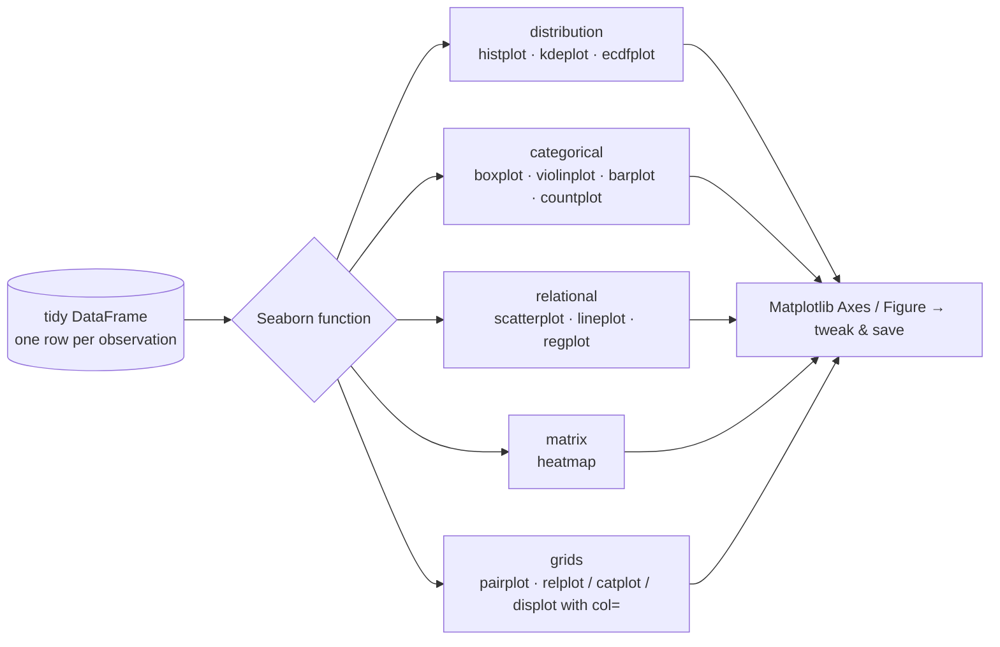
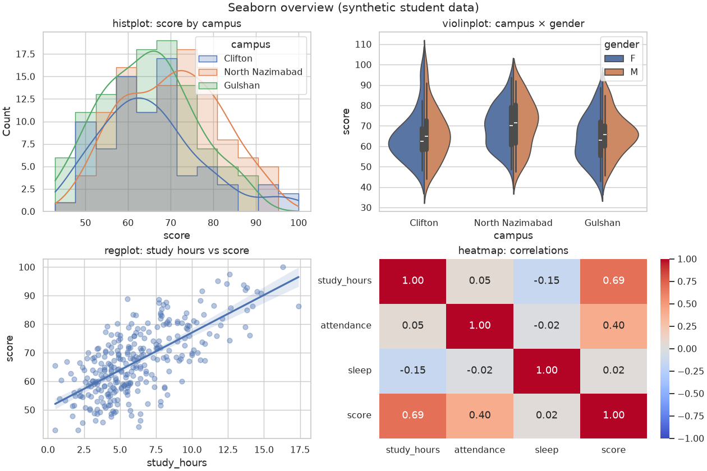
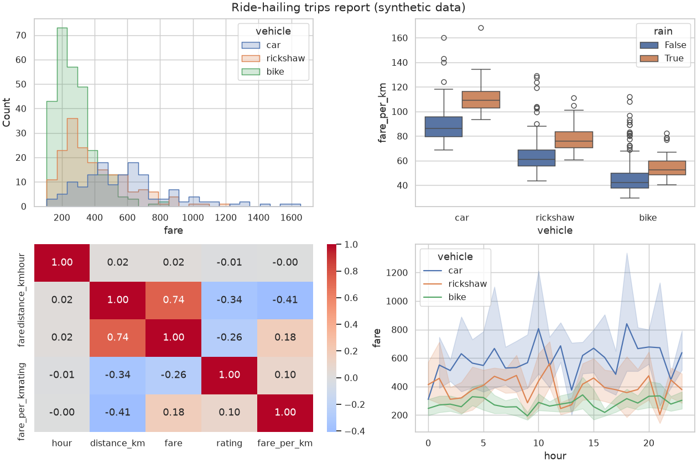

# Session 09 · Data Visualization Using Seaborn

> **Module:** Data Science with Python · **Term 1** · ⏱️ ~2 hours
> **You will learn:** how Seaborn builds statistical charts straight from a DataFrame — distribution plots (`histplot`, `kdeplot`), categorical plots (`boxplot`, `violinplot`, `barplot`, `countplot`), relationship plots (`scatterplot`, `regplot`, `lmplot`), `heatmap` for correlations, `pairplot`, and faceting with `hue`, `col` and `row`.

---

## 1. Seaborn = Matplotlib + statistics + good defaults

Matplotlib gives total control but needs many lines. **Seaborn** sits on top of it: you pass a DataFrame and column names, and it groups, aggregates, adds confidence intervals and legends for you. Because the output is still Matplotlib, you can fine-tune any chart with `ax.set(...)`.

> 📒 **Analogy:** Matplotlib is cooking *nihari* from scratch — grind every spice yourself. Seaborn is a good *masala* packet — the right blend is already in, and you can still add extra chilli (Matplotlib tweaks) at the end.





## 2. Reference tables

| Family | Axes-level function | Figure-level (supports `col=`/`row=`) |
|---|---|---|
| distribution | `histplot`, `kdeplot`, `ecdfplot` | `displot` |
| categorical | `boxplot`, `violinplot`, `stripplot`, `barplot`, `countplot` | `catplot` |
| relational | `scatterplot`, `lineplot` | `relplot` |
| regression | `regplot` | `lmplot` |
| matrix | `heatmap` | `clustermap` |
| many variables | — | `pairplot`, `jointplot` |

| Common argument | Effect |
|---|---|
| `data=df, x="col", y="col"` | use DataFrame columns by name |
| `hue="group"` | colour by a category (adds a legend) |
| `col="group"`, `row="group"` | small multiples (figure-level only) |
| `estimator="mean"`, `errorbar="ci"` | what bars show and their error bars |
| `palette="Set2"` | colour scheme |
| `ax=ax` | draw into an existing Matplotlib Axes |
| `sns.set_theme(style="whitegrid")` | global look |

**Tidy data rule:** Seaborn works best when each **row is one observation** and each **column is one variable** — use `melt` (Session 04) to convert wide tables first.

## 3. Worked examples

Full runnable code: [`code/examples.py`](./code/examples.py) · notebook: [`notebook.ipynb`](./notebook.ipynb) · chart script: [`code/make_chart.py`](./code/make_chart.py)

### Example 1 — distributions with `hue`
```python
import seaborn as sns
sns.set_theme(style="whitegrid")
sns.histplot(data=df, x="score", hue="campus", kde=True, element="step")
```

### Example 2 — compare groups: box vs violin
```python
fig, axes = plt.subplots(1, 2, figsize=(10, 4))
sns.boxplot(data=df, x="campus", y="score", ax=axes[0])
sns.violinplot(data=df, x="campus", y="score", hue="gender", split=True, ax=axes[1])
```

### Example 3 — bar (mean with CI) and count
```python
sns.barplot(data=df, x="campus", y="score", errorbar=("ci", 95))
sns.countplot(data=df, x="programme", hue="campus")
```

### Example 4 — relationships and a fitted line
```python
sns.scatterplot(data=df, x="study_hours", y="score", hue="campus", size="attendance")
sns.regplot(data=df, x="study_hours", y="score", scatter_kws={"alpha": 0.4})
```

### Example 5 — correlation heatmap
```python
corr = df[["study_hours", "attendance", "sleep", "score"]].corr()
sns.heatmap(corr, annot=True, fmt=".2f", cmap="coolwarm", vmin=-1, vmax=1)
```

### Example 6 — small multiples and pairplot
```python
g = sns.relplot(data=df, x="study_hours", y="score", col="campus", hue="gender", height=3)
g.savefig("facets.png")
sns.pairplot(df[["study_hours", "attendance", "score", "campus"]], hue="campus", corner=True)
```

## 4. Common mistakes

| Mistake | Fix |
|---|---|
| Passing a wide table (one column per month) | `melt` it into long/tidy format |
| `ax=` given to `relplot`/`catplot` | Figure-level functions make their own figure; use axes-level versions with `ax=` |
| Heatmap colours mislead (0 is not the centre) | `vmin=-1, vmax=1, center=0` for correlations |
| `sns.load_dataset` fails offline | It downloads from the internet; use your own DataFrame |
| Bars show the mean but you wanted totals | `estimator="sum"` |

## 5. Real-life coding problem 🧮

**Problem:** A ride-hailing company in Karachi wants an exploratory report on 600 trips (`hour`, `distance_km`, `fare`, `rating`, `vehicle` = bike/rickshaw/car, `rain`). Build a 2×2 figure: fare distribution by vehicle (`histplot`), fare per km by vehicle with/without rain (`boxplot` with `hue`), a correlation heatmap of the numeric columns, and average fare by hour (`lineplot`). Return the vehicle with the highest median fare per km and how much rain increases the median fare per km (%).

<details>
<summary>💡 Full solution</summary>

```python
def trips_report(df, path):
    d = df.assign(fare_per_km=df["fare"] / df["distance_km"])
    fig, axes = plt.subplots(2, 2, figsize=(12, 8), layout="constrained")
    sns.histplot(data=d, x="fare", hue="vehicle", element="step", ax=axes[0, 0])
    sns.boxplot(data=d, x="vehicle", y="fare_per_km", hue="rain", ax=axes[0, 1])
    sns.heatmap(d[["hour", "distance_km", "fare", "rating", "fare_per_km"]].corr(),
                annot=True, fmt=".2f", cmap="coolwarm", center=0, ax=axes[1, 0])
    sns.lineplot(data=d, x="hour", y="fare", hue="vehicle", ax=axes[1, 1])
    fig.savefig(path, dpi=110); plt.close(fig)
    med = d.groupby("vehicle")["fare_per_km"].median()
    by_rain = d.groupby("rain")["fare_per_km"].median()
    return med.idxmax(), round(100 * (by_rain[True] / by_rain[False] - 1), 1)
```
Full file: [`code/problem_solution.py`](./code/problem_solution.py) · output:


</details>

## 6. Practice exercises

1. Draw a `countplot` of students per programme, ordered from most to least.
2. Plot a KDE of scores for each campus on one axis (`hue`) with `common_norm=False`.
3. Convert a wide table of monthly sales per branch into long format and draw a `lineplot` with `hue="branch"`.
4. Make a `heatmap` of a pivot table: average score by campus (rows) × programme (columns).

<details>
<summary>✅ Solutions</summary>

```python
order = df["programme"].value_counts().index
sns.countplot(data=df, x="programme", order=order)

sns.kdeplot(data=df, x="score", hue="campus", common_norm=False)

long = wide.melt(id_vars="month", var_name="branch", value_name="sales")
sns.lineplot(data=long, x="month", y="sales", hue="branch")

pt = df.pivot_table(index="campus", columns="programme", values="score", aggfunc="mean")
sns.heatmap(pt, annot=True, fmt=".0f", cmap="YlGnBu")
```
File: [`code/exercises_solutions.py`](./code/exercises_solutions.py)
</details>

## 7. Quiz

1. What does the `hue` argument do?
2. What is the difference between an axes-level and a figure-level Seaborn function?
3. Which plot shows the full shape of a distribution per group better than a box plot?
4. Why set `center=0` on a correlation heatmap?
5. What data layout does Seaborn expect?

<details>
<summary>Answers</summary>

1. Splits the data by a category and colours each group differently, with a legend · 2. Axes-level functions draw on one Matplotlib Axes (accept `ax=`); figure-level functions (`relplot`, `catplot`, `displot`, `lmplot`) create a whole figure and support `col=`/`row=` facets · 3. A violin plot (or KDE) · 4. So positive and negative correlations get opposite colours with neutral at zero · 5. Tidy/long format: one row per observation, one column per variable.
</details>

## 8. Summary

- Seaborn draws statistical charts directly from DataFrame columns with sensible defaults.
- Pick the family: distribution, categorical, relational, regression, matrix, grids.
- `hue`, `col`, `row` add groups and small multiples; heatmaps summarise correlations.
- Everything is Matplotlib underneath — tweak with `ax.set` and save with `savefig`.

---
[⬅ Session 08](../Session-08-matplotlib-visualization/) · [Module home](../README.md) · [Session 10 ➡](../Session-10-non-linear-regression/)

<sub>Original teaching material by Aseef Ahmed · not official Aptech courseware · CC BY-NC 4.0 (text) / MIT (code)</sub>
