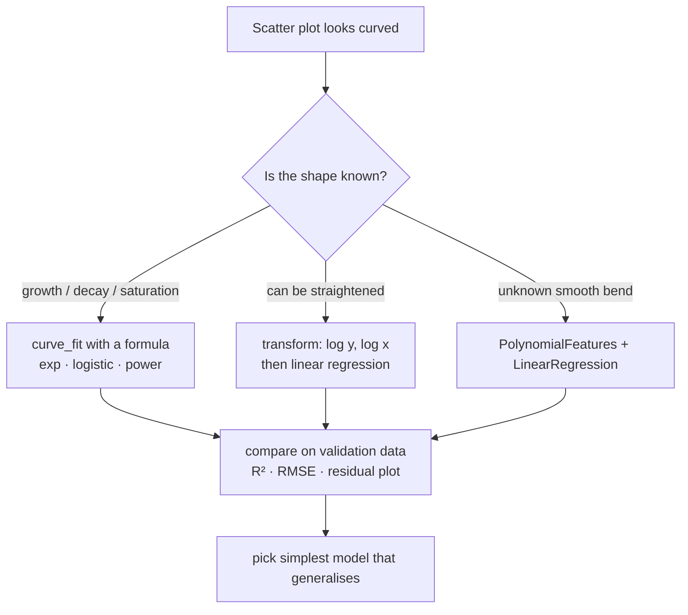
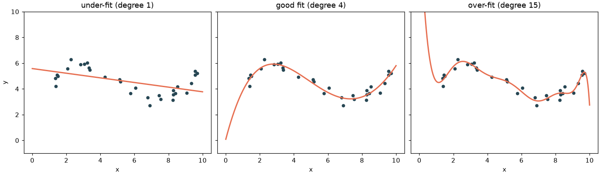

# Session 10 · Non-Linear Regression Analysis

> **Module:** Data Science with Python · **Term 1** · ⏱️ ~2 hours
> **You will learn:** when a straight line is not enough, polynomial regression with scikit-learn pipelines, fitting custom curves (exponential, logistic, power) with `scipy.optimize.curve_fit`, log transforms, under- vs over-fitting, choosing model complexity with a validation set, and reporting R² and RMSE.

---

## 1. When the line bends

Linear regression assumes `y = b0 + b1·x`: every extra unit of `x` adds the same amount to `y`. Real relationships often bend: a phone loses value fast in the first year and slowly later; a new app's users grow slowly, then explode, then flatten; fuel use rises sharply at high speeds. **Non-linear regression** fits curves to such data.

> 📒 **Analogy:** Mango prices in a season — expensive when the first *Sindhri* arrive, dropping fast in June, flattening in July, rising again at the end. A ruler (straight line) can't trace that; you need a flexible curve, but not so flexible that it follows every day's random haggling.





## 2. Reference tables

| Model | Formula | Python |
|---|---|---|
| polynomial (degree d) | `b0 + b1x + b2x² + … + bdxᵈ` | `make_pipeline(PolynomialFeatures(d), LinearRegression())` |
| exponential growth/decay | `a·e^(b·x)` | `curve_fit(lambda x, a, b: a*np.exp(b*x), x, y)` |
| logistic (S-curve) | `L / (1 + e^(−k(x − x0)))` | `curve_fit(logistic, x, y, p0=[...])` |
| power | `a·xᵇ` | log both sides → linear in `log x` |
| log-linear | `log y = b0 + b1x` | `LinearRegression().fit(x, np.log(y))` |

| Metric | Meaning | Good when |
|---|---|---|
| R² | share of variance explained (1 = perfect) | close to 1 on **test** data |
| RMSE | typical error, in the units of `y` | small relative to `y` |
| MAE | average absolute error | robust to outliers |
| residual plot | errors vs predictions | random cloud, no pattern |

| Symptom | Diagnosis | Remedy |
|---|---|---|
| train and test error both high | under-fitting (model too simple) | higher degree, better formula |
| train error tiny, test error high | over-fitting (too flexible) | lower degree, more data, regularisation (`Ridge`) |

## 3. Worked examples

Full runnable code: [`code/examples.py`](./code/examples.py) · notebook: [`notebook.ipynb`](./notebook.ipynb)

### Example 1 — a line under-fits curved data
```python
lin = LinearRegression().fit(X, y)
print("linear R²:", r2_score(y, lin.predict(X)))
```

### Example 2 — polynomial regression in a pipeline
```python
from sklearn.pipeline import make_pipeline
from sklearn.preprocessing import PolynomialFeatures
poly2 = make_pipeline(PolynomialFeatures(degree=2, include_bias=False), LinearRegression()).fit(X, y)
print("quadratic R²:", r2_score(y, poly2.predict(X)))
```

### Example 3 — choose the degree with a validation set
```python
for d in [1, 2, 3, 5, 9, 15]:
    m = make_pipeline(PolynomialFeatures(d), StandardScaler(), LinearRegression()).fit(X_tr, y_tr)
    print(d, rmse(y_tr, m.predict(X_tr)), rmse(y_te, m.predict(X_te)))
```

### Example 4 — exponential decay with `curve_fit` (phone resale value)
```python
from scipy.optimize import curve_fit
def decay(t, a, b):
    return a * np.exp(-b * t)
(a, b), _ = curve_fit(decay, months, price, p0=[150_000, 0.05])
half_life = np.log(2) / b
```

### Example 5 — logistic growth (app users)
```python
def logistic(t, L, k, t0):
    return L / (1 + np.exp(-k * (t - t0)))
(L, k, t0), _ = curve_fit(logistic, weeks, users, p0=[users.max(), 0.3, weeks.mean()])
```

### Example 6 — straighten with a log transform
```python
lm = LinearRegression().fit(np.log(area), np.log(price))   # power law: price = a·area^b
b = lm.coef_[0]                                               # elasticity
```

## 4. Common mistakes

| Mistake | Fix |
|---|---|
| Judging the model on training data only | Always report test (or cross-validated) R²/RMSE |
| Degree-15 polynomial "because R² = 0.99" | Watch test error; prefer the simplest good model |
| Extrapolating a polynomial beyond the data | Polynomials explode at the edges; use a formula with the right shape |
| `curve_fit` fails / returns nonsense | Give sensible starting values `p0` and scale your data |
| Huge coefficients with high degrees | Add `StandardScaler` and consider `Ridge` |

## 5. Real-life coding problem 🧮

**Problem:** A logistics company records a delivery truck's **fuel use (litres/100 km)** at different average speeds on the Karachi–Hyderabad motorway. Fuel use is high at low speeds (traffic), lowest around a "sweet spot", and rises at high speeds. Fit polynomial models of degree 1–6, choose the degree with the lowest validation RMSE, report test R², and find the **most fuel-efficient speed** from the chosen model.

<details>
<summary>💡 Full solution</summary>

```python
def best_speed(speed, fuel, degrees=range(1, 7), seed=0):
    X = speed.reshape(-1, 1)
    X_tr, X_te, y_tr, y_te = train_test_split(X, fuel, test_size=0.25, random_state=seed)
    X_fit, X_val, y_fit, y_val = train_test_split(X_tr, y_tr, test_size=0.25, random_state=seed)
    scores = {}
    for d in degrees:
        m = make_pipeline(PolynomialFeatures(d), StandardScaler(), LinearRegression()).fit(X_fit, y_fit)
        scores[d] = np.sqrt(mean_squared_error(y_val, m.predict(X_val)))
    d = min(scores, key=scores.get)
    model = make_pipeline(PolynomialFeatures(d), StandardScaler(), LinearRegression()).fit(X_tr, y_tr)
    grid = np.linspace(speed.min(), speed.max(), 500).reshape(-1, 1)
    sweet = float(grid[model.predict(grid).argmin(), 0])
    return d, r2_score(y_te, model.predict(X_te)), sweet
```
Full file with simulated data and checks: [`code/problem_solution.py`](./code/problem_solution.py)
</details>

## 6. Practice exercises

1. Fit degree-2 and degree-3 polynomials to `y = x³ − 4x + noise` and show which has the higher test R².
2. Use `curve_fit` to estimate the growth rate `b` in `y = a·e^(bx)` from noisy data generated with `b = 0.12`.
3. Fit a power law `price = a·areaᵇ` using log–log linear regression and report `b`.
4. Write `rmse(y_true, y_pred)` and compute it for a linear vs quadratic model on the same data.

<details>
<summary>✅ Solutions</summary>

```python
for d in (2, 3):
    m = make_pipeline(PolynomialFeatures(d), LinearRegression()).fit(X_tr, y_tr)
    print(d, r2_score(y_te, m.predict(X_te)))

(a, b), _ = curve_fit(lambda x, a, b: a * np.exp(b * x), x, y, p0=[1, 0.1])

b = LinearRegression().fit(np.log(area).reshape(-1, 1), np.log(price)).coef_[0]

def rmse(y_true, y_pred):
    return float(np.sqrt(np.mean((np.asarray(y_true) - np.asarray(y_pred)) ** 2)))
```
File: [`code/exercises_solutions.py`](./code/exercises_solutions.py)
</details>

## 7. Quiz

1. Why is polynomial regression still called a *linear* model?
2. What are the signs of over-fitting?
3. When would you choose `curve_fit` over a polynomial?
4. What does a log–log regression slope represent in a power law?
5. Why is extrapolating a high-degree polynomial dangerous?

<details>
<summary>Answers</summary>

1. It is linear in its **coefficients**; the features (`x`, `x²`, …) are just new columns · 2. Very low training error but much higher test/validation error · 3. When theory gives the shape (exponential decay, logistic saturation) — parameters are meaningful and it extrapolates more sensibly · 4. The exponent `b` (elasticity: % change in y per 1% change in x) · 5. High powers grow explosively outside the data range, giving absurd predictions.
</details>

## 8. Summary

- Look at the scatter plot first; curved patterns need non-linear models.
- Polynomials = `PolynomialFeatures` + `LinearRegression`; pick the degree with validation data.
- Use `curve_fit` for known shapes and log transforms to straighten power/exponential relations.
- Judge models on test data with R² and RMSE, and prefer the simplest model that generalises.

---
[⬅ Session 09](../Session-09-seaborn-visualization/) · [Module home](../README.md) · [Session 11 ➡](../Session-11-classification-1/)

<sub>Original teaching material by Aseef Ahmed · not official Aptech courseware · CC BY-NC 4.0 (text) / MIT (code)</sub>
