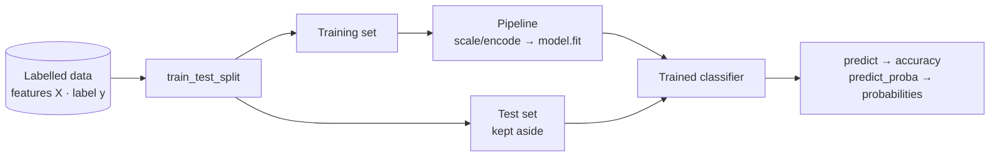

# Session 11 · Classification I

> **Module:** Data Science with Python · **Term 1** · ⏱️ ~2 hours
> **You will learn:** what classification is, the train/test workflow, feature scaling and encoding, **logistic regression** (sigmoid, probabilities, decision threshold) and **k-nearest neighbours** (distance, choosing *k*), with scikit-learn pipelines and accuracy as a first metric.

---

## 1. Predicting a category

Regression predicts a **number** (price, marks). **Classification** predicts a **label**: will this student pass or fail? Is this SMS spam? Will this customer default on a loan? The model learns from labelled examples and outputs a class (and often a probability).

> 📒 **Analogy:** A seasoned *mandi* trader can tell a sweet melon from a bland one by weight, colour and smell after seeing thousands. A classifier does the same: it studies many labelled examples (features → label) and learns a rule for new ones.



## 2. Reference tables

| Algorithm | Idea | Pros | Cons |
|---|---|---|---|
| Logistic regression | weighted sum → sigmoid → probability | fast, interpretable coefficients, gives probabilities | straight-line (linear) boundary |
| k-nearest neighbours (KNN) | vote of the *k* closest training points | no training, flexible boundary | slow on big data, needs scaling, sensitive to irrelevant features |

| Concept | Meaning |
|---|---|
| sigmoid `σ(z) = 1 / (1 + e^(−z))` | squashes any number into 0–1 |
| decision threshold | predict class 1 if probability ≥ 0.5 (adjustable) |
| `C` in `LogisticRegression` | inverse regularisation strength (smaller = simpler model) |
| `n_neighbors` (k) | small k = wiggly boundary (over-fit); large k = smooth (under-fit) |
| `stratify=y` | keeps class proportions equal in train and test |

| Preprocessing | Use for | scikit-learn |
|---|---|---|
| scaling | numeric features (essential for KNN) | `StandardScaler()` |
| one-hot encoding | categorical features | `OneHotEncoder(handle_unknown="ignore")` |
| combine both | mixed tables | `ColumnTransformer([...])` |

## 3. Worked examples

Full runnable code: [`code/examples.py`](./code/examples.py) · notebook: [`notebook.ipynb`](./notebook.ipynb)

### Example 1 — the sigmoid
```python
z = np.array([-4, -1, 0, 1, 4])
print(1 / (1 + np.exp(-z)))        # [0.018 0.269 0.5 0.731 0.982]
```

### Example 2 — logistic regression: pass/fail from study hours and attendance
```python
X_tr, X_te, y_tr, y_te = train_test_split(X, y, test_size=0.25, stratify=y, random_state=0)
logreg = make_pipeline(StandardScaler(), LogisticRegression()).fit(X_tr, y_tr)
print("accuracy:", logreg.score(X_te, y_te))
print(logreg.predict_proba([[6, 85]]))       # [P(fail), P(pass)]
```

### Example 3 — reading coefficients
```python
coef = logreg[-1].coef_[0]
print(dict(zip(["study_hours", "attendance"], coef.round(2))))   # positive = raises P(pass)
```

### Example 4 — changing the threshold
```python
proba = logreg.predict_proba(X_te)[:, 1]
strict = (proba >= 0.7).astype(int)          # flag fewer students as "will pass"
```

### Example 5 — KNN and the effect of k
```python
for k in [1, 5, 15, 51]:
    knn = make_pipeline(StandardScaler(), KNeighborsClassifier(n_neighbors=k)).fit(X_tr, y_tr)
    print(k, knn.score(X_tr, y_tr), knn.score(X_te, y_te))
```

### Example 6 — mixed numeric + categorical features
```python
pre = ColumnTransformer([("num", StandardScaler(), ["income", "age"]),
                         ("cat", OneHotEncoder(handle_unknown="ignore"), ["city"])])
model = make_pipeline(pre, LogisticRegression(max_iter=1000)).fit(df_tr, y_tr)
```

## 4. Common mistakes

| Mistake | Fix |
|---|---|
| Evaluating on the training data | Always score on the held-out test set |
| KNN without scaling (income in lakhs dominates age) | Put `StandardScaler` in the pipeline |
| Fitting the scaler on all data before splitting (leakage) | Split first; the pipeline fits the scaler on training data only |
| Using accuracy on 95% / 5% data | Accuracy misleads with imbalance — see Session 13 metrics |
| Feeding text categories directly | One-hot encode them |

## 5. Real-life coding problem 🧮

**Problem:** A microfinance bank in Hyderabad wants to pre-screen loan applications. Each applicant has `monthly_income` (Rs), `existing_loans`, `age`, `years_in_business` and `city`. Build logistic regression and KNN pipelines (with scaling and one-hot encoding), compare test accuracy, and write `screen(applicant)` that returns the approval probability and a decision using a **cautious threshold of 0.6**.

<details>
<summary>💡 Full solution</summary>

```python
NUM = ["monthly_income", "existing_loans", "age", "years_in_business"]
CAT = ["city"]

def build(model):
    pre = ColumnTransformer([("num", StandardScaler(), NUM),
                             ("cat", OneHotEncoder(handle_unknown="ignore"), CAT)])
    return make_pipeline(pre, model)

def train_models(df):
    X, y = df[NUM + CAT], df["repaid"]
    X_tr, X_te, y_tr, y_te = train_test_split(X, y, test_size=0.25, stratify=y, random_state=0)
    models = {"logreg": build(LogisticRegression(max_iter=1000)),
              "knn": build(KNeighborsClassifier(n_neighbors=15))}
    scores = {n: m.fit(X_tr, y_tr).score(X_te, y_te) for n, m in models.items()}
    return models, scores

def screen(model, applicant, threshold=0.6):
    p = model.predict_proba(pd.DataFrame([applicant]))[0, 1]
    return round(p, 3), "approve" if p >= threshold else "refer to officer"
```
Full file with simulated applicants and checks: [`code/problem_solution.py`](./code/problem_solution.py)
</details>

## 6. Practice exercises

1. Compute the sigmoid of `z = 2.2` by hand-code and confirm it is about 0.90.
2. Train logistic regression on a synthetic dataset from `make_classification` and report test accuracy.
3. Find the best *k* for KNN (1–30) using the test accuracy on a held-out split.
4. Show that removing `StandardScaler` lowers KNN accuracy when one feature has a much larger scale.

<details>
<summary>✅ Solutions</summary>

```python
sig = 1 / (1 + np.exp(-2.2))

X, y = make_classification(n_samples=500, n_features=5, random_state=0)
acc = LogisticRegression().fit(X_tr, y_tr).score(X_te, y_te)

best_k = max(range(1, 31), key=lambda k: make_pipeline(StandardScaler(), KNeighborsClassifier(k))
             .fit(X_tr, y_tr).score(X_te, y_te))

X_big = X.copy(); X_big[:, 0] *= 10_000      # one feature in huge units
```
File: [`code/exercises_solutions.py`](./code/exercises_solutions.py)
</details>

## 7. Quiz

1. What is the difference between regression and classification?
2. What does the sigmoid function output?
3. Why must features be scaled for KNN?
4. What happens with k = 1 in KNN?
5. Why use `stratify=y` in `train_test_split`?

<details>
<summary>Answers</summary>

1. Regression predicts a number; classification predicts a category · 2. A value between 0 and 1, read as a probability · 3. KNN uses distances, so features with large units would dominate · 4. The model memorises training data (100% train accuracy) and usually over-fits · 5. To keep the same class proportions in train and test sets.
</details>

## 8. Summary

- Classification predicts labels; always split data and evaluate on the test set.
- Logistic regression gives probabilities via the sigmoid; tune the threshold for the business need.
- KNN classifies by neighbours; scale features and pick *k* carefully.
- Pipelines with `StandardScaler`, `OneHotEncoder` and `ColumnTransformer` keep preprocessing leak-free.

---
[⬅ Session 10](../Session-10-non-linear-regression/) · [Module home](../README.md) · [Session 12 ➡](../Session-12-classification-2/)

<sub>Original teaching material by Aseef Ahmed · not official Aptech courseware · CC BY-NC 4.0 (text) / MIT (code)</sub>
