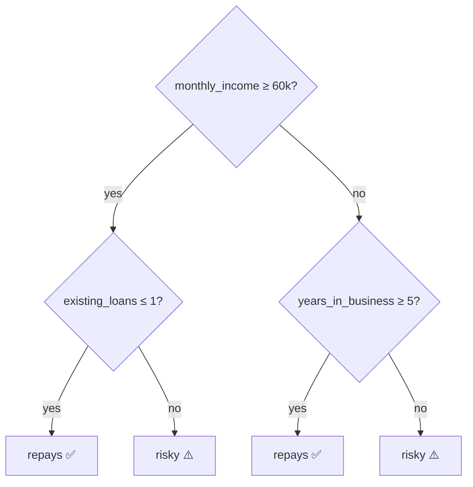

# Session 12 · Classification II

> **Module:** Data Science with Python · **Term 1** · ⏱️ ~2 hours
> **You will learn:** four more classifiers — **decision trees** (Gini, depth, reading rules), **random forests** (bagging, feature importance), **Naive Bayes** (probabilistic, great for text) and **support vector machines** (margins, kernels) — and how to compare them fairly with cross-validation.

---

## 1. Different ways to draw the line

Logistic regression and KNN (Session 11) are only two ways to separate classes. Trees ask yes/no questions; forests let many trees vote; Naive Bayes multiplies probabilities; SVMs find the widest street between classes. No single algorithm wins everywhere — you try a few and compare.

> 📒 **Analogy:** A decision tree is the admission officer at a college counter: "Matric marks above 70%? → Science or Arts? → Interview score?" A random forest is a panel of 100 such officers, each having seen slightly different files, and the majority decides.



## 2. Reference tables

| Algorithm | How it decides | Key hyper-parameters | Strengths | Weaknesses |
|---|---|---|---|---|
| Decision tree | sequence of feature thresholds chosen to reduce **Gini impurity** / entropy | `max_depth`, `min_samples_leaf` | readable rules, no scaling needed | over-fits when deep, unstable |
| Random forest | majority vote of many trees, each on a bootstrap sample and random feature subsets | `n_estimators`, `max_depth`, `max_features` | accurate, robust, feature importance | less interpretable, bigger |
| Naive Bayes | Bayes' rule assuming features independent given the class | `var_smoothing` (Gaussian), `alpha` (Multinomial) | very fast, works with little data, text | independence assumption is crude |
| SVM | maximum-margin boundary; kernels bend it | `C`, `kernel` (`linear`, `rbf`), `gamma` | strong on medium-sized, high-dimensional data | needs scaling, slow on huge data |

**Gini impurity** of a node: `1 − Σ pᵢ²`. A pure node (all one class) has Gini 0; a 50/50 node has 0.5.

| Naive Bayes variant | Features |
|---|---|
| `GaussianNB` | continuous numbers |
| `MultinomialNB` | word counts (text) |
| `BernoulliNB` | yes/no features |

## 3. Worked examples

Full runnable code: [`code/examples.py`](./code/examples.py) · notebook: [`notebook.ipynb`](./notebook.ipynb)

### Example 1 — Gini impurity by hand
```python
def gini(counts):
    p = np.array(counts) / sum(counts)
    return 1 - (p ** 2).sum()
print(gini([50, 50]), gini([90, 10]), gini([100, 0]))   # 0.5 0.18 0.0
```

### Example 2 — a readable decision tree
```python
tree = DecisionTreeClassifier(max_depth=3, random_state=0).fit(X_tr, y_tr)
print(export_text(tree, feature_names=features))
```

### Example 3 — depth vs over-fitting
```python
for d in [1, 3, 5, 10, None]:
    t = DecisionTreeClassifier(max_depth=d, random_state=0).fit(X_tr, y_tr)
    print(d, t.score(X_tr, y_tr), t.score(X_te, y_te))
```

### Example 4 — random forest and feature importance
```python
rf = RandomForestClassifier(n_estimators=300, random_state=0).fit(X_tr, y_tr)
print(pd.Series(rf.feature_importances_, index=features).sort_values(ascending=False))
```

### Example 5 — Naive Bayes for SMS spam
```python
spam = make_pipeline(CountVectorizer(), MultinomialNB()).fit(texts, labels)
spam.predict(["Congratulations! You won a free Rs 50,000 prize, call now"])
```

### Example 6 — SVM with RBF kernel and model comparison
```python
models = {"tree": DecisionTreeClassifier(max_depth=4), "forest": RandomForestClassifier(200),
          "nb": GaussianNB(), "svm": make_pipeline(StandardScaler(), SVC(kernel="rbf", C=1))}
for name, m in models.items():
    print(name, cross_val_score(m, X, y, cv=5).mean())
```

## 4. Common mistakes

| Mistake | Fix |
|---|---|
| Unlimited-depth tree with 100% train accuracy | Limit `max_depth` / `min_samples_leaf`; check test score |
| Comparing models on one lucky split | Use `cross_val_score(cv=5)` |
| SVM without scaling | Pipeline with `StandardScaler` |
| Treating feature importance as causation | It shows what the model used, not what causes the outcome |
| Trusting default (impurity) importances blindly | They favour continuous / many-valued features; confirm with `sklearn.inspection.permutation_importance` on test data |
| `GaussianNB` on word counts | Use `MultinomialNB` for counts |

## 5. Real-life coding problem 🧮

**Problem:** A telecom company in Pakistan wants to predict which prepaid customers will **churn** (switch network) next month. Features: `tenure_months`, `monthly_spend`, `data_gb`, `complaints`, `dropped_calls`, `has_family_bundle`. Compare a decision tree, random forest, Gaussian Naive Bayes and RBF SVM with 5-fold cross-validation, pick the best, report its test accuracy, list the top three churn drivers from the forest, and print the depth-2 tree rules for the retention team.

<details>
<summary>💡 Full solution</summary>

```python
def churn_study(df):
    X, y = df[FEATURES], df["churn"]
    X_tr, X_te, y_tr, y_te = train_test_split(X, y, test_size=0.25, stratify=y, random_state=0)
    models = {
        "tree": DecisionTreeClassifier(max_depth=4, random_state=0),
        "forest": RandomForestClassifier(n_estimators=300, min_samples_leaf=3, random_state=0),
        "naive_bayes": GaussianNB(),
        "svm": make_pipeline(StandardScaler(), SVC(kernel="rbf", C=1.0)),
    }
    cv = {n: cross_val_score(m, X_tr, y_tr, cv=5).mean() for n, m in models.items()}
    best = max(cv, key=cv.get)
    test_acc = models[best].fit(X_tr, y_tr).score(X_te, y_te)
    forest = models["forest"].fit(X_tr, y_tr)
    drivers = pd.Series(forest.feature_importances_, index=FEATURES).nlargest(3)
    rules = export_text(DecisionTreeClassifier(max_depth=2, random_state=0).fit(X_tr, y_tr), feature_names=FEATURES)
    return cv, best, test_acc, drivers, rules
```
Full file with simulated customers and checks: [`code/problem_solution.py`](./code/problem_solution.py)
</details>

## 6. Practice exercises

1. Compute the Gini impurity of a node with 30 "yes" and 10 "no".
2. Train trees with `min_samples_leaf` of 1, 10 and 50 and compare test accuracy.
3. Train a `MultinomialNB` spam filter on 8 short messages and classify two new ones.
4. Compare `SVC(kernel="linear")` and `SVC(kernel="rbf")` on `make_moons` data.

<details>
<summary>✅ Solutions</summary>

```python
g = 1 - (0.75 ** 2 + 0.25 ** 2)            # 0.375

for leaf in (1, 10, 50):
    print(leaf, DecisionTreeClassifier(min_samples_leaf=leaf, random_state=0).fit(X_tr, y_tr).score(X_te, y_te))

nb = make_pipeline(CountVectorizer(), MultinomialNB()).fit(msgs, labels)

X, y = make_moons(400, noise=0.2, random_state=0)
for k in ("linear", "rbf"):
    print(k, cross_val_score(make_pipeline(StandardScaler(), SVC(kernel=k)), X, y, cv=5).mean())
```
File: [`code/exercises_solutions.py`](./code/exercises_solutions.py)
</details>

## 7. Quiz

1. What does a Gini impurity of 0 mean?
2. How does a random forest reduce over-fitting compared with one tree?
3. What is "naive" about Naive Bayes?
4. What does the `kernel` in an SVM allow?
5. Why use cross-validation to compare models?

<details>
<summary>Answers</summary>

1. The node is pure — all samples belong to one class · 2. It averages many trees trained on different bootstrap samples and feature subsets, so individual trees' errors cancel out · 3. It assumes features are independent of each other given the class · 4. Non-linear decision boundaries (by implicitly mapping data to a higher-dimensional space) · 5. It averages performance over several splits, so the comparison doesn't depend on one lucky or unlucky test set.
</details>

## 8. Summary

- Trees split on thresholds that reduce impurity; limit depth to avoid over-fitting.
- Random forests combine many trees for accuracy and provide feature importances.
- Naive Bayes is fast and strong for text; SVMs find maximum-margin boundaries and need scaling.
- Compare candidates with cross-validation, then confirm the winner on the test set.

---
[⬅ Session 11](../Session-11-classification-1/) · [Module home](../README.md) · [Session 13 ➡](../Session-13-evaluating-classifiers/)

<sub>Original teaching material by Aseef Ahmed · not official Aptech courseware · CC BY-NC 4.0 (text) / MIT (code)</sub>
