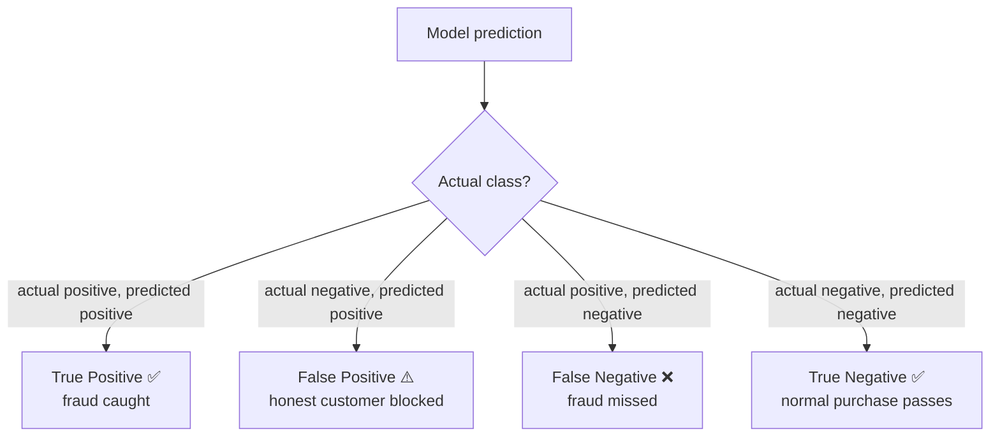
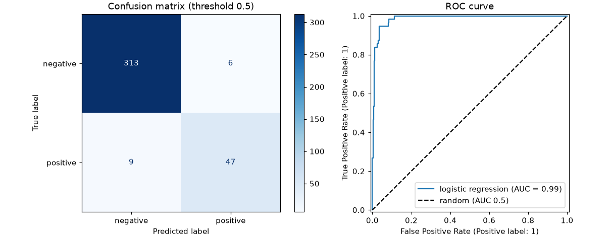

# Session 13 · Evaluating Classifier Models

> **Module:** Data Science with Python · **Term 1** · ⏱️ ~2 hours
> **You will learn:** why accuracy can lie, the confusion matrix, precision, recall, F1 and specificity, ROC curves and AUC, precision–recall curves, choosing a decision threshold from business costs, and reliable estimates with stratified k-fold cross-validation and `GridSearchCV`.

---

## 1. "98% accurate" can be useless

Suppose 2% of card transactions are fraud. A model that says "not fraud" every time is **98% accurate** — and catches zero fraud. To judge a classifier you must look at **which** mistakes it makes and what each mistake costs.

> 📒 **Analogy:** A security guard at a mall who lets everyone in is "right" for 999 of 1,000 visitors — but useless against the one thief. A guard who stops everyone catches the thief but angers 999 shoppers. Good evaluation measures both kinds of error.





## 2. Reference tables

|  | Predicted ➖ | Predicted ➕ |
|---|---|---|
| **Actual ➖** | TN | FP (type I error) |
| **Actual ➕** | FN (type II error) | TP |

| Metric | Formula | Question it answers | Prioritise when |
|---|---|---|---|
| Accuracy | (TP+TN) / all | How often is it right? | classes balanced, errors cost the same |
| Precision | TP / (TP+FP) | When it says ➕, how often is it right? | false alarms are expensive (spam filter) |
| Recall (sensitivity) | TP / (TP+FN) | Of all real ➕, how many did it find? | misses are expensive (disease, fraud) |
| Specificity | TN / (TN+FP) | Of all real ➖, how many were cleared? | screening programmes |
| F1 | 2·P·R / (P+R) | balance of precision and recall | imbalanced data, one number needed |
| ROC-AUC | area under TPR-vs-FPR curve | how well it ranks ➕ above ➖ (0.5 = random) | comparing models across thresholds |
| PR-AUC (average precision) | area under precision-recall curve | performance on the rare class | heavy imbalance |

| scikit-learn | Gives |
|---|---|
| `confusion_matrix`, `ConfusionMatrixDisplay` | the 2×2 counts / plot |
| `classification_report` | precision, recall, F1 per class |
| `roc_auc_score`, `roc_curve` | AUC and curve points (needs probabilities) |
| `precision_recall_curve`, `average_precision_score` | PR curve |
| `StratifiedKFold`, `cross_validate(scoring=[...])` | several metrics over folds |
| `GridSearchCV(model, grid, scoring="f1")` | tuning for the metric you care about |

## 3. Worked examples

Full runnable code: [`code/examples.py`](./code/examples.py) · notebook: [`notebook.ipynb`](./notebook.ipynb)

### Example 1 — the accuracy trap
```python
y_true = np.array([0] * 98 + [1] * 2)
always_no = np.zeros(100, dtype=int)
print(accuracy_score(y_true, always_no), recall_score(y_true, always_no))   # 0.98 0.0
```

### Example 2 — confusion matrix and report
```python
model = make_pipeline(StandardScaler(), LogisticRegression(max_iter=1000)).fit(X_tr, y_tr)
pred = model.predict(X_te)
print(confusion_matrix(y_te, pred))
print(classification_report(y_te, pred, digits=3))
```

### Example 3 — metrics by hand from the matrix
```python
tn, fp, fn, tp = confusion_matrix(y_te, pred).ravel()
precision, recall = tp / (tp + fp), tp / (tp + fn)
f1 = 2 * precision * recall / (precision + recall)
```

### Example 4 — ROC curve and AUC
```python
proba = model.predict_proba(X_te)[:, 1]
fpr, tpr, thr = roc_curve(y_te, proba)
print("AUC:", roc_auc_score(y_te, proba))
```

### Example 5 — choosing a threshold by cost
```python
def total_cost(threshold, fn_cost=50_000, fp_cost=2_000):
    p = (proba >= threshold).astype(int)
    tn, fp, fn, tp = confusion_matrix(y_te, p).ravel()
    return fn * fn_cost + fp * fp_cost
best = min(np.linspace(0.05, 0.95, 19), key=total_cost)
```

### Example 6 — cross-validation and grid search on F1
```python
cv = StratifiedKFold(5, shuffle=True, random_state=0)
scores = cross_validate(model, X, y, cv=cv, scoring=["accuracy", "precision", "recall", "f1", "roc_auc"])
grid = GridSearchCV(RandomForestClassifier(random_state=0),
                    {"max_depth": [3, 6, None], "class_weight": [None, "balanced"]}, scoring="f1", cv=cv)
```

## 4. Common mistakes

| Mistake | Fix |
|---|---|
| Reporting only accuracy on imbalanced data | Report precision, recall, F1 and PR-AUC |
| Computing AUC from hard 0/1 predictions | Use `predict_proba(...)[:, 1]` (scores) |
| Tuning the threshold on the test set | Tune on validation/CV data; test once at the end |
| Plain `KFold` on imbalanced labels | `StratifiedKFold` keeps the class ratio in each fold |
| Mixing up FP and FN | Write the 2×2 table with "actual" rows and "predicted" columns |

## 5. Real-life coding problem 🧮

**Problem:** A diagnostic lab in Karachi screens patients for diabetes using `glucose`, `bmi`, `age` and `family_history`. Missing a diabetic patient (FN) is estimated to cost **Rs 80,000** in later treatment; a false alarm (FP) costs **Rs 3,000** for a confirmatory test. Train a model, report the default-threshold confusion matrix and metrics, then pick the threshold (from validation data) that minimises total cost and show how recall and cost change on the test set.

<details>
<summary>💡 Full solution</summary>

```python
def cost(y, proba, t, fn_cost=80_000, fp_cost=3_000):
    tn, fp, fn, tp = confusion_matrix(y, (proba >= t).astype(int), labels=[0, 1]).ravel()
    return fn * fn_cost + fp * fp_cost

def lab_screening(df):
    X, y = df[FEATURES], df["diabetic"]
    X_tmp, X_te, y_tmp, y_te = train_test_split(X, y, test_size=0.25, stratify=y, random_state=0)
    X_tr, X_val, y_tr, y_val = train_test_split(X_tmp, y_tmp, test_size=0.25, stratify=y_tmp, random_state=0)
    model = make_pipeline(StandardScaler(), LogisticRegression(max_iter=1000)).fit(X_tr, y_tr)
    grid = np.round(np.linspace(0.02, 0.9, 45), 2)
    p_val = model.predict_proba(X_val)[:, 1]
    best_t = min(grid, key=lambda t: cost(y_val, p_val, t))
    p_te = model.predict_proba(X_te)[:, 1]
    report = {t: {"recall": recall_score(y_te, p_te >= t), "precision": precision_score(y_te, p_te >= t),
                  "cost": cost(y_te, p_te, t)} for t in (0.5, best_t)}
    return best_t, report, roc_auc_score(y_te, p_te)
```
Full file with simulated patients and checks: [`code/problem_solution.py`](./code/problem_solution.py)
</details>

## 6. Practice exercises

1. From `TP=40, FP=10, FN=20, TN=130` compute accuracy, precision, recall, specificity and F1.
2. Show that a random classifier has ROC-AUC close to 0.5.
3. Use `cross_validate` to report mean recall and F1 of a decision tree with 5 stratified folds.
4. Compare recall and F1 of a random forest with `class_weight=None` vs `"balanced"` on data with 5% positives.

<details>
<summary>✅ Solutions</summary>

```python
tp, fp, fn, tn = 40, 10, 20, 130
acc = (tp + tn) / 200; prec = tp / (tp + fp); rec = tp / (tp + fn)
spec = tn / (tn + fp); f1 = 2 * prec * rec / (prec + rec)

auc_random = roc_auc_score(y, rng.random(len(y)))

res = cross_validate(DecisionTreeClassifier(max_depth=4), X, y, cv=StratifiedKFold(5), scoring=["recall", "f1"])

for cw in (None, "balanced"):
    p = RandomForestClassifier(class_weight=cw, max_depth=5).fit(X_tr, y_tr).predict(X_te)
    print(cw, recall_score(y_te, p), f1_score(y_te, p))   # balanced -> higher recall
```
File: [`code/exercises_solutions.py`](./code/exercises_solutions.py)
</details>

## 7. Quiz

1. Why is accuracy misleading for rare events?
2. Which metric matters most when missing a positive is very costly?
3. What does an ROC-AUC of 0.5 mean?
4. What happens to recall and precision when you lower the threshold?
5. Why use `StratifiedKFold`?

<details>
<summary>Answers</summary>

1. Predicting the majority class gives high accuracy while finding none of the rare cases · 2. Recall (sensitivity) · 3. The model ranks no better than random guessing · 4. Recall usually rises (more positives flagged) and precision usually falls (more false alarms) · 5. Each fold keeps the same class proportions, giving stable estimates on imbalanced data.
</details>

## 8. Summary

- Start from the confusion matrix: TP, FP, FN, TN.
- Precision guards against false alarms, recall against misses; F1 balances them.
- ROC-AUC and PR-AUC judge ranking quality across thresholds; tune the threshold from real costs.
- Use stratified cross-validation and `GridSearchCV(scoring=...)` for honest, metric-driven model choice.

---
[⬅ Session 12](../Session-12-classification-2/) · [Module home](../README.md) · [Session 14 ➡](../Session-14-clustering/)

<sub>Original teaching material by Aseef Ahmed · not official Aptech courseware · CC BY-NC 4.0 (text) / MIT (code)</sub>
