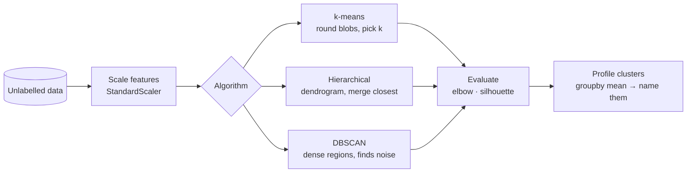
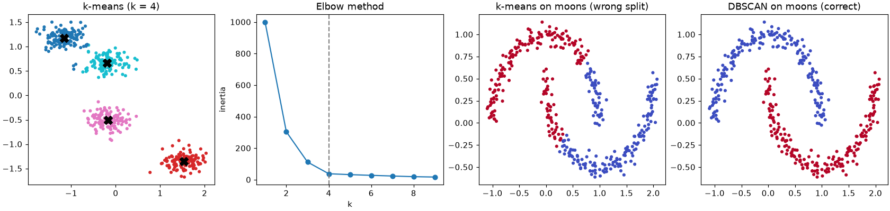

# Session 14 · Clustering

> **Module:** Data Science with Python · **Term 1** · ⏱️ ~2 hours
> **You will learn:** unsupervised learning, **k-means** (centroids, inertia), choosing *k* with the elbow method and silhouette score, **hierarchical clustering** and dendrograms, **DBSCAN** for odd shapes and noise, why scaling matters, and how to describe ("profile") clusters for business use.

---

## 1. Finding groups without labels

In classification we had a label column. Often we don't: a shop has thousands of customers and no tags like "bargain hunter" or "loyal big spender". **Clustering** groups similar records together so that each group can be understood and treated differently.

> 📒 **Analogy:** On the first day at a new hostel, nobody tells you who belongs to which group — but by the end of the week you notice the cricket crowd, the late-night gamers and the early-morning namazis. Clustering spots such natural groups from behaviour alone.





## 2. Reference tables

| Algorithm | Needs *k*? | Cluster shape | Handles noise? | Scale |
|---|---|---|---|---|
| `KMeans(n_clusters=k)` | yes | round, similar size | no (every point assigned) | large data |
| `AgglomerativeClustering(n_clusters=k, linkage="ward")` | yes (or cut a dendrogram) | flexible with linkage | no | small–medium |
| `DBSCAN(eps, min_samples)` | no | any shape | yes (label `-1`) | medium |

| k-means step | What happens |
|---|---|
| 1 | place *k* centroids (smart start: `k-means++`) |
| 2 | assign each point to the nearest centroid |
| 3 | move each centroid to the mean of its points |
| 4 | repeat 2–3 until assignments stop changing |

| Evaluation | Read it as |
|---|---|
| inertia (`model.inertia_`) | total squared distance to centroids — always falls as *k* rises; look for the **elbow** |
| silhouette score (−1 to 1) | how much closer points are to their own cluster than to the next; higher is better |
| cluster profile | `df.groupby("cluster").mean()` — do the groups make business sense? |

## 3. Worked examples

Full runnable code: [`code/examples.py`](./code/examples.py) · notebook: [`notebook.ipynb`](./notebook.ipynb)

### Example 1 — k-means on customer data
```python
X = StandardScaler().fit_transform(customers[["visits_per_month", "avg_basket"]])
km = KMeans(n_clusters=3, n_init=10, random_state=0).fit(X)
customers["cluster"] = km.labels_
```

### Example 2 — the elbow method
```python
inertia = {k: KMeans(k, n_init=10, random_state=0).fit(X).inertia_ for k in range(1, 9)}
```

### Example 3 — silhouette score
```python
for k in range(2, 7):
    labels = KMeans(k, n_init=10, random_state=0).fit_predict(X)
    print(k, silhouette_score(X, labels))
```

### Example 4 — why scaling matters
```python
raw = KMeans(3, n_init=10, random_state=0).fit_predict(customers[["visits_per_month", "avg_basket"]])
# without scaling, avg_basket (thousands of rupees) decides everything
```

### Example 5 — hierarchical clustering and a dendrogram
```python
from scipy.cluster.hierarchy import linkage, dendrogram
Z = linkage(X[:40], method="ward")
dendrogram(Z)
agg = AgglomerativeClustering(n_clusters=3, linkage="ward").fit_predict(X)
```

### Example 6 — DBSCAN finds odd shapes and noise
```python
Xm, _ = make_moons(300, noise=0.06, random_state=0)
db = DBSCAN(eps=0.2, min_samples=5).fit(Xm)
print(set(db.labels_))          # {0, 1, -1}  (-1 = noise)
```

## 4. Common mistakes

| Mistake | Fix |
|---|---|
| Clustering unscaled features | `StandardScaler` first |
| Choosing *k* because the boss wants 5 segments | Check elbow + silhouette + business sense together |
| Expecting k-means to find moon or ring shapes | Use DBSCAN or hierarchical (single linkage) |
| Reading cluster numbers as an order ("cluster 2 is better") | Labels are arbitrary names; profile them |
| Forgetting `n_init` / `random_state` | Results vary between runs; fix them for reproducibility |

## 5. Real-life coding problem 🧮

**Problem:** A supermarket chain in Karachi has a loyalty-card file with each customer's `visits_per_month`, `avg_basket` (Rs), `pct_discounted` (share of items bought on promotion) and `days_since_last_visit`. Segment customers with k-means: choose *k* between 2 and 7 by silhouette score, profile each segment (mean of every feature and size), and give each segment a business name using simple rules (e.g. "Loyal big spenders", "Deal seekers", "At risk").

<details>
<summary>💡 Full solution</summary>

```python
FEATURES = ["visits_per_month", "avg_basket", "pct_discounted", "days_since_last_visit"]

def segment(df, k_range=range(2, 8)):
    X = StandardScaler().fit_transform(df[FEATURES])
    sil = {k: silhouette_score(X, KMeans(k, n_init=10, random_state=0).fit_predict(X)) for k in k_range}
    k = max(sil, key=sil.get)
    out = df.copy()
    out["segment"] = KMeans(k, n_init=10, random_state=0).fit_predict(X)
    profile = out.groupby("segment")[FEATURES].mean().round(1)
    profile["size"] = out["segment"].value_counts().sort_index()
    profile["name"] = profile.apply(name_segment, axis=1, overall=df[FEATURES].mean())
    return k, sil, profile

def name_segment(row, overall):
    if row["days_since_last_visit"] > 1.5 * overall["days_since_last_visit"]:
        return "At risk"
    if row["pct_discounted"] > 1.3 * overall["pct_discounted"]:
        return "Deal seekers"
    if row["avg_basket"] > overall["avg_basket"] and row["visits_per_month"] > overall["visits_per_month"]:
        return "Loyal big spenders"
    return "Regulars"
```
Full file with simulated customers and checks: [`code/problem_solution.py`](./code/problem_solution.py)
</details>

## 6. Practice exercises

1. Run k-means with *k* = 4 on `make_blobs(centers=4)` data and compare the found centres with the true ones.
2. Plot (or print) inertia for *k* = 1…10 and identify the elbow.
3. Show that DBSCAN separates two concentric circles (`make_circles`) while k-means does not (use adjusted Rand index).
4. Use `AgglomerativeClustering` with `linkage="single"` vs `"ward"` on moons and compare.

<details>
<summary>✅ Solutions</summary>

```python
X, y, centres = make_blobs(600, centers=4, random_state=1, return_centers=True)
km = KMeans(4, n_init=10, random_state=0).fit(X)

inertia = [KMeans(k, n_init=10, random_state=0).fit(X).inertia_ for k in range(1, 11)]

Xc, yc = make_circles(500, factor=0.4, noise=0.04, random_state=0)
ari_db = adjusted_rand_score(yc, DBSCAN(eps=0.2).fit_predict(Xc))
ari_km = adjusted_rand_score(yc, KMeans(2, n_init=10).fit_predict(Xc))

for link in ("single", "ward"):
    print(link, adjusted_rand_score(ym, AgglomerativeClustering(2, linkage=link).fit_predict(Xm)))
```
File: [`code/exercises_solutions.py`](./code/exercises_solutions.py)
</details>

## 7. Quiz

1. How is clustering different from classification?
2. What two steps does k-means repeat?
3. Why does inertia alone not tell you the best *k*?
4. What does DBSCAN label `-1` mean?
5. Why must features be scaled before clustering?

<details>
<summary>Answers</summary>

1. Clustering has no labels — it discovers groups; classification learns from labelled examples · 2. Assign points to the nearest centroid; move centroids to the mean of their points · 3. Inertia always decreases as *k* grows; you look for the elbow and confirm with silhouette/business sense · 4. A noise point that belongs to no dense cluster · 5. Distance-based algorithms are dominated by features with large units.
</details>

## 8. Summary

- Clustering finds structure in unlabelled data; scale features first.
- k-means is fast for round groups; choose *k* with elbow + silhouette.
- Hierarchical clustering shows a merge tree; DBSCAN finds arbitrary shapes and noise.
- Always profile clusters and name them in business language.

---
[⬅ Session 13](../Session-13-evaluating-classifiers/) · [Module home](../README.md) · [Session 15 ➡](../Session-15-association-rules/)

<sub>Original teaching material by Aseef Ahmed · not official Aptech courseware · CC BY-NC 4.0 (text) / MIT (code)</sub>
