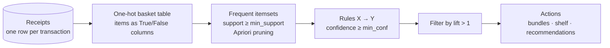

# Session 15 · Association

> **Module:** Data Science with Python · **Term 1** · ⏱️ ~2 hours
> **You will learn:** market-basket analysis, transactions and itemsets, **support**, **confidence** and **lift**, the **Apriori** principle and algorithm (implemented from scratch in pandas), generating and filtering rules, and turning rules into business actions (placement, bundles, recommendations).

---

## 1. "People who bought X also bought Y"

Association analysis looks for items that appear together in transactions more often than chance would predict. Supermarkets use it for shelf placement and bundles, e-commerce sites for "frequently bought together", and banks for cross-selling products.

> 📒 **Analogy:** Every *chai dhaba* owner knows that whoever orders *paratha* usually wants *chai* too, so he puts the kettle on the moment a paratha order comes in. Association rules find those habits in thousands of receipts instead of years of experience.



## 2. Reference tables

| Measure | Formula | Meaning |
|---|---|---|
| support(X) | transactions containing X / all transactions | how common X is |
| support(X → Y) | support(X ∪ Y) | how common the pair is |
| confidence(X → Y) | support(X ∪ Y) / support(X) | if X is bought, chance Y is bought too |
| lift(X → Y) | confidence(X → Y) / support(Y) | how much X raises Y's chance (1 = independent) |
| leverage | support(X ∪ Y) − support(X)·support(Y) | extra co-occurrence beyond chance |

| Lift value | Interpretation |
|---|---|
| > 1 | positive association — X makes Y more likely |
| = 1 | independent — no useful rule |
| < 1 | negative association — substitutes (e.g. two brands of the same item) |

**Apriori principle:** every subset of a frequent itemset is frequent; so if `{milk}` is rare, no itemset containing milk can be frequent — those candidates are skipped (pruned).

| Apriori step | |
|---|---|
| 1 | count single items; keep those with support ≥ threshold |
| 2 | join frequent (k−1)-itemsets into k-item candidates |
| 3 | prune candidates with any infrequent subset |
| 4 | count support of the rest; keep frequent ones; repeat until none left |
| 5 | split each frequent itemset into rules X → Y and compute confidence and lift |

> Libraries such as `mlxtend` (`apriori`, `association_rules`) do this in two lines. Here we write it ourselves in ~40 lines so the maths is clear and no extra package is needed.

## 3. Worked examples

Full runnable code: [`code/examples.py`](./code/examples.py) · helper module: [`code/apriori.py`](./code/apriori.py) · notebook: [`notebook.ipynb`](./notebook.ipynb)

### Example 1 — transactions to a one-hot basket
```python
transactions = [["bread", "eggs", "milk"], ["bread", "butter"], ["chai", "rusk", "milk"], ...]
items = sorted({i for t in transactions for i in t})
basket = pd.DataFrame([[i in t for i in items] for t in transactions], columns=items)
```

### Example 2 — support by hand
```python
support = basket.mean()                                   # single items
pair = (basket["bread"] & basket["eggs"]).mean()          # {bread, eggs}
```

### Example 3 — confidence and lift by hand
```python
conf = pair / support["bread"]                 # bread → eggs
lift = conf / support["eggs"]
```

### Example 4 — frequent itemsets with our Apriori
```python
from apriori import frequent_itemsets
fi = frequent_itemsets(basket, min_support=0.2)
```

### Example 5 — rules, filtered and sorted
```python
from apriori import association_rules
rules = association_rules(fi, min_confidence=0.6)
rules[rules["lift"] > 1].sort_values("lift", ascending=False)
```

### Example 6 — spotting substitutes (lift < 1)
```python
rules_all = association_rules(fi, min_confidence=0.0)
rules_all[rules_all["lift"] < 1]
```

## 4. Common mistakes

| Mistake | Fix |
|---|---|
| Trusting high confidence alone ("anything → bread" because bread is in every basket) | Check **lift** > 1 |
| `min_support` too low → millions of rules | Start higher (e.g. 1–5% for big shops) and lower gradually |
| Treating rules as cause and effect | They show co-occurrence; test actions (A/B) before big changes |
| Counting quantities instead of presence | Basket analysis uses True/False per item |
| Mixing transactions from different contexts (wholesale + retail) | Analyse segments separately |

## 5. Real-life coding problem 🧮

**Problem:** A Karachi grocery store (*kiryana* with a POS system) exported 1,000 receipts. The owner wants to: (a) find all item pairs and triples bought in at least 4% of receipts, (b) list the top 5 rules by lift with confidence ≥ 40%, and (c) get a function `recommend(cart)` that suggests up to 3 items not already in the cart, ranked by the best rule whose antecedent is contained in the cart.

<details>
<summary>💡 Full solution</summary>

```python
from apriori import association_rules, frequent_itemsets, to_basket

def store_rules(transactions, min_support=0.04, min_confidence=0.4):
    basket = to_basket(transactions)
    fi = frequent_itemsets(basket, min_support)
    multi = fi[fi["itemset"].map(len) >= 2]
    rules = association_rules(fi, min_confidence)
    top5 = rules[rules["lift"] > 1].nlargest(5, "lift")
    return multi, rules, top5

def recommend(cart, rules, n=3):
    cart = set(cart)
    usable = rules[rules["antecedent"].map(lambda a: a <= cart) & (rules["lift"] > 1)]
    scores = {}
    for _, r in usable.iterrows():
        for item in r["consequent"] - cart:
            scores[item] = max(scores.get(item, 0), r["lift"] * r["confidence"])
    return sorted(scores, key=scores.get, reverse=True)[:n]
```
Full file with simulated receipts and checks: [`code/problem_solution.py`](./code/problem_solution.py)
</details>

## 6. Practice exercises

1. For 10 transactions, compute support of `{chai}`, `{rusk}` and `{chai, rusk}` by hand-code.
2. Compute confidence and lift for `chai → rusk` and `rusk → chai`. Why are the lifts equal?
3. Use `frequent_itemsets` with `min_support` 0.3, 0.2 and 0.1 and report how many itemsets each finds.
4. Write a function that returns all rules where a given item is the consequent.

<details>
<summary>✅ Solutions</summary>

```python
s_chai, s_rusk = basket["chai"].mean(), basket["rusk"].mean()
s_both = (basket["chai"] & basket["rusk"]).mean()

conf_cr, conf_rc = s_both / s_chai, s_both / s_rusk
lift = s_both / (s_chai * s_rusk)              # symmetric formula -> same both ways

counts = {s: len(frequent_itemsets(basket, s)) for s in (0.3, 0.2, 0.1)}

def rules_for(rules, item):
    return rules[rules["consequent"].map(lambda c: c == frozenset([item]))]
```
File: [`code/exercises_solutions.py`](./code/exercises_solutions.py)
</details>

## 7. Quiz

1. Define support, confidence and lift.
2. What does a lift of 0.7 suggest?
3. State the Apriori principle.
4. Why can a rule with 90% confidence still be useless?
5. Name two business uses of association rules.

<details>
<summary>Answers</summary>

1. Support = share of transactions containing the itemset; confidence = P(Y | X); lift = confidence ÷ support(Y) · 2. The items are bought together less than chance — likely substitutes · 3. All subsets of a frequent itemset must also be frequent (so supersets of infrequent itemsets can be skipped) · 4. If Y is in almost every basket anyway, confidence is high but lift ≈ 1 — X adds no information · 5. Product placement, bundles/promotions, "frequently bought together" recommendations, cross-selling.
</details>

## 8. Summary

- Market-basket analysis finds items that co-occur more than chance.
- Support filters common itemsets, confidence measures rule reliability, lift checks it beats chance.
- Apriori prunes candidates using the "subsets of frequent sets are frequent" principle.
- Turn high-lift rules into actions, and test them before rolling out.

🎓 **Module complete!** You can now load, clean, visualise and model data with Python. Next: **Module 04 — Inferential Statistical Analysis**.

---
[⬅ Session 14](../Session-14-clustering/) · [Module home](../README.md)

<sub>Original teaching material by Aseef Ahmed · not official Aptech courseware · CC BY-NC 4.0 (text) / MIT (code)</sub>
