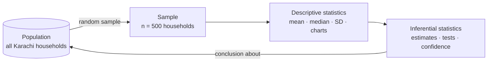
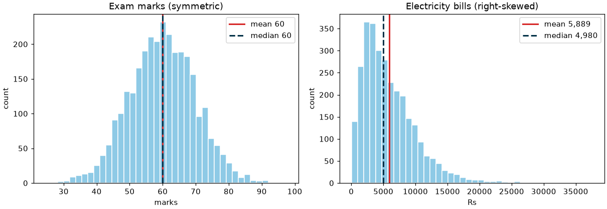

# Session 01 · Introduction to Statistics

> **Module:** Inferential Statistical Analysis · **Term 1** · ⏱️ ~2 hours
> **You will learn:** what statistics is (descriptive vs inferential), populations, samples, parameters and statistics, types of data and measurement scales, measures of centre (mean, median, mode), spread (range, IQR, variance, standard deviation, coefficient of variation), shape (skewness), percentiles, z-scores and frequency tables — all computed with Python.

---

## 1. Why statistics?

Data alone is a pile of numbers. **Statistics** turns it into decisions: Is the new teaching method better? What is the typical monthly electricity bill in Gulshan? How sure are we? This module moves from *describing* data to *drawing conclusions* about a whole population from a sample.

> 📒 **Analogy:** To check whether a *degh* of biryani has enough salt, the cook tastes one spoon — he doesn't eat the whole pot. The pot is the **population**, the spoon is the **sample**, and judging the whole pot from the spoon is **inferential statistics**. Stirring first (random sampling) makes the spoon representative.





## 2. Reference tables

| Term | Population | Sample |
|---|---|---|
| size | N | n |
| mean | μ (mu) — a **parameter** | x̄ (x-bar) — a **statistic** |
| standard deviation | σ (sigma) | s |
| proportion | p | p̂ |

| Data type | Scale | Example | Valid summaries |
|---|---|---|---|
| Qualitative | nominal | city, blood group | counts, mode |
| Qualitative | ordinal | grade A/B/C, satisfaction 1–5 | median, percentiles, mode |
| Quantitative (discrete) | interval / ratio | number of children | all |
| Quantitative (continuous) | ratio | height, income, temperature in K | all |

| Measure | Formula / Python | Note |
|---|---|---|
| mean | `x.mean()` = Σx / n | pulled by outliers |
| median | `x.median()` | middle value; robust |
| mode | `x.mode()` | most frequent; for categories |
| range | `x.max() - x.min()` | uses only two values |
| IQR | `Q3 - Q1` | spread of the middle 50% |
| variance | `x.var()` = Σ(x − x̄)² / (n − 1) | units squared |
| standard deviation | `x.std()` | typical distance from the mean |
| coefficient of variation | `x.std() / x.mean()` | compare spreads with different units |
| skewness | `x.skew()` | > 0 right tail (mean > median), < 0 left tail |
| z-score | `(x - x.mean()) / x.std()` | how many SDs from the mean |

> **Why n − 1?** A sample's values are on average closer to their own mean than to the true μ, so dividing by n under-estimates σ². Dividing by n − 1 (Bessel's correction) fixes the bias. pandas uses n − 1 by default; NumPy's `np.std` uses n unless you pass `ddof=1`.

## 3. Worked examples

Full runnable code: [`code/examples.py`](./code/examples.py) · notebook: [`notebook.ipynb`](./notebook.ipynb)

### Example 1 — centre: mean vs median with an outlier
```python
salaries = pd.Series([45, 52, 48, 60, 55, 50, 47, 900])   # Rs '000; one CEO
print(salaries.mean(), salaries.median())                    # 157.1 vs 51.0
```

### Example 2 — spread
```python
marks = pd.Series([55, 62, 68, 70, 71, 74, 78, 81, 85, 96])
print(marks.max() - marks.min(), marks.quantile(0.75) - marks.quantile(0.25), marks.var(), marks.std())
```

### Example 3 — sample vs population standard deviation
```python
x = np.array([4, 8, 6, 5, 7])
print(np.std(x), np.std(x, ddof=1), pd.Series(x).std())     # 1.414, 1.581, 1.581
```

### Example 4 — coefficient of variation: which is more variable?
```python
cv_height = heights.std() / heights.mean()        # cm
cv_income = incomes.std() / incomes.mean()        # Rs
```

### Example 5 — skewness, percentiles and z-scores
```python
bills = pd.Series(rng.gamma(2, 3000, 1000))        # electricity bills, right-skewed
print(bills.skew(), bills.quantile([0.1, 0.5, 0.9]))
z = (bills - bills.mean()) / bills.std()
```

### Example 6 — frequency table for grouped data
```python
bins = [0, 40, 50, 60, 70, 80, 101]
table = pd.cut(marks, bins, right=False).value_counts().sort_index()
rel = (table / table.sum()).round(2); cum = rel.cumsum()
```

## 4. Common mistakes

| Mistake | Fix |
|---|---|
| Reporting the mean of skewed data (incomes, house prices) | Report the median (and IQR) too |
| Averaging ordinal codes (satisfaction 1–5) as if equal steps | Use median / percentages per level |
| Mixing NumPy (`ddof=0`) and pandas (`ddof=1`) SDs | Be explicit: `np.std(x, ddof=1)` for samples |
| Comparing SDs of variables in different units | Use the coefficient of variation |
| Treating a convenience sample (your friends) as representative | Use random sampling; describe how data was collected |

## 5. Real-life coding problem 🧮

**Problem:** A K-Electric analyst has a random sample of 800 monthly household bills (Rs) from two areas, *Gulshan* and *Korangi*. Write `describe_bills(df)` that returns, per area: n, mean, median, SD, IQR, CV, skewness and the 90th percentile; flags bills with |z| > 3 within each area; and states which area has more *relative* variability. Also produce a grouped frequency table (Rs 0–2k, 2–4k, …) with relative and cumulative percentages.

<details>
<summary>💡 Full solution</summary>

```python
def describe_bills(df):
    g = df.groupby("area")["bill"]
    summary = pd.DataFrame({
        "n": g.size(), "mean": g.mean(), "median": g.median(), "sd": g.std(),
        "iqr": g.quantile(0.75) - g.quantile(0.25), "p90": g.quantile(0.9), "skew": g.skew(),
    })
    summary["cv"] = summary["sd"] / summary["mean"]
    z = (df["bill"] - g.transform("mean")) / g.transform("std")
    flagged = df[z.abs() > 3]
    more_variable = summary["cv"].idxmax()
    edges = list(range(0, int(df["bill"].max()) + 2000, 2000))
    freq = pd.cut(df["bill"], edges, right=False).value_counts().sort_index()
    table = pd.DataFrame({"count": freq, "pct": (100 * freq / freq.sum()).round(1)})
    table["cum_pct"] = table["pct"].cumsum()
    return summary.round(2), flagged, more_variable, table
```
Full file with simulated bills and checks: [`code/problem_solution.py`](./code/problem_solution.py)
</details>

## 6. Practice exercises

1. For `[12, 15, 15, 18, 20, 22, 95]` compute mean, median and mode; which best represents the data?
2. Compute the variance by hand-code (`Σ(x − x̄)² / (n − 1)`) and compare with `pd.Series.var()`.
3. A student scored 78 in Maths (class mean 65, SD 8) and 70 in English (mean 60, SD 5). In which subject did they do relatively better?
4. Classify these variables by scale: CNIC number, shoe size, rank in class, temperature in °C, monthly rent.

<details>
<summary>✅ Solutions</summary>

```python
s = pd.Series([12, 15, 15, 18, 20, 22, 95]); s.mean(), s.median(), s.mode()[0]   # median is best (outlier 95)

x = np.array([...]); var = ((x - x.mean()) ** 2).sum() / (len(x) - 1)

z_maths, z_eng = (78 - 65) / 8, (70 - 60) / 5      # 1.625 vs 2.0 -> English

scales = {"CNIC": "nominal", "shoe size": "ratio (discrete)", "rank": "ordinal",
          "temperature °C": "interval", "monthly rent": "ratio"}
```
File: [`code/exercises_solutions.py`](./code/exercises_solutions.py)
</details>

## 7. Quiz

1. What is the difference between a parameter and a statistic?
2. Which measure of centre is most affected by outliers?
3. Why do we divide by n − 1 for the sample variance?
4. If mean > median, what is the likely skew?
5. What does a z-score of −2 mean?

<details>
<summary>Answers</summary>

1. A parameter describes a population (μ, σ); a statistic describes a sample (x̄, s) and estimates the parameter · 2. The mean · 3. To correct the downward bias from using the sample mean (Bessel's correction) · 4. Positive (right) skew · 5. The value is 2 standard deviations below the mean.
</details>

## 8. Summary

- Descriptive statistics summarise a sample; inferential statistics generalise to the population.
- Know your data type — it decides which summaries are valid.
- Report centre (mean/median), spread (SD/IQR/CV) and shape (skewness) together.
- z-scores and percentiles place a single value within its distribution.

---
[Module home](../README.md) · [Session 02 ➡](../Session-02-introduction-to-probability/)

<sub>Original teaching material by Aseef Ahmed · not official Aptech courseware · CC BY-NC 4.0 (text) / MIT (code)</sub>
