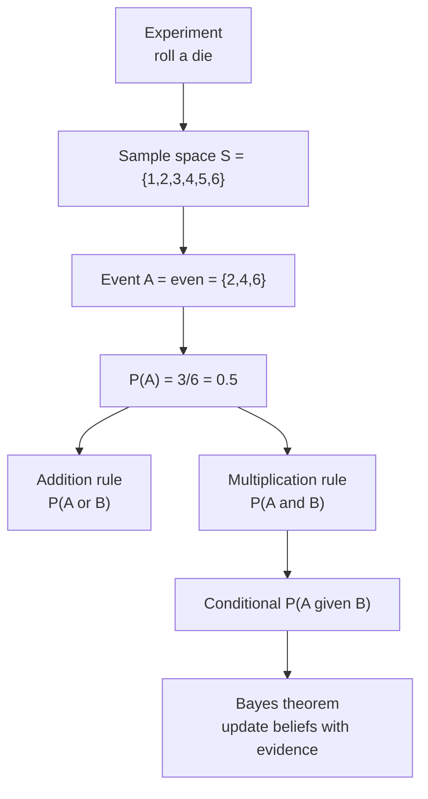
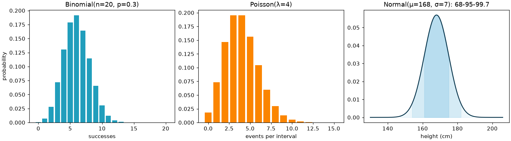

# Session 02 · Introduction to Probability

> **Module:** Inferential Statistical Analysis · **Term 1** · ⏱️ ~2 hours
> **You will learn:** experiments, sample spaces and events, the addition and multiplication rules, conditional probability and independence, **Bayes' theorem**, random variables and expected value, and the key distributions — binomial, Poisson and normal — with `scipy.stats` and simulation.

---

## 1. Measuring uncertainty

Probability is a number between 0 and 1 that measures how likely something is. It is the language of inference: every confidence interval and hypothesis test in this module is a probability statement. It also powers AI — spam filters, recommendation systems and medical tests all compute probabilities.

> 📒 **Analogy:** The weather app says "70% chance of rain in Karachi tomorrow". It doesn't know the future; it means that on days with conditions like tomorrow's, it rained about 7 times out of 10. Probability is long-run frequency (or a degree of belief) — never certainty.





## 2. Reference tables

| Rule | Formula | Example |
|---|---|---|
| complement | P(not A) = 1 − P(A) | P(no six) = 5/6 |
| addition (general) | P(A ∪ B) = P(A) + P(B) − P(A ∩ B) | even **or** > 4 |
| addition (mutually exclusive) | P(A ∪ B) = P(A) + P(B) | 1 or 2 |
| multiplication (general) | P(A ∩ B) = P(A) · P(B \| A) | two aces without replacement |
| multiplication (independent) | P(A ∩ B) = P(A) · P(B) | two coin heads |
| conditional | P(A \| B) = P(A ∩ B) / P(B) | |
| Bayes | P(A \| B) = P(B \| A) · P(A) / P(B) | disease given positive test |

| Distribution | Models | Parameters | Mean | Variance | scipy |
|---|---|---|---|---|---|
| Binomial | number of successes in n yes/no trials | n, p | np | np(1−p) | `stats.binom(n, p)` |
| Poisson | count of events in a fixed interval | λ | λ | λ | `stats.poisson(mu)` |
| Normal | continuous, bell-shaped measurements | μ, σ | μ | σ² | `stats.norm(loc, scale)` |

| scipy method | Gives |
|---|---|
| `.pmf(k)` / `.pdf(x)` | probability of exactly k (discrete) / density (continuous) |
| `.cdf(x)` | P(X ≤ x) |
| `.sf(x)` | P(X > x) = 1 − cdf |
| `.ppf(q)` | value with cumulative probability q (inverse cdf) |
| `.rvs(size, random_state)` | random samples |

**Empirical rule (normal):** about 68% of values lie within 1σ of the mean, 95% within 2σ, 99.7% within 3σ.

## 3. Worked examples

Full runnable code: [`code/examples.py`](./code/examples.py) · notebook: [`notebook.ipynb`](./notebook.ipynb)

### Example 1 — classical vs simulated probability
```python
rolls = rng.integers(1, 7, 100_000)
print((rolls % 2 == 0).mean())          # ≈ 0.5 = 3/6
```

### Example 2 — addition rule with a contingency table
```python
#             smoker  non-smoker
# male          30       70
# female        10       90
p_male_or_smoker = (100 + 40 - 30) / 200        # 0.55
```

### Example 3 — conditional probability and independence
```python
p_smoker_given_male = 30 / 100                  # 0.30
p_smoker = 40 / 200                             # 0.20 -> not independent of gender
```

### Example 4 — Bayes: a positive dengue test
```python
prior, sens, spec = 0.02, 0.95, 0.90
p_pos = sens * prior + (1 - spec) * (1 - prior)
posterior = sens * prior / p_pos                 # ≈ 0.162
```

### Example 5 — binomial and Poisson
```python
stats.binom(n=20, p=0.1).sf(3)                   # P(more than 3 defective bulbs in 20)
stats.poisson(mu=4).pmf(0)                       # P(no calls in a minute | 4 per minute on average)
```

### Example 6 — normal distribution
```python
heights = stats.norm(loc=168, scale=7)
heights.cdf(180) - heights.cdf(160)              # share between 160 and 180 cm
heights.ppf(0.95)                                # 95th percentile height
```

## 4. Common mistakes

| Mistake | Fix |
|---|---|
| Adding probabilities of overlapping events | Subtract the overlap: P(A) + P(B) − P(A ∩ B) |
| Confusing P(A \| B) with P(B \| A) ("prosecutor's fallacy") | Use Bayes' theorem |
| Assuming events are independent without checking | Compare P(A \| B) with P(A) |
| Gambler's fallacy ("tails is due") | Independent trials have no memory |
| Using `pdf` for a probability of a continuous value | Continuous P(X = x) is 0; use `cdf` differences |

## 5. Real-life coding problem 🧮

**Problem:** A call centre in Karachi receives on average **6 calls per minute** at peak time, and each agent handles one call per minute. A customer-satisfaction survey says 15% of callers are angry; angry callers hang up 60% of the time if they wait, others 10%. Answer: (a) the probability of more than 8 calls in a minute, (b) how many agents are needed so that P(calls > agents) is below 5%, (c) the probability a caller who hung up was angry (Bayes), and (d) verify (a) and (c) with a simulation of 200,000 minutes/callers.

<details>
<summary>💡 Full solution</summary>

```python
def call_centre(rate=6, p_angry=0.15, hang_angry=0.6, hang_calm=0.10, target=0.05):
    calls = stats.poisson(rate)
    p_over_8 = calls.sf(8)
    agents = next(k for k in range(rate, 5 * rate) if calls.sf(k) < target)
    p_hang = hang_angry * p_angry + hang_calm * (1 - p_angry)
    p_angry_given_hang = hang_angry * p_angry / p_hang
    return p_over_8, agents, p_angry_given_hang
```
Full file with the simulation checks: [`code/problem_solution.py`](./code/problem_solution.py)
</details>

## 6. Practice exercises

1. Two dice are rolled. Find P(sum = 7) by listing outcomes and by simulation.
2. A class has 60% girls; 30% of girls and 20% of boys wear glasses. Find P(glasses) and P(girl | glasses).
3. A quiz has 10 MCQs with 4 options. If a student guesses, find P(at least 5 correct).
4. Exam marks are normal with μ = 62, σ = 12. What percentage scores above 80, and what mark is the top 10% cut-off?

<details>
<summary>✅ Solutions</summary>

```python
outcomes = [(a, b) for a in range(1, 7) for b in range(1, 7)]
p7 = sum(a + b == 7 for a, b in outcomes) / 36          # 1/6

p_glasses = 0.6 * 0.3 + 0.4 * 0.2                        # 0.26
p_girl_given = 0.6 * 0.3 / p_glasses                      # 0.692

p_5plus = stats.binom(10, 0.25).sf(4)                    # ≈ 0.078

m = stats.norm(62, 12); above80 = m.sf(80); cutoff = m.ppf(0.9)
```
File: [`code/exercises_solutions.py`](./code/exercises_solutions.py)
</details>

## 7. Quiz

1. What is P(not A) if P(A) = 0.35?
2. When can you multiply P(A) · P(B) to get P(A and B)?
3. Why is P(disease | positive) often much smaller than the test's sensitivity?
4. Which distribution models the number of customers arriving per hour?
5. Using the empirical rule, what share of a normal population lies within ±2σ?

<details>
<summary>Answers</summary>

1. 0.65 · 2. When A and B are independent · 3. Because the disease is rare (low prior), so false positives from the large healthy group outnumber true positives · 4. Poisson · 5. About 95%.
</details>

## 8. Summary

- Probabilities live in [0, 1]; use complement, addition and multiplication rules carefully.
- Conditional probability and Bayes' theorem update beliefs with evidence.
- Binomial (successes in n trials), Poisson (counts per interval) and normal (measurements) cover most everyday cases.
- `scipy.stats` gives pmf/pdf, cdf, sf and ppf; simulation is a great way to check answers.

---
[⬅ Session 01](../Session-01-introduction-to-statistics/) · [Module home](../README.md) · [Session 03 ➡](../Session-03-correlation-and-regression/)

<sub>Original teaching material by Aseef Ahmed · not official Aptech courseware · CC BY-NC 4.0 (text) / MIT (code)</sub>
