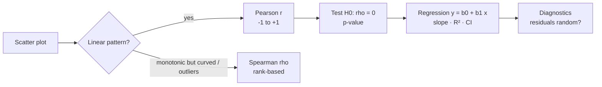
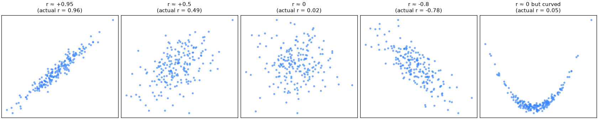

# Session 03 · Correlation and Regression

> **Module:** Inferential Statistical Analysis · **Term 1** · ⏱️ ~2 hours
> **You will learn:** covariance, Pearson's *r* and Spearman's ρ, testing whether a correlation is significant, correlation vs causation, simple linear regression by least squares (slope, intercept, R²), reading a `statsmodels` regression table (standard errors, *t*, *p*, confidence intervals), residual checks, and multiple regression.

---

## 1. Do two things move together?

Do students who attend more score higher? Does advertising raise sales? **Correlation** measures the strength and direction of a *linear* relationship between two numeric variables. **Regression** goes further: it fits an equation so we can predict one variable from another and say how much `y` changes per unit of `x` — with a measure of uncertainty.

> 📒 **Analogy:** In Karachi, ice-cream sales and drowning incidents at Sea View rise together. They are correlated — but ice-cream doesn't cause drowning; hot weather drives both. Correlation tells you *that* things move together, not *why*.





## 2. Reference tables

| *r* value | Typical description |
|---|---|
| ±0.9 to ±1.0 | very strong |
| ±0.7 to ±0.9 | strong |
| ±0.4 to ±0.7 | moderate |
| ±0.1 to ±0.4 | weak |
| ≈ 0 | no linear relationship (there may still be a curve!) |

| Quantity | Formula | Python |
|---|---|---|
| covariance | Σ(x − x̄)(y − ȳ) / (n − 1) | `np.cov(x, y)[0, 1]` |
| Pearson *r* | cov(x, y) / (sₓ s_y) | `stats.pearsonr(x, y)` |
| Spearman ρ | Pearson *r* of the ranks | `stats.spearmanr(x, y)` |
| slope b₁ | r · s_y / sₓ | `stats.linregress(x, y).slope` |
| intercept b₀ | ȳ − b₁ x̄ | `.intercept` |
| R² | r² (simple regression) = share of variance explained | `.rvalue ** 2` |
| full table | coefficients, SE, *t*, *p*, CI | `smf.ols("y ~ x", data=df).fit().summary()` |

| Regression assumption (LINE) | Check |
|---|---|
| **L**inearity | scatter / residuals vs fitted show no curve |
| **I**ndependence | observations unrelated (no repeated measures, no time pattern) |
| **N**ormality of residuals | histogram / Q-Q plot of residuals |
| **E**qual variance | residual spread constant (no funnel) |

## 3. Worked examples

Full runnable code: [`code/examples.py`](./code/examples.py) · notebook: [`notebook.ipynb`](./notebook.ipynb)

### Example 1 — covariance and Pearson r by hand
```python
cov = ((x - x.mean()) * (y - y.mean())).sum() / (len(x) - 1)
r = cov / (x.std(ddof=1) * y.std(ddof=1))
r_scipy, p = stats.pearsonr(x, y)
```

### Example 2 — Pearson vs Spearman with an outlier
```python
x2, y2 = np.append(x, 40), np.append(y, 5)        # one strange point
print(stats.pearsonr(x2, y2)[0], stats.spearmanr(x2, y2)[0])
```

### Example 3 — zero correlation, strong relationship
```python
u = np.linspace(-3, 3, 100); v = u ** 2
print(stats.pearsonr(u, v)[0])                    # ≈ 0, yet v depends perfectly on u
```

### Example 4 — simple regression with linregress
```python
res = stats.linregress(df["attendance"], df["marks"])
print(res.slope, res.intercept, res.rvalue ** 2, res.pvalue)
```

### Example 5 — statsmodels table and confidence intervals
```python
import statsmodels.formula.api as smf
model = smf.ols("marks ~ attendance", data=df).fit()
print(model.params, model.conf_int(), model.rsquared)
model.get_prediction(pd.DataFrame({"attendance": [90]})).summary_frame(alpha=0.05)
```

### Example 6 — multiple regression and residuals
```python
m2 = smf.ols("marks ~ attendance + study_hours + C(campus)", data=df).fit()
resid = m2.resid
print(stats.shapiro(resid).pvalue)                 # normality check
```

## 4. Common mistakes

| Mistake | Fix |
|---|---|
| "r = 0.8, so X causes Y" | Correlation ≠ causation; look for confounders, use experiments |
| Using Pearson on curved or outlier-heavy data | Plot first; use Spearman or transform |
| Concluding "no relationship" from r ≈ 0 | r measures *linear* association only |
| Predicting far outside the observed x-range | Extrapolation is unreliable |
| Ignoring residual plots | Check LINE assumptions before trusting *p*-values |

## 5. Real-life coding problem 🧮

**Problem:** A real-estate agency has 150 recent apartment sales in Karachi with `size_sqft`, `age_years`, `floor`, `distance_to_main_road_km` and `price_lakh`. (a) Compute the correlation matrix and report which variable is most strongly correlated with price and whether that correlation is significant. (b) Fit `price ~ size_sqft` and interpret the slope (lakh per extra 100 sq ft) with its 95% CI. (c) Fit a multiple regression with all predictors, report adjusted R² and which predictors are significant at 5%, and (d) predict the price (with a 95% prediction interval) of a 1,200 sq ft, 5-year-old flat on the 3rd floor, 0.5 km from the main road.

<details>
<summary>💡 Full solution</summary>

```python
def price_study(df):
    corr = df.corr()["price_lakh"].drop("price_lakh")
    best = corr.abs().idxmax()
    r, p = stats.pearsonr(df[best], df["price_lakh"])
    simple = smf.ols("price_lakh ~ size_sqft", data=df).fit()
    slope_100 = 100 * simple.params["size_sqft"]
    ci_100 = 100 * simple.conf_int().loc["size_sqft"].to_numpy()
    full = smf.ols("price_lakh ~ size_sqft + age_years + floor + distance_to_main_road_km", data=df).fit()
    significant = full.pvalues.drop("Intercept").loc[lambda s: s < 0.05].index.tolist()
    new = pd.DataFrame({"size_sqft": [1200], "age_years": [5], "floor": [3], "distance_to_main_road_km": [0.5]})
    pred = full.get_prediction(new).summary_frame(alpha=0.05)
    return best, r, p, slope_100, ci_100, full.rsquared_adj, significant, pred
```
Full file with simulated sales and checks: [`code/problem_solution.py`](./code/problem_solution.py)
</details>

## 6. Practice exercises

1. For `x = [2, 4, 6, 8, 10]`, `y = [3, 7, 5, 11, 14]` compute Pearson *r* by hand-code and check with scipy.
2. Compute the regression slope and intercept from the formulas `b1 = r·s_y/s_x`, `b0 = ȳ − b1·x̄`.
3. Simulate a confounder: temperature drives both ice-cream sales and drownings; show r(ice-cream, drownings) is high but drops near 0 after controlling for temperature (regress both on temperature and correlate residuals).
4. Fit `smf.ols` and extract the 95% CI of the slope.

<details>
<summary>✅ Solutions</summary>

```python
r = np.corrcoef(x, y)[0, 1]
b1 = r * y.std(ddof=1) / x.std(ddof=1); b0 = y.mean() - b1 * x.mean()

res_ice = smf.ols("ice ~ temp", d).fit().resid
res_drown = smf.ols("drown ~ temp", d).fit().resid
partial_r = stats.pearsonr(res_ice, res_drown)[0]

ci = smf.ols("y ~ x", df).fit().conf_int().loc["x"]
```
File: [`code/exercises_solutions.py`](./code/exercises_solutions.py)
</details>

## 7. Quiz

1. What does r = −0.85 tell you?
2. When should you prefer Spearman's ρ over Pearson's r?
3. In simple linear regression, how is R² related to r?
4. What does a 95% confidence interval for the slope that excludes 0 mean?
5. Name the four LINE assumptions.

<details>
<summary>Answers</summary>

1. A strong negative linear relationship — as x rises, y tends to fall · 2. When the relationship is monotonic but not linear, data are ordinal, or there are outliers · 3. R² = r² · 4. The slope is significantly different from 0 at the 5% level — x is a useful linear predictor · 5. Linearity, Independence, Normality of residuals, Equal variance.
</details>

## 8. Summary

- Covariance gives direction; Pearson *r* gives standardised linear strength; Spearman handles ranks and outliers.
- Test correlations (`pearsonr` p-value) and never read them as causation.
- Least-squares regression gives slope, intercept and R²; `statsmodels` adds SEs, *p*-values and intervals.
- Check residuals (LINE) before trusting inferences; multiple regression controls for other variables.

---
[⬅ Session 02](../Session-02-introduction-to-probability/) · [Module home](../README.md) · [Session 04 ➡](../Session-04-inferential-statistics/)

<sub>Original teaching material by Aseef Ahmed · not official Aptech courseware · CC BY-NC 4.0 (text) / MIT (code)</sub>
