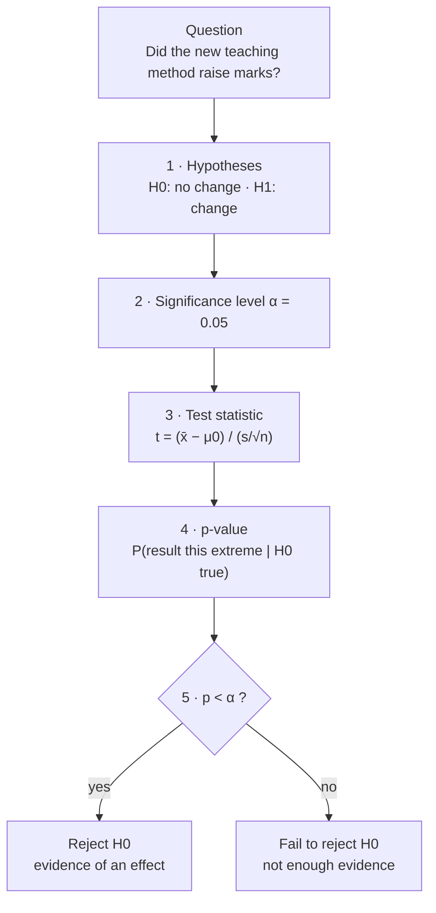
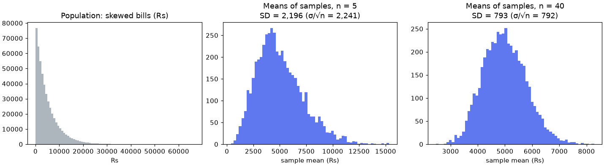

# Session 04 · Inferential Statistics

> **Module:** Inferential Statistical Analysis · **Term 1** · ⏱️ ~2 hours
> **You will learn:** sampling distributions and the **Central Limit Theorem**, standard error, **confidence intervals** for a mean and a proportion, the five-step **hypothesis-testing** procedure, *p*-values, one-sample, two-sample and paired *t*-tests, a *z*-test for proportions, Type I/II errors, power and effect size.

---

## 1. From a sample to the population

We almost never measure everyone. We take a sample and ask: *what can we say about the population, and how sure are we?* Inferential statistics answers with **estimates** (confidence intervals) and **decisions** (hypothesis tests), each with a known error rate.

> 📒 **Analogy:** Before an election, a TV channel surveys 1,500 voters and says "Party A: 42% ± 2.5%". It didn't ask 130 million voters, but random sampling plus probability lets it state a range and how often such ranges capture the truth (95% of the time).





## 2. Reference tables

| Idea | Formula | Python |
|---|---|---|
| standard error of the mean | SE = s / √n | `stats.sem(x)` |
| CI for a mean (σ unknown) | x̄ ± t* · SE, df = n − 1 | `stats.t.interval(0.95, df, loc=x̄, scale=SE)` |
| SE of a proportion | √(p̂(1 − p̂)/n) | |
| CI for a proportion | p̂ ± z* · SE | `statsmodels.stats.proportion.proportion_confint` |
| sample size for a mean | n = (z* · σ / E)² | |
| effect size (Cohen's d) | (x̄₁ − x̄₂) / s_pooled | 0.2 small · 0.5 medium · 0.8 large |

| Test | Use when | scipy / statsmodels |
|---|---|---|
| one-sample *t* | compare a mean with a target value | `stats.ttest_1samp(x, popmean)` |
| two-sample *t* (Welch) | compare means of two independent groups | `stats.ttest_ind(a, b, equal_var=False)` |
| paired *t* | before/after on the same subjects | `stats.ttest_rel(before, after)` |
| one-proportion *z* | compare a proportion with a target | `proportions_ztest(count, n, value)` |
| two-proportion *z* | compare two proportions (A/B test) | `proportions_ztest([c1, c2], [n1, n2])` |

| | H₀ true | H₀ false |
|---|---|---|
| **Reject H₀** | Type I error (α) — false alarm | ✅ correct (power = 1 − β) |
| **Fail to reject** | ✅ correct | Type II error (β) — missed effect |

**Central Limit Theorem:** for large enough *n* (≈ 30+), the distribution of sample means is approximately normal with mean μ and SD σ/√n — *whatever* the shape of the population.

## 3. Worked examples

Full runnable code: [`code/examples.py`](./code/examples.py) · notebook: [`notebook.ipynb`](./notebook.ipynb)

### Example 1 — the CLT by simulation
```python
population = rng.exponential(scale=5000, size=1_000_000)          # very skewed bills
means = [rng.choice(population, 40).mean() for _ in range(5000)]
print(np.std(means), population.std() / np.sqrt(40))               # ≈ equal
```

### Example 2 — a 95% CI for a mean
```python
se = stats.sem(sample)
lo, hi = stats.t.interval(0.95, df=len(sample) - 1, loc=sample.mean(), scale=se)
```

### Example 3 — what "95% confidence" means
```python
covered = 0
for _ in range(1000):
    s = rng.normal(70, 10, 25)
    lo, hi = stats.t.interval(0.95, 24, loc=s.mean(), scale=stats.sem(s))
    covered += lo <= 70 <= hi
print(covered / 1000)            # ≈ 0.95
```

### Example 4 — one-sample and paired t-tests
```python
stats.ttest_1samp(fill_volumes, popmean=500)       # are 500 ml bottles under-filled?
stats.ttest_rel(before, after)                      # did tutoring change marks?
```

### Example 5 — two-sample Welch t-test and effect size
```python
t, p = stats.ttest_ind(campus_a, campus_b, equal_var=False)
d = (campus_a.mean() - campus_b.mean()) / np.sqrt((campus_a.var(ddof=1) + campus_b.var(ddof=1)) / 2)
```

### Example 6 — A/B test of two proportions
```python
from statsmodels.stats.proportion import proportions_ztest
z, p = proportions_ztest(count=[132, 168], nobs=[2400, 2400])     # old vs new sign-up page
```

## 4. Common mistakes

| Mistake | Fix |
|---|---|
| "p = 0.03 means a 3% chance H₀ is true" | It is P(data this extreme **if** H₀ were true) |
| "Fail to reject" read as "H₀ is proven" | Absence of evidence is not evidence of absence |
| Running many tests and reporting the one with p < 0.05 | Pre-register the hypothesis; correct for multiple tests (Bonferroni) |
| Using an independent t-test for before/after data | Use the paired test |
| Statistically significant = important | Report effect size and CI, not just *p* |

## 5. Real-life coding problem 🧮

**Problem:** An Aptech-style training centre piloted a new **project-based teaching method** in one batch. You have final marks for 45 students taught the new way and 50 taught the old way, plus pre- and post-test marks for the 45 new-method students. (a) Give 95% CIs for both group means. (b) Test (Welch, α = 0.05) whether the new method gives higher marks (one-sided) and report Cohen's *d*. (c) Test with a paired *t*-test whether the new-method students improved from pre- to post-test. (d) Estimate how many students per group a future study needs to detect a 5-mark difference with SD 12 at 80% power.

<details>
<summary>💡 Full solution</summary>

```python
from statsmodels.stats.power import TTestIndPower

def ci(x, level=0.95):
    return stats.t.interval(level, len(x) - 1, loc=np.mean(x), scale=stats.sem(x))

def teaching_study(new, old, pre, post, alpha=0.05):
    ci_new, ci_old = ci(new), ci(old)
    t, p_one = stats.ttest_ind(new, old, equal_var=False, alternative="greater")
    d = (np.mean(new) - np.mean(old)) / np.sqrt((np.var(new, ddof=1) + np.var(old, ddof=1)) / 2)
    t_pair, p_pair = stats.ttest_rel(post, pre, alternative="greater")
    n_needed = TTestIndPower().solve_power(effect_size=5 / 12, power=0.8, alpha=alpha)
    return {"ci_new": ci_new, "ci_old": ci_old, "p_welch": p_one, "cohens_d": d,
            "p_paired": p_pair, "n_per_group": int(np.ceil(n_needed))}
```
Full file with simulated marks and checks: [`code/problem_solution.py`](./code/problem_solution.py)
</details>

## 6. Practice exercises

1. A sample of 36 delivery times has mean 32 min and SD 6 min. Compute the 95% CI by formula and with `stats.t.interval`.
2. A biscuit factory claims packets weigh 100 g. Test this claim with a sample of 20 packets (two-sided, α = 0.05).
3. 540 of 1,200 surveyed Karachi residents support a new bus route. Give a 95% CI for the proportion and test H₀: p = 0.5.
4. Simulate 2,000 t-tests where H₀ is true and show that about 5% give p < 0.05 (the Type I error rate).

<details>
<summary>✅ Solutions</summary>

```python
se = 6 / np.sqrt(36); tcrit = stats.t.ppf(0.975, 35)
ci = (32 - tcrit * se, 32 + tcrit * se)

t, p = stats.ttest_1samp(packets, 100)

lo, hi = proportion_confint(540, 1200, method="normal"); z, p = proportions_ztest(540, 1200, value=0.5)

false_alarms = np.mean([stats.ttest_1samp(rng.normal(50, 10, 30), 50).pvalue < 0.05 for _ in range(2000)])
```
File: [`code/exercises_solutions.py`](./code/exercises_solutions.py)
</details>

## 7. Quiz

1. What does the Central Limit Theorem say?
2. How does increasing the sample size affect the width of a confidence interval?
3. Define the *p*-value.
4. Which test compares before-and-after marks of the same students?
5. What is a Type II error?

<details>
<summary>Answers</summary>

1. Sample means are approximately normally distributed (mean μ, SD σ/√n) for large n, regardless of the population's shape · 2. It narrows (width ∝ 1/√n) · 3. The probability, assuming H₀ is true, of getting a result at least as extreme as the one observed · 4. The paired *t*-test · 5. Failing to reject H₀ when it is actually false (missing a real effect).
</details>

## 8. Summary

- Sample statistics vary; the CLT and the standard error describe how much.
- Confidence intervals give a range of plausible values with a known long-run success rate.
- Hypothesis tests follow five steps and end with a *p*-value compared with α.
- Choose the right test (one-sample, Welch, paired, proportion), and always report effect size and power considerations.

---
[⬅ Session 03](../Session-03-correlation-and-regression/) · [Module home](../README.md) · [Session 05 ➡](../Session-05-exact-sampling-distributions/)

<sub>Original teaching material by Aseef Ahmed · not official Aptech courseware · CC BY-NC 4.0 (text) / MIT (code)</sub>
