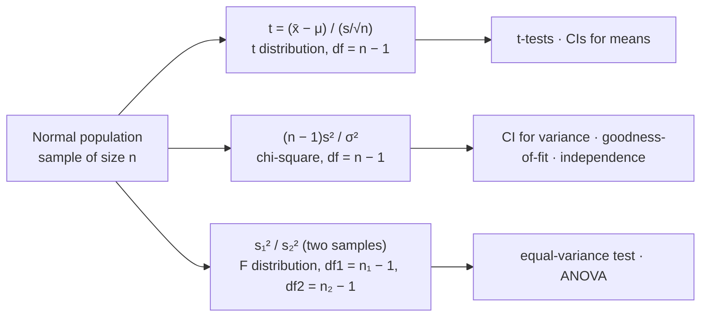
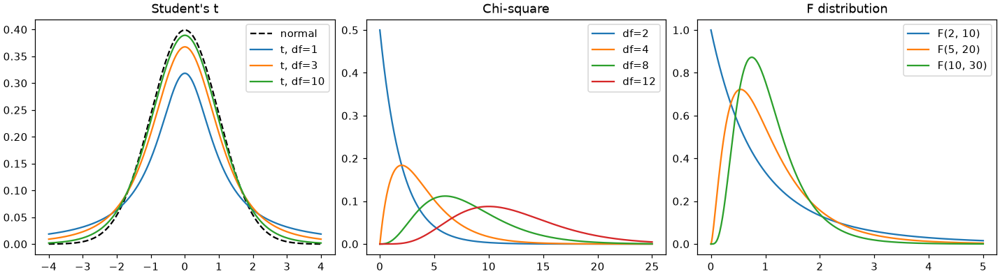

# Session 05 · Exact Sampling Distributions

> **Module:** Inferential Statistical Analysis · **Term 1** · ⏱️ ~2 hours
> **You will learn:** the three "exact" sampling distributions used for small samples from normal populations — **Student's t**, **chi-square (χ²)** and **F** — what degrees of freedom are, how to read critical values with `scipy.stats`, and the tests built on them: a CI for a variance, χ² goodness-of-fit, χ² test of independence, and the F-test for equal variances.

---

## 1. Why "exact" distributions?

The Central Limit Theorem (Session 04) gives *approximate* normality for large samples. With small samples from a normal population we can do better: certain statistics follow known distributions **exactly**. They are the engines behind *t*-tests, χ² tests and ANOVA.

> 📒 **Analogy:** The normal distribution is a ready-made *kurta* in size M — fine for most people (large samples). The t, χ² and F distributions are tailor-made: the tailor (degrees of freedom) adjusts the fit to how much data you actually have.





## 2. Reference tables

| Distribution | Shape | Built from | Mean | Main uses |
|---|---|---|---|---|
| *t* (df) | symmetric, heavier tails than normal; → normal as df grows | Z / √(χ²/df) | 0 | means with unknown σ |
| χ² (df) | right-skewed, ≥ 0 | sum of df squared standard normals | df | variance, counts / categories |
| F (df1, df2) | right-skewed, ≥ 0 | (χ²₁/df1) / (χ²₂/df2) | df2/(df2−2) | ratio of variances, ANOVA |

**Degrees of freedom (df):** the number of values free to vary after estimating something. With *n* numbers and a known mean, only *n* − 1 can be chosen freely.

| Critical value | scipy |
|---|---|
| two-sided t, 95%, df = 9 | `stats.t.ppf(0.975, 9)` → 2.262 |
| χ² upper 5%, df = 4 | `stats.chi2.ppf(0.95, 4)` → 9.488 |
| F upper 5%, (3, 20) | `stats.f.ppf(0.95, 3, 20)` → 3.098 |

| Test | Statistic | df | Python |
|---|---|---|---|
| CI for σ² | ((n−1)s²/χ²_upper, (n−1)s²/χ²_lower) | n − 1 | `stats.chi2.ppf` |
| goodness-of-fit | Σ (O − E)² / E | k − 1 | `stats.chisquare(observed, expected)` |
| independence (contingency table) | Σ (O − E)² / E | (r−1)(c−1) | `stats.chi2_contingency(table)` |
| equal variances | s₁² / s₂² | (n₁−1, n₂−1) | `stats.f.sf` (or `stats.levene` — robust) |

## 3. Worked examples

Full runnable code: [`code/examples.py`](./code/examples.py) · notebook: [`notebook.ipynb`](./notebook.ipynb)

### Example 1 — t approaches normal as df grows
```python
for df in (2, 5, 30, 1000):
    print(df, stats.t.ppf(0.975, df))      # 4.30, 2.57, 2.04, 1.96
```

### Example 2 — simulating where χ² comes from
```python
n, sigma = 8, 5
stat = [(n - 1) * rng.normal(50, sigma, n).var(ddof=1) / sigma**2 for _ in range(20000)]
print(np.mean(stat))                        # ≈ df = 7
```

### Example 3 — a 95% CI for a variance (bottle filling consistency)
```python
n, s2 = len(fills), fills.var(ddof=1)
lo = (n - 1) * s2 / stats.chi2.ppf(0.975, n - 1)
hi = (n - 1) * s2 / stats.chi2.ppf(0.025, n - 1)
```

### Example 4 — χ² goodness-of-fit: is the die fair?
```python
observed = [18, 22, 16, 25, 30, 9]
stats.chisquare(observed)                   # expected equal by default
```

### Example 5 — χ² test of independence
```python
table = pd.crosstab(df["programme"], df["placed"])
chi2, p, dof, expected = stats.chi2_contingency(table)
```

### Example 6 — F-test for equal variances
```python
F = a.var(ddof=1) / b.var(ddof=1)
p = 2 * min(stats.f.sf(F, len(a) - 1, len(b) - 1), stats.f.cdf(F, len(a) - 1, len(b) - 1))
stats.levene(a, b)                          # robust alternative
```

## 4. Common mistakes

| Mistake | Fix |
|---|---|
| Using normal z-values for small samples | Use t with df = n − 1 |
| χ² test on percentages | Use raw **counts** |
| Expected counts below 5 in many cells | Merge categories or use Fisher's exact test (`stats.fisher_exact`) |
| Concluding causation from χ² independence | It only shows association |
| F-test on clearly non-normal data | F is sensitive to non-normality; prefer Levene's test |

## 5. Real-life coding problem 🧮

**Problem:** A Karachi edtech company surveyed 400 graduates of four programmes (Data Science, Web Dev, AI, Networking) on whether they found a job within 6 months. (a) Test whether placement is independent of programme and show which cells contribute most to χ². (b) The company claims its students come equally from four Karachi districts; test this with the observed district counts. (c) Salaries (Rs '000) for 12 Data Science and 15 Web Dev graduates are given; test whether the two programmes have equal salary variances (F and Levene) and give a 95% CI for the Data Science salary standard deviation.

<details>
<summary>💡 Full solution</summary>

```python
def placement_study(survey, district_counts, ds, web):
    table = pd.crosstab(survey["programme"], survey["placed"])
    chi2, p_ind, dof, expected = stats.chi2_contingency(table)
    contrib = ((table - expected) ** 2 / expected).round(2)
    gof = stats.chisquare(district_counts)
    F = np.var(ds, ddof=1) / np.var(web, ddof=1)
    d1, d2 = len(ds) - 1, len(web) - 1
    p_f = 2 * min(stats.f.sf(F, d1, d2), stats.f.cdf(F, d1, d2))
    p_lev = stats.levene(ds, web).pvalue
    s2 = np.var(ds, ddof=1)
    sd_ci = np.sqrt([d1 * s2 / stats.chi2.ppf(0.975, d1), d1 * s2 / stats.chi2.ppf(0.025, d1)])
    return p_ind, contrib, gof.pvalue, p_f, p_lev, sd_ci
```
Full file with simulated data and checks: [`code/problem_solution.py`](./code/problem_solution.py)
</details>

## 6. Practice exercises

1. Find the 95% two-sided t critical values for df = 4, 14 and 60 and compare with 1.96.
2. In 120 cricket tosses a coin landed heads 72 times. Use a χ² goodness-of-fit test for fairness.
3. A 2×2 table: smokers/non-smokers × cough/no cough = [[40, 60], [25, 125]]. Test independence and print expected counts.
4. Compute the probability that an F(5, 10) variable exceeds 3.33.

<details>
<summary>✅ Solutions</summary>

```python
crit = {df: stats.t.ppf(0.975, df) for df in (4, 14, 60)}

stats.chisquare([72, 48])                                     # expected 60/60

chi2, p, dof, exp = stats.chi2_contingency([[40, 60], [25, 125]])

p_tail = stats.f.sf(3.33, 5, 10)                              # ≈ 0.05
```
File: [`code/exercises_solutions.py`](./code/exercises_solutions.py)
</details>

## 7. Quiz

1. How does the t distribution differ from the standard normal?
2. What are the degrees of freedom of a χ² independence test on a 3×4 table?
3. Why can a χ² statistic never be negative?
4. Which distribution describes the ratio of two sample variances?
5. What should you do if many expected counts are below 5?

<details>
<summary>Answers</summary>

1. It has heavier tails (more spread) for small df, approaching the normal as df increases · 2. (3 − 1)(4 − 1) = 6 · 3. It is a sum of squared terms · 4. The F distribution · 5. Combine categories or use an exact test (Fisher's exact test for 2×2).
</details>

## 8. Summary

- *t*, χ² and F are exact sampling distributions for normal populations, indexed by degrees of freedom.
- *t* handles means with unknown σ; χ² handles variances and categorical counts; F compares variances.
- `stats.<dist>.ppf` gives critical values and `.sf` gives tail probabilities.
- χ² goodness-of-fit and independence tests need raw counts and adequate expected frequencies.

---
[⬅ Session 04](../Session-04-inferential-statistics/) · [Module home](../README.md) · [Session 06 ➡](../Session-06-analysis-of-variance/)

<sub>Original teaching material by Aseef Ahmed · not official Aptech courseware · CC BY-NC 4.0 (text) / MIT (code)</sub>
