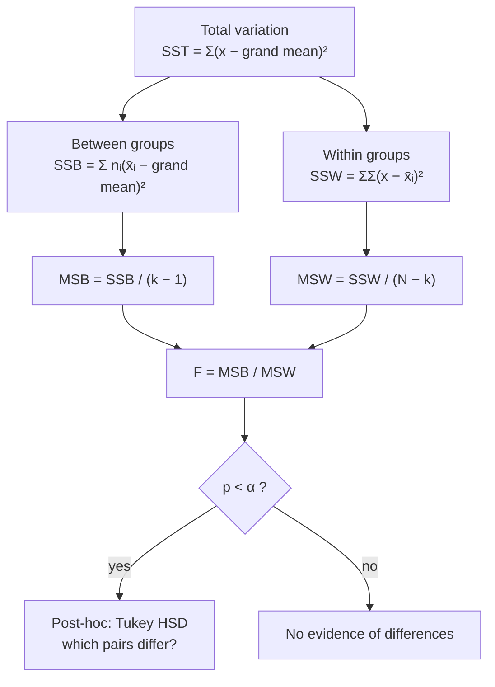
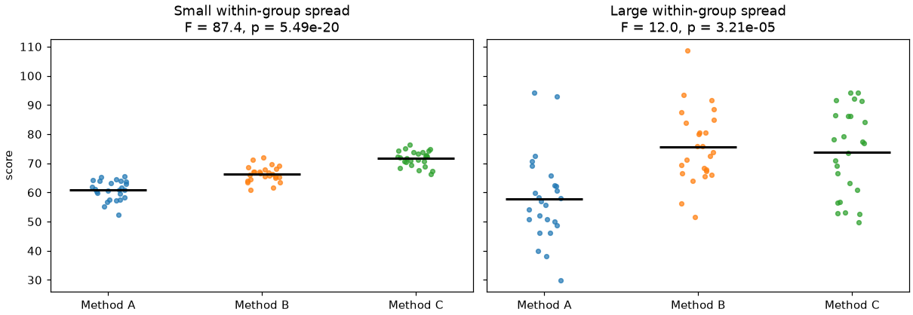

# Session 06 · Analysis of Variance

> **Module:** Inferential Statistical Analysis · **Term 1** · ⏱️ ~2 hours
> **You will learn:** why we don't run many *t*-tests, the logic of **one-way ANOVA** (between- vs within-group variation, the F ratio), building the ANOVA table by hand and with `scipy`/`statsmodels`, checking assumptions, **post-hoc** comparisons with Tukey's HSD, effect size (η²), **two-way ANOVA** with interaction, and the Kruskal–Wallis alternative.

---

## 1. Comparing more than two groups

Session 04 compared two means with a *t*-test. What about four teaching methods, five fertilisers or three delivery companies? Running every pair of *t*-tests inflates the false-alarm rate: with 6 pairwise tests at α = 0.05 the chance of at least one false positive is about 26%. **ANOVA** tests all groups at once: *are any of the means different?*

> 📒 **Analogy:** Three *nihari* shops claim to be the best. If customers' ratings differ a lot **between** shops compared with how much they differ **within** each shop, the shops really differ. If ratings vary just as much inside each shop, the "difference" is just noise. That ratio is the F statistic.





## 2. Reference tables

**One-way ANOVA table**

| Source | SS | df | MS | F |
|---|---|---|---|---|
| Between groups | SSB | k − 1 | MSB = SSB/(k−1) | MSB / MSW |
| Within groups (error) | SSW | N − k | MSW = SSW/(N−k) | |
| Total | SST = SSB + SSW | N − 1 | | |

| Hypotheses | |
|---|---|
| H₀ | μ₁ = μ₂ = … = μₖ |
| H₁ | at least one mean differs |

| Assumption | Check | If violated |
|---|---|---|
| independent observations | study design | redesign / mixed models |
| normal residuals in each group | Shapiro–Wilk, Q-Q plot | Kruskal–Wallis (`stats.kruskal`) |
| equal variances | Levene's test | Welch's ANOVA (`pingouin`/manual) or transform |

| Tool | Python |
|---|---|
| one-way ANOVA | `stats.f_oneway(g1, g2, g3)` |
| ANOVA table (any design) | `sm.stats.anova_lm(smf.ols("y ~ C(group)", df).fit(), typ=2)` |
| two-way with interaction | `smf.ols("y ~ C(a) * C(b)", df)` |
| Tukey post-hoc | `statsmodels.stats.multicomp.pairwise_tukeyhsd(y, group)` |
| non-parametric | `stats.kruskal(g1, g2, g3)` |
| effect size η² | SSB / SST (0.01 small · 0.06 medium · 0.14 large) |

## 3. Worked examples

Full runnable code: [`code/examples.py`](./code/examples.py) · notebook: [`notebook.ipynb`](./notebook.ipynb)

### Example 1 — why not many t-tests?
```python
k_tests = 6
print(1 - 0.95 ** k_tests)                 # 0.265 chance of ≥ 1 false positive
```

### Example 2 — ANOVA table by hand
```python
grand = df["score"].mean()
ssb = df.groupby("method")["score"].apply(lambda g: len(g) * (g.mean() - grand) ** 2).sum()
ssw = df.groupby("method")["score"].apply(lambda g: ((g - g.mean()) ** 2).sum()).sum()
F = (ssb / (k - 1)) / (ssw / (N - k)); p = stats.f.sf(F, k - 1, N - k)
```

### Example 3 — the same with scipy and statsmodels
```python
stats.f_oneway(*[g["score"] for _, g in df.groupby("method")])
sm.stats.anova_lm(smf.ols("score ~ C(method)", data=df).fit(), typ=2)
```

### Example 4 — assumptions
```python
stats.levene(*groups)                                  # equal variances?
stats.shapiro(smf.ols("score ~ C(method)", df).fit().resid)   # normal residuals?
```

### Example 5 — Tukey HSD and η²
```python
from statsmodels.stats.multicomp import pairwise_tukeyhsd
print(pairwise_tukeyhsd(df["score"], df["method"], alpha=0.05))
eta_sq = ssb / (ssb + ssw)
```

### Example 6 — two-way ANOVA with interaction
```python
m = smf.ols("yield_kg ~ C(fertiliser) * C(irrigation)", data=farm).fit()
sm.stats.anova_lm(m, typ=2)
```

## 4. Common mistakes

| Mistake | Fix |
|---|---|
| Running all pairwise *t*-tests | One ANOVA, then a post-hoc test that controls the error rate |
| Stopping at "p < 0.05, the groups differ" | Use Tukey HSD to find **which** groups differ; report η² |
| Ignoring a significant interaction in two-way ANOVA | Interpret simple effects; main effects can mislead |
| Using ANOVA on very skewed data with small groups | Kruskal–Wallis or a transformation |
| Forgetting `C()` for numeric group codes in formulas | `C(group)` treats it as categorical |

## 5. Real-life coding problem 🧮

**Problem:** A Karachi logistics firm tests **three courier partners** (A, B, C) for delivery time (hours) and also whether the parcel was sent on a **weekday or weekend**. For 180 parcels: (a) run a one-way ANOVA on courier, check Levene and Shapiro, and compute η²; (b) if significant, use Tukey HSD to list which couriers differ; (c) run a two-way ANOVA (courier × day type) and report whether the interaction is significant; (d) confirm (a) with Kruskal–Wallis. Recommend a courier.

<details>
<summary>💡 Full solution</summary>

```python
def courier_study(df, alpha=0.05):
    groups = [g["hours"].to_numpy() for _, g in df.groupby("courier")]
    f, p = stats.f_oneway(*groups)
    one = smf.ols("hours ~ C(courier)", data=df).fit()
    table = sm.stats.anova_lm(one, typ=2)
    eta_sq = table.loc["C(courier)", "sum_sq"] / table["sum_sq"].sum()
    checks = {"levene_p": stats.levene(*groups).pvalue, "shapiro_p": stats.shapiro(one.resid).pvalue}
    tukey = pairwise_tukeyhsd(df["hours"], df["courier"], alpha=alpha)
    tk = pd.DataFrame(tukey.summary().data[1:], columns=tukey.summary().data[0])
    different = tk.loc[tk["reject"], ["group1", "group2"]].apply(tuple, axis=1).tolist()
    two = sm.stats.anova_lm(smf.ols("hours ~ C(courier) * C(day_type)", data=df).fit(), typ=2)
    p_interaction = two.loc["C(courier):C(day_type)", "PR(>F)"]
    p_kw = stats.kruskal(*groups).pvalue
    best = df.groupby("courier")["hours"].mean().idxmin()
    return p, eta_sq, checks, different, p_interaction, p_kw, best
```
Full file with simulated deliveries and checks: [`code/problem_solution.py`](./code/problem_solution.py)
</details>

## 6. Practice exercises

1. Three groups: `[23, 25, 21, 24]`, `[30, 28, 31, 29]`, `[22, 26, 24, 23]`. Compute SSB, SSW and F by hand-code and confirm with `f_oneway`.
2. Show by simulation that running 3 pairwise *t*-tests on 3 identical groups gives a family-wise false-positive rate above 5%, while one ANOVA stays near 5%.
3. Run Tukey HSD on the groups from exercise 1 and list the significant pairs.
4. Run a Kruskal–Wallis test on three skewed (exponential) samples with different scales.

<details>
<summary>✅ Solutions</summary>

```python
groups = [np.array(g) for g in ([23, 25, 21, 24], [30, 28, 31, 29], [22, 26, 24, 23])]
allx = np.concatenate(groups); grand = allx.mean()
ssb = sum(len(g) * (g.mean() - grand) ** 2 for g in groups)
ssw = sum(((g - g.mean()) ** 2).sum() for g in groups)
F = (ssb / 2) / (ssw / 9)

# family-wise error: any of 3 t-tests significant vs one ANOVA
fw_t = np.mean([any(stats.ttest_ind(a, b).pvalue < 0.05 for a, b in pairs(sim())) for _ in range(2000)])

pairwise_tukeyhsd(allx, np.repeat(["g1", "g2", "g3"], 4))

stats.kruskal(rng.exponential(1, 30), rng.exponential(2, 30), rng.exponential(3, 30))
```
File: [`code/exercises_solutions.py`](./code/exercises_solutions.py)
</details>

## 7. Quiz

1. What null hypothesis does one-way ANOVA test?
2. What does a large F ratio indicate?
3. With 4 groups and 40 observations, what are the between and within degrees of freedom?
4. Why do we need a post-hoc test after a significant ANOVA?
5. What does a significant interaction mean in a two-way ANOVA?

<details>
<summary>Answers</summary>

1. All group means are equal · 2. Variation between group means is large relative to variation within groups — evidence that at least one mean differs · 3. Between: 4 − 1 = 3; within: 40 − 4 = 36 · 4. ANOVA says *some* means differ but not which; post-hoc tests (Tukey) compare pairs while controlling the family-wise error rate · 5. The effect of one factor depends on the level of the other factor.
</details>

## 8. Summary

- ANOVA compares several means in one test by splitting total variation into between and within parts.
- F = MSB / MSW; a small *p*-value means at least one mean differs.
- Check independence, normal residuals and equal variances; use Kruskal–Wallis if needed.
- Follow up with Tukey HSD, report η², and use two-way ANOVA to study two factors and their interaction.

🎓 **Module complete!** You can now describe data, reason with probability, and draw sound conclusions from samples. Next: **Module 05 — Managing Large Datasets using MongoDB**.

---
[⬅ Session 05](../Session-05-exact-sampling-distributions/) · [Module home](../README.md)

<sub>Original teaching material by Aseef Ahmed · not official Aptech courseware · CC BY-NC 4.0 (text) / MIT (code)</sub>
