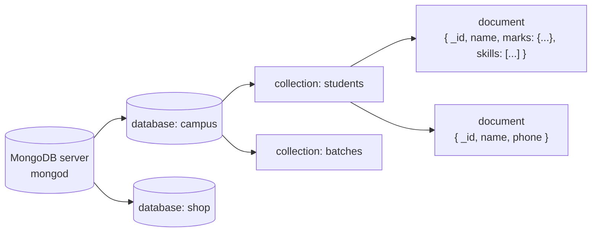

# Session 01 · Introduction to MongoDB

> **Module:** Managing Large Datasets using MongoDB · **Term 1** · ⏱️ ~2 hours
> **You will learn:** what NoSQL is and why it exists, how MongoDB stores data (databases → collections → documents), JSON vs BSON and the main BSON types, the `_id` field and `ObjectId`, installing MongoDB and using the `mongosh` shell, your first CRUD commands, and when to choose MongoDB over a relational database.

---

## 1. Why NoSQL?

Relational databases (Module 02, T-SQL) are excellent when data fits fixed tables. Modern apps also produce data that is **large**, **fast-changing** and **irregular**: product catalogues where each item has different attributes, IoT sensor streams, social-media posts with nested comments. **NoSQL** databases relax the fixed-table model to scale out across many servers and store flexible records. **MongoDB** is the most widely used *document* database.

> 📒 **Analogy:** A relational database is a government form — every applicant fills the same boxes, and an empty box is still a box. MongoDB is a file folder per applicant — one folder holds a CNIC copy and two degrees, another holds a passport and an experience letter. Same drawer, different contents.



## 2. Reference tables

| NoSQL family | Stores | Example products | Typical use |
|---|---|---|---|
| Document | JSON-like documents | **MongoDB**, Couchbase | apps, catalogues, content |
| Key–value | key → value | Redis, DynamoDB | caching, sessions |
| Column-family | wide rows | Cassandra, HBase | huge write-heavy logs |
| Graph | nodes + edges | Neo4j | social networks, recommendations |

| RDBMS (SQL Server) | MongoDB |
|---|---|
| database | database |
| table | collection |
| row | document |
| column | field |
| `PRIMARY KEY` | `_id` (unique, auto-created) |
| `JOIN` | embedded documents or `$lookup` |
| fixed schema | flexible schema (optional validation) |
| T-SQL | MongoDB Query API (JSON-style) |

| BSON type | Shell example | Python (PyMongo) |
|---|---|---|
| String | `"Karachi"` | `str` |
| Int32 / Int64 / Double | `42`, `NumberLong(42)`, `3.5` | `int`, `float` |
| Decimal128 | `NumberDecimal("1999.99")` | `bson.Decimal128` (money!) |
| Boolean | `true` | `bool` |
| Date | `ISODate("2026-10-27T09:00:00Z")` | `datetime` |
| ObjectId | `ObjectId("...")` | `bson.ObjectId` |
| Array | `["python", "sql"]` | `list` |
| Embedded document | `{ city: "Karachi", zip: "75300" }` | `dict` |
| Null | `null` | `None` |

**ObjectId** = 12 bytes: 4-byte timestamp + 5-byte random value + 3-byte counter — unique without a central counter, and roughly sorted by creation time.

## 3. Getting started

**Install options:** MongoDB Community Server (Windows/macOS/Linux) + `mongosh`, or a free cloud cluster on **MongoDB Atlas** (Session 11). GUI: **MongoDB Compass**.

```javascript
// mongosh
show dbs
use campus                              // switches (creates on first insert)
db.students.insertOne({ name: "Ali Raza", city: "Karachi", marks: { python: 78 } })
db.students.find()
db.students.find({ city: "Karachi" }, { name: 1, _id: 0 })
db.students.updateOne({ name: "Ali Raza" }, { $set: { batch: "DS-01" } })
db.students.deleteOne({ name: "Ali Raza" })
show collections
```

> 🧪 **Running the Python code:** scripts use [`code/mongo_conn.py`](./code/mongo_conn.py) — an in-memory **mongomock** server by default (`pip install mongomock`), or a real server when `MONGO_URI` is set (`pip install pymongo`). Shared sample data: [`code/campus_data.py`](./code/campus_data.py).

## 4. Worked examples

Full runnable code: [`code/examples.py`](./code/examples.py) · notebook: [`notebook.ipynb`](./notebook.ipynb)

### Example 1 — connect, insert, find
```python
from mongo_conn import get_db
db = get_db("campus")
res = db.students.insert_one({"name": "Ali Raza", "city": "Karachi", "marks": {"python": 78}})
print(res.inserted_id)                      # an ObjectId
print(db.students.find_one({"name": "Ali Raza"}))
```

### Example 2 — flexible schema
```python
db.students.insert_many([
    {"name": "Sana Khan", "city": "Lahore", "skills": ["python", "sql"]},
    {"name": "Hamza Ali", "phone": "0300-1234567"},          # different fields — allowed
])
```

### Example 3 — what's inside an ObjectId
```python
oid = res.inserted_id
print(oid.generation_time)                  # creation timestamp (UTC)
```

### Example 4 — BSON types from Python
```python
from datetime import datetime
from bson.decimal128 import Decimal128
db.payments.insert_one({"amount": Decimal128("15000.50"), "paid_on": datetime(2026, 10, 27), "late": False})
```

### Example 5 — count, distinct, simple update and delete
```python
db.students.count_documents({"city": "Karachi"})
db.students.distinct("city")
db.students.update_one({"name": "Hamza Ali"}, {"$set": {"city": "Karachi"}})
db.students.delete_many({"city": {"$exists": False}})
```

### Example 6 — SQL vs MongoDB side by side
```python
# SELECT name FROM students WHERE city = 'Karachi' ORDER BY name;
list(db.students.find({"city": "Karachi"}, {"_id": 0, "name": 1}).sort("name", 1))
```

## 5. Common mistakes

| Mistake | Fix |
|---|---|
| Expecting `use mydb` to create the database immediately | It appears only after the first insert |
| Storing money as `Double` (rounding errors) | Use `Decimal128` (or integer paisa) |
| Storing dates as strings | Use real `Date` / Python `datetime` so range queries and sorting work |
| Treating "schemaless" as "no design" | Plan document shapes around your queries; add validation (Session 02) |
| Typos in field names silently create new fields | Check with `findOne()`; use schema validation |

## 6. Real-life coding problem 🧮

**Problem:** A tuition academy in North Nazimabad keeps student records in Excel-style rows: `name, city, phone, python, sql, skills` (skills as a comma-separated string, some phones missing). Write `load_rows(db, rows)` that converts each row into a **well-shaped MongoDB document** (nested `marks`, `skills` as an array, omit empty phone, add `enrolled` as a `datetime`), inserts them, and returns a summary: documents inserted, distinct cities, students without a phone, and the student with the highest Python mark.

<details>
<summary>💡 Full solution</summary>

```python
from datetime import datetime

def to_doc(row, enrolled):
    doc = {"name": row["name"].strip().title(), "city": row["city"].strip().title(),
           "marks": {"python": int(row["python"]), "sql": int(row["sql"])},
           "skills": [s.strip().lower() for s in row["skills"].split(",") if s.strip()],
           "enrolled": enrolled}
    if row.get("phone", "").strip():
        doc["phone"] = row["phone"].strip()
    return doc

def load_rows(db, rows, enrolled=datetime(2026, 10, 27)):
    db.students.insert_many([to_doc(r, enrolled) for r in rows])
    top = db.students.find_one(sort=[("marks.python", -1)])
    return {"inserted": db.students.count_documents({}),
            "cities": sorted(db.students.distinct("city")),
            "no_phone": db.students.count_documents({"phone": {"$exists": False}}),
            "top_python": top["name"]}
```
Full file with sample rows and checks: [`code/problem_solution.py`](./code/problem_solution.py)
</details>

## 7. Practice exercises

1. Insert three `courses` documents (`code`, `title`, `hours`, `tags` array) and print them without `_id`.
2. Count students from Karachi in the sample campus data.
3. List the distinct batches in the campus data.
4. Find the creation time of a newly inserted document from its `_id`.

<details>
<summary>✅ Solutions</summary>

```python
db.courses.insert_many([{"code": "PY101", "title": "Python Basics", "hours": 36, "tags": ["python"]}, ...])
list(db.courses.find({}, {"_id": 0}))

seed(db); db.students.count_documents({"city": "Karachi"})

sorted(db.students.distinct("batch"))

oid = db.notes.insert_one({"text": "hello"}).inserted_id; oid.generation_time
```
File: [`code/exercises_solutions.py`](./code/exercises_solutions.py)
</details>

## 8. Quiz

1. Name the four main families of NoSQL databases.
2. What is the MongoDB equivalent of a table and of a row?
3. What does every MongoDB document have that you did not have to create?
4. Which BSON type should you use for money?
5. Give one situation where a relational database is a better choice than MongoDB.

<details>
<summary>Answers</summary>

1. Document, key–value, column-family, graph · 2. Collection and document · 3. An `_id` field (an `ObjectId` by default) · 4. `Decimal128` · 5. Highly structured data with many relationships and complex multi-table transactions, e.g. core banking ledgers or an accounting system.
</details>

## 9. Summary

- MongoDB is a document database: server → databases → collections → JSON-like (BSON) documents.
- Documents in one collection can have different fields; nested objects and arrays are normal.
- `_id` is the primary key; `ObjectId` embeds a creation timestamp.
- Basic CRUD: `insertOne/Many`, `find/findOne`, `updateOne/Many`, `deleteOne/Many` — the same in `mongosh` and PyMongo (snake_case).

---
[Module home](../README.md) · [Session 02 ➡](../Session-02-working-with-databases/)

<sub>Original teaching material by Aseef Ahmed · not official Aptech courseware · CC BY-NC 4.0 (text) / MIT (code)</sub>
