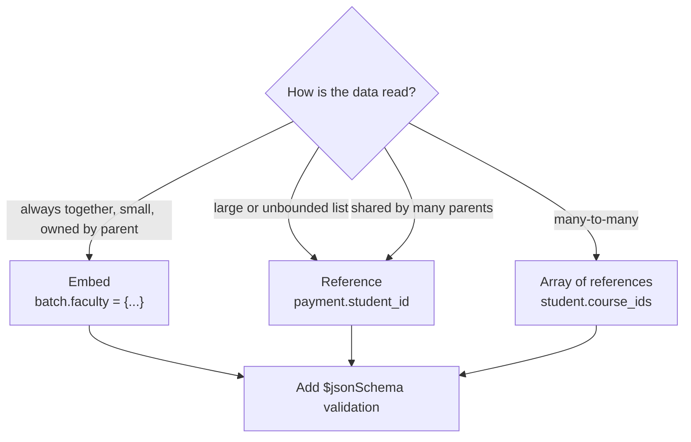

# Session 02 · Working with MongoDB Databases

> **Module:** Managing Large Datasets using MongoDB · **Term 1** · ⏱️ ~2 hours
> **You will learn:** creating, listing, renaming and dropping databases and collections, ordered vs unordered inserts, bulk writes, capped collections, **schema validation** with `$jsonSchema`, and the core data-modelling decision — **embed or reference** — including the main relationship patterns (one-to-few, one-to-many, many-to-many).

---

## 1. Designing before inserting

MongoDB lets you insert almost anything, which makes *design* your job. A good document shape matches how the application **reads** data: what is shown together is stored together. Validation rules then stop bad documents from creeping in.

> 📒 **Analogy:** Packing for a trip to Murree. Things you always use together (toothbrush and toothpaste) go in the same pouch — that's **embedding**. Things that are big, shared or change often (the family's one camera) get a label saying "it's in Abbu's bag" — that's a **reference**.



## 2. Reference tables

| Task | mongosh | PyMongo |
|---|---|---|
| list databases | `show dbs` | `client.list_database_names()` |
| switch / create db | `use campus` | `client["campus"]` |
| drop database | `db.dropDatabase()` | `client.drop_database("campus")` |
| list collections | `show collections` | `db.list_collection_names()` |
| create collection (with options) | `db.createCollection("logs", {...})` | `db.create_collection("logs", ...)` |
| rename | `db.old.renameCollection("new")` | `db.old.rename("new")` |
| drop collection | `db.logs.drop()` | `db.logs.drop()` |
| bulk write | `db.c.bulkWrite([...])` | `db.c.bulk_write([InsertOne(...), UpdateOne(...)])` |

| Insert option | Behaviour on a duplicate `_id` |
|---|---|
| `ordered: true` (default) | stops at the first error; earlier docs stay inserted |
| `ordered: false` | skips failing docs, inserts all the others |

| Relationship | Pattern | Example |
|---|---|---|
| one-to-one | embed | student → address |
| one-to-few | embed an array | batch → 2–3 timetable slots |
| one-to-many (many = hundreds+) | reference from the "many" side | payment → `student_id` |
| many-to-many | arrays of ids on one or both sides | student ↔ courses |
| frequently read summary of a reference | **extended reference** (copy a few fields) | order stores customer name + id |

**16 MB rule:** a single document can't exceed 16 MB, so never embed an unbounded, ever-growing list (e.g. every log line of a sensor).

### Schema validation (real MongoDB)
```javascript
db.createCollection("students", {
  validator: { $jsonSchema: {
    bsonType: "object",
    required: ["name", "batch", "marks"],
    properties: {
      name:  { bsonType: "string", minLength: 3 },
      batch: { enum: ["DS-01", "DS-02", "AI-01"] },
      marks: { bsonType: "object",
               properties: { python: { bsonType: "int", minimum: 0, maximum: 100 } } },
      phone: { bsonType: "string", pattern: "^03[0-9]{2}-[0-9]{7}$" }
    }
  }},
  validationLevel: "strict", validationAction: "error"
})
// capped collection: fixed size, keeps only the newest documents (great for logs)
db.createCollection("recent_logins", { capped: true, size: 1048576, max: 1000 })
```

> 🧪 **Note:** mongomock (our default test server) cannot enforce validators or capped collections, so the Python code includes a tiny `check(doc, schema)` function that applies the same rules in plain Python. On a real server, the commands above are enforced by MongoDB itself.

## 3. Worked examples

Full runnable code: [`code/examples.py`](./code/examples.py) · notebook: [`notebook.ipynb`](./notebook.ipynb)

### Example 1 — databases and collections
```python
client = get_client(); db = client["campus_admin"]
db.notices.insert_one({"text": "Eid holidays from Monday"})
print(client.list_database_names(), db.list_collection_names())
db.notices.rename("announcements")
```

### Example 2 — ordered vs unordered inserts
```python
try:
    db.t.insert_many([{"_id": 1}, {"_id": 1}, {"_id": 2}], ordered=False)
except BulkWriteError as e:
    print(e.details["nInserted"])           # 2 — only the duplicate was skipped
```

### Example 3 — bulk writes
```python
db.batches.bulk_write([InsertOne({"_id": "WEB-01"}), InsertOne({"_id": "NET-01"}), DeleteOne({"_id": "NET-01"})])
```

### Example 4 — embedding (batch with faculty)
```python
db.batches.insert_one({"_id": "DS-01", "faculty": {"name": "Aseef Ahmed", "subject": "Python"},
                       "slots": [{"day": "Mon", "time": "18:00"}, {"day": "Wed", "time": "18:00"}]})
```

### Example 5 — referencing (payments → students) and many-to-many
```python
db.payments.insert_one({"student_id": 2, "amount": 15000, "month": "2026-10"})
db.students.update_one({"student_id": 2}, {"$set": {"course_ids": ["PY101", "DB201"]}})
```

### Example 6 — validating documents
```python
problems = check({"name": "Al", "batch": "XX-9", "marks": {"python": 120}}, STUDENT_SCHEMA)
# ['name too short', 'batch not allowed', 'marks.python out of range']
```

## 4. Common mistakes

| Mistake | Fix |
|---|---|
| Embedding an ever-growing array (all payments inside the student) | Reference from the "many" side |
| Splitting everything into many collections "like SQL" | Embed data that is read together |
| Assuming `insert_many` rolls back on error | It doesn't; use `ordered=False` to continue, or transactions (Session 09) |
| Adding a validator and expecting old documents to be fixed | Validation applies to new writes/updates; clean old data separately |
| Using a capped collection for data you must update or delete | Capped collections are for append-only rolling data |

## 5. Real-life coding problem 🧮

**Problem:** A private hospital in Karachi is moving patient visits from Excel to MongoDB. Each patient has a profile, an emergency contact, a list of allergies, and **hundreds of visits** over the years; each visit has a doctor (shared across many visits). Design the collections, write `build_hospital(db)` that inserts sample data following your design, and `patient_card(db, mrn)` that returns a patient's profile with the last 3 visits (newest first) and each visit's doctor name — using only the queries your design allows. Validate patient documents with a simple schema before inserting.

<details>
<summary>💡 Full solution</summary>

```python
# Design: patients (embed contact + allergies), doctors (own collection), visits (reference patient & doctor)
PATIENT_SCHEMA = {"required": ["mrn", "name", "contact"], "types": {"mrn": str, "name": str, "allergies": list}}

def build_hospital(db, patients, doctors, visits):
    for p in patients:
        problems = check(p, PATIENT_SCHEMA)
        if problems:
            raise ValueError(f"{p.get('mrn')}: {problems}")
    db.patients.insert_many(patients); db.doctors.insert_many(doctors); db.visits.insert_many(visits)

def patient_card(db, mrn):
    p = db.patients.find_one({"mrn": mrn}, {"_id": 0})
    recent = list(db.visits.find({"mrn": mrn}, {"_id": 0}).sort("date", -1).limit(3))
    names = {d["_id"]: d["name"] for d in db.doctors.find({"_id": {"$in": [v["doctor_id"] for v in recent]}})}
    for v in recent:
        v["doctor"] = names[v.pop("doctor_id")]
    return {**p, "recent_visits": recent}
```
Full file: [`code/problem_solution.py`](./code/problem_solution.py)
</details>

## 6. Practice exercises

1. Create a database `library`, insert one document into `books`, list the collections, then drop the database.
2. Insert 5 documents with one duplicate `_id` using `ordered=True` and then `ordered=False`; compare how many are inserted.
3. Model a **student ↔ course** many-to-many relationship and find all students taking `"DB201"`.
4. Extend `check()` so it also rejects a phone that doesn't match `03XX-XXXXXXX`.

<details>
<summary>✅ Solutions</summary>

```python
lib = client["library"]; lib.books.insert_one({"title": "Python for Everyone"})
lib.list_collection_names(); client.drop_database("library")

for ordered in (True, False):
    try: c.insert_many(docs, ordered=ordered)
    except BulkWriteError as e: print(ordered, e.details["nInserted"])

db.students.find({"course_ids": "DB201"})          # matching inside an array is automatic

if "phone" in doc and not re.fullmatch(r"03\d{2}-\d{7}", doc["phone"]): problems.append("bad phone")
```
File: [`code/exercises_solutions.py`](./code/exercises_solutions.py)
</details>

## 7. Quiz

1. When does a new database actually appear on the server?
2. What is the difference between `ordered=True` and `ordered=False` inserts?
3. Give one reason to reference rather than embed.
4. What is the maximum size of a single document?
5. What is a capped collection good for?

<details>
<summary>Answers</summary>

1. When the first document (or collection) is created in it · 2. Ordered stops at the first error; unordered continues and inserts every valid document · 3. The related data is large/unbounded, shared by many documents, or changes independently · 4. 16 MB · 5. Fixed-size, append-only rolling data such as recent logs or events (oldest documents are overwritten).
</details>

## 8. Summary

- Databases and collections are created lazily; manage them with `list_*`, `create_collection`, `rename`, `drop`.
- Use `insert_many(ordered=False)` and `bulk_write` for efficient batch loading.
- Model for your queries: embed what is read together, reference what is large or shared.
- Protect data quality with `$jsonSchema` validation on the server.

---
[⬅ Session 01](../Session-01-introduction-to-mongodb/) · [Module home](../README.md) · [Session 03 ➡](../Session-03-mongodb-operators/)

<sub>Original teaching material by Aseef Ahmed · not official Aptech courseware · CC BY-NC 4.0 (text) / MIT (code)</sub>
