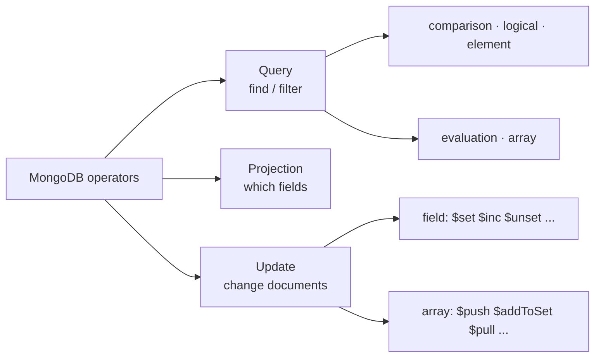

# Session 03 · MongoDB Operators

> **Module:** Managing Large Datasets using MongoDB · **Term 1** · ⏱️ ~2 hours
> **You will learn:** query operators — comparison, logical, element, evaluation (`$regex`, `$expr`) and array (`$all`, `$elemMatch`, `$size`) — projection operators (`$slice`, `$elemMatch`, positional `$`), and update operators for fields (`$set`, `$unset`, `$inc`, `$mul`, `$min`, `$max`, `$rename`, `$currentDate`) and arrays (`$push` with modifiers, `$addToSet`, `$pull`, `$pop`, positional `$` and `$[<id>]` with `arrayFilters`), plus upserts.

---

## 1. Operators are MongoDB's vocabulary

In SQL you write `WHERE marks > 70 AND city IN ('Karachi', 'Lahore')`. In MongoDB the same idea is a JSON document whose keys starting with `$` are **operators**: `{"marks": {"$gt": 70}, "city": {"$in": ["Karachi", "Lahore"]}}`. The same `$` style is used to *change* documents (`$set`, `$push`) and, later, in aggregation.

> 📒 **Analogy:** Operators are like the codes a *rishta* aunty uses when searching her register: "age between 25 and 30" (`$gte`/`$lte`), "from Karachi **or** Hyderabad" (`$in`), "must have a phone number" (`$exists`), "knows both Urdu **and** English" (`$all`).



## 2. Reference tables

**Query operators**

| Group | Operators | Example (students) |
|---|---|---|
| comparison | `$eq $ne $gt $gte $lt $lte $in $nin` | `{"marks.python": {"$gte": 80}}` |
| logical | `$and $or $not $nor` | `{"$or": [{"city": "Quetta"}, {"marks.sql": {"$lt": 50}}]}` |
| element | `$exists $type` | `{"phone": {"$exists": False}}` |
| evaluation | `$regex $expr $mod $text` | `{"$expr": {"$gt": ["$marks.sql", "$marks.python"]}}` |
| array | `$all $elemMatch $size` | `{"skills": {"$all": ["python", "sql"]}}` |

**Projection operators**

| Operator | Effect |
|---|---|
| `{"skills": {"$slice": 2}}` / `-1` | first 2 / last element of an array |
| `{"tests": {"$elemMatch": {"s": {"$gt": 70}}}}` | first array element matching a condition |
| `{"tests.$": 1}` | first element that matched the **query** |

**Update operators**

| Field | Array |
|---|---|
| `$set`, `$unset` | `$push` (with `$each`, `$sort`, `$slice`, `$position`) |
| `$inc`, `$mul` | `$addToSet` (no duplicates) |
| `$min`, `$max` (only if smaller/larger) | `$pull` (by value or condition), `$pullAll` |
| `$rename`, `$currentDate` | `$pop` (`1` last, `-1` first) |
| `$setOnInsert` (with upsert) | `arr.$` (first matched), `arr.$[]` (all), `arr.$[e]` + `arrayFilters` |

> 🧪 mongomock supports most of these. It does **not** support `$mod`, `$mul`, positional projection (`"tests.$"`) or `arrayFilters`; those are shown below in shell syntax only.

## 3. Worked examples

Full runnable code: [`code/examples.py`](./code/examples.py) · notebook: [`notebook.ipynb`](./notebook.ipynb) · sample data: [`code/campus_data.py`](./code/campus_data.py)

### Example 1 — comparison and logical
```python
db.students.find({"marks.python": {"$gte": 80}, "city": {"$in": ["Karachi", "Lahore"]}})
db.students.find({"$or": [{"city": "Quetta"}, {"marks.sql": {"$lt": 50}}]})
db.students.find({"$nor": [{"city": "Karachi"}, {"city": "Lahore"}]})
```

### Example 2 — element and evaluation
```python
db.students.find({"phone": {"$exists": False}})
db.students.find({"name": {"$regex": "^a", "$options": "i"}})
db.students.find({"$expr": {"$gt": ["$marks.sql", "$marks.python"]}})   # compare two fields
```

### Example 3 — array queries
```python
db.students.find({"skills": "python"})                          # contains
db.students.find({"skills": {"$all": ["python", "sql"]}})       # contains both
db.students.find({"skills": {"$size": 0}})                      # empty array
db.quizzes.find({"tests": {"$elemMatch": {"topic": "sql", "score": {"$gte": 8}}}})
```

### Example 4 — projections
```python
db.students.find({}, {"_id": 0, "name": 1, "skills": {"$slice": 1}})
```
```javascript
// mongosh only (not in mongomock):
db.quizzes.find({ "tests.score": { $gte: 9 } }, { "tests.$": 1 })
```

### Example 5 — field updates and upsert
```python
db.students.update_one({"student_id": 1},
    {"$inc": {"marks.sql": 5}, "$min": {"marks.stats": 60}, "$rename": {"phone": "mobile"},
     "$currentDate": {"updated": True}})
db.attendance.update_one({"student_id": 1, "date": "2026-10-27"},
    {"$set": {"status": "present"}}, upsert=True)
```

### Example 6 — array updates
```python
db.students.update_one({"student_id": 1}, {"$addToSet": {"skills": "sql"}})
db.students.update_many({}, {"$pull": {"skills": "excel"}})
db.quizzes.update_one({"name": "Ali"}, {"$push": {"tests": {"$each": [new], "$sort": {"score": -1}, "$slice": 3}}})
db.quizzes.update_one({"name": "Ali", "tests.topic": "sql"}, {"$set": {"tests.$.score": 10}})
```
```javascript
// mongosh: bonus mark to every test below 5, and halve a field
db.quizzes.updateMany({}, { $inc: { "tests.$[t].score": 1 } }, { arrayFilters: [ { "t.score": { $lt: 5 } } ] })
db.students.updateOne({ student_id: 2 }, { $mul: { "marks.python": 0.5 } })
```

## 4. Common mistakes

| Mistake | Fix |
|---|---|
| `{"marks.python": {"$gt": 50}, "marks.python": {"$lt": 90}}` (duplicate key — first is lost) | Combine: `{"marks.python": {"$gt": 50, "$lt": 90}}` |
| `{"tests.topic": "sql", "tests.score": {"$gte": 8}}` matches different elements | Use `$elemMatch` so both conditions apply to the same element |
| `update_one(filter, {"name": "X"})` | Always use operators (`$set`); a plain doc is a *replacement* (`replace_one`) |
| `$push` creating duplicates | Use `$addToSet` |
| Unanchored, case-insensitive `$regex` on huge collections | Anchor with `^` so an index can help, or use a text index |

## 5. Real-life coding problem 🧮

**Problem:** A Karachi coaching centre keeps quiz results as `{name, batch, tests: [{topic, score}]}` (scores out of 10). Write functions that: (a) find students who scored ≥ 8 **in the same test** on `"sql"` (`$elemMatch`), (b) find students with no test at all or fewer than 2 tests, (c) record a new test for a student, keeping only their **latest 5** tests, (d) give +1 grace mark (capped at 10) to every student's `"stats"` test, and (e) upsert a daily attendance record without creating duplicates.

<details>
<summary>💡 Full solution</summary>

```python
def strong_in_sql(db):
    return sorted(d["name"] for d in db.quizzes.find({"tests": {"$elemMatch": {"topic": "sql", "score": {"$gte": 8}}}}))

def few_tests(db):
    return sorted(d["name"] for d in db.quizzes.find({"$or": [{"tests": {"$exists": False}}, {"tests": {"$size": 0}},
                                                              {"tests": {"$size": 1}}]}))

def add_test(db, name, topic, score):
    db.quizzes.update_one({"name": name}, {"$push": {"tests": {"$each": [{"topic": topic, "score": score}], "$slice": -5}}})

def grace_stats(db):
    # positional $ updates the first matching element per document
    for d in db.quizzes.find({"tests.topic": "stats"}):
        db.quizzes.update_one({"_id": d["_id"], "tests.topic": "stats"}, {"$inc": {"tests.$.score": 1}})
        db.quizzes.update_one({"_id": d["_id"], "tests": {"$elemMatch": {"topic": "stats", "score": {"$gt": 10}}}},
                              {"$set": {"tests.$.score": 10}})

def mark_attendance(db, name, date, status):
    db.attendance.update_one({"name": name, "date": date}, {"$set": {"status": status}}, upsert=True)
```
Full file with sample data and checks: [`code/problem_solution.py`](./code/problem_solution.py)
</details>

## 6. Practice exercises

1. Find students whose Python mark is between 60 and 80 (inclusive) and who are **not** in batch AI-01.
2. Find students who have a phone **and** at least 3 skills (hint: `"skills.2": {"$exists": True}`).
3. Rename the field `city` to `home_city` for all students, then add `"tableau"` to Faraz's skills only if missing.
4. Remove the last skill from every student who has more than 3 skills.

<details>
<summary>✅ Solutions</summary>

```python
db.students.find({"marks.python": {"$gte": 60, "$lte": 80}, "batch": {"$ne": "AI-01"}})

db.students.find({"phone": {"$exists": True}, "skills.2": {"$exists": True}})

db.students.update_many({}, {"$rename": {"city": "home_city"}})
db.students.update_one({"name": "Faraz Iqbal"}, {"$addToSet": {"skills": "tableau"}})

db.students.update_many({"skills.3": {"$exists": True}}, {"$pop": {"skills": 1}})
```
File: [`code/exercises_solutions.py`](./code/exercises_solutions.py)
</details>

## 7. Quiz

1. Write a filter for "city is Karachi or Lahore" without `$or`.
2. Why use `$elemMatch` instead of two dot-notation conditions on an array of sub-documents?
3. What is the difference between `$push` and `$addToSet`?
4. What does `upsert=True` do?
5. Which operator compares two fields of the same document?

<details>
<summary>Answers</summary>

1. `{"city": {"$in": ["Karachi", "Lahore"]}}` · 2. Dot-notation conditions can be satisfied by *different* elements; `$elemMatch` requires one element to satisfy all conditions · 3. `$push` always appends; `$addToSet` appends only if the value is not already present · 4. Updates a matching document, or inserts a new one if none matches · 5. `$expr` (e.g. `{"$expr": {"$gt": ["$marks.sql", "$marks.python"]}}`).
</details>

## 8. Summary

- Query operators (`$gt`, `$in`, `$or`, `$exists`, `$regex`, `$expr`, `$all`, `$elemMatch`, `$size`) build precise filters.
- Projection operators trim arrays (`$slice`, `$elemMatch`, `$`).
- Update operators change fields (`$set`, `$inc`, `$min`, `$rename`) and arrays (`$push`+modifiers, `$addToSet`, `$pull`, `$pop`, positional `$`).
- Upserts write "update or insert" in one atomic step.

---
[⬅ Session 02](../Session-02-working-with-databases/) · [Module home](../README.md) · [Session 04 ➡](../Session-04-aggregation-pipeline/)

<sub>Original teaching material by Aseef Ahmed · not official Aptech courseware · CC BY-NC 4.0 (text) / MIT (code)</sub>
