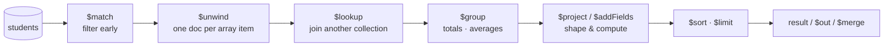

# Session 04 · Aggregation Pipeline

> **Module:** Managing Large Datasets using MongoDB · **Term 1** · ⏱️ ~2 hours
> **You will learn:** how the aggregation pipeline processes documents stage by stage, the core stages (`$match`, `$project`, `$addFields`, `$group`, `$sort`, `$limit`, `$unwind`, `$lookup`, `$bucket`, `$facet`, `$count`, `$out`/`$merge`), accumulators (`$sum`, `$avg`, `$min`, `$max`, `$push`, `$addToSet`, `$first`), expression operators (`$cond`, `$switch`, `$concat`, `$dateToString`), and how to order stages for performance.

---

## 1. Data on a conveyor belt

`find()` returns documents as they are. Reports need more: totals per batch, average marks per city, top students, revenue per month. The **aggregation pipeline** passes documents through a list of **stages**; each stage transforms the stream and hands it to the next — like `GROUP BY`, `JOIN`, `CASE` and `ORDER BY` combined, but executed inside the database.

> 📒 **Analogy:** A mango processing line in Multan: the first worker removes bad mangoes (`$match`), the next washes and labels them (`$project`), another sorts them into crates by size (`$group`), and the last stacks the best crates at the front (`$sort`, `$limit`). Each worker only sees what the previous one passed on.



## 2. Reference tables

| Stage | SQL idea | Example |
|---|---|---|
| `$match` | `WHERE` / `HAVING` | `{"$match": {"city": "Karachi"}}` |
| `$project` | `SELECT` columns/expressions | `{"$project": {"_id": 0, "name": 1, "total": {"$add": [...]}}}` |
| `$addFields` / `$set` | add computed columns | `{"$addFields": {"total": ...}}` |
| `$group` | `GROUP BY` | `{"$group": {"_id": "$batch", "n": {"$sum": 1}}}` |
| `$sort`, `$limit`, `$skip` | `ORDER BY`, `TOP`, `OFFSET` | `{"$sort": {"n": -1}}` |
| `$unwind` | flatten an array | `{"$unwind": "$skills"}` |
| `$lookup` | `LEFT JOIN` | `{"$lookup": {"from": "payments", "localField": "student_id", "foreignField": "student_id", "as": "pays"}}` |
| `$bucket` | ranges / histogram | `{"$bucket": {"groupBy": "$marks.python", "boundaries": [0, 50, 70, 90, 101]}}` |
| `$facet` | several reports in one pass | `{"$facet": {"by_city": [...], "by_batch": [...]}}` |
| `$count` | `COUNT(*)` | `{"$count": "n"}` |
| `$out` / `$merge` | `SELECT INTO` / upsert into a collection | `{"$out": "report"}` |

| Accumulator (in `$group`) | Result |
|---|---|
| `{"$sum": 1}` / `{"$sum": "$amount"}` | count / total |
| `$avg`, `$min`, `$max` | statistics |
| `$push` / `$addToSet` | list of values / unique values |
| `$first` / `$last` | first/last value (after a `$sort`) |

| Expression | Example |
|---|---|
| arithmetic | `{"$add": ["$marks.python", "$marks.sql"]}`, `$subtract`, `$multiply`, `$divide` |
| conditional | `{"$cond": [{"$gte": ["$total", 240]}, "A", "B"]}`, `$switch` |
| string | `{"$concat": [{"$toUpper": "$city"}, "-", "$batch"]}` |
| date | `{"$dateToString": {"format": "%Y-%m", "date": "$enrolled"}}`, `$month`, `$year` |
| array | `{"$size": "$skills"}` |

**Performance rule:** put `$match` (and `$project` that drops big fields) **as early as possible** so later stages handle fewer documents, and so `$match` at the start can use an index (Session 07).

> 🧪 mongomock runs all the pipelines in this session. It lacks a few newer operators (`$round`, `$sortByCount`, `$lookup` with `let`/`pipeline`), so rounding is done in Python where needed; the README shows the real syntax.

## 3. Worked examples

Full runnable code: [`code/examples.py`](./code/examples.py) · notebook: [`notebook.ipynb`](./notebook.ipynb)

### Example 1 — count and average per batch
```python
db.students.aggregate([
    {"$group": {"_id": "$batch", "students": {"$sum": 1}, "avg_python": {"$avg": "$marks.python"}}},
    {"$sort": {"_id": 1}},
])
```

### Example 2 — computed fields and grades
```python
db.students.aggregate([
    {"$addFields": {"total": {"$add": ["$marks.python", "$marks.sql", "$marks.stats"]}}},
    {"$addFields": {"grade": {"$switch": {"branches": [
        {"case": {"$gte": ["$total", 240]}, "then": "A"},
        {"case": {"$gte": ["$total", 180]}, "then": "B"}], "default": "C"}}}},
    {"$project": {"_id": 0, "name": 1, "total": 1, "grade": 1}},
    {"$sort": {"total": -1}},
])
```

### Example 3 — `$unwind`: most common skills
```python
db.students.aggregate([{"$unwind": "$skills"},
                       {"$group": {"_id": "$skills", "n": {"$sum": 1}}},
                       {"$sort": {"n": -1, "_id": 1}}, {"$limit": 3}])
```

### Example 4 — `$lookup`: fees collected per city
```python
db.payments.aggregate([
    {"$lookup": {"from": "students", "localField": "student_id", "foreignField": "student_id", "as": "s"}},
    {"$unwind": "$s"},
    {"$group": {"_id": "$s.city", "collected": {"$sum": "$amount"}}},
    {"$sort": {"collected": -1}},
])
```

### Example 5 — `$bucket` and `$facet`
```python
db.students.aggregate([{"$facet": {
    "python_bands": [{"$bucket": {"groupBy": "$marks.python", "boundaries": [0, 50, 70, 90, 101],
                                  "output": {"n": {"$sum": 1}}}}],
    "karachi": [{"$match": {"city": "Karachi"}}, {"$count": "n"}],
}}])
```

### Example 6 — top student per batch and saving the report
```python
db.students.aggregate([
    {"$sort": {"marks.python": -1}},
    {"$group": {"_id": "$batch", "top": {"$first": "$name"}, "score": {"$first": "$marks.python"}}},
    {"$out": "top_students"},
])
```

## 4. Common mistakes

| Mistake | Fix |
|---|---|
| Forgetting `$` before field names in expressions (`"marks.python"` vs `"$marks.python"`) | Field *values* in expressions need the `$` prefix |
| `$match` after `$group` on a field that no longer exists | After `$group`, only `_id` and the accumulators exist |
| `$unwind` silently drops documents with empty/missing arrays | `{"$unwind": {"path": "$skills", "preserveNullAndEmptyArrays": True}}` |
| Putting `$match` at the end | Filter first — it is faster and can use indexes |
| Expecting `$first` to mean "highest" without sorting | `$sort` before `$group` |

## 5. Real-life coding problem 🧮

**Problem:** The campus finance office wants a **monthly fee report** from the `payments` and `students` collections: for each month, total collected, number of payments, and the split by payment method (cash / bank / easypaisa / jazzcash); for each batch, total collected and the list of students who have **never paid** (hint: `$lookup` from students to payments and keep those with an empty array). Save the batch report into a `fee_report` collection with `$out`.

<details>
<summary>💡 Full solution</summary>

```python
def monthly_report(db):
    return list(db.payments.aggregate([
        {"$group": {"_id": {"month": "$month", "method": "$method"}, "amount": {"$sum": "$amount"}, "n": {"$sum": 1}}},
        {"$group": {"_id": "$_id.month", "total": {"$sum": "$amount"}, "payments": {"$sum": "$n"},
                    "by_method": {"$push": {"method": "$_id.method", "amount": "$amount"}}}},
        {"$sort": {"_id": 1}},
    ]))

def batch_report(db):
    db.students.aggregate([
        {"$lookup": {"from": "payments", "localField": "student_id", "foreignField": "student_id", "as": "pays"}},
        {"$addFields": {"paid": {"$sum": "$pays.amount"}, "n_pays": {"$size": "$pays"}}},
        {"$group": {"_id": "$batch", "collected": {"$sum": "$paid"},
                    "never_paid": {"$push": {"$cond": [{"$eq": ["$n_pays", 0]}, "$name", None]}}}},
        {"$sort": {"_id": 1}},
        {"$out": "fee_report"},
    ])
    rows = list(db.fee_report.find())
    for r in rows:                         # drop the None placeholders
        r["never_paid"] = [n for n in r["never_paid"] if n]
    return rows
```
Full file with checks: [`code/problem_solution.py`](./code/problem_solution.py)
</details>

## 6. Practice exercises

1. Average SQL mark per city, highest first.
2. For each batch, the list of distinct skills (`$unwind` + `$addToSet`).
3. Number of students enrolled per month, as `"2026-01"` strings.
4. Students whose total of three marks is above the overall average total (two pipelines, or `$facet`).

<details>
<summary>✅ Solutions</summary>

```python
[{"$group": {"_id": "$city", "avg_sql": {"$avg": "$marks.sql"}}}, {"$sort": {"avg_sql": -1}}]

[{"$unwind": "$skills"}, {"$group": {"_id": "$batch", "skills": {"$addToSet": "$skills"}}}]

[{"$group": {"_id": {"$dateToString": {"format": "%Y-%m", "date": "$enrolled"}}, "n": {"$sum": 1}}}, {"$sort": {"_id": 1}}]

avg = list(db.students.aggregate([{"$group": {"_id": None, "avg": {"$avg": TOTAL}}}]))[0]["avg"]
[{"$addFields": {"total": TOTAL}}, {"$match": {"total": {"$gt": avg}}}]
```
File: [`code/exercises_solutions.py`](./code/exercises_solutions.py)
</details>

## 7. Quiz

1. What is the SQL equivalent of `$group`, and of `$lookup`?
2. Why should `$match` usually come first?
3. What does `$unwind` do to a document with a 3-element array?
4. Which accumulator gives a list of unique values?
5. What is the difference between `$out` and `$merge`?

<details>
<summary>Answers</summary>

1. `GROUP BY`; `LEFT OUTER JOIN` · 2. It reduces the documents later stages must process and can use an index · 3. Produces three documents, one per array element · 4. `$addToSet` · 5. `$out` replaces the target collection with the results; `$merge` inserts/updates results into an existing collection.
</details>

## 8. Summary

- A pipeline is a list of stages; documents flow through them in order.
- `$match`, `$project`/`$addFields`, `$group`, `$sort`, `$limit` cover most reports; `$unwind` and `$lookup` handle arrays and joins.
- Accumulators summarise groups; expression operators compute values, conditions, strings and dates.
- Filter early, sort before `$first`, and save results with `$out` or `$merge`.

---
[⬅ Session 03](../Session-03-mongodb-operators/) · [Module home](../README.md) · [Session 05 ➡](../Session-05-database-commands/)

<sub>Original teaching material by Aseef Ahmed · not official Aptech courseware · CC BY-NC 4.0 (text) / MIT (code)</sub>
