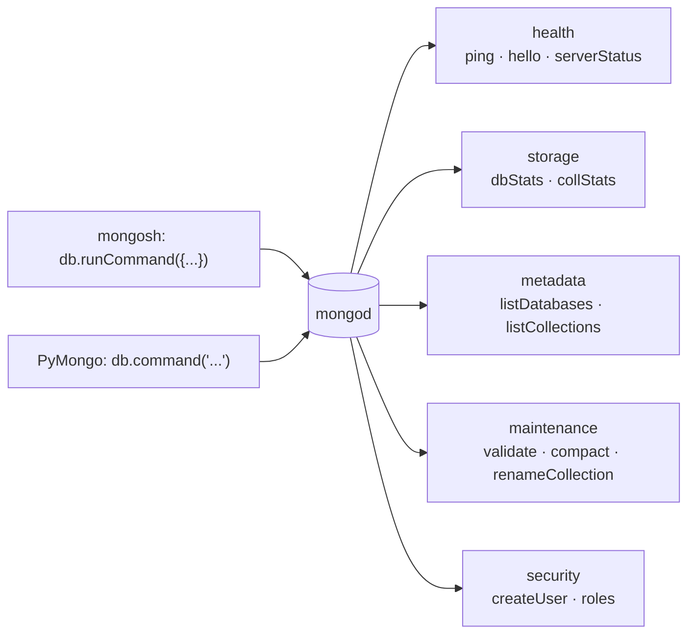

# Session 05 · Database Commands

> **Module:** Managing Large Datasets using MongoDB · **Term 1** · ⏱️ ~2 hours
> **You will learn:** what database commands are and how to run them (`db.runCommand()`, `db.adminCommand()`, PyMongo `db.command()`), the most useful commands for health checks (`ping`, `hello`, `buildInfo`, `serverStatus`), storage statistics (`dbStats`, `collStats` / `$collStats`), metadata (`listDatabases`, `listCollections`), query commands (`count`, `distinct`, `explain`), maintenance (`validate`, `compact`, `renameCollection`) and user/role management (`createUser`, `grantRolesToUser`).

---

## 1. Talking to the server itself

CRUD methods work on documents. **Database commands** ask the server to *do* or *report* something: "are you alive?", "how big is this collection?", "which operations are running?", "create a user with read-only access". Every shell helper you have used (`show dbs`, `db.stats()`) is a friendly wrapper around a command document.

> 📒 **Analogy:** Commands are the instructions you give a building's *chowkidar* rather than the residents: "Is the gate open?" (`ping`), "How many flats are occupied?" (`dbStats`), "Give the new tenant a key to the 3rd floor only" (`createUser` with a role).



## 2. Reference tables

| Command | mongosh | PyMongo | Returns |
|---|---|---|---|
| ping | `db.runCommand({ ping: 1 })` | `db.command("ping")` | `{ok: 1}` if reachable |
| hello | `db.hello()` | `db.command("hello")` | primary/secondary role, limits |
| buildInfo | `db.version()` | `db.command("buildInfo")["version"]` | server version |
| serverStatus | `db.serverStatus()` | `client.admin.command("serverStatus")` | connections, memory, opcounters |
| dbStats | `db.stats()` | `db.command("dbStats")` | collections, objects, dataSize, indexes |
| collStats | `db.students.aggregate([{ $collStats: { storageStats: {} } }])` | same via `aggregate` | size, count, avgObjSize |
| listDatabases | `show dbs` | `client.admin.command("listDatabases")` | names + sizes |
| listCollections | `show collections` | `db.command("listCollections")` | names + options |
| count / distinct | `db.runCommand({ count: "students", query: {...} })` | `db.command("count", "students", query={...})` | numbers / values |
| explain | `db.students.find({...}).explain("executionStats")` | `cursor.explain()` | query plan |
| validate | `db.runCommand({ validate: "students" })` | `db.command("validate", "students")` | structure check |
| compact | `db.runCommand({ compact: "students" })` | | reclaims disk space |
| renameCollection | `db.adminCommand({ renameCollection: "campus.a", to: "campus.b" })` | `coll.rename("b")` | |
| currentOp / killOp | `db.currentOp()`, `db.killOp(opid)` | `client.admin.command("currentOp")` | running operations |

| Built-in role | Allows |
|---|---|
| `read` | read all non-system collections of a database |
| `readWrite` | read + insert/update/delete |
| `dbAdmin` | indexes, stats, validation (no data reads by itself) |
| `userAdmin` | create users and grant roles in a database |
| `clusterMonitor` | read-only monitoring (serverStatus, currentOp) |
| `root` | everything — avoid in applications |

```javascript
// mongosh — create a reporting user with read-only access to campus
use campus
db.createUser({ user: "report_bot", pwd: passwordPrompt(), roles: [ { role: "read", db: "campus" } ] })
db.grantRolesToUser("report_bot", [ { role: "read", db: "shop" } ])
db.getUsers()
```

> 🧪 mongomock implements only a few commands (`ping`). The session code therefore uses [`code/commands.py`](./code/commands.py): on a real server (`MONGO_URI` set) it simply calls `db.command(...)`; on mongomock it **computes the same numbers in plain Python** (document counts, BSON sizes, collection lists), so you can see what each command reports.

## 3. Worked examples

Full runnable code: [`code/examples.py`](./code/examples.py) · notebook: [`notebook.ipynb`](./notebook.ipynb)

### Example 1 — health check
```python
from commands import run
print(run(db, "ping"))                     # {'ok': 1.0}
```

### Example 2 — database statistics
```python
stats = run(db, "dbStats")
print(stats["collections"], stats["objects"], stats["dataSize"], stats["avgObjSize"])
```

### Example 3 — collection statistics
```python
cs = run(db, "collStats", "students")
print(cs["count"], cs["size"], cs["avgObjSize"])
```

### Example 4 — metadata
```python
print([c["name"] for c in run(db, "listCollections")["cursor"]["firstBatch"]])
```

### Example 5 — count and distinct as commands
```python
run(db, "count", "students", query={"city": "Karachi"})["n"]
run(db, "distinct", "students", key="batch")["values"]
```

### Example 6 — a simple capacity report
```python
for name in db.list_collection_names():
    cs = run(db, "collStats", name)
    print(f"{name:<10} {cs['count']:>4} docs  {cs['size']:>6} bytes")
```

## 4. Common mistakes

| Mistake | Fix |
|---|---|
| Running admin commands on the wrong database | `listDatabases`, `serverStatus`, `renameCollection` go to `admin` (`db.adminCommand` / `client.admin.command`) |
| Giving apps the `root` role | Grant the smallest role that works (`read`, `readWrite`) |
| Typing passwords into scripts | `passwordPrompt()` in mongosh; environment variables / secrets in code |
| Running `compact` on a busy primary at peak time | Schedule maintenance; it can block operations |
| Reading `dataSize` as disk usage | `storageSize` (compressed, on disk) differs from `dataSize` (uncompressed BSON) |

## 5. Real-life coding problem 🧮

**Problem:** The campus IT team wants a nightly **health report** script: (1) confirm the server answers `ping`, (2) list every collection with document count, data size and average document size, (3) flag collections whose average document is larger than a threshold (possible unbounded arrays) or that are empty, and (4) return the report as a list of dicts sorted by size. Use the `run()` helper so the same script works on mongomock and a real server.

<details>
<summary>💡 Full solution</summary>

```python
def health_report(db, big_doc_bytes=400):
    if run(db, "ping").get("ok") != 1:
        raise RuntimeError("server not reachable")
    report = []
    for name in sorted(db.list_collection_names()):
        cs = run(db, "collStats", name)
        flags = []
        if cs["count"] == 0:
            flags.append("empty")
        elif cs["avgObjSize"] > big_doc_bytes:
            flags.append("large documents")
        report.append({"collection": name, "count": cs["count"], "size": cs["size"],
                       "avgObjSize": cs["avgObjSize"], "flags": flags})
    return sorted(report, key=lambda r: r["size"], reverse=True)
```
Full file with checks: [`code/problem_solution.py`](./code/problem_solution.py)
</details>

## 6. Practice exercises

1. Use `run(db, "count", ...)` to count students in batch `AI-01` and compare with `count_documents`.
2. Use `distinct` to list cities of students with Python marks ≥ 80.
3. Compute the share (%) of total `dataSize` taken by each collection.
4. Write the mongosh command to create a user `fee_clerk` with `readWrite` on `campus` only.

<details>
<summary>✅ Solutions</summary>

```python
run(db, "count", "students", query={"batch": "AI-01"})["n"] == db.students.count_documents({"batch": "AI-01"})

run(db, "distinct", "students", key="city", query={"marks.python": {"$gte": 80}})["values"]

total = run(db, "dbStats")["dataSize"]
shares = {n: 100 * run(db, "collStats", n)["size"] / total for n in db.list_collection_names()}

# db.createUser({ user: "fee_clerk", pwd: passwordPrompt(), roles: [ { role: "readWrite", db: "campus" } ] })
```
File: [`code/exercises_solutions.py`](./code/exercises_solutions.py)
</details>

## 7. Quiz

1. What is the difference between `db.runCommand()` and `db.adminCommand()`?
2. Which command quickly checks whether the server is reachable?
3. Which statistic tells you the average document size of a collection?
4. Which role would you give a dashboard that only reads data?
5. Why should `compact` be scheduled carefully?

<details>
<summary>Answers</summary>

1. `runCommand` runs against the current database; `adminCommand` runs against the `admin` database (needed for server-wide commands) · 2. `ping` · 3. `avgObjSize` from `collStats`/`dbStats` · 4. `read` on that database · 5. It rewrites data files and can block or slow other operations.
</details>

## 8. Summary

- Database commands are documents sent to the server; shell helpers wrap them.
- Use `ping`/`hello`/`serverStatus` for health, `dbStats`/`collStats` for size, `listDatabases`/`listCollections` for metadata.
- Maintenance commands (`validate`, `compact`) and user/role commands keep databases safe and healthy.
- Follow least privilege when creating users.

---
[⬅ Session 04](../Session-04-aggregation-pipeline/) · [Module home](../README.md) · [Session 06 ➡](../Session-06-shell-methods/)

<sub>Original teaching material by Aseef Ahmed · not official Aptech courseware · CC BY-NC 4.0 (text) / MIT (code)</sub>
