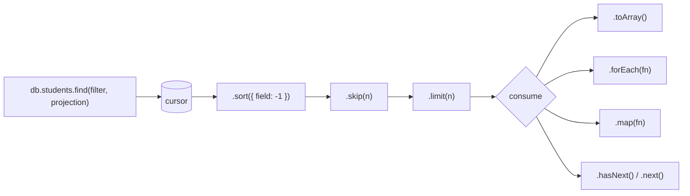

# Session 06 · MongoDB Shell Methods

> **Module:** Managing Large Datasets using MongoDB · **Term 1** · ⏱️ ~2 hours
> **You will learn:** working productively in **mongosh** — database methods (`db.getCollectionNames()`, `db.getSiblingDB()`), collection methods (`findOne`, `findOneAndUpdate`, `replaceOne`, `countDocuments` vs `estimatedDocumentCount`), **cursor methods** (`sort`, `skip`, `limit`, `forEach`, `map`, `toArray`, `hasNext`/`next`), JavaScript in the shell (variables, loops, functions, `load()` scripts), pagination, and the matching PyMongo calls.

---

## 1. The shell is a JavaScript console

`mongosh` is a full JavaScript (Node.js) environment connected to your database. Besides one-line queries you can store results in variables, loop over cursors, write helper functions and run whole `.js` scripts — handy for quick fixes, data checks and admin jobs.

> 📒 **Analogy:** A **cursor** is like a token number at NADRA. The office doesn't call all 300 people at once; it hands you a token and serves people in batches as you call `next()`. `sort`, `skip` and `limit` decide the order of the queue and how many get served.



## 2. Reference tables

| Database methods (mongosh) | PyMongo |
|---|---|
| `db.getName()` | `db.name` |
| `db.getCollectionNames()` | `db.list_collection_names()` |
| `db.getSiblingDB("shop")` | `client["shop"]` |
| `db.stats()` | `db.command("dbStats")` |
| `db.getCollection("fee-2026")` (odd names) | `db["fee-2026"]` |

| Collection methods | PyMongo | Note |
|---|---|---|
| `findOne(filter, proj)` | `find_one` | first match or `null` |
| `findOneAndUpdate(f, u, { returnDocument: "after" })` | `find_one_and_update(..., return_document=ReturnDocument.AFTER)` | atomic read-modify-return |
| `findOneAndDelete(f)` | `find_one_and_delete` | |
| `replaceOne(f, doc)` | `replace_one` | replaces the whole document (keeps `_id`) |
| `countDocuments(f)` | `count_documents` | exact, uses the filter |
| `estimatedDocumentCount()` | `estimated_document_count` | fast, from metadata, no filter |
| `distinct(field, f)` | `distinct` | |

| Cursor methods | PyMongo | Note |
|---|---|---|
| `.sort({ a: 1, b: -1 })` | `.sort([("a", 1), ("b", -1)])` | 1 = ascending, −1 = descending |
| `.skip(n)` / `.limit(n)` | same | pagination |
| `.toArray()` | `list(cursor)` | loads all into memory |
| `.forEach(doc => ...)` | `for doc in cursor:` | streams |
| `.map(doc => doc.name)` | list comprehension | |
| `.hasNext()` / `.next()` | `cursor.alive` / `next(cursor)` | |
| `.count()` (deprecated) | — | use `countDocuments` |
| `.explain("executionStats")` | `.explain()` | query plan (Session 07) |

### JavaScript in mongosh
```javascript
const top = db.students.find({}, { name: 1, "marks.python": 1, _id: 0 }).sort({ "marks.python": -1 }).limit(3).toArray()
top.forEach(s => print(`${s.name}: ${s.marks.python}`))

function passRate(batch) {
  const total = db.students.countDocuments({ batch })
  const passed = db.students.countDocuments({ batch, "marks.python": { $gte: 60 } })
  return Math.round(100 * passed / total)
}
["DS-01", "DS-02", "AI-01"].forEach(b => print(b, passRate(b) + "%"))

load("scripts/nightly_fix.js")      // run a script file
```

## 3. Worked examples

Full runnable code: [`code/examples.py`](./code/examples.py) · notebook: [`notebook.ipynb`](./notebook.ipynb)

### Example 1 — sort, skip, limit (top 3, then the next 3)
```python
page1 = db.students.find({}, {"_id": 0, "name": 1, "marks.python": 1}).sort("marks.python", -1).limit(3)
page2 = db.students.find({}, {"_id": 0, "name": 1}).sort("marks.python", -1).skip(3).limit(3)
```

### Example 2 — multi-key sort
```python
db.students.find().sort([("batch", 1), ("marks.python", -1)])
```

### Example 3 — iterating a cursor manually
```python
cur = db.students.find({"city": "Karachi"})
first = next(cur); second = next(cur)
rest = [d["name"] for d in cur]               # the cursor continues where it stopped
```

### Example 4 — atomic findOneAndUpdate (issue the next roll number)
```python
from pymongo import ReturnDocument
counter = db.counters.find_one_and_update({"_id": "roll_no"}, {"$inc": {"seq": 1}},
                                          upsert=True, return_document=ReturnDocument.AFTER)
```

### Example 5 — replaceOne vs updateOne
```python
db.batches.replace_one({"_id": "DS-02"}, {"programme": "Data Science", "room": 9})   # other fields gone!
db.batches.update_one({"_id": "AI-01"}, {"$set": {"room": 7}})                       # only room changes
```

### Example 6 — exact vs estimated counts, sibling databases
```python
db.students.count_documents({"batch": "DS-01"}), db.students.estimated_document_count()
shop = db.client["shop_demo"]                  # like db.getSiblingDB("shop_demo")
```

## 4. Common mistakes

| Mistake | Fix |
|---|---|
| `.toArray()` on millions of documents | Iterate (`forEach`) or paginate |
| Deep pagination with huge `skip(100000)` | Use range-based paging: `{_id: {$gt: lastId}}` + `limit` |
| Using `replaceOne` when you meant to change one field | `updateOne` with `$set` |
| Relying on natural order without `sort` | Always `sort` when order matters (and include a unique field like `_id` as tie-breaker) |
| Read-then-write counters in two steps (race condition) | `findOneAndUpdate` with `$inc` is atomic |

## 5. Real-life coding problem 🧮

**Problem:** The campus web portal shows the student list **10 per page**, sorted by name, and must stay fast as the collection grows. Write: (a) `page_by_skip(db, page, size)` (simple, classic), (b) `page_by_range(db, after_name, size)` (keyset pagination using the last name seen), and show both return the same pages; (c) `next_roll_no(db, batch)` that atomically issues roll numbers like `DS-01-0007` per batch using `find_one_and_update`; and (d) a `cursor_report(db)` that streams students and builds a per-city summary without loading everything into a list.

<details>
<summary>💡 Full solution</summary>

```python
def page_by_skip(db, page, size=10):
    cur = db.people.find({}, {"_id": 0, "name": 1}).sort("name", 1).skip((page - 1) * size).limit(size)
    return [d["name"] for d in cur]

def page_by_range(db, after_name=None, size=10):
    flt = {"name": {"$gt": after_name}} if after_name else {}
    return [d["name"] for d in db.people.find(flt, {"_id": 0, "name": 1}).sort("name", 1).limit(size)]

def next_roll_no(db, batch):
    c = db.counters.find_one_and_update({"_id": batch}, {"$inc": {"seq": 1}}, upsert=True,
                                        return_document=ReturnDocument.AFTER)
    return f"{batch}-{c['seq']:04d}"

def cursor_report(db):
    summary = {}
    for doc in db.people.find({}, {"city": 1}):          # streamed, one batch at a time
        summary[doc["city"]] = summary.get(doc["city"], 0) + 1
    return dict(sorted(summary.items()))
```
Full file with 47 generated students and checks: [`code/problem_solution.py`](./code/problem_solution.py)
</details>

## 6. Practice exercises

1. Show the 4th to 6th best students by SQL mark (names only).
2. Print each AI-01 student's name and number of skills using a loop over a cursor.
3. Use `find_one_and_delete` to remove and return the student with the lowest Python mark.
4. Write the mongosh one-liner that prints the names of all Karachi students in upper case.

<details>
<summary>✅ Solutions</summary>

```python
[d["name"] for d in db.students.find().sort("marks.sql", -1).skip(3).limit(3)]

for d in db.students.find({"batch": "AI-01"}): print(d["name"], len(d["skills"]))

db.students.find_one_and_delete({}, sort=[("marks.python", 1)])

// db.students.find({ city: "Karachi" }).forEach(s => print(s.name.toUpperCase()))
```
File: [`code/exercises_solutions.py`](./code/exercises_solutions.py)
</details>

## 7. Quiz

1. What does `find()` return before you iterate it?
2. Which method gives a fast but approximate total count?
3. Why is `findOneAndUpdate` better than `findOne` + `updateOne` for counters?
4. What is the problem with very large `skip()` values?
5. What is the difference between `replaceOne` and `updateOne`?

<details>
<summary>Answers</summary>

1. A cursor — documents are fetched lazily in batches · 2. `estimatedDocumentCount()` · 3. It reads and modifies in one atomic operation, so two clients can't get the same value · 4. The server still walks past all skipped documents, so it gets slower as pages go deeper; range-based paging avoids this · 5. `replaceOne` swaps the whole document (except `_id`); `updateOne` changes only the fields named by update operators.
</details>

## 8. Summary

- mongosh is JavaScript: use variables, functions, loops and `load()` scripts.
- `find()` returns a cursor; shape it with `sort`, `skip`, `limit` and consume it with `forEach`, `map`, `toArray`, `next`.
- Use `findOneAndUpdate` for atomic counters and `countDocuments` vs `estimatedDocumentCount` appropriately.
- Prefer range-based pagination for large collections.

---
[⬅ Session 05](../Session-05-database-commands/) · [Module home](../README.md) · [Session 07 ➡](../Session-07-indexing/)

<sub>Original teaching material by Aseef Ahmed · not official Aptech courseware · CC BY-NC 4.0 (text) / MIT (code)</sub>
