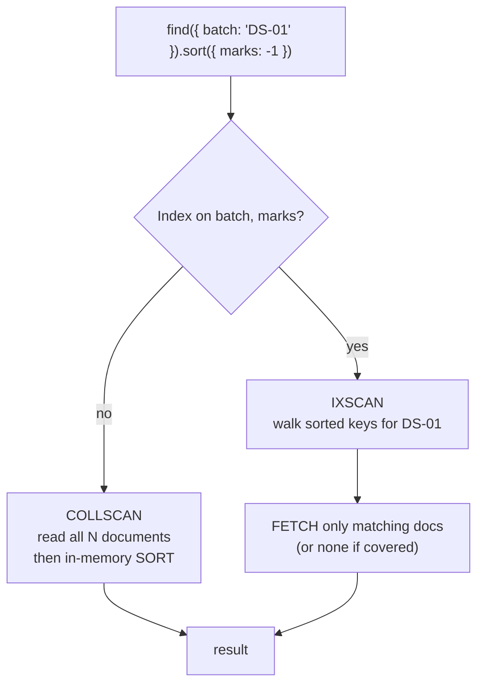

# Session 07 · MongoDB Indexing

> **Module:** Managing Large Datasets using MongoDB · **Term 1** · ⏱️ ~2 hours
> **You will learn:** why queries get slow on large collections, how B-tree indexes work, creating and managing indexes (single-field, compound, multikey, text, unique, sparse/partial, TTL), the **ESR rule** (Equality → Sort → Range) for compound indexes, covered queries, reading `explain("executionStats")` (COLLSCAN vs IXSCAN, keys and docs examined), and the cost of too many indexes.

---

## 1. From scanning every page to using the index

Without an index MongoDB must read **every document** (a *collection scan*) to answer `find({"cnic": "42101-..."})`. With 10 documents nobody notices; with 50 million it takes seconds. An **index** is a separate, sorted structure (a B-tree) of field values pointing to documents, so the server can jump straight to the matches.

> 📒 **Analogy:** Finding "Bayes' theorem" in a 900-page statistics book: without the index at the back you flip every page (COLLSCAN). With the index you look up "B", find "Bayes … p. 412", and open that page (IXSCAN). But every new edition needs the index updated — that's the write cost.



## 2. Reference tables

| Index type | Create (mongosh) | Use for |
|---|---|---|
| single field | `db.students.createIndex({ city: 1 })` | equality / range on one field |
| compound | `createIndex({ batch: 1, "marks.python": -1 })` | filter + sort on several fields |
| multikey (automatic on arrays) | `createIndex({ skills: 1 })` | queries on array elements |
| text | `createIndex({ bio: "text" })` | keyword search with `$text` |
| unique | `createIndex({ email: 1 }, { unique: true })` | no duplicates |
| sparse / partial | `createIndex({ phone: 1 }, { partialFilterExpression: { phone: { $exists: true } } })` | index only some documents |
| TTL | `createIndex({ createdAt: 1 }, { expireAfterSeconds: 3600 })` | auto-delete old sessions/logs |
| hashed | `createIndex({ user_id: "hashed" })` | even distribution for sharding (Session 08) |

| Management | mongosh | PyMongo |
|---|---|---|
| list | `db.students.getIndexes()` | `index_information()` |
| create | `createIndex(keys, options)` | `create_index([...], **options)` |
| drop | `dropIndex("name")` | `drop_index("name")` |
| force a plan | `.hint({ city: 1 })` | `.hint("city_1")` |
| analyse | `.explain("executionStats")` | `cursor.explain()` |

| `explain` field | Good sign |
|---|---|
| `winningPlan.stage` | `IXSCAN` (not `COLLSCAN`), no blocking `SORT` |
| `totalKeysExamined` ≈ `nReturned` | the index is selective |
| `totalDocsExamined` = 0 | **covered query** (all fields come from the index) |
| `executionTimeMillis` | low and stable |

**ESR rule for compound indexes:** put fields used for **E**quality first, then fields used for **S**orting, then fields used in **R**ange filters. For `find({batch: "DS-01", "marks.python": {$gte: 60}}).sort({enrolled: -1})` → index `{batch: 1, enrolled: -1, "marks.python": 1}`.

**Prefix rule:** an index on `{a, b, c}` also serves queries on `{a}` and `{a, b}`, but not `{b}` or `{c}` alone.

> 🧪 mongomock creates and enforces indexes (unique, compound, TTL definition) but has no query planner, so `explain()` isn't available. [`code/index_sim.py`](./code/index_sim.py) simulates a collection scan vs a sorted index in plain Python (using binary search) so you can *see* "documents examined" shrink — the same idea `explain` reports on a real server.

## 3. Worked examples

Full runnable code: [`code/examples.py`](./code/examples.py) · notebook: [`notebook.ipynb`](./notebook.ipynb)

### Example 1 — create and list indexes
```python
db.students.create_index("city")
db.students.create_index([("batch", 1), ("marks.python", -1)], name="batch_python")
print(db.students.index_information().keys())
```

### Example 2 — unique index blocks duplicates
```python
db.users.create_index("email", unique=True)
db.users.insert_one({"email": "ali@campus.pk"})
db.users.insert_one({"email": "ali@campus.pk"})        # DuplicateKeyError
```

### Example 3 — COLLSCAN vs IXSCAN (simulated)
```python
from index_sim import collscan, ixscan
print(collscan(docs, "cnic", target))   # examined = N
print(ixscan(index, target))            # examined ≈ log2(N) comparisons + matches
```

### Example 4 — partial and TTL indexes
```python
db.students.create_index("phone", partialFilterExpression={"phone": {"$exists": True}})
db.sessions.create_index("created_at", expireAfterSeconds=1800)   # delete after 30 min
```

### Example 5 — the ESR rule and the prefix rule
```python
db.students.create_index([("batch", 1), ("enrolled", -1), ("marks.python", 1)], name="esr")
q = db.students.find({"batch": "DS-01", "marks.python": {"$gte": 60}}).sort("enrolled", -1).hint("esr")
```

### Example 6 — reading explain on a real server
```javascript
db.students.find({ city: "Karachi" }, { _id: 0, city: 1 }).explain("executionStats")
// winningPlan: PROJECTION_COVERED <- IXSCAN { city: 1 }   totalDocsExamined: 0  (covered)
```

## 4. Common mistakes

| Mistake | Fix |
|---|---|
| Indexing every field "just in case" | Each index slows writes and uses RAM; index for real query patterns |
| Compound index in the wrong order | Follow ESR; check with `explain` |
| Low-selectivity index (e.g. `gender`) alone | Combine with a selective field or skip it |
| Regex `/karachi/i` expecting an index to help | Only anchored, case-sensitive prefixes (`/^Kar/`) use an index well; use text search |
| Forgetting that unique index creation fails on existing duplicates | Clean duplicates first |

## 5. Real-life coding problem 🧮

**Problem:** A Karachi e-commerce site's `orders` collection has 200,000 documents. The three most frequent queries are: (1) a customer's orders, newest first; (2) all `pending` orders in a city placed in the last 7 days; (3) look up one order by `order_no` (must be unique). Propose indexes using the ESR rule, create them, and use the plain-Python simulator to compare **documents examined** for query (3) with and without an index. Also verify that inserting a duplicate `order_no` fails.

<details>
<summary>💡 Full solution</summary>

```python
INDEXES = {
    "customer_newest": [("customer_id", 1), ("created_at", -1)],              # E, S
    "status_city_date": [("status", 1), ("city", 1), ("created_at", -1)],      # E, E, R
    "order_no_unique": [("order_no", 1)],
}

def create_indexes(db):
    for name, keys in INDEXES.items():
        db.orders.create_index(keys, name=name, unique=(name == "order_no_unique"))
    return sorted(db.orders.index_information())

def compare_lookup(docs, order_no):
    scan = collscan(docs, "order_no", order_no)
    idx = build_index(docs, "order_no")
    seek = ixscan(idx, order_no)
    return scan["examined"], seek["examined"]
```
Full file with generated orders and checks: [`code/problem_solution.py`](./code/problem_solution.py)
</details>

## 6. Practice exercises

1. Create a compound index `{city: 1, "marks.sql": -1}` and list all index names.
2. Which of these queries can use an index `{batch: 1, city: 1, "marks.python": -1}`: by batch; by city; by batch + city; by batch + python mark?
3. Using the simulator, show how documents examined grow as N goes from 1,000 to 1,000,000 for a scan vs an index seek.
4. Write the mongosh command for a text index on `name` and `skills`, and a search for "python".

<details>
<summary>✅ Solutions</summary>

```python
db.students.create_index([("city", 1), ("marks.sql", -1)])

# by batch ✅ (prefix) · by city ❌ · batch + city ✅ · batch + python mark ✅ for batch, partial use

for n in (1_000, 10_000, 100_000, 1_000_000): print(n, n, math.ceil(math.log2(n)) + 1)

// db.students.createIndex({ name: "text", skills: "text" }); db.students.find({ $text: { $search: "python" } })
```
File: [`code/exercises_solutions.py`](./code/exercises_solutions.py)
</details>

## 7. Quiz

1. What does `COLLSCAN` in an explain plan mean?
2. What is a covered query?
3. State the ESR rule.
4. Why can too many indexes hurt performance?
5. What does a TTL index do?

<details>
<summary>Answers</summary>

1. The server read every document in the collection (no index used) · 2. A query whose filter and returned fields are all in the index, so no documents are fetched (`totalDocsExamined: 0`) · 3. In a compound index put Equality fields first, then Sort fields, then Range fields · 4. Every insert/update/delete must update each index, and indexes consume RAM and disk · 5. Automatically deletes documents once a date field is older than `expireAfterSeconds`.
</details>

## 8. Summary

- Indexes are sorted B-trees that turn full scans into fast seeks.
- Choose index types for the job: single, compound, multikey, text, unique, partial, TTL, hashed.
- Design compound indexes with ESR and the prefix rule; verify with `explain("executionStats")`.
- Every index has a write and memory cost — index for real query patterns only.

---
[⬅ Session 06](../Session-06-shell-methods/) · [Module home](../README.md) · [Session 08 ➡](../Session-08-replication-and-sharding/)

<sub>Original teaching material by Aseef Ahmed · not official Aptech courseware · CC BY-NC 4.0 (text) / MIT (code)</sub>
