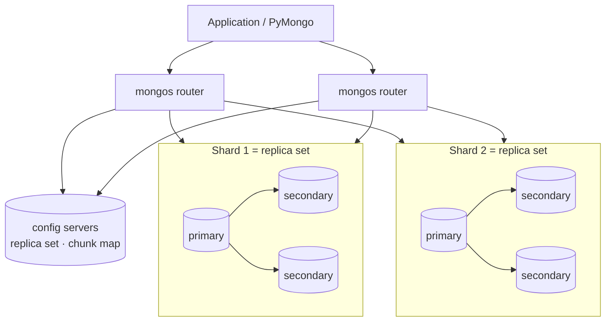

# Session 08 · Replication and Sharding

> **Module:** Managing Large Datasets using MongoDB · **Term 1** · ⏱️ ~2 hours
> **You will learn:** how a **replica set** keeps copies of data for high availability (primary, secondaries, arbiter, oplog, elections), **write concern** and **read preference**, how **sharding** scales out across servers (shards, `mongos` routers, config servers, chunks, balancer), choosing a good **shard key** (range vs hashed, cardinality, frequency, monotonic keys), and the commands to set both up.

---

## 1. Two different problems

* **Replication** answers: *what if a server dies?* Keep identical copies on several servers so one can take over automatically.
* **Sharding** answers: *what if one server is too small?* Split the data across many servers so each holds a part.

Large production clusters use both: every shard is itself a replica set.

> 📒 **Analogy:** **Replication** is a bank keeping the same customer ledger in three branches — if the Saddar branch floods, Clifton continues. **Sharding** is splitting customers alphabetically across branches — A–F at Saddar, G–M at Clifton, N–Z at Gulshan — so no single branch is overloaded.



## 2. Replication reference

| Term | Meaning |
|---|---|
| replica set | group of `mongod` servers holding the same data (usually 3 or 5) |
| primary | the only member that accepts writes |
| secondary | copies the primary's **oplog** and applies operations; can serve reads |
| arbiter | votes in elections, holds no data (avoid when possible) |
| oplog | capped collection of recent write operations, used for replication |
| election | if the primary is unreachable (~10 s), members vote; a majority elects a new primary |
| majority | more than half of voting members — why replica sets use an **odd** number |

| Write concern | Acknowledged when | Trade-off |
|---|---|---|
| `w: 1` | primary has the write | fast; may be lost if primary fails before replication |
| `w: "majority"` | a majority have it | durable across failover (default in modern MongoDB) |
| `j: true` | written to the on-disk journal | survives a crash of that node |

| Read preference | Reads from |
|---|---|
| `primary` (default) | primary only — always latest data |
| `primaryPreferred` | primary, secondary if primary down |
| `secondary` / `secondaryPreferred` | secondaries (may be slightly behind) — reports, analytics |
| `nearest` | lowest network latency member |

```javascript
// start three mongod processes with --replSet rs0, then in mongosh:
rs.initiate({ _id: "rs0", members: [
  { _id: 0, host: "db1.campus.local:27017" },
  { _id: 1, host: "db2.campus.local:27017" },
  { _id: 2, host: "db3.campus.local:27017" } ] })
rs.status()          // who is PRIMARY / SECONDARY
rs.stepDown()        // force an election (maintenance)
```
```python
client = MongoClient("mongodb://db1,db2,db3/?replicaSet=rs0&w=majority&readPreference=secondaryPreferred")
```

## 3. Sharding reference

| Component | Role |
|---|---|
| shard | holds a subset of the data (a replica set) |
| `mongos` | router — apps connect here; it sends each query to the right shard(s) |
| config servers | store metadata: which **chunk** (key range) lives on which shard |
| chunk | contiguous range of shard-key values (default max 128 MB) |
| balancer | moves chunks between shards to keep them even |

| Shard key quality | Good | Bad |
|---|---|---|
| cardinality (number of distinct values) | high (`user_id`) | low (`gender`, `city` with 5 values) |
| frequency (how evenly values occur) | even | one value dominates ("Karachi" = 60%) |
| monotonic change | random/hashed | always increasing (`_id` ObjectId, timestamps) → all inserts hit one "hot" shard |
| query isolation | most queries include the key → *targeted* | queries lack the key → *scatter-gather* to all shards |

| Strategy | How | Pros / cons |
|---|---|---|
| ranged | chunks by key ranges | efficient range queries; risk of hot spots |
| hashed | chunks by hash of the key | even writes; range queries become scatter-gather |
| zoned | pin ranges to shards (e.g. by region) | data locality / compliance |

```javascript
sh.enableSharding("shop")
sh.shardCollection("shop.orders", { customer_id: "hashed" })
sh.status()
```

> 🧪 Replica sets and sharded clusters need several servers, so the runnable code is a **plain-Python simulation** ([`code/cluster_sim.py`](./code/cluster_sim.py)): majority elections and write concerns for a replica set, and ranged vs hashed routing of documents to shards.

## 4. Worked examples

Full runnable code: [`code/examples.py`](./code/examples.py) · notebook: [`notebook.ipynb`](./notebook.ipynb)

### Example 1 — majority and elections
```python
rs = ReplicaSet(["db1", "db2", "db3"])
rs.fail("db1")                 # primary down
print(rs.elect())              # db2 becomes primary (2 of 3 = majority)
rs.fail("db2"); print(rs.elect())   # None — 1 of 3 is not a majority, set becomes read-only
```

### Example 2 — write concern
```python
rs.write({"x": 1}, w=1)            # acknowledged by primary only
rs.write({"x": 2}, w="majority")   # needs 2 of 3 healthy members
```

### Example 3 — ranged sharding with a monotonic key (hot shard)
```python
counts = route_counts(new_order_ids, ranged_router(boundaries))   # all new ids land on the last shard
```

### Example 4 — hashed sharding spreads writes
```python
counts = route_counts(new_order_ids, hashed_router(n_shards=3))   # roughly equal
```

### Example 5 — targeted vs scatter-gather queries
```python
shards_for_query({"customer_id": 42}, key="customer_id")   # 1 shard
shards_for_query({"city": "Karachi"}, key="customer_id")    # all shards
```

### Example 6 — choosing a shard key
```python
score_key(orders, "city"), score_key(orders, "customer_id")   # cardinality & max share per value
```

## 5. Common mistakes

| Mistake | Fix |
|---|---|
| Two-member replica set (no majority after one failure) | Use 3 (or 5) voting members |
| Reading from secondaries and expecting the latest write | Use `primary` reads, or `w: "majority"` + causal consistency |
| Sharding on an increasing key (`_id`, timestamp) | Use a hashed key or a compound key with high-cardinality prefix |
| Sharding on a low-cardinality key (`city`) | Chunks can't be split further — "jumbo chunks" |
| Sharding too early | Index and tune first; shard when one replica set truly can't cope |

## 6. Real-life coding problem 🧮

**Problem:** A national food-delivery app stores 30 million orders. Using the simulator: (a) show what happens to writes during a primary failure with 3 vs 5 members when 1 and then 2 servers fail; (b) compare three candidate shard keys — `city`, `created_at` (ranged) and `customer_id` (hashed) — on a sample of 60,000 new orders: report the share of writes the busiest shard receives (ideal ≈ 1/3 with 3 shards) and recommend the key.

<details>
<summary>💡 Full solution</summary>

```python
def availability(members, failures):
    rs = ReplicaSet([f"db{i}" for i in range(1, members + 1)])
    out = []
    for name in failures:
        rs.fail(name); rs.elect()
        out.append(rs.can_write())
    return out

def busiest_share(orders, key, router):
    counts = route_counts([o[key] for o in orders], router)
    return max(counts.values()) / len(orders)

# city (ranged by name) is skewed, created_at (ranged) sends every new order to the last chunk,
# customer_id (hashed) spreads writes evenly -> recommend hashed customer_id.
```
Full file: [`code/problem_solution.py`](./code/problem_solution.py)
</details>

## 7. Practice exercises

1. In a 5-member replica set, how many members can fail while writes with `w: "majority"` still succeed? Check with the simulator.
2. Route 9,000 sequential order numbers with a ranged router using boundaries `[3000, 6000]` and with a hashed router; compare counts.
3. Which queries are targeted if the shard key is `{customer_id: 1}`: by `customer_id`; by `order_no`; by `customer_id` + `status`?
4. Write the mongosh commands to shard `campus.attendance` on a hashed `student_id`.

<details>
<summary>✅ Solutions</summary>

```python
rs = ReplicaSet([f"db{i}" for i in range(1, 6)]); rs.fail("db1"); rs.fail("db2"); rs.elect(); rs.can_write()  # True; a 3rd failure -> False

route_counts(range(9000), ranged_router([3000, 6000])); route_counts(range(9000), hashed_router(3))

# customer_id ✅ targeted · order_no ❌ scatter-gather · customer_id + status ✅ targeted

// sh.enableSharding("campus"); sh.shardCollection("campus.attendance", { student_id: "hashed" })
```
File: [`code/exercises_solutions.py`](./code/exercises_solutions.py)
</details>

## 8. Quiz

1. Which replica-set member accepts writes?
2. Why should a replica set have an odd number of voting members?
3. What does `w: "majority"` guarantee?
4. Why is an always-increasing shard key a problem?
5. What does `mongos` do?

<details>
<summary>Answers</summary>

1. The primary · 2. So a clear majority can always be formed for elections (and ties are impossible) · 3. The write is acknowledged only after a majority of members have it, so it survives a primary failover · 4. All new inserts go to the chunk with the highest values on one shard — a write hot spot · 5. It is the router: applications connect to it and it sends each operation to the correct shard(s) using the config servers' chunk map.
</details>

## 9. Summary

- Replica sets provide high availability: one primary, several secondaries, automatic majority elections.
- Write concern controls durability; read preference controls where reads go.
- Sharding scales horizontally: shards + `mongos` + config servers, with chunks moved by the balancer.
- A good shard key has high cardinality, even frequency, non-monotonic growth, and appears in most queries.

---
[⬅ Session 07](../Session-07-indexing/) · [Module home](../README.md) · [Session 09 ➡](../Session-09-transactions/)

<sub>Original teaching material by Aseef Ahmed · not official Aptech courseware · CC BY-NC 4.0 (text) / MIT (code)</sub>
