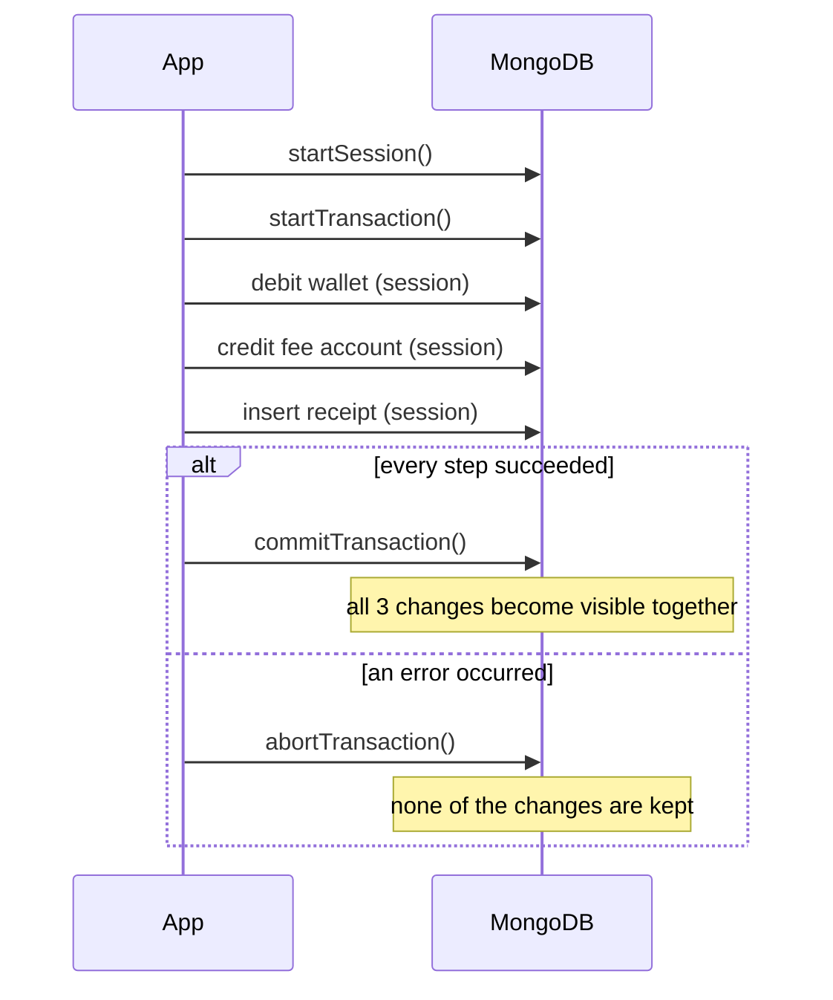

# Session 09 · Transaction Management

> **Module:** Managing Large Datasets using MongoDB · **Term 1** · ⏱️ ~2 hours
> **You will learn:** ACID properties, why single-document operations are already atomic in MongoDB, when you need **multi-document transactions**, sessions and the transaction API (`startTransaction`, `commitTransaction`, `abortTransaction`, `withTransaction`), read/write concerns inside transactions, retrying transient errors, limits and best practices — and how schema design can avoid transactions altogether.

---

## 1. All or nothing

Moving Rs 15,000 from a student's wallet to the fee account is **two** writes: debit one document, credit another. If the server crashes between them, money disappears. A **transaction** groups several operations so that either *all* of them happen or *none* do.

> 📒 **Analogy:** Buying a plot at the registrar's office: the buyer's payment, the seller's signature and the new title deed must all be recorded together. If the seller refuses to sign, the payment is returned — nobody is left with half a deal.



## 2. Reference tables

| ACID property | Meaning | In MongoDB |
|---|---|---|
| Atomicity | all-or-nothing | single document always; multi-document via transactions |
| Consistency | data moves between valid states | your rules + schema validation + unique indexes |
| Isolation | concurrent transactions don't see each other's partial work | snapshot isolation inside a transaction |
| Durability | committed data survives crashes | journal + `w: "majority"` |

| Situation | Need a transaction? |
|---|---|
| update several fields of **one** document (`$inc` balance and `$push` history) | ❌ already atomic |
| debit one document and credit another | ✅ |
| insert an order **and** decrement stock in a different collection | ✅ (or redesign) |
| bulk import of independent records | ❌ use `insert_many(ordered=False)` |

| API | mongosh | PyMongo |
|---|---|---|
| start session | `const s = db.getMongo().startSession()` | `with client.start_session() as s:` |
| begin | `s.startTransaction({ readConcern: { level: "snapshot" }, writeConcern: { w: "majority" } })` | `s.start_transaction(...)` |
| use session | `s.getDatabase("campus").wallets.updateOne(...)` | `coll.update_one(..., session=s)` |
| commit / abort | `s.commitTransaction()` / `s.abortTransaction()` | `s.commit_transaction()` / `s.abort_transaction()` |
| convenient wrapper (auto-retry) | `s.withTransaction(async () => {...})` | `s.with_transaction(callback)` |

| Limit / best practice | Detail |
|---|---|
| needs a replica set or sharded cluster | not available on a standalone `mongod` |
| keep them short | default max runtime 60 s; long transactions hold resources |
| modest size | change only the documents you must (thousands, not millions) |
| retry on `TransientTransactionError` | `with_transaction` does this automatically |
| prefer good schema design | embedding related data makes most operations single-document (atomic) |

```python
# PyMongo on a real replica set
def transfer(session):
    wallets = session.client.campus.wallets
    wallets.update_one({"_id": "sana", "balance": {"$gte": 15000}}, {"$inc": {"balance": -15000}}, session=session)
    wallets.update_one({"_id": "fees"}, {"$inc": {"balance": 15000}}, session=session)

with client.start_session() as s:
    s.with_transaction(transfer, write_concern=WriteConcern("majority"))
```

> 🧪 mongomock has no sessions. [`code/txn.py`](./code/txn.py) gives one function, `run_transaction(db, fn)`: on a real replica set (`MONGO_URI`) it uses `start_session().with_transaction()`; on mongomock it **snapshots the affected collections and restores them if `fn` raises** — the same all-or-nothing behaviour, implemented in plain Python for learning.

## 3. Worked examples

Full runnable code: [`code/examples.py`](./code/examples.py) · notebook: [`notebook.ipynb`](./notebook.ipynb)

### Example 1 — single-document atomicity (no transaction needed)
```python
db.wallets.update_one({"_id": "ali"}, {"$inc": {"balance": -500},
                                       "$push": {"history": {"type": "canteen", "amount": -500}}})
```

### Example 2 — the problem without a transaction
```python
debit("sana", 15000)
raise RuntimeError("power cut!")      # credit never happens -> money vanished
```

### Example 3 — a transfer inside a transaction
```python
def transfer(session):
    debit(db, "sana", 15000, session); credit(db, "fees", 15000, session)
run_transaction(db, transfer, collections=["wallets"])
```

### Example 4 — automatic rollback on error
```python
def bad_transfer(session):
    debit(db, "hamza", 50000, session)        # raises: insufficient balance
    credit(db, "fees", 50000, session)
run_transaction(db, bad_transfer, collections=["wallets"])   # nothing changes
```

### Example 5 — order + stock in two collections
```python
def place_order(session):
    res = db.stock.update_one({"_id": "laptop", "qty": {"$gte": 1}}, {"$inc": {"qty": -1}}, session=session)
    if res.modified_count == 0:
        raise ValueError("out of stock")
    db.orders.insert_one({"item": "laptop", "student": "faraz"}, session=session)
```

### Example 6 — design instead of transaction
```python
# keep balance and its history in ONE document -> every top-up is atomic without a transaction
db.wallets.update_one({"_id": "ali"}, {"$inc": {"balance": 1000}, "$push": {"history": {"type": "top-up", "amount": 1000}}})
```

## 4. Common mistakes

| Mistake | Fix |
|---|---|
| Forgetting `session=s` on one operation | That operation runs **outside** the transaction — pass the session to every call |
| Using transactions for everything | Single-document updates are atomic; redesign before reaching for transactions |
| Long transactions doing slow work (HTTP calls, big loops) | Prepare data first; keep the transaction to the writes |
| Not retrying transient errors | Use `with_transaction`, which retries automatically |
| Trying transactions on a standalone server | Run a (single-node) replica set: `mongod --replSet rs0` + `rs.initiate()` |

## 5. Real-life coding problem 🧮

**Problem:** The campus canteen uses a prepaid **student wallet**. Implement `buy_meal(db, student, items)` that in one transaction: (1) checks and decrements the stock of every item in `menu`, (2) debits the total from the student's wallet (must not go below zero), (3) inserts a `receipts` document. If any item is out of stock or the balance is insufficient, **nothing** must change. Show a successful purchase, an out-of-stock failure and an insufficient-balance failure, and verify the totals afterwards.

<details>
<summary>💡 Full solution</summary>

```python
def buy_meal(db, student, items):
    def work(session):
        total = 0
        for item, qty in items.items():
            res = db.menu.find_one_and_update({"_id": item, "stock": {"$gte": qty}},
                                              {"$inc": {"stock": -qty}}, session=session)
            if res is None:
                raise ValueError(f"{item} out of stock")
            total += res["price"] * qty
        res = db.wallets.update_one({"_id": student, "balance": {"$gte": total}},
                                    {"$inc": {"balance": -total}}, session=session)
        if res.modified_count == 0:
            raise ValueError("insufficient balance")
        db.receipts.insert_one({"student": student, "items": items, "total": total}, session=session)
        return total
    return run_transaction(db, work, collections=["menu", "wallets", "receipts"])
```
Full file with checks: [`code/problem_solution.py`](./code/problem_solution.py)
</details>

## 6. Practice exercises

1. Write a single `update_one` that deducts Rs 200 and appends a history entry atomically (no transaction).
2. Write `transfer(db, src, dst, amount)` using `run_transaction` and show the total money in the system stays constant after 5 random transfers (some failing).
3. Make a transaction that inserts a student and their first payment; force a failure on the payment and show the student was not inserted.
4. Write the mongosh code for the same transfer using `session.withTransaction`.

<details>
<summary>✅ Solutions</summary>

```python
db.wallets.update_one({"_id": "ali", "balance": {"$gte": 200}},
                      {"$inc": {"balance": -200}, "$push": {"history": {"amount": -200}}})

total_before = sum(w["balance"] for w in db.wallets.find())
# ... 5 transfers inside try/except ...
assert sum(w["balance"] for w in db.wallets.find()) == total_before

# insert student + failing payment inside run_transaction -> student count unchanged

// const s = db.getMongo().startSession();
// s.withTransaction(() => { const w = s.getDatabase("campus").wallets;
//   w.updateOne({ _id: "sana" }, { $inc: { balance: -500 } }); w.updateOne({ _id: "fees" }, { $inc: { balance: 500 } }); });
```
File: [`code/exercises_solutions.py`](./code/exercises_solutions.py)
</details>

## 7. Quiz

1. What does the "A" in ACID mean?
2. Do you need a transaction to `$inc` a balance and `$push` to a history array in the same document?
3. What happens to the writes if `abortTransaction()` is called?
4. What deployment is required for multi-document transactions?
5. What does `withTransaction` add over manual start/commit?

<details>
<summary>Answers</summary>

1. Atomicity — all operations succeed together or none take effect · 2. No — writes to a single document are atomic · 3. They are discarded; other clients never see them · 4. A replica set (even a single-node one) or a sharded cluster · 5. It commits for you and automatically retries on transient errors (and unknown commit results).
</details>

## 8. Summary

- Single-document operations are atomic; multi-document transactions provide ACID across documents and collections.
- Use sessions: start, pass `session=` to every operation, then commit or abort (or use `with_transaction`).
- Keep transactions short and small, use majority write concern, and retry transient errors.
- Good schema design (embedding) removes the need for most transactions.

---
[⬅ Session 08](../Session-08-replication-and-sharding/) · [Module home](../README.md) · [Session 10 ➡](../Session-10-mongodb-tools/)

<sub>Original teaching material by Aseef Ahmed · not official Aptech courseware · CC BY-NC 4.0 (text) / MIT (code)</sub>
